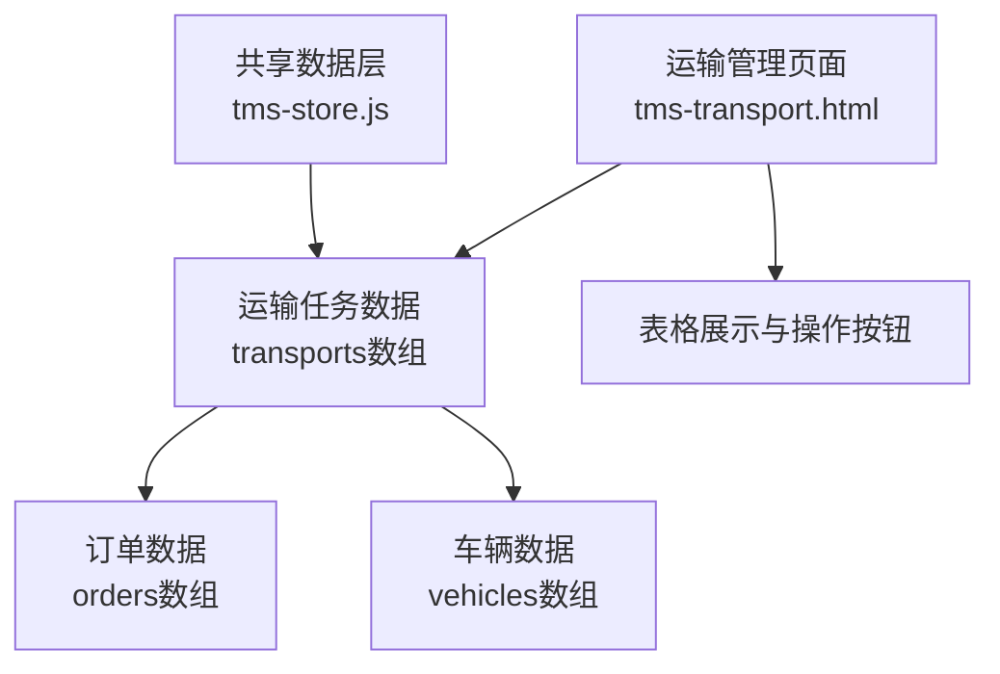
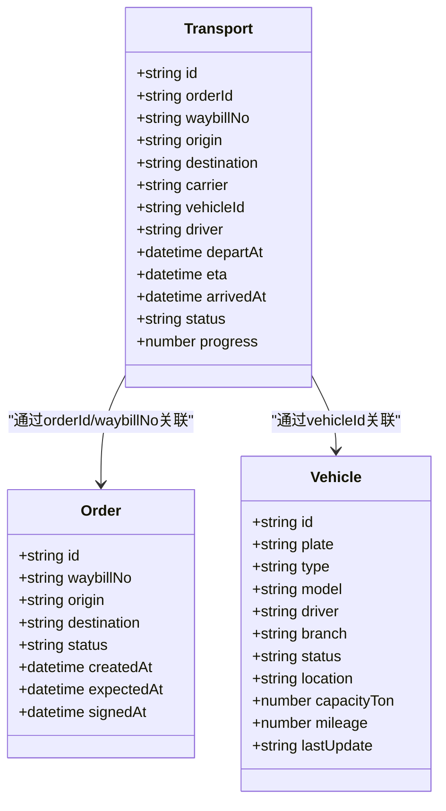
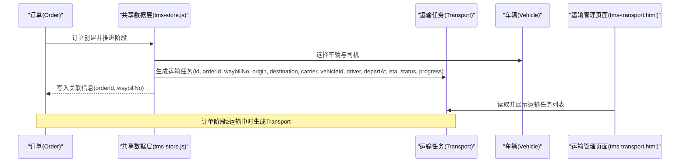
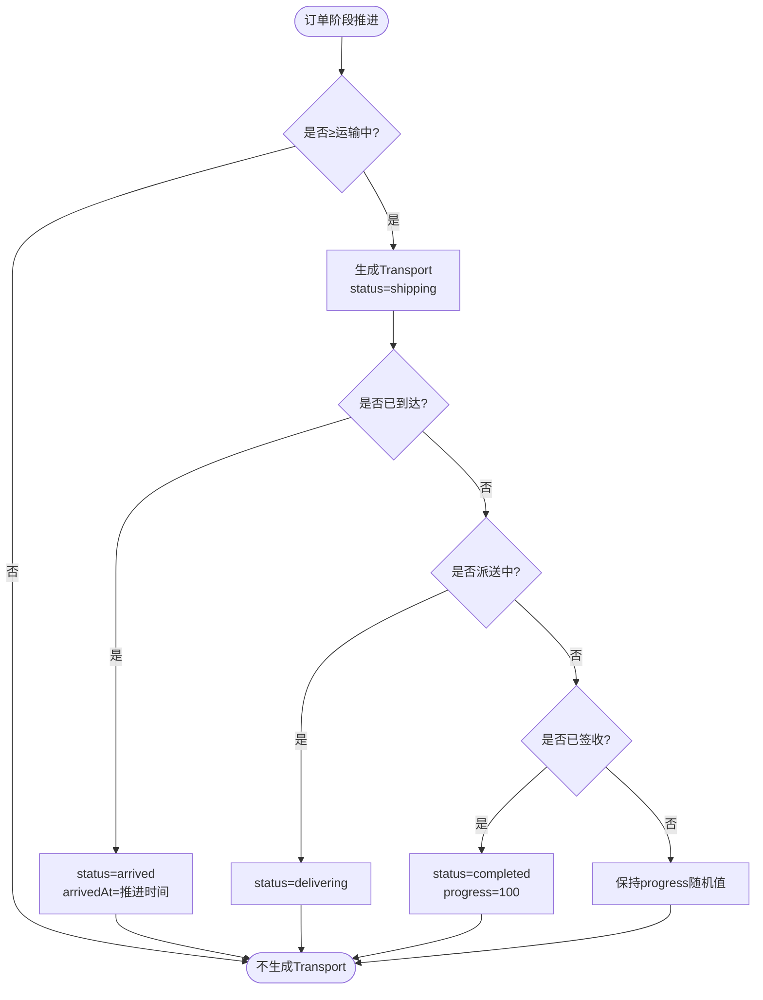
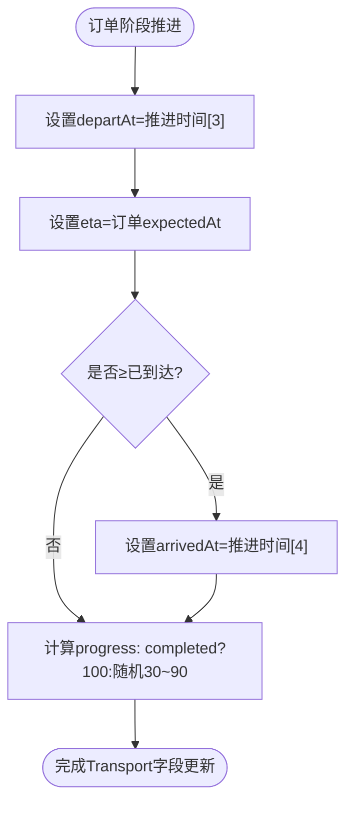
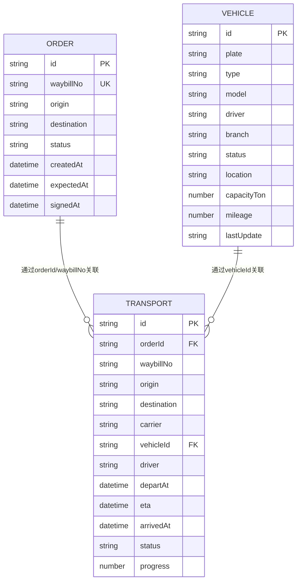
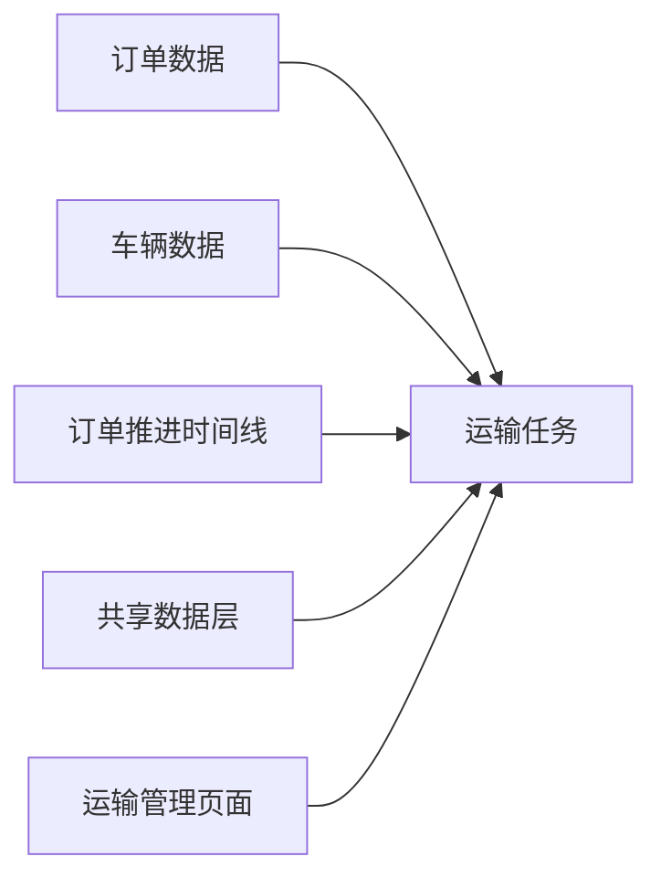

# 运输任务实体(Transport)

<cite>
**本文引用的文件**   
- [tms-store.js](file://tms-store.js)
- [tms-transport.html](file://tms-transport.html)
</cite>

## 目录
1. [引言](#引言)
2. [项目结构定位](#项目结构定位)
3. [核心数据模型](#核心数据模型)
4. [架构与生命周期总览](#架构与生命周期总览)
5. [字段详细定义](#字段详细定义)
6. [状态管理与流转规则](#状态管理与流转规则)
7. [时间字段与进度跟踪机制](#时间字段与进度跟踪机制)
8. [与订单、车辆、司机的关联关系](#与订单车辆司机的关联关系)
9. [依赖关系分析](#依赖关系分析)
10. [性能与一致性考虑](#性能与一致性考虑)
11. [常见问题排查](#常见问题排查)
12. [结论](#结论)

## 引言
本文面向TMS系统中的“运输任务”核心业务实体，基于仓库中的共享数据层和运输管理页面，系统化梳理Transport实体的完整字段定义、主键生成规则、关联字段含义、状态机、时间语义、进度计算方式，以及从创建到完成的全生命周期数据变化。文档同时给出可视化架构图、类图、时序图和流程图，帮助非技术读者也能理解运输任务在系统中的作用和数据流转。

## 项目结构定位
在本项目中，Transport实体并非独立模块，而是由共享数据层集中生成并维护，运输管理页面负责展示和交互：
- 数据模型与种子数据生成：集中在共享数据层中，负责构造订单、运单、运输任务、扫描记录、异常、财务等全量演示数据。
- 展示与操作入口：运输管理页面提供运输任务列表、查看、更新状态、完成任务等前端交互逻辑。

**图表来源**
- [tms-store.js:462-873](file://tms-store.js#L462-L873)
- [tms-transport.html:382-459](file://tms-transport.html#L382-L459)

**章节来源**
- [tms-store.js:462-873](file://tms-store.js#L462-L873)
- [tms-transport.html:382-459](file://tms-transport.html#L382-L459)

## 核心数据模型
Transport实体用于描述一次干线或区域运输任务，承载订单从发货到到达/派送的运输阶段信息。其关键字段包括：
- id：运输任务唯一标识，采用日期+序号的固定前缀格式。
- orderId：关联订单号，指向订单主数据。
- waybillNo：关联运单号，便于按运单维度追踪。
- origin：出发地城市。
- destination：目的地城市。
- carrier：承运商名称。
- vehicleId：关联车辆ID。
- driver：司机姓名（来自车辆主数据的默认司机）。
- departAt：发车时间。
- eta：预计到达时间。
- arrivedAt：实际到达时间。
- status：运输任务状态。
- progress：百分比进度。

**图表来源**
- [tms-store.js:844-862](file://tms-store.js#L844-L862)
- [tms-store.js:500-518](file://tms-store.js#L500-L518)
- [tms-store.js:739-777](file://tms-store.js#L739-L777)

**章节来源**
- [tms-store.js:844-862](file://tms-store.js#L844-L862)
- [tms-store.js:500-518](file://tms-store.js#L500-L518)
- [tms-store.js:739-777](file://tms-store.js#L739-L777)

## 架构与生命周期总览
运输任务的生命周期与订单阶段紧密耦合。当订单进入“运输中”及以上阶段时，系统会生成对应的Transport记录；随着订单继续推进到“已到达”“派送中”“已签收”，Transport的状态与时间字段逐步更新。

**图表来源**
- [tms-store.js:700-777](file://tms-store.js#L700-L777)
- [tms-store.js:844-862](file://tms-store.js#L844-L862)
- [tms-transport.html:382-459](file://tms-transport.html#L382-L459)

**章节来源**
- [tms-store.js:700-777](file://tms-store.js#L700-L777)
- [tms-store.js:844-862](file://tms-store.js#L844-L862)
- [tms-transport.html:382-459](file://tms-transport.html#L382-L459)

## 字段详细定义
以下对Transport关键字段进行详细说明，并结合代码实现解释其生成与更新逻辑。

- id：运输任务主键
  - 生成规则：使用共享数据层的计数器函数，以“TR-YYYYMMDD+三位序号”形式生成，保证每日递增且可排序。
  - 业务意义：唯一标识一次运输任务，便于查询、统计与审计。

- orderId：订单号
  - 关联含义：指向订单主数据，建立运输任务与订单的一对一关系。
  - 数据来源：订单创建时生成的orderId，随订单推进被复制到Transport。

- waybillNo：运单号
  - 关联含义：与订单的waybillNo保持一致，便于按运单维度追踪物流轨迹。
  - 数据来源：订单创建时根据orderId计算生成。

- origin：出发地
  - 含义：订单的起始城市，通常对应揽收网点或始发分拨。
  - 数据来源：订单主数据的origin字段。

- destination：目的地
  - 含义：订单的目的城市，通常对应目的分拨或派送网点。
  - 数据来源：订单主数据的destination字段。

- carrier：承运商
  - 含义：承担干线运输的承运商名称，如顺丰、中通等。
  - 数据来源：从承运商字典中按订单顺序选取。

- vehicleId：车辆ID
  - 含义：关联车辆主数据，表示本次运输使用的车辆。
  - 数据来源：从车辆列表中按订单顺序选取。

- driver：司机姓名
  - 含义：车辆的默认司机姓名，简化调度展示。
  - 数据来源：车辆主数据的driver字段。

- departAt：发车时间
  - 含义：运输任务开始执行的时间点。
  - 更新逻辑：当订单阶段达到“运输中”时，使用订单推进时间线中的第4个时间点作为departAt。

- eta：预计到达时间
  - 含义：计划到达目的地的时间，通常等于订单的expectedAt。
  - 更新逻辑：在生成Transport时直接复制订单的expectedAt。

- arrivedAt：到达时间
  - 含义：实际到达目的地的时间。
  - 更新逻辑：当订单阶段达到“已到达”及以上时，使用订单推进时间线中的第5个时间点填充；否则为空。

- status：状态
  - 含义：运输任务当前所处阶段。
  - 取值与映射：
    - pending：待发车
    - shipping：运输中
    - arrived：已到达
    - delivering：派送中
    - completed：已完成
    - cancelled：已取消
  - 更新逻辑：根据订单阶段索引映射为对应状态。

- progress：进度百分比
  - 含义：运输任务的完成百分比，用于前端展示进度条。
  - 更新逻辑：若订单已签收（completed），则设为100；否则随机生成30~90之间的值，体现进行中状态的不确定性。

**章节来源**
- [tms-store.js:246-250](file://tms-store.js#L246-L250)
- [tms-store.js:252-261](file://tms-store.js#L252-L261)
- [tms-store.js:700-777](file://tms-store.js#L700-L777)
- [tms-store.js:844-862](file://tms-store.js#L844-L862)

## 状态管理与流转规则
Transport的状态与订单阶段强相关。订单阶段推进时，Transport状态按如下规则更新：

- 订单阶段≥“运输中”：生成Transport，初始状态为shipping。
- 订单阶段=“已到达”：Transport状态更新为arrived。
- 订单阶段=“派送中”：Transport状态更新为delivering。
- 订单阶段=“已签收”：Transport状态更新为completed，progress设为100。
- 订单取消：Transport状态可为cancelled（本仓库种子数据未显式生成取消态Transport，但状态字典包含该值）。

**图表来源**
- [tms-store.js:844-862](file://tms-store.js#L844-L862)

**章节来源**
- [tms-store.js:844-862](file://tms-store.js#L844-L862)

## 时间字段与进度跟踪机制
- departAt：发车时间
  - 业务含义：运输任务正式开始执行的时间点。
  - 计算逻辑：取订单推进时间线中的第4个时间点（索引3），对应“DEPARTURE”节点。

- eta：预计到达时间
  - 业务含义：计划到达目的地的时间，通常与订单的expectedAt一致。
  - 计算逻辑：生成Transport时直接复制订单的expectedAt。

- arrivedAt：到达时间
  - 业务含义：实际到达目的地的时间。
  - 计算逻辑：当订单阶段≥“已到达”时，取订单推进时间线中的第5个时间点（索引4）；否则为空。

- progress：进度百分比
  - 业务含义：反映运输任务的完成程度，用于前端进度展示。
  - 计算策略：
    - 若订单已签收（completed），progress固定为100。
    - 否则，随机生成30~90之间的值，模拟进行中状态的动态性。

**图表来源**
- [tms-store.js:844-862](file://tms-store.js#L844-L862)

**章节来源**
- [tms-store.js:844-862](file://tms-store.js#L844-L862)

## 与订单、车辆、司机的关联关系
- 与订单(Order)的关系
  - 通过orderId和waybillNo建立一对一关联。
  - 订单创建时生成orderId和waybillNo，随后复制到Transport。
  - 订单阶段推进驱动Transport状态与时间字段更新。

- 与车辆(Vehicle)的关系
  - 通过vehicleId关联车辆主数据。
  - 车辆主数据包含plate、type、model、driver、branch、status、location等字段。
  - 种子数据中按订单顺序从车辆列表中选择vehicleId和driver。

- 与司机(Driver)的关系
  - driver字段直接取自车辆主数据的driver字段，简化调度展示。
  - 实际系统中可能进一步关联员工表，但本仓库中仅使用车辆默认司机。

**图表来源**
- [tms-store.js:739-777](file://tms-store.js#L739-L777)
- [tms-store.js:500-518](file://tms-store.js#L500-L518)
- [tms-store.js:844-862](file://tms-store.js#L844-L862)

**章节来源**
- [tms-store.js:739-777](file://tms-store.js#L739-L777)
- [tms-store.js:500-518](file://tms-store.js#L500-L518)
- [tms-store.js:844-862](file://tms-store.js#L844-L862)

## 依赖关系分析
- 数据层依赖
  - Transport依赖于订单主数据（orderId、waybillNo、origin、destination、expectedAt）。
  - Transport依赖于车辆主数据（vehicleId、driver）。
  - Transport的状态与时间字段依赖于订单推进时间线（progression数组）。

- 页面依赖
  - 运输管理页面依赖共享数据层提供的transports数组进行渲染。
  - 页面提供查看、更新状态、完成任务等操作入口，但具体更新逻辑在当前仓库中为占位提示。

**图表来源**
- [tms-store.js:700-777](file://tms-store.js#L700-L777)
- [tms-store.js:844-862](file://tms-store.js#L844-L862)
- [tms-transport.html:382-459](file://tms-transport.html#L382-L459)

**章节来源**
- [tms-store.js:700-777](file://tms-store.js#L700-L777)
- [tms-store.js:844-862](file://tms-store.js#L844-L862)
- [tms-transport.html:382-459](file://tms-transport.html#L382-L459)

## 性能与一致性考虑
- 性能
  - Transport数据在共享数据层中一次性生成，后续页面读取为内存数组访问，性能开销较低。
  - 进度值为随机数，避免复杂计算，适合演示场景。

- 一致性
  - Transport与订单通过orderId和waybillNo保持一致，确保查询与统计的一致性。
  - 状态与时间字段严格依赖订单推进时间线，避免状态漂移。
  - 车辆与司机信息从车辆主数据同步，减少冗余。

**章节来源**
- [tms-store.js:844-862](file://tms-store.js#L844-L862)

## 常见问题排查
- 问题：Transport未生成
  - 原因：订单阶段未达到“运输中”。
  - 排查：检查订单状态是否为shipping及以上。

- 问题：arrivedAt为空
  - 原因：订单阶段未达到“已到达”。
  - 排查：检查订单状态是否为arrived及以上。

- 问题：progress不为100
  - 原因：订单尚未签收。
  - 排查：检查订单状态是否为signed。

- 问题：driver为空
  - 原因：车辆主数据中driver字段为空。
  - 排查：检查车辆主数据的driver字段。

**章节来源**
- [tms-store.js:844-862](file://tms-store.js#L844-L862)

## 结论
Transport实体是TMS系统中连接订单与车辆的关键纽带，承载了运输阶段的完整数据。通过orderId和waybillNo与订单关联，通过vehicleId与车辆关联，Transport的状态、时间字段和进度均与订单推进时间线保持一致。本仓库的实现以共享数据层为核心，提供稳定的数据生成与展示能力，适合演示与学习场景。在实际生产环境中，可进一步扩展状态机、时间计算逻辑、进度算法以及与外部系统的集成。