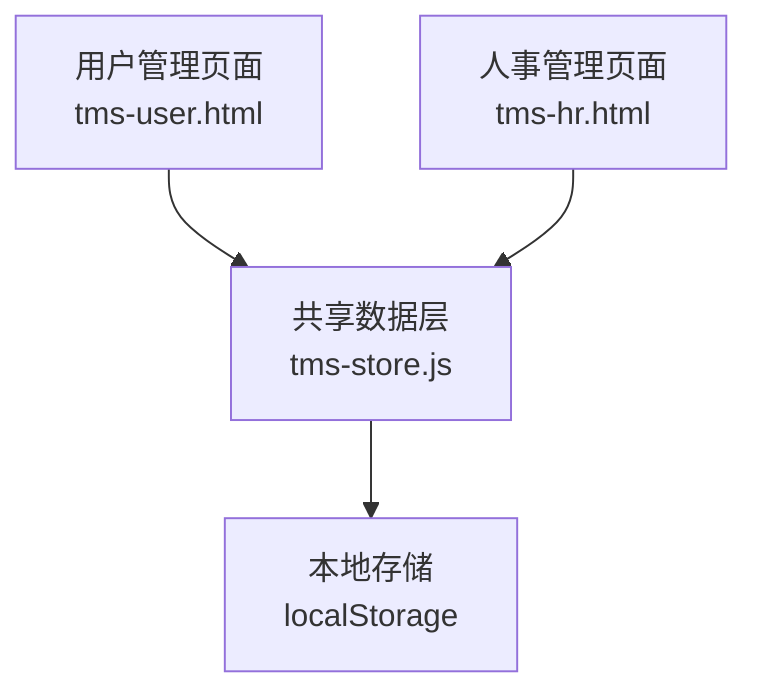
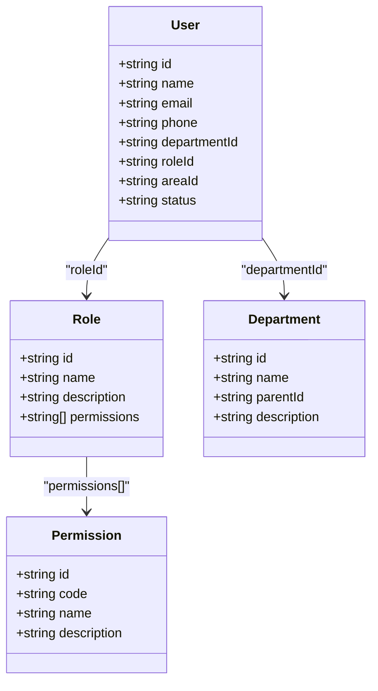
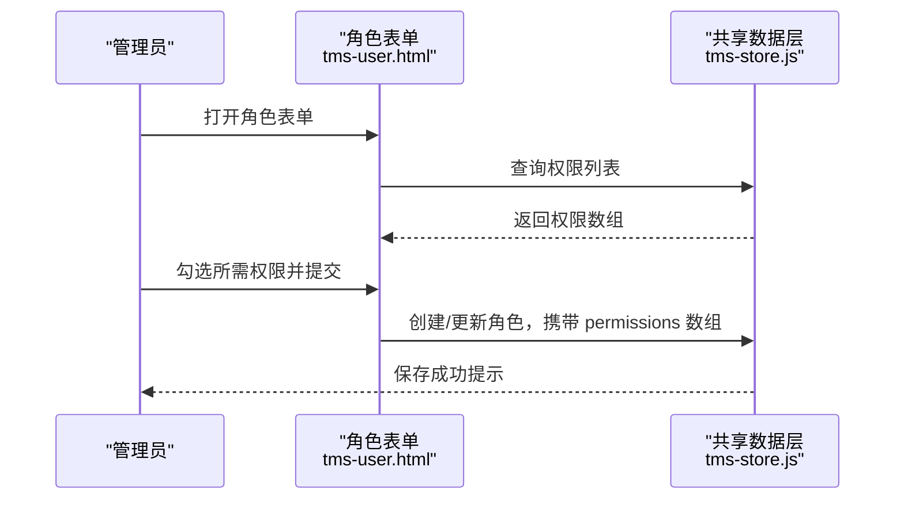
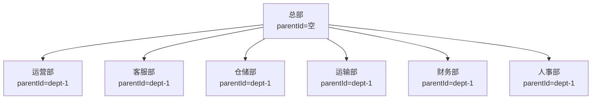
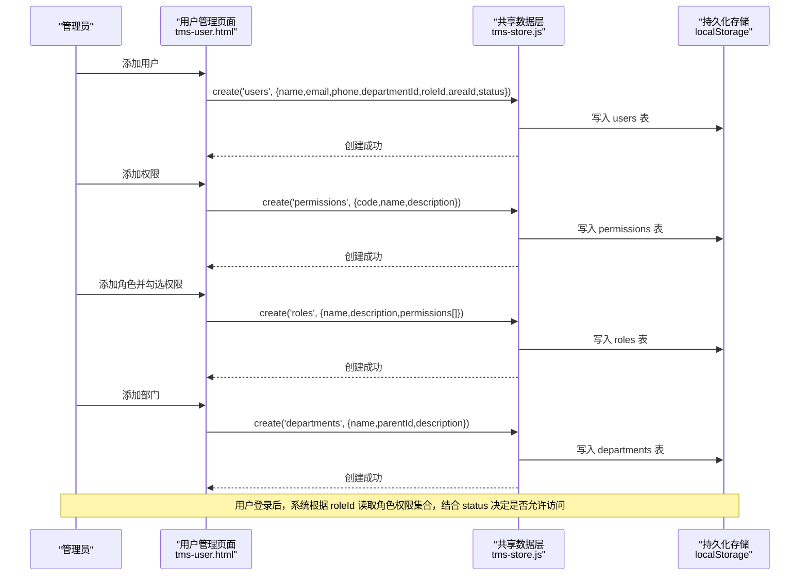

# 用户管理模型

<cite>
**本文引用的文件**   
- [tms-user.html](file://tms-user.html)
- [tms-store.js](file://tms-store.js)
- [tms-hr.html](file://tms-hr.html)
</cite>

## 目录
1. [引言](#引言)
2. [项目结构](#项目结构)
3. [核心数据实体与字段定义](#核心数据实体与字段定义)
4. [RBAC 权限模型设计](#rbac-权限模型设计)
5. [组织架构与部门层级](#组织架构与部门层级)
6. [用户认证相关字段说明](#用户认证相关字段说明)
7. [完整用户管理数据流图](#完整用户管理数据流图)
8. [数据库 Schema 设计与示例数据](#数据库-schema-设计与示例数据)
9. [依赖关系分析](#依赖关系分析)
10. [性能与扩展建议](#性能与扩展建议)
11. [常见问题排查](#常见问题排查)
12. [结论](#结论)

## 引言
本文件面向 TMS 系统的用户管理模块，目标是给出 User、Role、Permission、Department 等实体的详细数据定义，并基于现有前端实现与共享数据层，解释 RBAC 权限模型、角色权限分配、用户角色绑定、权限继承机制，以及用户的组织架构关系。文档同时提供从用户创建到权限验证的完整数据流图，并给出可直接用于后端实现的数据库 Schema 和示例数据，帮助开发者快速落地。

## 项目结构
TMS 的用户管理与权限能力主要由以下两个部分构成：
- 用户管理页面 tms-user.html：提供用户、角色、权限、部门的增删改查界面，并通过表单与表格驱动数据变更。
- 共享数据层 tms-store.js：在浏览器端维护 users、roles、permissions、departments 等实体，并提供统一的数据读写接口；同时内置种子数据，包括部门、权限、角色、区域等基础字典。



**图表来源**
- [tms-user.html:524-539](file://tms-user.html#L524-L539)
- [tms-store.js:1-12](file://tms-store.js#L1-L12)
- [tms-hr.html:375-385](file://tms-hr.html#L375-L385)

**章节来源**
- [tms-user.html:524-539](file://tms-user.html#L524-L539)
- [tms-store.js:1-12](file://tms-store.js#L1-L12)
- [tms-hr.html:375-385](file://tms-hr.html#L375-L385)

## 核心数据实体与字段定义
本节梳理四个核心实体：User（用户）、Role（角色）、Permission（权限）、Department（部门），并结合页面表单与数据层种子数据，给出字段含义与约束。

### User（用户）
用户是系统登录与授权的基本主体，关联部门、角色与管理区域，并通过状态控制账号是否可用。

| 字段 | 类型 | 必填 | 说明 |
| --- | --- | --- | --- |
| id | 字符串 | 是 | 用户唯一标识，由数据层生成或业务侧传入 |
| name | 字符串 | 是 | 用户名，用于显示与搜索 |
| email | 字符串 | 是 | 邮箱，作为登录名或通知地址 |
| phone | 字符串 | 否 | 手机号，可选联系方式 |
| departmentId | 字符串 | 是 | 所属部门 ID，关联 departments.id |
| roleId | 字符串 | 是 | 角色 ID，关联 roles.id |
| areaId | 字符串 | 否 | 管理区域 ID，关联 areas.id |
| status | 枚举 | 是 | active 表示启用，inactive 表示禁用 |

参考来源：
- 用户表单字段定义与校验逻辑位于用户管理页面的用户编辑弹窗中。
- 用户列表列包含 id、name、email、phone、departmentId、roleId、areaId、status。

**章节来源**
- [tms-user.html:572-644](file://tms-user.html#L572-L644)

### Role（角色）
角色是一组权限的集合，用于将权限按岗位进行分组，便于批量授权。

| 字段 | 类型 | 必填 | 说明 |
| --- | --- | --- | --- |
| id | 字符串 | 是 | 角色唯一标识 |
| name | 字符串 | 是 | 角色名称，如“系统管理员”“运营管理员” |
| description | 字符串 | 否 | 角色描述，说明职责范围 |
| permissions | 字符串数组 | 否 | 权限 ID 列表，表示该角色拥有的权限点 |

参考来源：
- 角色表单包含 name、description，并在提交时收集选中的权限 ID 列表。
- 角色列表展示权限数量，删除前检查是否有用户引用该角色。

**章节来源**
- [tms-user.html:646-715](file://tms-user.html#L646-L715)

### Permission（权限）
权限是系统功能的最小控制单元，通常以“资源:动作”形式的 code 标识。

| 字段 | 类型 | 必填 | 说明 |
| --- | --- | --- | --- |
| id | 字符串 | 是 | 权限唯一标识 |
| code | 字符串 | 是 | 权限代码，如 user:manage、exception:manage |
| name | 字符串 | 是 | 权限名称，如“用户管理”“异常处理” |
| description | 字符串 | 否 | 权限描述 |

参考来源：
- 权限表单包含 name、code、description。
- 权限列表支持按 code 与 name 搜索。

**章节来源**
- [tms-user.html:717-772](file://tms-user.html#L717-L772)

### Department（部门）
部门用于组织用户，支持父子层级结构，体现公司组织架构。

| 字段 | 类型 | 必填 | 说明 |
| --- | --- | --- | --- |
| id | 字符串 | 是 | 部门唯一标识 |
| name | 字符串 | 是 | 部门名称 |
| parentId | 字符串 | 否 | 上级部门 ID，为空表示根部门 |
| description | 字符串 | 否 | 部门描述 |

参考来源：
- 部门列表展示 parentId 对应的上级部门名称。
- 删除部门前检查是否有用户引用或子部门存在。

**章节来源**
- [tms-user.html:774-800](file://tms-user.html#L774-L800)

## RBAC 权限模型设计
TMS 采用经典的 RBAC（基于角色的访问控制）模型：
- Permission 是原子权限点，例如 user:manage、role:manage、permission:manage、department:manage、order:manage、fence:manage、vehicle:manage、warehouse:manage、finance:manage、exception:manage。
- Role 聚合多个 Permission，形成岗位权限包。
- User 通过 roleId 绑定一个 Role，从而获得该角色下的所有 Permission。
- 当前实现未显式实现“角色继承”，但可通过为高级角色赋予更多权限来模拟继承效果。



**图表来源**
- [tms-user.html:572-772](file://tms-user.html#L572-L772)
- [tms-store.js:144-164](file://tms-store.js#L144-L164)

### 角色权限分配流程
角色表单动态加载所有权限，并以复选框形式呈现；提交时将选中权限的 id 写入 role.permissions。



**图表来源**
- [tms-user.html:684-715](file://tms-user.html#L684-L715)
- [tms-store.js:144-164](file://tms-store.js#L144-L164)

**章节来源**
- [tms-user.html:646-715](file://tms-user.html#L646-L715)
- [tms-store.js:144-164](file://tms-store.js#L144-L164)

## 组织架构与部门层级
部门通过 parentId 构建层级树，根部门的 parentId 为空。种子数据中包含总部及多个业务部门，用户通过 departmentId 归属到具体部门。



**图表来源**
- [tms-store.js:134-142](file://tms-store.js#L134-L142)

**章节来源**
- [tms-store.js:134-142](file://tms-store.js#L134-L142)

## 用户认证相关字段说明
- email：作为用户登录名或通知邮箱，在用户表单中为必填项。
- phone：可选联系方式，用于短信通知或联系用户。
- status：active 表示账号可正常登录，inactive 表示账号被禁用。
- roleId：决定用户登录后具备哪些权限点。
- departmentId：决定用户在组织架构中的归属。
- areaId：决定用户负责的管理区域，常用于数据隔离与权限过滤。

这些字段共同支撑了用户认证与授权的基础能力：登录时使用 email 识别用户，结合 status 判断是否允许登录；登录后根据 roleId 获取权限集合，再结合 departmentId 与 areaId 做数据级权限控制。

**章节来源**
- [tms-user.html:572-644](file://tms-user.html#L572-L644)

## 完整用户管理数据流图
下图展示从用户创建到权限验证的完整过程，涵盖用户管理、角色管理、权限管理与部门管理的交互。



**图表来源**
- [tms-user.html:572-772](file://tms-user.html#L572-L772)
- [tms-store.js:144-164](file://tms-store.js#L144-L164)

**章节来源**
- [tms-user.html:572-772](file://tms-user.html#L572-L772)
- [tms-store.js:144-164](file://tms-store.js#L144-L164)

## 数据库 Schema 设计与示例数据
以下 Schema 与示例数据可直接用于后端实现，保持与前端一致的数据结构与语义。

### 表结构定义

#### users（用户表）
| 列名 | 类型 | 约束 | 说明 |
| --- | --- | --- | --- |
| id | VARCHAR(64) | PK | 用户唯一标识 |
| name | VARCHAR(128) | NOT NULL | 用户名 |
| email | VARCHAR(256) | NOT NULL, UNIQUE | 邮箱，作为登录名 |
| phone | VARCHAR(32) | NULL | 手机号 |
| department_id | VARCHAR(64) | FK -> departments.id | 所属部门 |
| role_id | VARCHAR(64) | FK -> roles.id | 角色 |
| area_id | VARCHAR(64) | NULL | 管理区域 |
| status | ENUM('active','inactive') | NOT NULL | 账号状态 |
| created_at | TIMESTAMP | DEFAULT CURRENT_TIMESTAMP | 创建时间 |
| updated_at | TIMESTAMP | DEFAULT CURRENT_TIMESTAMP ON UPDATE | 更新时间 |

#### roles（角色表）
| 列名 | 类型 | 约束 | 说明 |
| --- | --- | --- | --- |
| id | VARCHAR(64) | PK | 角色唯一标识 |
| name | VARCHAR(128) | NOT NULL | 角色名称 |
| description | TEXT | NULL | 角色描述 |
| permissions | JSON | NULL | 权限 ID 数组 |
| created_at | TIMESTAMP | DEFAULT CURRENT_TIMESTAMP | 创建时间 |
| updated_at | TIMESTAMP | DEFAULT CURRENT_TIMESTAMP ON UPDATE | 更新时间 |

#### permissions（权限表）
| 列名 | 类型 | 约束 | 说明 |
| --- | --- | --- | --- |
| id | VARCHAR(64) | PK | 权限唯一标识 |
| code | VARCHAR(128) | NOT NULL, UNIQUE | 权限代码 |
| name | VARCHAR(128) | NOT NULL | 权限名称 |
| description | TEXT | NULL | 权限描述 |
| created_at | TIMESTAMP | DEFAULT CURRENT_TIMESTAMP | 创建时间 |
| updated_at | TIMESTAMP | DEFAULT CURRENT_TIMESTAMP ON UPDATE | 更新时间 |

#### departments（部门表）
| 列名 | 类型 | 约束 | 说明 |
| --- | --- | --- | --- |
| id | VARCHAR(64) | PK | 部门唯一标识 |
| name | VARCHAR(128) | NOT NULL | 部门名称 |
| parent_id | VARCHAR(64) | NULL, FK -> departments.id | 上级部门 |
| description | TEXT | NULL | 部门描述 |
| created_at | TIMESTAMP | DEFAULT CURRENT_TIMESTAMP | 创建时间 |
| updated_at | TIMESTAMP | DEFAULT CURRENT_TIMESTAMP ON UPDATE | 更新时间 |

### 示例数据
以下为种子数据，便于理解与测试：

- 权限
  - perm-1: user:manage, 用户管理
  - perm-2: role:manage, 角色管理
  - perm-3: permission:manage, 权限管理
  - perm-4: department:manage, 部门管理
  - perm-5: order:manage, 订单管理
  - perm-6: fence:manage, 围栏管理
  - perm-7: vehicle:manage, 车辆管理
  - perm-8: warehouse:manage, 仓储管理
  - perm-9: finance:manage, 财务管理
  - perm-10: exception:manage, 异常管理

- 角色
  - role-1: 系统管理员，拥有全部权限
  - role-2: 运营管理员，拥有用户管理、订单管理、围栏管理、异常管理
  - role-3: 客服专员，拥有订单管理、异常管理
  - role-4: 仓储管理员，拥有部门管理、仓储管理
  - role-5: 派送员，无权限
  - role-6: 财务专员，拥有财务管理

- 部门
  - dept-1: 总部
  - dept-2: 运营部
  - dept-3: 客服部
  - dept-4: 仓储部
  - dept-5: 运输部
  - dept-6: 财务部
  - dept-7: 人事部

- 用户
  - 示例用户包含 id、name、email、phone、departmentId、roleId、areaId、status，其中 status 为 active 或 inactive。

**章节来源**
- [tms-store.js:134-164](file://tms-store.js#L134-L164)
- [tms-user.html:572-772](file://tms-user.html#L572-L772)

## 依赖关系分析
- 用户管理页面依赖共享数据层提供的 list、create、update、remove 等方法操作 users、roles、permissions、departments。
- 角色表单依赖权限列表动态渲染复选框，提交时写入 permissions 数组。
- 部门层级通过 parentId 自关联，用户通过 departmentId 归属部门。
- 删除保护：删除角色前检查是否有用户引用；删除权限前检查是否有角色引用；删除部门前检查是否有用户引用或子部门存在。

```mermaid
graph LR
Users["users"] --> Roles["roles"]
Roles --> Permissions["permissions"]
Users --> Departments["departments"]
Departments --> Departments : "parent_id"
```

**图表来源**
- [tms-user.html:646-772](file://tms-user.html#L646-L772)
- [tms-store.js:134-164](file://tms-store.js#L134-L164)

**章节来源**
- [tms-user.html:646-772](file://tms-user.html#L646-L772)
- [tms-store.js:134-164](file://tms-store.js#L134-L164)

## 性能与扩展建议
- 索引优化：对 users.email、users.role_id、users.department_id、permissions.code、departments.parent_id 建立索引以提升查询性能。
- 权限缓存：在用户登录后缓存其权限集合，避免每次请求都进行角色权限解析。
- 分页与筛选：对用户、角色、权限、部门列表实现服务端分页与多条件筛选，减少前端渲染压力。
- 权限继承扩展：如需支持角色继承，可增加 role_inheritance 表记录父角色与子角色关系，并在权限计算时递归合并权限集合。
- 审计日志：对用户、角色、权限、部门的增删改操作记录审计日志，便于追踪与合规。

[本节为通用建议，不直接分析具体文件]

## 常见问题排查
- 无法删除角色：当有用户仍绑定该角色时，前端会阻止删除。需先解绑用户角色或删除用户。
- 无法删除权限：当有角色引用该权限时，前端会阻止删除。需先移除角色中的权限引用。
- 无法删除部门：当有用户属于该部门或存在子部门时，前端会阻止删除。需先迁移用户或删除子部门。
- 用户状态影响登录：status 为 inactive 的用户不应允许登录，应在认证逻辑中检查该字段。

**章节来源**
- [tms-user.html:667-715](file://tms-user.html#L667-L715)
- [tms-user.html:735-772](file://tms-user.html#L735-L772)
- [tms-user.html:795-800](file://tms-user.html#L795-L800)

## 结论
TMS 的用户管理模型以 User、Role、Permission、Department 为核心，通过 RBAC 模型实现细粒度权限控制。用户通过角色获得权限集合，部门通过层级结构组织员工，状态字段控制账号可用性。当前实现在前端通过表单与表格驱动数据变更，并由共享数据层维护数据一致性。基于本文档提供的 Schema 与数据流图，开发者可在后端实现一致的模型与流程，确保权限控制与组织架构管理能力稳定可靠。

[本节为总结性内容，不直接分析具体文件]