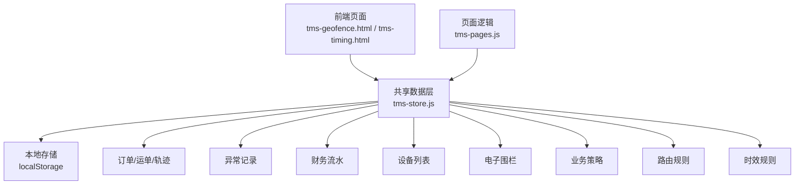
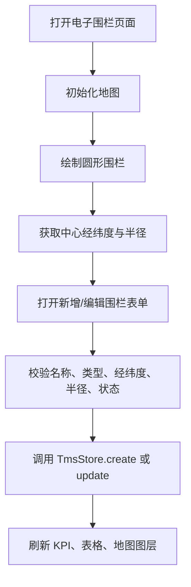
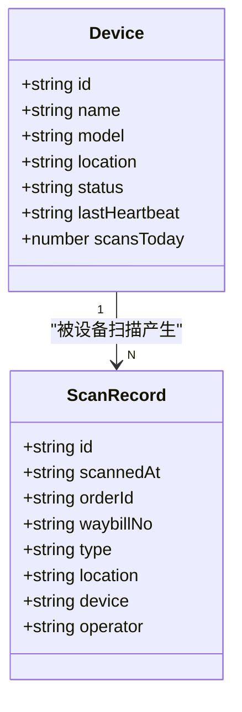
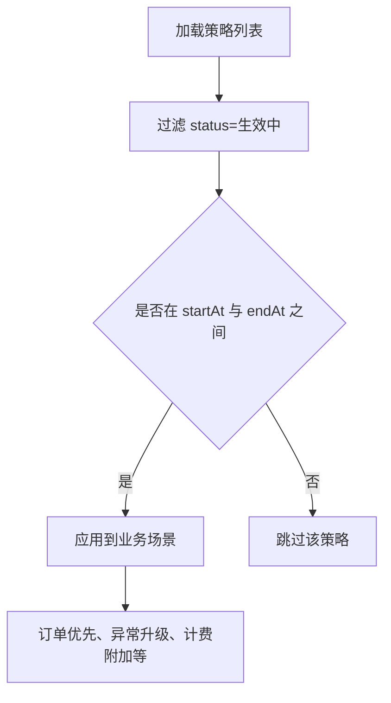
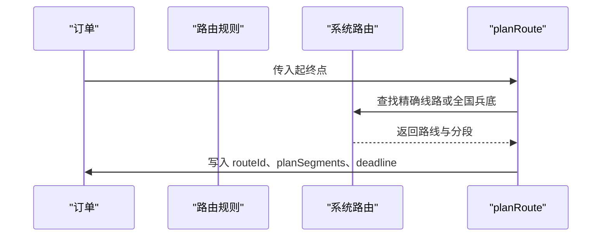
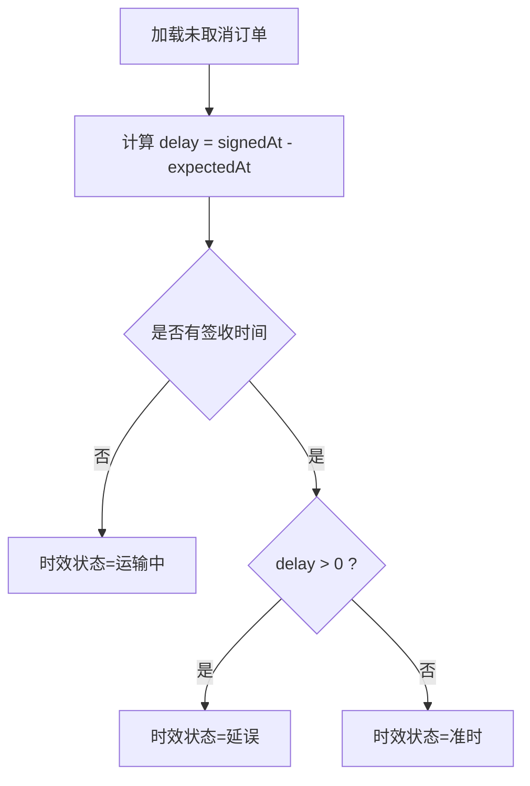
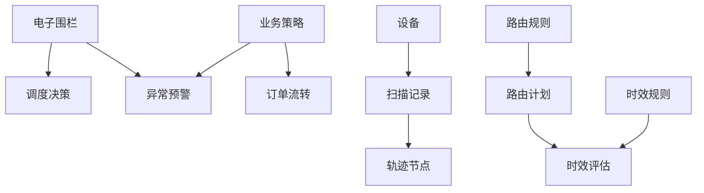
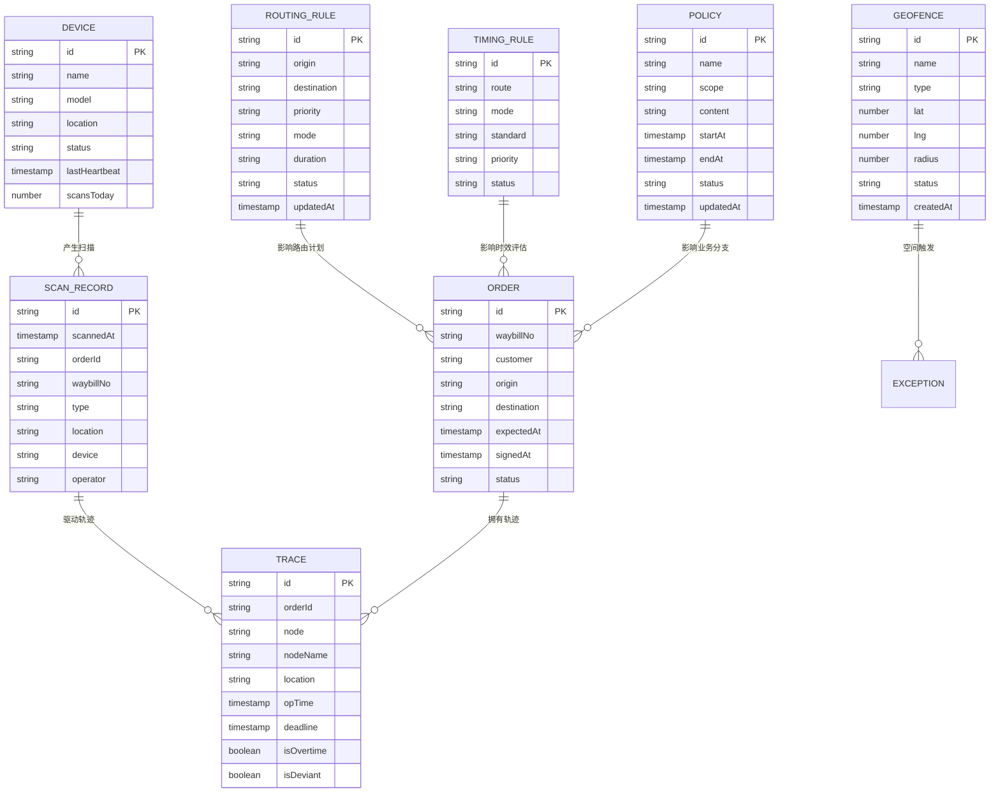

# 辅助功能模型

<cite>
**本文引用的文件**   
- [tms-store.js](file://tms-store.js)
- [tms-geofence.html](file://tms-geofence.html)
- [tms-timing.html](file://tms-timing.html)
- [tms-pages.js](file://tms-pages.js)
- [tms-ui.js](file://tms-ui.js)
</cite>

## 目录
1. [引言](#引言)
2. [项目结构与数据入口](#项目结构与数据入口)
3. [核心辅助实体总览](#核心辅助实体总览)
4. [电子围栏 Geofence 数据定义](#电子围栏-geofence-数据定义)
5. [设备 Device 数据定义](#设备-device-数据定义)
6. [业务策略 Policy 数据定义](#业务策略-policy-数据定义)
7. [路由规则 RoutingRule 数据定义](#路由规则-routingrule-数据定义)
8. [时效规则 TimingRule 数据定义](#时效规则-timingrule-数据定义)
9. [辅助模型与核心业务的集成方式](#辅助模型与核心业务的集成方式)
10. [使用场景与配置示例](#使用场景与配置示例)
11. [依赖关系分析](#依赖关系分析)
12. [性能与扩展建议](#性能与扩展建议)
13. [常见问题排查](#常见问题排查)
14. [结论](#结论)

## 引言
本文面向 TMS 系统的辅助功能模型，重点解释以下实体的字段含义、用途和实际用法：
- 电子围栏 Geofence
- 设备 Device（以 PDA 扫描枪为代表）
- 业务策略 Policy
- 路由规则 RoutingRule
- 时效规则 TimingRule

这些模型共同构成 TMS 的“能力底座”：围栏提供空间约束，设备提供数据采集入口，策略提供动态规则表达，路由与时效规则提供运输规划与 SLA 支撑。文档同时说明它们如何与订单、轨迹、异常、结算等核心业务联动。

## 项目结构与数据入口
TMS 的前端页面通过共享数据层访问所有实体；辅助模型的数据由 `tms-store.js` 初始化并持久化到浏览器本地存储，页面通过 `TmsStore.list/create/update/remove/subscribe` 进行读写。

**图表来源**
- [tms-store.js:16-17](file://tms-store.js#L16-L17)
- [tms-store.js:220-244](file://tms-store.js#L220-L244)
- [tms-store.js:1113-1153](file://tms-store.js#L1113-L1153)

**章节来源**
- [tms-store.js:1-12](file://tms-store.js#L1-L12)
- [tms-store.js:220-244](file://tms-store.js#L220-L244)
- [tms-store.js:1113-1153](file://tms-store.js#L1113-L1153)

## 核心辅助实体总览
| 实体 | 集合名 | 主要用途 | 关键状态或维度 |
|---|---|---|---|
| 电子围栏 | geofences | 在地图上定义仓储、网点、禁行区域等圆形范围，支持启用/停用 | type、lat、lng、radius、status |
| 设备 | devices | 管理 PDA 扫描枪等设备的位置、心跳、当日扫描量 | model、location、status、lastHeartbeat、scansToday |
| 业务策略 | policies | 描述可启停的业务规则，如大客户优先、夜间揽收激励、异常升级 | scope、content、startAt、endAt、status |
| 路由规则 | routingRules | 按起终点、优先级、运输方式和时长定义基础路由 | origin、destination、priority、mode、duration、status |
| 时效规则 | timingRules | 为线路+运输方式定义标准时效，用于时效监控与考核 | route、mode、standard、priority、status |

**章节来源**
- [tms-store.js:573-655](file://tms-store.js#L573-L655)
- [tms-store.js:1090-1134](file://tms-store.js#L1090-L1134)

## 电子围栏 Geofence 数据定义
### 字段说明
| 字段 | 类型 | 是否必填 | 含义与用途 |
|---|---|---:|---|
| id | 字符串 | 是 | 围栏唯一标识，默认前缀为 GF |
| name | 字符串 | 是 | 围栏名称，例如“朝阳区网点围栏” |
| type | 枚举 | 是 | 围栏类型，包括仓储围栏、网点围栏、禁行区域、派送围栏、到货围栏、派送员围栏 |
| lat | 数字 | 是 | 中心纬度，范围 -90 到 90 |
| lng | 数字 | 是 | 中心经度，范围 -180 到 180 |
| radius | 数字 | 是 | 半径，单位为米，最小值 50，最大值 50000 |
| status | 枚举 | 是 | 生效中或已停用，控制是否参与规则校验 |
| createdAt | 时间戳 | 否 | 创建时间，新增时自动写入 |

### 行为与界面联动
- 地图展示：系统使用 Leaflet 将每个围栏渲染为圆形，颜色根据 type 区分，opacity 和虚线表示 status。
- KPI 统计：统计围栏总数、生效中数量、仓储围栏数量、禁行区域数量。
- 表格操作：支持定位、启用、停用、编辑、删除。
- 绘制流程：用户在地图上绘制圆形后，自动填充 center 和 radius，再进入表单确认保存。

**图表来源**
- [tms-geofence.html:600-609](file://tms-geofence.html#L600-L609)
- [tms-geofence.html:611-623](file://tms-geofence.html#L611-L623)
- [tms-geofence.html:686-718](file://tms-geofence.html#L686-L718)
- [tms-geofence.html:748-776](file://tms-geofence.html#L748-L776)

**章节来源**
- [tms-geofence.html:611-623](file://tms-geofence.html#L611-L623)
- [tms-geofence.html:633-683](file://tms-geofence.html#L633-L683)
- [tms-geofence.html:686-718](file://tms-geofence.html#L686-L718)
- [tms-geofence.html:721-790](file://tms-geofence.html#L721-L790)
- [tms-store.js:573-591](file://tms-store.js#L573-L591)
- [tms-store.js:1268-1286](file://tms-store.js#L1268-L1286)

## 设备 Device 数据定义
### 字段说明
| 字段 | 类型 | 是否必填 | 含义与用途 |
|---|---|---:|---|
| id | 字符串 | 是 | 设备唯一标识，默认前缀为 DEV |
| name | 字符串 | 是 | 设备名称，例如“PDA 扫描枪 01” |
| model | 字符串 | 是 | 设备型号，例如斑马 TC52、霍尼韦尔 8680、新大陆 N7 |
| location | 字符串 | 是 | 设备部署位置，例如北京中心仓、上海分拨中心 |
| status | 枚举 | 是 | 在线、维修中等，用于设备健康监控 |
| lastHeartbeat | 时间戳 | 否 | 最近心跳时间，可用于判断设备活跃度 |
| scansToday | 数字 | 否 | 当日扫描次数，反映设备采集工作量 |

### 使用方式
- 设备列表作为运营监控的一部分，显示在线设备数量与设备明细。
- 运维人员可手动将设备状态置为 online，模拟心跳恢复。
- 扫描记录中的 device 字段通常关联设备 ID，便于追溯扫描来源。

**图表来源**
- [tms-store.js:1090-1102](file://tms-store.js#L1090-L1102)
- [tms-store.js:829-842](file://tms-store.js#L829-L842)

**章节来源**
- [tms-store.js:1090-1102](file://tms-store.js#L1090-L1102)
- [tms-store.js:829-842](file://tms-store.js#L829-L842)
- [tms-pages.js:1478-1499](file://tms-pages.js#L1478-L1499)

## 业务策略 Policy 数据定义
### 字段说明
| 字段 | 类型 | 是否必填 | 含义与用途 |
|---|---|---:|---|
| id | 字符串 | 是 | 策略唯一标识，默认前缀为 POL |
| name | 字符串 | 是 | 策略名称，例如“大客户优先派送”“夜间揽收激励” |
| scope | 字符串 | 是 | 策略适用范围，例如“大客户订单”“全部网点”“全部订单” |
| content | 字符串 | 是 | 策略内容，描述规则动作，例如优先分配运力、插队分拣、补贴金额 |
| startAt | 时间戳 | 否 | 生效开始时间 |
| endAt | 时间戳 | 否 | 失效结束时间 |
| status | 枚举 | 是 | 生效中、已暂停、已失效，用于动态开关策略 |
| updatedAt | 时间戳 | 否 | 更新时间 |

### 动态规则引擎支撑
- Policy 本身是结构化规则描述，适合扩展为规则表达式或条件树。
- 当前实现以文本 content 为主，未来可扩展为 engine 字段，承载 JSON 规则。
- 结合订单、异常、调度等模块，可在运行时读取 active 且处于 time window 的策略，驱动业务分支。

**图表来源**
- [tms-store.js:594-612](file://tms-store.js#L594-L612)
- [tms-store.js:113-114](file://tms-store.js#L113-L114)

**章节来源**
- [tms-store.js:594-612](file://tms-store.js#L594-L612)
- [tms-store.js:113-114](file://tms-store.js#L113-L114)
- [tms-store.js:1268-1286](file://tms-store.js#L1268-L1286)

## 路由规则 RoutingRule 数据定义
### 字段说明
| 字段 | 类型 | 是否必填 | 含义与用途 |
|---|---|---:|---|
| id | 字符串 | 是 | 路由规则唯一标识，默认前缀为 RUL |
| origin | 字符串 | 是 | 起点城市或区域 |
| destination | 字符串 | 是 | 终点城市或区域 |
| priority | 枚举 | 是 | 高、中、低，影响路由选择优先级 |
| mode | 枚举 | 是 | 陆运、空运等运输方式 |
| duration | 字符串 | 是 | 预计时长，例如“24小时”“12小时” |
| status | 枚举 | 是 | 启用/停用，控制是否参与路由匹配 |
| updatedAt | 时间戳 | 否 | 更新时间 |

### 与路由规划的关系
- routingRules 是用户维护的规则表；routes 是系统内部生成的多段路由结构，包含 segments、totalStdHours 等。
- planRoute 会根据订单起终点匹配 routes，生成 planSegments 与逐段 deadline，从而支撑时效计算。
- routingRules 可作为外部输入，驱动 routes 构建或作为展示层规则说明。

**图表来源**
- [tms-store.js:387-424](file://tms-store.js#L387-L424)
- [tms-store.js:426-440](file://tms-store.js#L426-L440)
- [tms-store.js:614-630](file://tms-store.js#L614-L630)

**章节来源**
- [tms-store.js:387-440](file://tms-store.js#L387-L440)
- [tms-store.js:614-630](file://tms-store.js#L614-L630)
- [tms-store.js:1268-1286](file://tms-store.js#L1268-L1286)

## 时效规则 TimingRule 数据定义
### 字段说明
| 字段 | 类型 | 是否必填 | 含义与用途 |
|---|---|---:|---|
| id | 字符串 | 是 | 时效规则唯一标识，默认前缀为 TMR |
| route | 字符串 | 是 | 线路描述，例如“北京 → 上海” |
| mode | 枚举 | 是 | 运输方式，例如陆运、空运、铁路 |
| standard | 字符串 | 是 | 标准时效，例如“1天”“12小时” |
| priority | 枚举 | 是 | 高、中、低，用于时效规则排序与冲突处理 |
| status | 枚举 | 是 | 生效中、已停用，控制是否参与时效评估 |

### 时效监控算法
- 时效监控基于订单 expectedAt 与 signedAt 计算 delay 小时数。
- 若 actualAt 为空则为“运输中”，否则根据 delay 判定“准时”或“延误”。
- timingRules 提供线路维度的标准时效参考，可与订单 SLA 对比。

**图表来源**
- [tms-pages.js:1619-1641](file://tms-pages.js#L1619-L1641)
- [tms-store.js:646-655](file://tms-store.js#L646-L655)

**章节来源**
- [tms-pages.js:1548-1617](file://tms-pages.js#L1548-L1617)
- [tms-pages.js:1619-1641](file://tms-pages.js#L1619-L1641)
- [tms-store.js:646-655](file://tms-store.js#L646-L655)

## 辅助模型与核心业务的集成方式
### 电子围栏与业务
- 围栏类型包含仓储、网点、禁行区域等，可用于限制车辆进入、触发入库/出库事件、或作为异常预警的空间条件。
- 当前页面提供围栏可视化与管理，后续可在轨迹、异常、调度模块中引用围栏坐标与半径做地理判断。

### 设备与扫描
- 扫描记录包含 device 字段，关联具体 PDA 设备，便于统计设备利用率与操作人绩效。
- 设备状态可用于监控仓库/网点作业能力，离线或维修设备应减少任务分配。

### 策略与动态规则
- Policy 可驱动订单优先级、异常升级路径、计费附加、考核指标等。
- 建议在规则引擎中增加 condition、action、weight 字段，使策略从文本描述升级为可执行规则。

### 路由与时效
- RoutingRule 与 TimingRule 共同支撑运输规划与 SLA 管理。
- 订单计划阶段会写入 planSegments 与 deadline，轨迹节点带 isOvertime、isDeviant 标记，便于时效分析与异常上报。

**图表来源**
- [tms-store.js:442-460](file://tms-store.js#L442-L460)
- [tms-store.js:829-842](file://tms-store.js#L829-L842)
- [tms-store.js:1446-1465](file://tms-store.js#L1446-L1465)

**章节来源**
- [tms-store.js:442-460](file://tms-store.js#L442-L460)
- [tms-store.js:829-842](file://tms-store.js#L829-L842)
- [tms-store.js:1446-1465](file://tms-store.js#L1446-L1465)

## 使用场景与配置示例
### 场景一：仓库入库围栏
- 配置一个 type=仓储围栏 的 Geofence，设置仓库中心经纬度与合理半径。
- 当车辆或 PDA 进入围栏范围时，可触发入库扫描或异常预警。
- 相关数据：geofences.lat、geofences.lng、geofences.radius、geofences.status。

### 场景二：PDA 扫描枪监控
- 在设备管理中查看 devices 列表，关注 status=online 的设备数量。
- 若某设备 lastHeartbeat 长时间未更新，可人工更新为 online 或安排维修。
- 相关数据：devices.model、devices.location、devices.lastHeartbeat、devices.scansToday。

### 场景三：大客户优先策略
- 新增一条 Policy，scope=大客户订单，content=优先分配运力并插队分拣。
- 在订单创建或调度环节读取 active 且时间窗口内的策略，提升该客户订单优先级。
- 相关数据：policies.scope、policies.content、policies.startAt、policies.endAt、policies.status。

### 场景四：北京到上海高优先级空运
- 新增 RoutingRule：origin=北京、destination=上海、priority=高、mode=空运、duration=24小时。
- 系统据此生成或匹配 routes，并在 planRoute 中写入 planSegments 与 deadline。
- 相关数据：routingRules.origin、routingRules.destination、routingRules.priority、routingRules.mode、routingRules.duration。

### 场景五：线路时效监控
- 配置 TimingRule：route=北京 → 上海、mode=空运、standard=1天、priority=高。
- 时效页面根据订单 expectedAt 与 signedAt 计算 delay，展示准时率与延误订单。
- 相关数据：timingRules.route、timingRules.mode、timingRules.standard、timingRules.priority。

**章节来源**
- [tms-geofence.html:686-718](file://tms-geofence.html#L686-L718)
- [tms-store.js:573-655](file://tms-store.js#L573-L655)
- [tms-store.js:1090-1134](file://tms-store.js#L1090-L1134)
- [tms-pages.js:1548-1617](file://tms-pages.js#L1548-L1617)

## 依赖关系分析
### 实体依赖图

**图表来源**
- [tms-store.js:573-655](file://tms-store.js#L573-L655)
- [tms-store.js:829-842](file://tms-store.js#L829-L842)
- [tms-store.js:1446-1465](file://tms-store.js#L1446-L1465)

**章节来源**
- [tms-store.js:573-655](file://tms-store.js#L573-L655)
- [tms-store.js:829-842](file://tms-store.js#L829-L842)
- [tms-store.js:1446-1465](file://tms-store.js#L1446-L1465)

## 性能与扩展建议
- 数据层基于 localStorage，适合演示与轻量运行；生产环境建议迁移至后端数据库，并提供分页、索引与查询优化。
- 电子围栏地理判断应在服务端完成，避免在前端对大量轨迹点做重复距离计算。
- 策略引擎建议引入规则表达式语言，支持 AND/OR、阈值比较、时间窗口、标签匹配等。
- 设备心跳建议采用批量上报与去重机制，降低存储压力。
- 路由与时效规则建议建立版本管理机制，支持灰度发布与回滚。

[本节为通用建议，不直接分析具体文件]

## 常见问题排查
- 地图组件加载失败：当 Leaflet 未加载时，电子围栏页面会提示错误但仍可使用围栏列表。
- 围栏无法定位：检查 geofences.lat、geofences.lng、geofences.radius 是否为有效数值。
- 设备离线：检查 devices.status 与 lastHeartbeat，必要时手动更新为 online。
- 时效状态异常：检查订单 expectedAt 与 signedAt 是否正确，以及 timingRules 是否启用。
- 策略未生效：检查 policies.status 是否为生效中，且 startAt/endAt 是否覆盖当前时间。

**章节来源**
- [tms-geofence.html:600-609](file://tms-geofence.html#L600-L609)
- [tms-store.js:1210-1258](file://tms-store.js#L1210-L1258)
- [tms-pages.js:1619-1641](file://tms-pages.js#L1619-L1641)

## 结论
TMS 的辅助功能模型以 geofences、devices、policies、routingRules、timingRules 为核心，分别承担空间约束、设备采集、动态规则、路由规划与时效管理职责。它们通过共享数据层与页面交互，并与订单、轨迹、异常、财务等核心业务紧密耦合。开发者可在此基础上扩展规则引擎、地理计算、设备管理与时效算法，快速增强系统能力。

[本节为总结性内容，不直接分析具体文件]