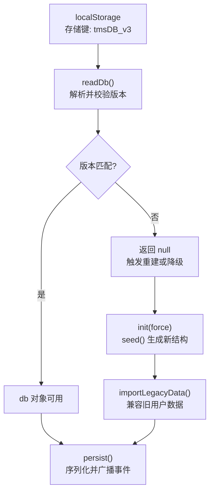
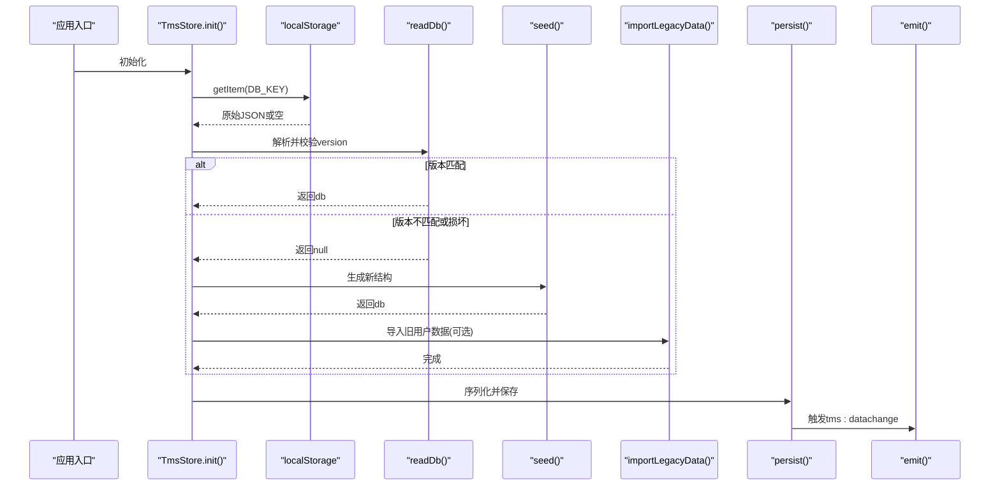
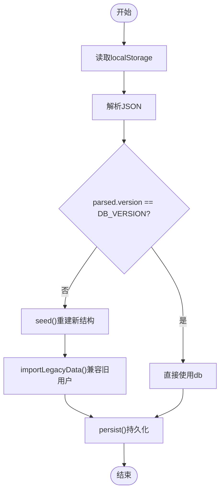
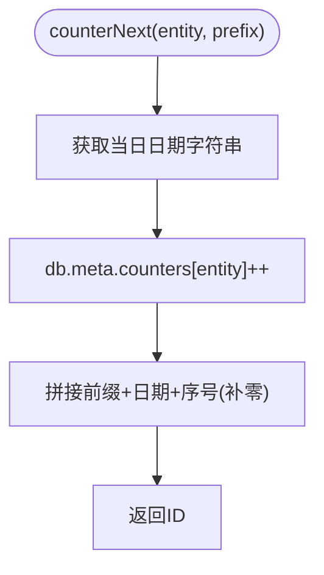
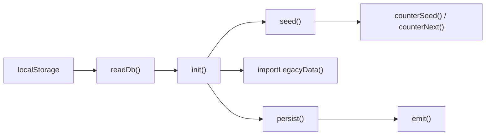

# 数据版本管理

<cite>
**本文引用的文件**   
- [tms-store.js](file://tms-store.js)
</cite>

## 目录
1. [引言](#引言)
2. [项目结构](#项目结构)
3. [核心组件](#核心组件)
4. [架构总览](#架构总览)
5. [详细组件分析](#详细组件分析)
6. [依赖关系分析](#依赖关系分析)
7. [性能与扩展性](#性能与扩展性)
8. [故障排查指南](#故障排查指南)
9. [结论](#结论)
10. [附录：版本升级最佳实践与完整性检查方案](#附录版本升级最佳实践与完整性检查方案)

## 引言
本文件面向 TMS（运输管理系统）前端本地数据层，聚焦“数据版本管理与迁移机制”。系统基于浏览器 localStorage 实现轻量级业务数据库，通过版本号控制数据结构演进、向后兼容与平滑升级。文档将深入解释 DB_VERSION 的设计思路、数据迁移算法、旧数据导入逻辑 importLegacyData()、ID 计数器 counterNext() 的版本管理策略，以及备份恢复、完整性校验和升级注意事项等工程化建议。

## 项目结构
TMS 的数据版本与迁移逻辑集中在单一共享数据层模块中，对外暴露统一的初始化与事件通知能力。关键路径如下：
- 数据持久化键与版本常量定义
- 读取/写入与事件广播
- 种子数据生成与 ID 生成器
- 旧数据导入与初始化流程

图表来源
- [tms-store.js:16-17](file://tms-store.js#L16-L17)
- [tms-store.js:220-235](file://tms-store.js#L220-L235)
- [tms-store.js:1166-1195](file://tms-store.js#L1166-L1195)

章节来源
- [tms-store.js:16-17](file://tms-store.js#L16-L17)
- [tms-store.js:220-235](file://tms-store.js#L220-L235)
- [tms-store.js:1166-1195](file://tms-store.js#L1166-L1195)

## 核心组件
- 数据键与版本常量
  - DB_KEY：用于标识当前版本的 localStorage 键名，随版本变化而变更，避免多版本数据混用。
  - DB_VERSION：当前数据结构版本号，用于在读取时进行兼容性判断。
- 数据读写与事件
  - readDb()：从 localStorage 解析数据，校验 version 字段是否等于 DB_VERSION；不匹配则视为无效数据。
  - persist()：将内存中的 db 对象序列化为 JSON 并写回 localStorage，同时触发 tms:datachange 事件。
  - emit()：分发数据变更事件，供 UI 或其他模块响应。
- 种子数据与 ID 生成
  - seed()：生成完整初始数据集，包含订单、运单、运输、异常、财务、账单、员工、车辆、仓库、库存、路由、价卡等。
  - counterSeed()：仅在种子数据生成阶段使用，保证列表 ID 与业务时间一致且唯一。
  - counterNext()：运行时 ID 生成器，基于日期与计数器生成连续且唯一的业务 ID。
- 旧数据导入
  - importLegacyData()：尝试从旧键 tmsUsers 导入用户数据，去重后合并到当前结构。
- 初始化流程
  - init(force)：若不存在有效 db 或强制初始化，则调用 seed() 生成新结构，并在非强制模式下执行 importLegacyData()，最后持久化。

章节来源
- [tms-store.js:16-17](file://tms-store.js#L16-L17)
- [tms-store.js:220-244](file://tms-store.js#L220-L244)
- [tms-store.js:246-261](file://tms-store.js#L246-L261)
- [tms-store.js:464-1154](file://tms-store.js#L464-L1154)
- [tms-store.js:1156-1164](file://tms-store.js#L1156-L1164)
- [tms-store.js:1166-1195](file://tms-store.js#L1166-L1195)

## 架构总览
下图展示数据版本管理的整体流程：从读取本地存储、版本校验、数据重建、旧数据兼容导入，到最终持久化与事件广播。

图表来源
- [tms-store.js:220-235](file://tms-store.js#L220-L235)
- [tms-store.js:464-1154](file://tms-store.js#L464-L1154)
- [tms-store.js:1166-1195](file://tms-store.js#L1166-L1195)

## 详细组件分析

### DB_VERSION 设计与版本升级策略
- 设计要点
  - 每个数据结构版本对应一个整数 DB_VERSION。
  - 每次对数据模型进行破坏性变更（新增必填字段、字段类型变更、枚举值调整等），需递增 DB_VERSION。
  - 读取时严格比较 parsed.version 与 DB_VERSION，不匹配即视为无效数据，防止旧结构污染新逻辑。
- 升级策略
  - 优先采用“向前兼容”的增量式演进：新增字段默认允许为空，旧数据可保留；删除字段需谨慎评估影响面。
  - 当必须破坏性变更时，提供一次性迁移脚本（可在后续迭代中引入），在 init() 中根据旧版本执行转换。
  - 通过 DB_KEY 与 DB_VERSION 双保险：键名含版本信息，避免不同版本数据共存于同一键。

章节来源
- [tms-store.js:16-17](file://tms-store.js#L16-L17)
- [tms-store.js:220-235](file://tms-store.js#L220-L235)
- [tms-store.js:1113-1116](file://tms-store.js#L1113-L1116)

### 数据迁移算法与向后兼容
- 当前实现
  - 读取阶段：readDb() 仅做版本相等判断，不做字段级迁移。
  - 初始化阶段：若读不到有效数据，直接 seed() 生成全新结构。
  - 兼容导入：importLegacyData() 从旧键 tmsUsers 读取用户数据，按 email 去重后追加到 users 数组。
- 向后兼容保证
  - 新字段默认允许缺失，旧记录仍可被消费方安全访问（通过默认值或空值）。
  - 枚举值扩展时，旧值保持不变，新值由逻辑分支处理。
  - 对历史数据的任何转换应在显式迁移步骤中进行，避免隐式副作用。

图表来源
- [tms-store.js:220-235](file://tms-store.js#L220-L235)
- [tms-store.js:464-1154](file://tms-store.js#L464-L1154)
- [tms-store.js:1166-1195](file://tms-store.js#L1166-L1195)

章节来源
- [tms-store.js:220-235](file://tms-store.js#L220-L235)
- [tms-store.js:1166-1195](file://tms-store.js#L1166-L1195)

### importLegacyData() 的实现与兼容性处理
- 功能说明
  - 从 localStorage 的 tmsUsers 键读取旧用户数据。
  - 若存在且为数组，遍历每条旧用户记录，按 email 去重后追加到当前 users 列表。
  - 对缺失字段提供默认值（如 departmentId、roleId、status、areaId），确保结构一致性。
  - 捕获异常并忽略错误，保证主流程不受旧数据格式问题影响。
- 兼容性要点
  - 仅做最小必要映射，避免强耦合旧结构。
  - 去重策略以 email 为准，避免重复导入。
  - 失败容忍：即使旧数据不可用，也不中断正常初始化。

章节来源
- [tms-store.js:1166-1185](file://tms-store.js#L1166-L1185)

### counterNext() 计数器的版本管理
- 功能说明
  - 基于当日日期与实体计数器生成唯一 ID，格式为 “前缀-YYYYMMDD-三位序号”。
  - 更新 db.meta.counters[entity] 自增，确保同一天内同一实体的序号连续且不重复。
- 唯一性与连续性
  - 唯一性：结合日期与实体维度，避免跨天或跨实体冲突。
  - 连续性：每日重置计数器（通过 dateKey 获取当天），在同一天内单调递增。
- 版本管理
  - 计数器存储在 db.meta.counters 中，随数据一起持久化，保证重启后延续。
  - 若数据重建（版本升级或损坏恢复），计数器会重新计算或从零开始，需关注业务侧对 ID 连续性的要求。

图表来源
- [tms-store.js:246-250](file://tms-store.js#L246-L250)

章节来源
- [tms-store.js:246-250](file://tms-store.js#L246-L250)
- [tms-store.js:1104-1116](file://tms-store.js#L1104-L1116)

### 数据备份与恢复机制
- 现状
  - 当前未实现显式的备份/恢复 API，所有数据均保存在 localStorage 的 tmsDB_v3 键中。
  - 数据损坏或版本不匹配时，readDb() 返回 null，init() 会重建数据。
- 建议方案
  - 导出备份：提供导出函数，将 db 对象序列化为 JSON 并下载为文件。
  - 导入恢复：提供导入函数，校验 JSON 结构与版本，必要时执行迁移后再覆盖 db。
  - 自动快照：在每次 persist() 前创建历史快照（例如 tmsDB_v3_snapshot_YYYYMMDD），便于快速回滚。
  - 损坏检测：在读取时增加字段完整性校验，发现缺失关键字段时提示用户并引导恢复。

章节来源
- [tms-store.js:220-235](file://tms-store.js#L220-L235)
- [tms-store.js:1187-1195](file://tms-store.js#L1187-L1195)

## 依赖关系分析
- 内部依赖
  - readDb()/persist()/emit() 构成数据存取与事件总线的基础设施。
  - seed() 依赖多个工具函数（日期、哈希、随机数、计费、路由等）构建完整数据集。
  - importLegacyData() 依赖 localStorage 的旧键 tmsUsers。
  - counterNext() 依赖 db.meta.counters 的状态。
- 外部依赖
  - 浏览器 localStorage API。
  - 自定义事件 tms:datachange，供 UI 层订阅刷新。

图表来源
- [tms-store.js:220-244](file://tms-store.js#L220-L244)
- [tms-store.js:464-1154](file://tms-store.js#L464-L1154)
- [tms-store.js:1156-1164](file://tms-store.js#L1156-L1164)
- [tms-store.js:1166-1195](file://tms-store.js#L1166-L1195)

章节来源
- [tms-store.js:220-244](file://tms-store.js#L220-L244)
- [tms-store.js:464-1154](file://tms-store.js#L464-L1154)
- [tms-store.js:1156-1164](file://tms-store.js#L1156-L1164)
- [tms-store.js:1166-1195](file://tms-store.js#L1166-L1195)

## 性能与扩展性
- 性能特征
  - 首次加载可能触发大量种子数据生成，涉及多次随机与计算，建议在后台线程或分片渲染中优化。
  - localStorage 序列化/反序列化开销较大，应避免频繁持久化；可将高频写入合并批处理。
- 扩展性建议
  - 引入迁移框架：集中管理各版本的迁移脚本，支持渐进式升级。
  - 计数器分区：在高并发场景下，考虑按实体或租户维度拆分计数器，减少锁竞争。
  - 数据分层：将热点数据与非热点数据分离，降低单次序列化体积。

## 故障排查指南
- 常见问题
  - 数据无法加载：可能是 DB_VERSION 不匹配或 JSON 损坏。检查 readDb() 返回值是否为 null。
  - 用户数据丢失：确认 importLegacyData() 是否正确读取 tmsUsers 且去重逻辑生效。
  - ID 重复：检查 counterNext() 的 db.meta.counters 是否被意外重置。
- 诊断步骤
  - 打开浏览器开发者工具，查看 localStorage 中 tmsDB_v3 的内容与版本。
  - 验证 tms:datachange 事件是否正常触发，UI 是否响应。
  - 临时清空 localStorage 后重试，观察是否成功重建数据。

章节来源
- [tms-store.js:220-235](file://tms-store.js#L220-L235)
- [tms-store.js:1166-1195](file://tms-store.js#L1166-L1195)

## 结论
TMS 的数据版本管理通过 DB_VERSION 与 DB_KEY 双重机制保障数据结构演进的稳定性。当前实现以“读取时版本校验 + 重建 + 旧数据兼容导入”为主，具备基本的向后兼容能力。未来可引入更完善的迁移框架、备份恢复与完整性校验工具，进一步提升系统的健壮性与可维护性。

## 附录：版本升级最佳实践与完整性检查方案
- 版本升级最佳实践
  - 保持字段新增的向后兼容：新字段允许为空，旧数据无需立即填充。
  - 谨慎删除字段：先标记废弃，再在多版本过渡期后移除。
  - 枚举值扩展：保留旧值，新增值由逻辑分支处理。
  - 迁移脚本集中管理：在 init() 中根据旧版本执行一次性转换。
  - 灰度发布：先在测试环境验证迁移脚本，再逐步放量。
- 数据完整性检查与修复工具
  - 字段校验：遍历 db 对象，检查必填字段是否存在且类型正确。
  - 关联一致性：校验外键引用（如 orderId、waybillNo）是否指向存在的记录。
  - 计数器修复：扫描所有实体 ID，重新计算 db.meta.counters 的最大值。
  - 自动修复：对可修复的问题（如缺失默认字段）进行自动补全，并记录修复日志。
  - 导出/导入：提供导出校验报告与修复后的数据，便于人工审核与回滚。