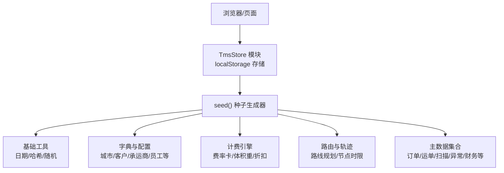
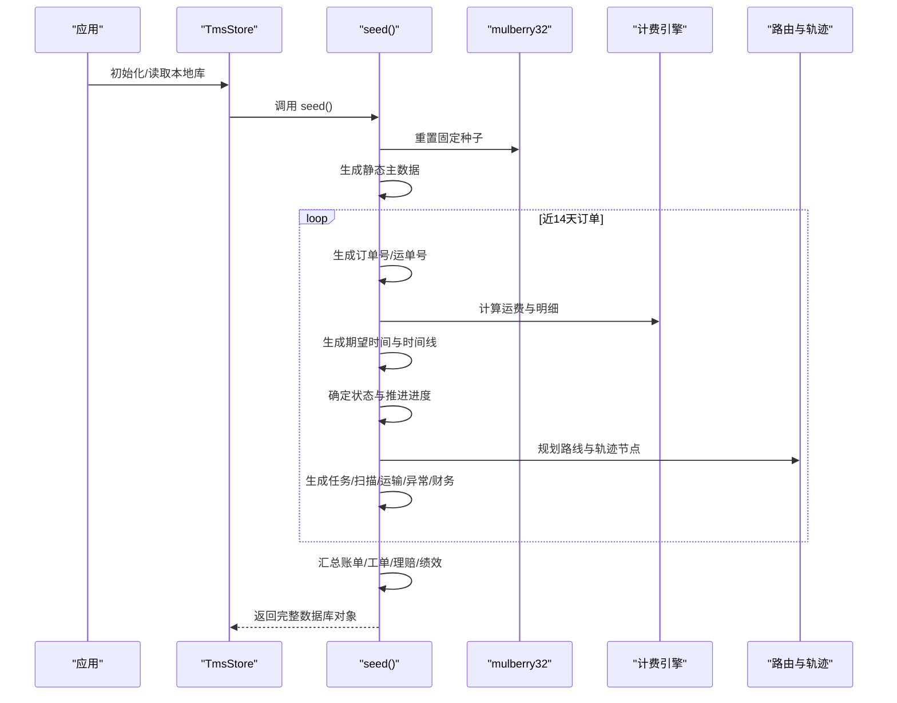
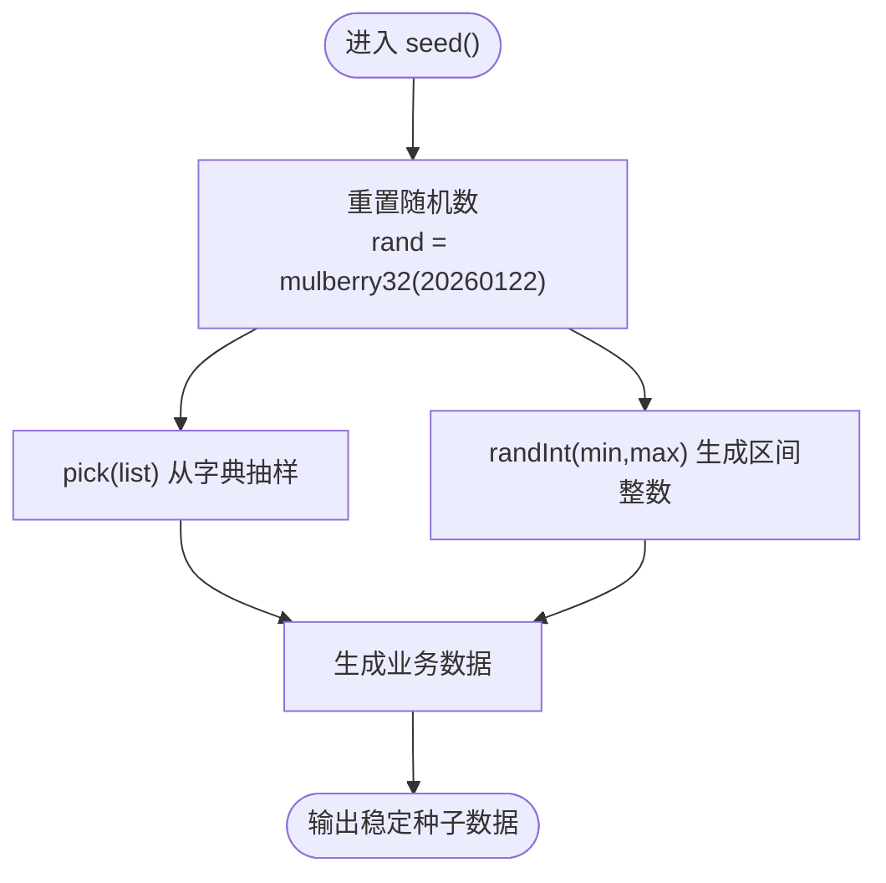
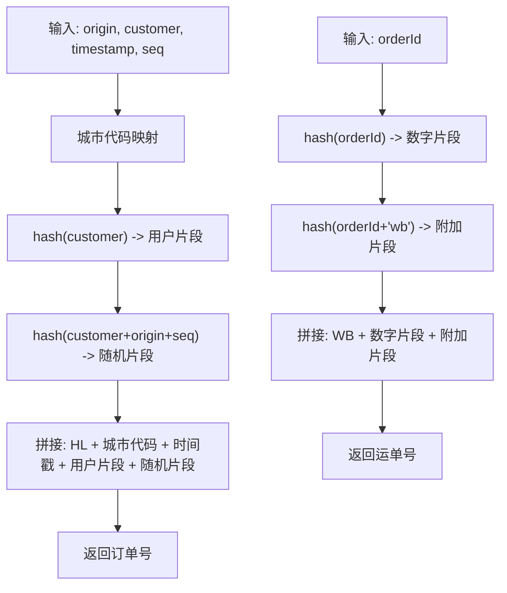
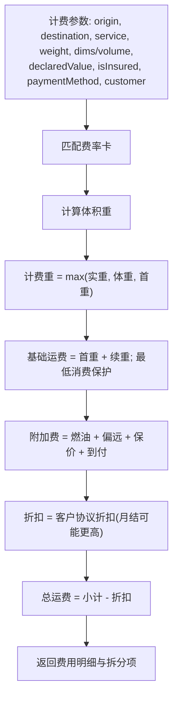
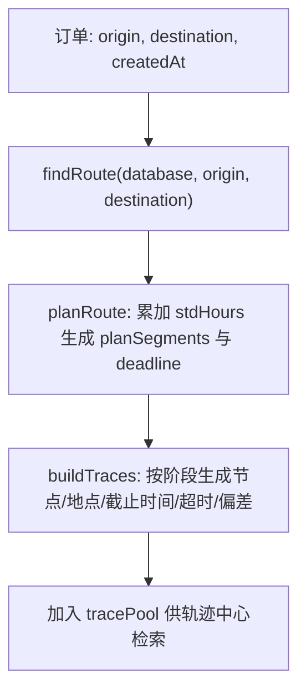
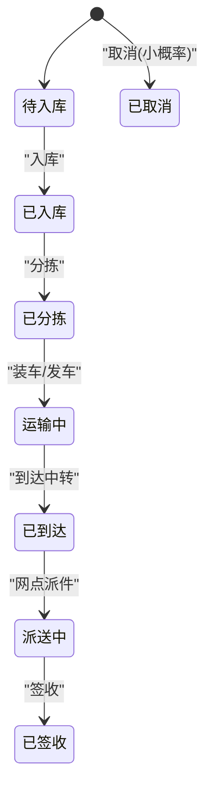
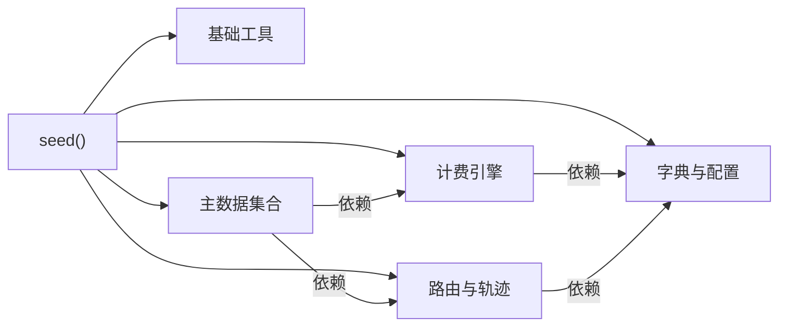

# 种子数据生成

<cite>
**本文引用的文件**   
- [tms-store.js](file://tms-store.js)
</cite>

## 目录
1. [引言](#引言)
2. [项目结构](#项目结构)
3. [核心组件](#核心组件)
4. [架构总览](#架构总览)
5. [详细组件分析](#详细组件分析)
6. [依赖关系分析](#依赖关系分析)
7. [性能与可维护性](#性能与可维护性)
8. [故障排查指南](#故障排查指南)
9. [结论](#结论)
10. [附录：扩展与校验方案](#附录扩展与校验方案)

## 引言
本技术文档聚焦 TMS（运输管理系统）前端演示数据的“种子数据生成”机制，重点解析 seed() 函数的实现逻辑、随机数算法与业务数据构造规则。目标是帮助开发者理解如何稳定地生成真实感数据，包括订单号、运单号、用户信息、时间序列轨迹、异常与财务等关联数据，并给出可扩展的自定义种子方法与数据质量校验思路。

## 项目结构
TMS 的种子数据生成逻辑集中在共享数据层模块中，该模块同时承担：
- 基于 localStorage 的轻量数据存储
- 首次访问时自动生成种子数据
- 提供统一的增删改查、事件通知与统计聚合能力

图表来源
- [tms-store.js:16-17](file://tms-store.js#L16-L17)
- [tms-store.js:464-1154](file://tms-store.js#L464-L1154)

章节来源
- [tms-store.js:1-12](file://tms-store.js#L1-L12)
- [tms-store.js:16-17](file://tms-store.js#L16-L17)

## 核心组件
- 伪随机数生成器 mulberry32：固定种子，保证同一浏览器内演示数据稳定可重现
- 基础工具函数：日期格式化、哈希、金额四舍五入、时间偏移等
- 字典与配置：城市、客户、商品、承运商、员工、部门、权限、角色、区域、服务等级、付款方式等
- 计费引擎：根据线路、服务等级、重量/体积、保价、到付、客户协议折扣计算运费明细
- 路由与轨迹：构建多段路线计划，按阶段生成轨迹节点、地点、截止时间及超时/偏差标记
- 种子数据生成器 seed()：组装全量业务实体，形成完整演示数据集

章节来源
- [tms-store.js:44-54](file://tms-store.js#L44-L54)
- [tms-store.js:21-77](file://tms-store.js#L21-L77)
- [tms-store.js:81-192](file://tms-store.js#L81-L192)
- [tms-store.js:263-383](file://tms-store.js#L263-L383)
- [tms-store.js:385-460](file://tms-store.js#L385-L460)
- [tms-store.js:464-1154](file://tms-store.js#L464-L1154)

## 架构总览
seed() 是种子数据生成的入口，内部依次完成以下关键步骤：
1. 重置随机数生成器，确保每次种子生成结果一致
2. 初始化各业务表数组与全局轨迹池
3. 生成静态主数据（员工、车辆、仓库、库存、运力、围栏、策略、路由规则、地址、时效规则、考核指标等）
4. 循环生成近 14 天的订单，并为每个订单：
   - 生成订单号与运单号
   - 调用计费引擎计算运费与费用明细
   - 生成期望签收时间与时间线
   - 根据日期与概率决定订单状态与推进进度
   - 生成分拣任务、装卸任务、扫描记录、运输任务、应付账款
   - 以一定概率生成异常记录，并联动扣款与应付
   - 根据结算方式生成应收与财务流水
5. 汇总生成月度账单，回写应收的账单编号
6. 生成工单、理赔、行政记录、绩效评估与排名
7. 生成系统用户与扫描设备
8. 返回包含版本、元数据与各业务表的完整数据库对象

图表来源
- [tms-store.js:44-54](file://tms-store.js#L44-L54)
- [tms-store.js:464-1154](file://tms-store.js#L464-L1154)
- [tms-store.js:263-383](file://tms-store.js#L263-L383)
- [tms-store.js:385-460](file://tms-store.js#L385-L460)

## 详细组件分析

### 伪随机数生成器与稳定性
- 使用 mulberry32(seed) 生成伪随机数，固定种子为 20260122
- 通过 rand = mulberry32(20260122) 在模块加载时初始化，并在 seed() 中再次重置，确保每次种子生成过程完全可重现
- 提供 pick(list)、randInt(min, max) 等便捷方法，用于从字典中抽样与区间整数生成

图表来源
- [tms-store.js:44-54](file://tms-store.js#L44-L54)
- [tms-store.js:56-62](file://tms-store.js#L56-L62)
- [tms-store.js:464-465](file://tms-store.js#L464-L465)

章节来源
- [tms-store.js:44-54](file://tms-store.js#L44-L54)
- [tms-store.js:56-62](file://tms-store.js#L56-L62)
- [tms-store.js:464-465](file://tms-store.js#L464-L465)

### 订单号与运单号生成规则
- 订单号 buildOrderId(origin, customer, timestamp, seq)：
  - 将起运城市映射为两字母代码
  - 使用 hash(customer) 生成用户片段
  - 结合 timestamp 与 hash(customer + origin + seq) 生成随机片段
  - 前缀 HL + 城市代码 + 时间戳 + 用户片段 + 随机片段
- 运单号 buildWaybill(orderId)：
  - 对 orderId 进行哈希，取固定长度数字片段
  - 追加二次哈希片段，形成唯一且稳定的运单号

图表来源
- [tms-store.js:252-261](file://tms-store.js#L252-L261)

章节来源
- [tms-store.js:252-261](file://tms-store.js#L252-L261)

### 计费引擎与费用分布
- 费率卡 buildRateCards：
  - 定义全国兵底与主要干线组合
  - 针对标准/加急/经济/冷链四种服务等级设置首重、续重、抛比、燃油率、最低消费、偏远附加费、保价与到付费率
- 匹配规则 pickRateCard：
  - 精确线路+服务 > 精确线路+标准 > 全国+服务 > 全国+标准
- 计费 calcFreight：
  - 体积重优先尺寸(LxWxH)，否则用体积(m3)
  - 计费重 = max(实际重量, 体积重, 首重)
  - 基础运费 = 首重费 + 续重费；若低于最低消费则取最低消费
  - 附加费 = 燃油费 + 偏远附加费 + 保价费 + 到付手续费
  - 折扣 = 客户协议折扣（月结大客户额外提升）
  - 最终运费 = 小计 - 折扣

图表来源
- [tms-store.js:278-325](file://tms-store.js#L278-L325)
- [tms-store.js:327-383](file://tms-store.js#L327-L383)

章节来源
- [tms-store.js:278-325](file://tms-store.js#L278-L325)
- [tms-store.js:327-383](file://tms-store.js#L327-L383)

### 路由与轨迹生成
- 路线构建 buildRoutes：
  - 定义多条干线（陆运/空运），区分全国兵底与具体城市对
  - 每段路线含起止点、模式、标准时长，累计得到总标准小时
- 路线查找 findRoute：
  - 优先精确起终点匹配，其次全国兜底
- 计划 planRoute：
  - 根据订单创建时间累加每段标准小时，生成计划分段与截止时间
- 轨迹 buildTraces：
  - 按订单阶段索引生成轨迹节点（揽收、入库、分拣、发车、到达、派送、签收）
  - 为每个节点分配地点、截止时间，并以概率标记超时与偏差

图表来源
- [tms-store.js:387-440](file://tms-store.js#L387-L440)
- [tms-store.js:442-460](file://tms-store.js#L442-L460)

章节来源
- [tms-store.js:387-440](file://tms-store.js#L387-L440)
- [tms-store.js:442-460](file://tms-store.js#L442-L460)

### 订单生命周期与时间序列
- 订单状态 ORDER_FLOW：待入库→已入库→已分拣→运输中→已到达→派送中→已签收
- 时间推进 progression：
  - 以 createdAt 为起点，按阶段小时增量（如 2h、8h、14h、30h、32h、36h）加上随机扰动生成各阶段时间
- 时间线 timeline：
  - 初始为“订单创建”，随后按状态推进写入仓内作业或运输调度操作
- 期望签收 expectedAt：
  - 在创建时间基础上增加 1-3 天，固定于当日 18:00
- 取消件 cancelled：
  - 较早日期的小概率取消，不生成后续轨迹与任务

图表来源
- [tms-store.js:88-96](file://tms-store.js#L88-L96)
- [tms-store.js:709-738](file://tms-store.js#L709-L738)
- [tms-store.js:719-726](file://tms-store.js#L719-L726)

章节来源
- [tms-store.js:88-96](file://tms-store.js#L88-L96)
- [tms-store.js:709-738](file://tms-store.js#L709-L738)
- [tms-store.js:719-726](file://tms-store.js#L719-L726)

### 业务数据生成规则
- 员工 employees：
  - 从 NAMES 列表选取，分配部门、岗位、邮箱、电话、入职日期、薪资
- 车辆 vehicles：
  - 车牌前缀、型号、司机、所属网点、载重、里程、最后更新时间
- 仓库与库存 warehouses/inventory：
  - 仓库名称、城市、面积、利用率、今日进出库量
  - 物料名称、规格、仓位、安全库存、状态
- 运力 capacities：
  - 自有/外协车辆、临时仓、航空仓位，剩余可用量与有效期
- 电子围栏 geofences：
  - 经纬度、半径、类型、状态、创建时间
- 策略 policies / 路由规则 routingRules / 时效规则 timingRules：
  - 覆盖大客户优先、夜间揽收激励、异常升级、冷链保障、偏远加价、退货逆向、高峰期预警、签收率考核等
- 地址 addresses：
  - 城市+区县+街道，审核状态与负责人
- 改单记录 changeRecords：
  - 订单修改原因与内容、操作人、操作时间
- 考核指标 evalMetrics：
  - 签收率、准时率、异常处理时效、满意度、扫描完整率、投诉率

章节来源
- [tms-store.js:483-591](file://tms-store.js#L483-L591)
- [tms-store.js:593-678](file://tms-store.js#L593-L678)
- [tms-store.js:632-667](file://tms-store.js#L632-L667)
- [tms-store.js:669-678](file://tms-store.js#L669-L678)

### 订单主数据与关联数据
- 订单 orders：
  - 字段涵盖客户、联系人、电话、商品、重量、件数、服务等级、尺寸/体积、保价、付款方式、账期、运费与明细、起终点、收发地址、状态、时间线、SLA 截止等
- 分拣任务 sortingTasks：
  - 关联订单与运单，计划时间、状态、是否漏扫、完成时间
- 装卸任务 loadingTasks：
  - 装车/卸车、地点、车辆、工人、吨位、设备、状态
- 扫描记录 scans：
  - 入库/分拣/出库/到达/派送/签收扫描，设备与操作员
- 运输任务 transports：
  - 承运商、车辆、司机、发车/到达时间、ETA、进度百分比
- 应付 payables：
  - 向承运商结算干线运费（约收入的 60%），异常扣款也生成应付
- 异常 exceptions：
  - 类型、描述、发生时间、处理状态、责任人、SLA、升级标志、解决方案、根因、扣款金额、流程
- 应收 receivables：
  - 月结挂账，逾期或部分回款状态，到期日
- 财务 finances：
  - 收入与支出流水，分类与备注
- 账单 bills：
  - 按月结客户+账期聚合，总金额、已收金额、状态、到期日

章节来源
- [tms-store.js:680-950](file://tms-store.js#L680-L950)
- [tms-store.js:953-988](file://tms-store.js#L953-L988)

### 工单、理赔、行政与绩效
- 服务工单 tickets：
  - 类型（查询/改派/投诉/催件/理赔咨询）、优先级、内容、状态、处理人、时间
- 理赔 claims：
  - 类型（破损/丢失/延误/拒退）、金额、原因、状态、申请人、时间
- 行政记录 adminRecords：
  - 采购/报销/会议/资产/用车，金额、状态、时间
- 绩效 evaluations/performance：
  - 评分、等级、签名率、准时率、满意度、排名

章节来源
- [tms-store.js:990-1076](file://tms-store.js#L990-L1076)

### 用户与设备
- 用户 users：
  - 管理员、运营经理、客服、仓储、司机、财务、人事等角色
- 设备 devices：
  - PDA 扫描枪型号、位置、在线状态、心跳时间、当日扫描量

章节来源
- [tms-store.js:1078-1102](file://tms-store.js#L1078-L1102)

## 依赖关系分析
- seed() 依赖的基础工具与字典：
  - pad/dateKey/dateTimeKey/hash/money/nowIso/at
  - CITY_PROVINCE/CITIES/ORDER_FLOW/STATUS_LABELS/CUSTOMERS/GOODS/CARRIERS/NAMES/DEPARTMENTS/PERMISSIONS/ROLES/AREAS/REMOTE_CITIES/SERVICE_LEVELS/PAYMENT_METHODS/CUSTOMER_LEVELS/TRACE_NODES
- seed() 调用的子模块：
  - buildRateCards/pickRateCard/calcFreight
  - buildRoutes/findRoute/planRoute/buildTraces
- 数据产出：
  - orders/transports/sortingTasks/loadingTasks/scans/traces/exceptions/finances/receivables/payables/bills/tickets/claims/adminRecords/evaluations/performance/users/devices

图表来源
- [tms-store.js:21-77](file://tms-store.js#L21-L77)
- [tms-store.js:81-192](file://tms-store.js#L81-L192)
- [tms-store.js:263-383](file://tms-store.js#L263-L383)
- [tms-store.js:385-460](file://tms-store.js#L385-L460)
- [tms-store.js:464-1154](file://tms-store.js#L464-L1154)

章节来源
- [tms-store.js:21-77](file://tms-store.js#L21-L77)
- [tms-store.js:81-192](file://tms-store.js#L81-L192)
- [tms-store.js:263-383](file://tms-store.js#L263-L383)
- [tms-store.js:385-460](file://tms-store.js#L385-L460)
- [tms-store.js:464-1154](file://tms-store.js#L464-L1154)

## 性能与可维护性
- 随机数稳定性：
  - 固定种子确保演示数据在同一浏览器内稳定，便于复现问题与对比优化效果
- 数据规模控制：
  - 近 14 天订单数量适中，避免一次性生成过多数据导致 UI 卡顿
- 计算复杂度：
  - 计费引擎与路线匹配为线性查找，数据量较小情况下开销可控
- 可维护性建议：
  - 将字典与配置抽离为独立配置文件，便于扩展城市、客户与服务等级
  - 将 seed() 拆分为多个子生成器（如 generateOrders、generateFinances），提高可读性与测试覆盖率

[本节为通用指导，不直接分析具体文件]

## 故障排查指南
- 数据不一致或不可重现：
  - 检查 mulberry32 的初始种子是否被意外修改
  - 确认 seed() 是否在每次生成前重置随机数
- 订单号重复或格式异常：
  - 检查 buildOrderId 的哈希与拼接逻辑
  - 确认传入的 origin/customer/timestamp/seq 参数正确
- 运费计算异常：
  - 检查费率卡是否存在对应线路与服务等级
  - 核对尺寸/体积单位与抛比配置
- 轨迹缺失或时间顺序错误：
  - 检查 progression 的阶段小时增量与随机扰动
  - 确认 planRoute 与 buildTraces 的参数传递

章节来源
- [tms-store.js:44-54](file://tms-store.js#L44-L54)
- [tms-store.js:252-261](file://tms-store.js#L252-L261)
- [tms-store.js:278-383](file://tms-store.js#L278-L383)
- [tms-store.js:426-460](file://tms-store.js#L426-L460)

## 结论
TMS 的种子数据生成通过 mulberry32 固定种子与完善的业务规则，实现了稳定、真实感强的演示数据。seed() 函数整合了订单、运单、任务、扫描、异常、财务、账单、工单、理赔、行政、绩效、用户与设备等全量数据，并通过计费引擎与路由轨迹模块保证数据的合理性与一致性。该设计既满足演示需求，也为后续扩展与测试提供了良好基础。

[本节为总结性内容，不直接分析具体文件]

## 附录：扩展与校验方案

### 自定义种子数据扩展方法
- 新增城市与客户：
  - 在 CITY_PROVINCE/CUSTOMERS/CUSTOMER_LEVELS 中添加新条目，确保折扣与账期符合业务策略
- 新增服务等级与支付方式：
  - 在 SERVICE_LEVELS/PAYMENT_METHODS 中扩展，并在 buildRateCards 中补充对应费率配置
- 新增轨迹节点：
  - 在 TRACE_NODES 中增加节点与标准时限，并在 STAGE_NODE 中映射阶段索引
- 自定义订单生成策略：
  - 调整 day 范围、count 分布、statusIndex 概率、cancelled 概率等，以模拟不同业务场景

章节来源
- [tms-store.js:81-192](file://tms-store.js#L81-L192)
- [tms-store.js:278-325](file://tms-store.js#L278-L325)
- [tms-store.js:194-213](file://tms-store.js#L194-L213)
- [tms-store.js:680-738](file://tms-store.js#L680-L738)

### 数据质量验证与校验机制
- 唯一性校验：
  - 订单号与运单号应唯一；可通过哈希与序列号保证
- 时间一致性校验：
  - 订单时间线应按状态推进，progression 中的各阶段时间应递增
- 计费合理性校验：
  - 计费重不应小于首重；最低消费保护生效时应记录 minimumApplied
  - 折扣率应在合理范围内，月结大客户应有额外折扣
- 异常与财务联动校验：
  - 异常扣款应生成对应的应付记录；异常 SLA 截止时间应晚于发生时间
- 账单聚合校验：
  - 月度账单总金额应等于应收行金额之和；账单状态应与回款情况一致

章节来源
- [tms-store.js:252-261](file://tms-store.js#L252-L261)
- [tms-store.js:709-738](file://tms-store.js#L709-L738)
- [tms-store.js:327-383](file://tms-store.js#L327-L383)
- [tms-store.js:875-917](file://tms-store.js#L875-L917)
- [tms-store.js:963-988](file://tms-store.js#L963-L988)