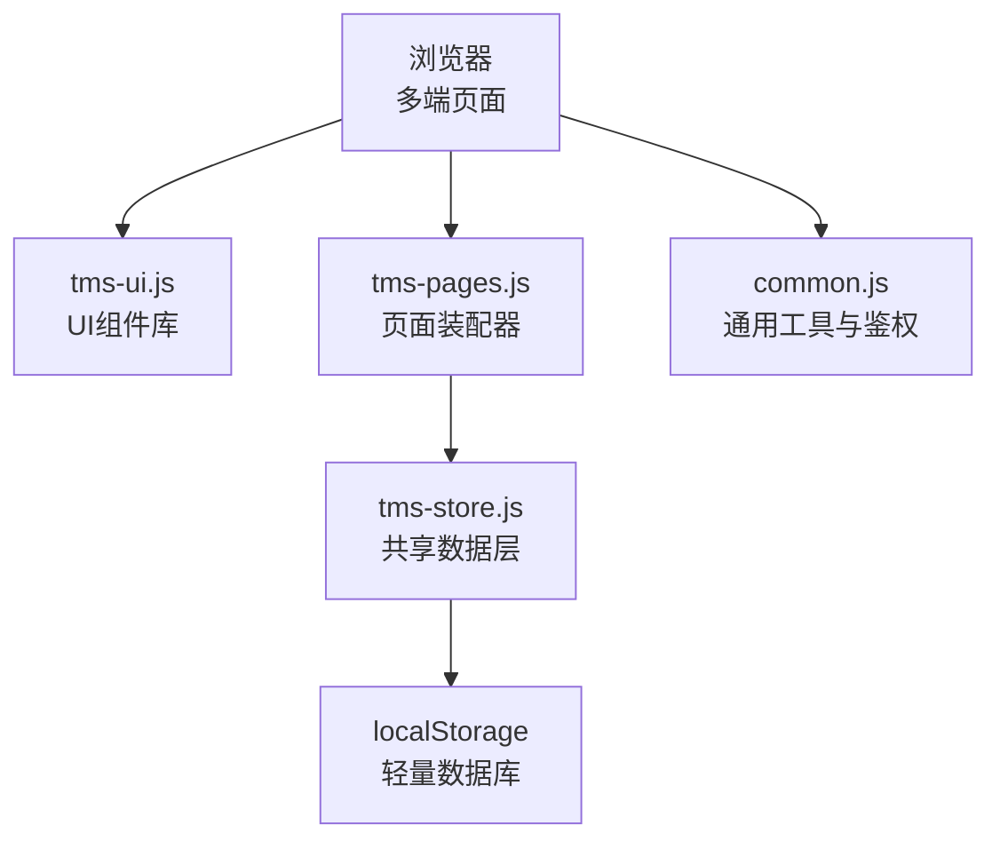
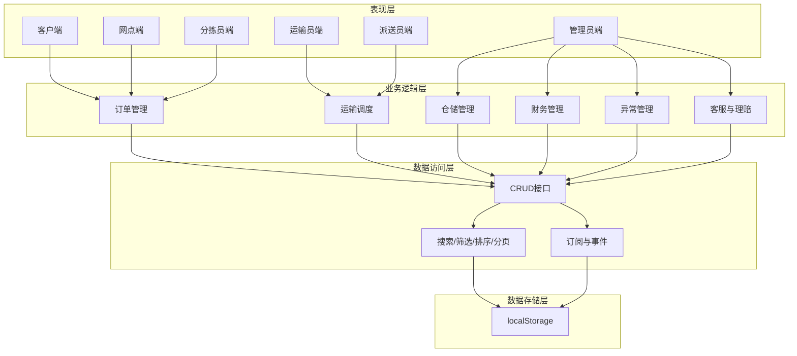
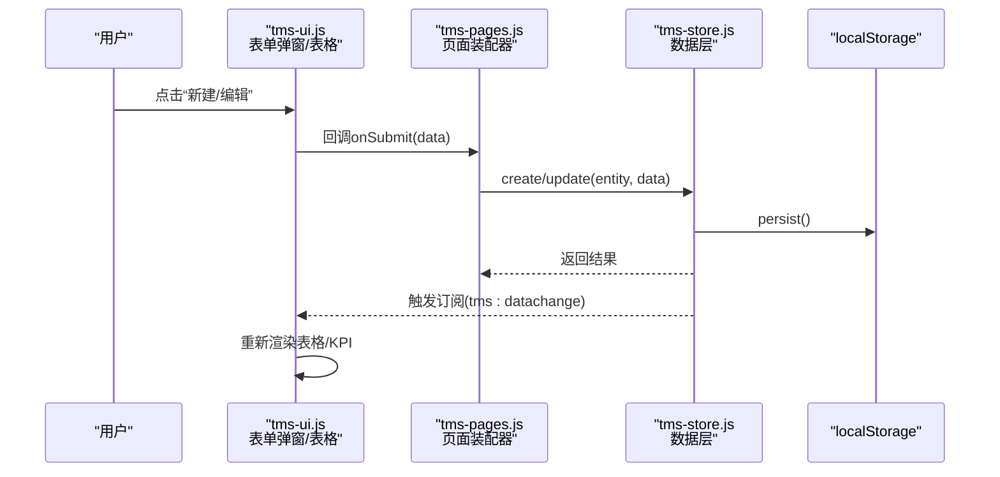
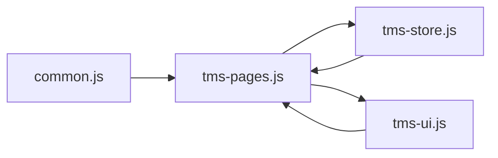
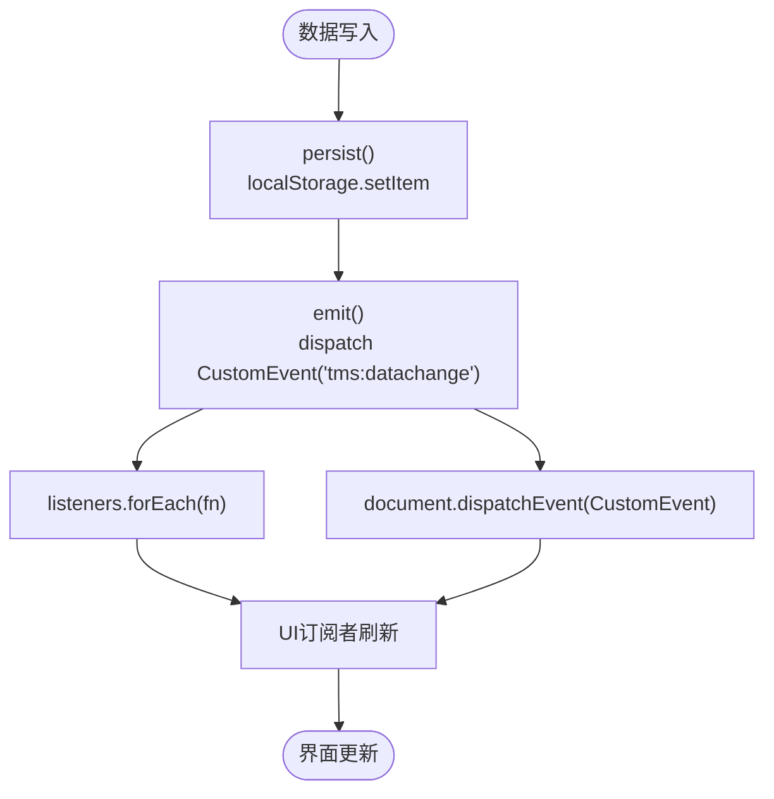
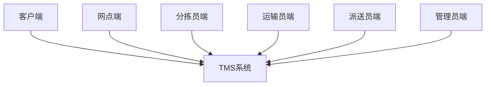
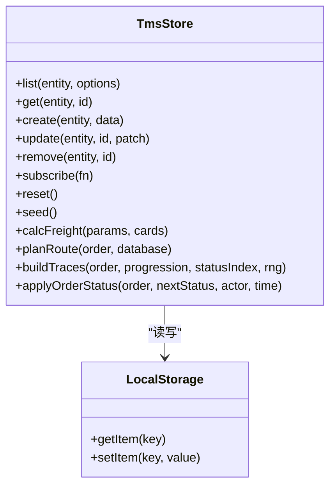
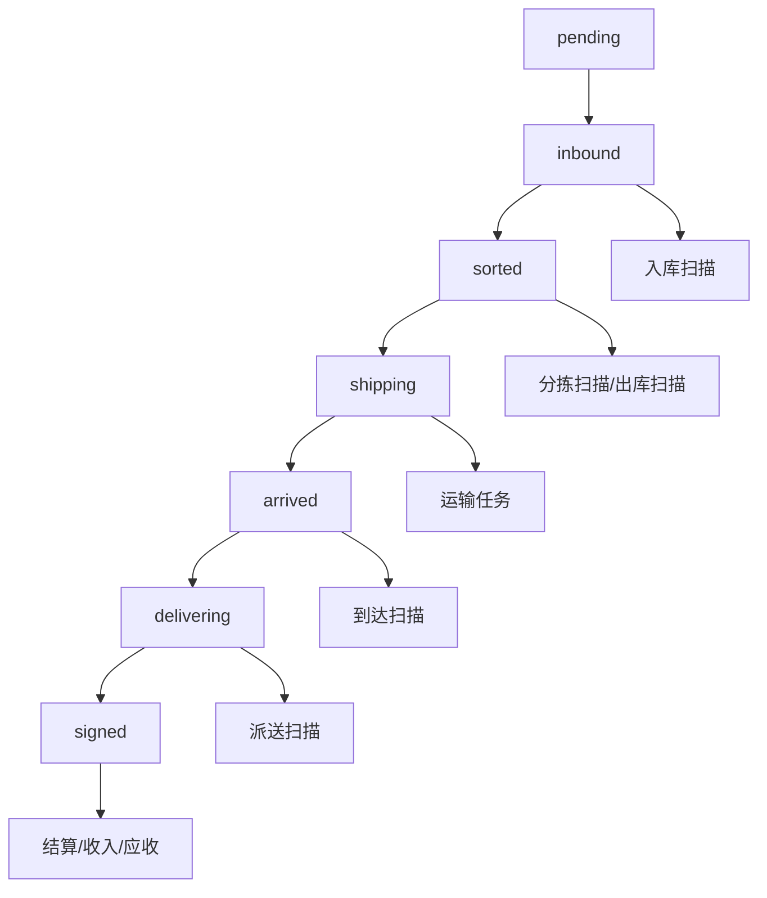
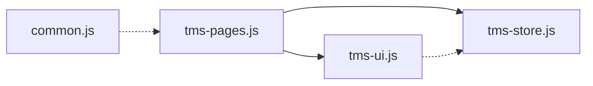
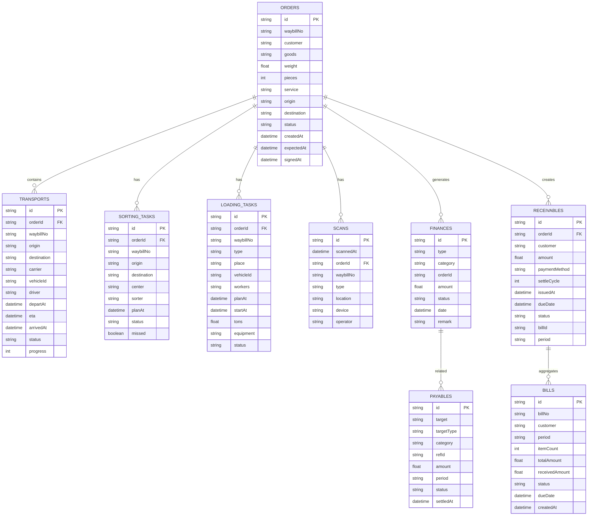

# 架构概览

<cite>
**本文引用的文件**   
- [tms-architecture.html](file://tms-architecture.html)
- [common.js](file://common.js)
- [tms-ui.js](file://tms-ui.js)
- [tms-store.js](file://tms-store.js)
- [tms-pages.js](file://tms-pages.js)
</cite>

## 目录
1. [引言](#引言)
2. [项目结构](#项目结构)
3. [核心组件](#核心组件)
4. [架构总览](#架构总览)
5. [详细组件分析](#详细组件分析)
6. [依赖关系分析](#依赖关系分析)
7. [性能与可扩展性](#性能与可扩展性)
8. [故障排查指南](#故障排查指南)
9. [结论](#结论)
10. [附录：技术栈与数据模型](#附录技术栈与数据模型)

## 引言
本架构概览面向TMS运输管理系统，聚焦整体设计理念、技术选型与架构模式。系统采用前端多端页面（客户端、网点端、分拣员端、运输员端、派送员端、管理员端）+ 轻量级本地数据层的设计，通过事件驱动实现跨模块的数据变更通知与视图自动刷新。MVC模式在系统中体现为：Model由共享数据层提供，View由UI组件库与页面装配器负责，Controller由业务逻辑与页面交互处理构成。数据存储基于localStorage的轻量数据库，具备种子数据生成、CRUD、搜索筛选排序分页、订单全生命周期流转与关联记录联动等能力。

## 项目结构
仓库以“按角色/功能划分的HTML页面 + 共享JS/CSS”组织，关键文件职责如下：
- tms-architecture.html：系统架构介绍与网络架构图展示页
- common.js：通用工具函数、登录鉴权、用户信息与积分等基础能力
- tms-ui.js：共享UI组件库（Toast、Modal、表单弹窗、表格、KPI、图表等）
- tms-store.js：共享数据层（localStorage数据库、CRUD、订阅事件、计费引擎、路由轨迹、种子数据）
- tms-pages.js：管理员端各业务页面的统一装配（KPI + 图表 + 表格 + CRUD）

**图示来源**
- [tms-ui.js:301-542](file://tms-ui.js#L301-L542)
- [tms-store.js:1-12](file://tms-store.js#L1-L12)
- [tms-pages.js:1-12](file://tms-pages.js#L1-L12)
- [common.js:135-218](file://common.js#L135-L218)

**章节来源**
- [tms-architecture.html:638-715](file://tms-architecture.html#L638-L715)
- [tms-ui.js:1-12](file://tms-ui.js#L1-L12)
- [tms-store.js:1-12](file://tms-store.js#L1-L12)
- [tms-pages.js:1-12](file://tms-pages.js#L1-L12)
- [common.js:1-12](file://common.js#L1-L12)

## 核心组件
- 共享数据层（Model）：tms-store.js
  - 提供localStorage持久化、版本控制、种子数据初始化
  - 统一的list/get/create/update/remove接口
  - 订阅机制subscribe与CustomEvent事件广播
  - 订单状态机与关联记录联动（扫描、运输、财务、异常等）
  - 计费引擎、路由规划、轨迹节点、统计聚合
- UI组件库（View）：tms-ui.js
  - Toast提示、Modal对话框、表单弹窗
  - 通用表格（搜索/筛选/排序/分页）、KPI卡片、SVG图表
  - 页面外壳initShell、页面头部pageHeader、空态emptyState
- 页面装配器（Controller）：tms-pages.js
  - 将业务页面统一装配为“KPI + 图表 + 可筛选分页表格 + CRUD”
  - 调用TmsStore进行数据操作，调用TmsUI渲染界面
- 通用工具（Common）：common.js
  - 登录/登出、角色跳转、当前用户显示、用户信息/积分管理

**章节来源**
- [tms-store.js:1-12](file://tms-store.js#L1-L12)
- [tms-ui.js:1-12](file://tms-ui.js#L1-L12)
- [tms-pages.js:1-12](file://tms-pages.js#L1-L12)
- [common.js:135-218](file://common.js#L135-L218)

## 架构总览
系统采用分层架构与模块化设计：
- 表现层：多端HTML页面（客户端、网点端、分拣员端、运输员端、派送员端、管理员端）
- 业务逻辑层：页面装配器与各业务模块（订单、运输、仓储、财务、异常、客服、理赔等）
- 数据访问层：共享数据层封装CRUD、搜索筛选、订阅事件
- 数据存储层：localStorage轻量数据库

**图示来源**
- [tms-architecture.html:665-715](file://tms-architecture.html#L665-L715)
- [tms-store.js:1208-1311](file://tms-store.js#L1208-L1311)
- [tms-ui.js:301-542](file://tms-ui.js#L301-L542)
- [tms-pages.js:87-114](file://tms-pages.js#L87-L114)

## 详细组件分析

### MVC模式在系统中的体现
- Model（数据层）
  - 由tms-store.js提供，封装localStorage读写、版本控制、种子数据、CRUD、订阅事件、订单状态机、计费引擎、路由与轨迹、统计聚合等
  - 对外暴露window.TmsStore，供页面装配器与UI组件使用
- View（视图层）
  - 由tms-ui.js提供，包含Toast、Modal、表单弹窗、通用表格、KPI、SVG图表等
  - 页面外壳initShell负责导航高亮、退出登录绑定、当前用户显示、异常待办角标等
- Controller（业务逻辑层）
  - 由tms-pages.js承担，定义各业务页面配置（标题、副标题、KPI、图表、表格列、工具栏、动作），并调用TmsStore与TmsUI完成数据操作与界面渲染
  - 常见流程：用户点击按钮 → 打开表单弹窗 → 提交数据 → 调用S.create/update → 触发事件 → 表格/KPI刷新

**图示来源**
- [tms-ui.js:163-285](file://tms-ui.js#L163-L285)
- [tms-pages.js:150-166](file://tms-pages.js#L150-L166)
- [tms-store.js:1263-1294](file://tms-store.js#L1263-L1294)
- [tms-store.js:232-244](file://tms-store.js#L232-L244)

**章节来源**
- [tms-ui.js:701-744](file://tms-ui.js#L701-L744)
- [tms-pages.js:87-114](file://tms-pages.js#L87-L114)
- [tms-store.js:1208-1311](file://tms-store.js#L1208-L1311)

### 模块化架构与依赖关系
- 模块划分
  - 数据层模块：tms-store.js（数据模型、业务规则、事件总线）
  - UI模块：tms-ui.js（通用组件、图表、表格）
  - 页面装配模块：tms-pages.js（业务页面配置与编排）
  - 通用模块：common.js（鉴权、用户信息、积分）
- 依赖方向
  - tms-pages.js依赖tms-store.js与tms-ui.js
  - tms-ui.js依赖全局TmsStore（可选）用于表格订阅刷新
  - common.js独立于其他模块，提供基础能力

**图示来源**
- [tms-pages.js:1-12](file://tms-pages.js#L1-L12)
- [tms-ui.js:301-542](file://tms-ui.js#L301-L542)
- [tms-store.js:1208-1311](file://tms-store.js#L1208-L1311)

**章节来源**
- [tms-pages.js:1-12](file://tms-pages.js#L1-L12)
- [tms-ui.js:1-12](file://tms-ui.js#L1-L12)
- [tms-store.js:1-12](file://tms-store.js#L1-L12)
- [common.js:135-218](file://common.js#L135-L218)

### 事件驱动架构与CustomEvent
- 数据变更事件
  - tms-store.js在persist中派发CustomEvent('tms:datachange')，同时维护listeners数组并通过subscribe注册监听器
  - tms-ui.js的table组件在entity模式下订阅TmsStore变更，自动刷新列表与分页
  - 多个页面通过TmsStore.subscribe订阅数据变化，实现KPI与图表实时更新
- 数据变更通知机制
  - 所有写操作(create/update/remove)最终调用persist，确保事件广播一致
  - 订阅者可在回调中执行局部刷新或全局重绘

**图示来源**
- [tms-store.js:232-244](file://tms-store.js#L232-L244)
- [tms-store.js:1306-1311](file://tms-store.js#L1306-L1311)
- [tms-ui.js:523-535](file://tms-ui.js#L523-L535)

**章节来源**
- [tms-store.js:232-244](file://tms-store.js#L232-L244)
- [tms-ui.js:523-535](file://tms-ui.js#L523-L535)

### 系统上下文图（多端关系）
- 客户端：下单、跟踪、积分、个人信息
- 网点端：入库、出库、库存、网点服务
- 分拣员端：扫描、分拣任务、绩效
- 运输员端：发车、路线、装卸、绩效
- 派送员端：打卡、任务、异常、联系人
- 管理员端：订单、运输、仓储、车辆、运力、物资、客服、理赔、财务、行政、考核、人事、扫描、时效

**图示来源**
- [tms-architecture.html:665-715](file://tms-architecture.html#L665-L715)
- [common.js:163-174](file://common.js#L163-L174)

**章节来源**
- [tms-architecture.html:665-715](file://tms-architecture.html#L665-L715)
- [common.js:163-174](file://common.js#L163-L174)

### 数据存储策略（localStorage轻量数据库）
- 存储键与版本
  - DB_KEY='tmsDB_v3'，DB_VERSION=3，readDb/persist保证版本兼容与持久化
- 数据结构
  - orders/transports/sortingTasks/loadingTasks/scans/traces/exceptions/finances/receivables/payables/bills/serviceTickets/claims等实体集合
  - meta.counters用于ID生成与计数
- 初始数据
  - seed()生成真实感种子数据，包括员工、车辆、仓库、库存、运力、电子围栏、策略、路由、订单、扫描、异常、财务等
- CRUD与查询
  - list/get/create/update/remove支持filters/search/sort/page/pageSize
- 业务规则
  - 订单状态机applyOrderStatus联动扫描、运输、财务、异常等
  - 计费引擎calcFreight计算运费明细
  - 路由planRoute与轨迹buildTraces生成计划与节点

**图示来源**
- [tms-store.js:16-17](file://tms-store.js#L16-L17)
- [tms-store.js:220-244](file://tms-store.js#L220-L244)
- [tms-store.js:464-1152](file://tms-store.js#L464-L1152)
- [tms-store.js:1208-1311](file://tms-store.js#L1208-L1311)
- [tms-store.js:332-383](file://tms-store.js#L332-L383)
- [tms-store.js:427-460](file://tms-store.js#L427-L460)
- [tms-store.js:1494-1556](file://tms-store.js#L1494-L1556)

**章节来源**
- [tms-store.js:16-17](file://tms-store.js#L16-L17)
- [tms-store.js:220-244](file://tms-store.js#L220-L244)
- [tms-store.js:464-1152](file://tms-store.js#L464-L1152)
- [tms-store.js:1208-1311](file://tms-store.js#L1208-L1311)
- [tms-store.js:332-383](file://tms-store.js#L332-L383)
- [tms-store.js:427-460](file://tms-store.js#L427-L460)
- [tms-store.js:1494-1556](file://tms-store.js#L1494-L1556)

### 订单状态机与关联记录联动
- 状态流转
  - pending→inbound→sorted→shipping→arrived→delivering→signed
  - applyOrderStatus根据nextStatus写入timeline、traces、scans、transports、vehicles、finances等
- 关联记录
  - 入库：创建分拣任务、标记分拣进行中
  - 分拣完成：创建装卸任务、标记装车完成
  - 运输：创建运输任务、更新车辆状态
  - 到达/派送：更新运输任务状态
  - 签收：完成运输任务、结算应收/收入、恢复车辆在线

**图示来源**
- [tms-store.js:88-96](file://tms-store.js#L88-L96)
- [tms-store.js:1494-1556](file://tms-store.js#L1494-L1556)

**章节来源**
- [tms-store.js:88-96](file://tms-store.js#L88-L96)
- [tms-store.js:1494-1556](file://tms-store.js#L1494-L1556)

## 依赖关系分析
- 模块耦合
  - tms-pages.js对tms-store.js与tms-ui.js存在强依赖（数据与UI）
  - tms-ui.js对TmsStore存在弱依赖（仅在entity模式下订阅刷新）
  - common.js与其他模块解耦，提供通用能力
- 外部依赖
  - localStorage作为唯一持久化介质
  - 无后端API依赖，适合演示与离线场景
- 潜在循环依赖
  - 当前结构无循环依赖；如需扩展建议保持单向依赖（页面→数据/UI，UI→数据可选）

**图示来源**
- [tms-pages.js:1-12](file://tms-pages.js#L1-L12)
- [tms-ui.js:301-542](file://tms-ui.js#L301-L542)
- [tms-store.js:1208-1311](file://tms-store.js#L1208-L1311)

**章节来源**
- [tms-pages.js:1-12](file://tms-pages.js#L1-L12)
- [tms-ui.js:301-542](file://tms-ui.js#L301-L542)
- [tms-store.js:1208-1311](file://tms-store.js#L1208-L1311)
- [common.js:135-218](file://common.js#L135-L218)

## 性能与可扩展性
- 性能特性
  - localStorage读写为同步I/O，适合小规模数据；大数据量时需考虑分页与索引优化
  - 表格组件内置搜索/筛选/排序/分页，减少DOM渲染压力
  - 事件订阅避免轮询，按需刷新
- 可扩展性建议
  - 将TmsStore抽象为可替换的数据适配器（如IndexedDB或后端API）
  - 将TmsUI组件拆分为更细粒度的模块，便于按需加载
  - 引入路由与懒加载，提升首屏性能

[本节为通用指导，不直接分析具体文件]

## 故障排查指南
- 常见问题
  - 登录后未跳转或权限不足：检查common.js中的checkLoginStatus与rolePages映射
  - 表格不刷新：确认TmsStore.subscribe是否注册，以及persist是否正确触发emit
  - 数据丢失：检查localStorage是否被清理或版本不匹配导致readDb返回null
- 定位方法
  - 在console查看日志输出（common.js与tms-store.js包含多处console.log）
  - 使用TmsStore.reset重置数据，验证种子数据是否正常生成
  - 检查CustomEvent('tms:datachange')是否被派发

**章节来源**
- [common.js:176-218](file://common.js#L176-L218)
- [tms-store.js:220-244](file://tms-store.js#L220-L244)
- [tms-store.js:1313-1318](file://tms-store.js#L1313-L1318)

## 结论
TMS系统通过清晰的分层与模块化设计，实现了多端协作与数据一致性。MVC模式在系统中得到充分体现：数据层由tms-store.js统一管理，视图层由tms-ui.js提供丰富组件，控制器由tms-pages.js编排业务页面。事件驱动架构通过CustomEvent与订阅机制，确保数据变更实时反映到界面。基于localStorage的轻量数据库降低了部署复杂度，适合演示与小型应用场景。未来可通过适配器模式扩展数据源，结合路由懒加载与组件拆分进一步提升性能与可维护性。

[本节为总结性内容，不直接分析具体文件]

## 附录：技术栈与数据模型
- 技术栈
  - HTML5/CSS3/JavaScript ES5
  - Chart.js（未在代码中直接使用，但系统内建SVG图表能力）
  - localStorage作为持久化存储
- 数据模型（部分实体）
  - orders：订单主数据
  - transports：运输任务
  - sortingTasks/loadingTasks：分拣/装卸任务
  - scans：扫描记录
  - traces：轨迹汇总
  - exceptions：异常记录
  - finances/receivables/payables/bills：财务与账单
  - employees/vehicles/warehouses/inventory/capacities/geofences：资源与设施
  - serviceTickets/claims：客服与理赔

**图示来源**
- [tms-store.js:1111-1151](file://tms-store.js#L1111-L1151)
- [tms-store.js:1266-1275](file://tms-store.js#L1266-L1275)

**章节来源**
- [tms-store.js:1111-1151](file://tms-store.js#L1111-L1151)
- [tms-store.js:1266-1275](file://tms-store.js#L1266-L1275)