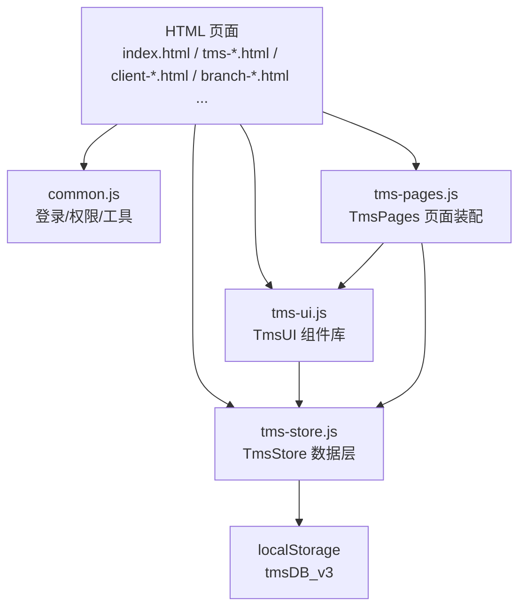
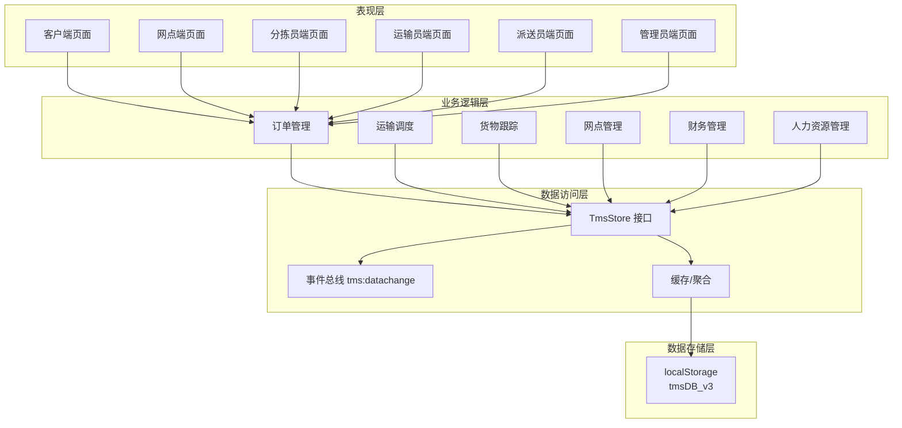
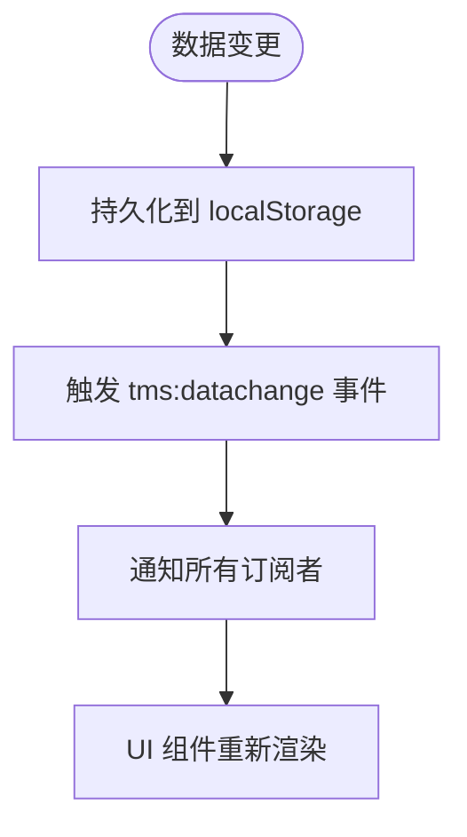
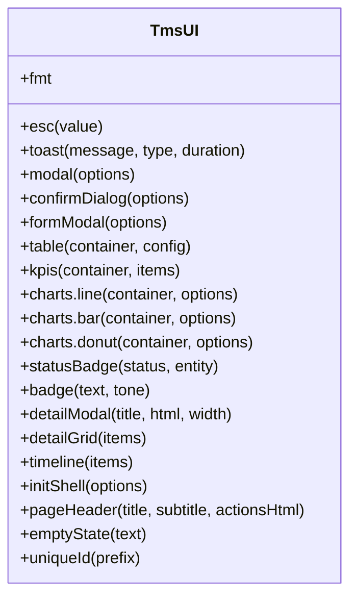
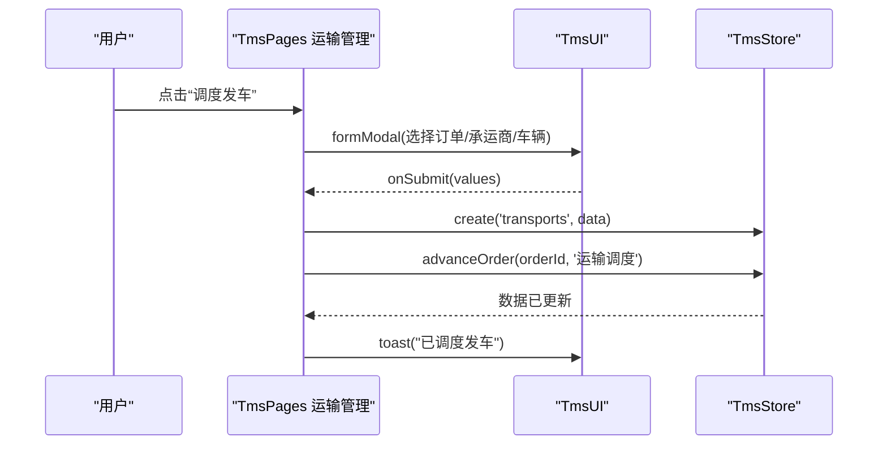
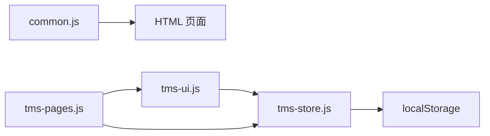

# 系统架构设计

<cite>
**本文引用的文件**   
- [tms-architecture.html](file://tms-architecture.html)
- [tms-store.js](file://tms-store.js)
- [tms-ui.js](file://tms-ui.js)
- [common.js](file://common.js)
- [tms-pages.js](file://tms-pages.js)
</cite>

## 目录
1. [引言](#引言)
2. [项目结构](#项目结构)
3. [核心组件](#核心组件)
4. [架构总览](#架构总览)
5. [详细组件分析](#详细组件分析)
6. [依赖关系分析](#依赖关系分析)
7. [性能与可扩展性](#性能与可扩展性)
8. [横切关注点：安全、监控与灾难恢复](#横切关注点安全监控与灾难恢复)
9. [技术栈与兼容性](#技术栈与兼容性)
10. [故障排查指南](#故障排查指南)
11. [结论](#结论)

## 引言
本仓库是一个面向物流与运输管理的单页应用集合，覆盖客户端、网点端、分拣员端、运输员端、派送员端与管理端。其前端采用“数据层 + UI 组件层 + 页面装配层”的三层组织方式，并通过浏览器本地存储作为演示数据源。整体强调 MVC 风格、模块化、事件驱动和数据驱动，便于在纯前端环境下快速构建可交互的管理后台。

## 项目结构
仓库以 HTML 页面为主，配合少量 JS/CSS 实现多角色界面；关键运行时逻辑集中在以下文件：
- tms-store.js：共享数据层（TmsStore），基于 localStorage 提供统一的数据访问、状态流转与事件通知。
- tms-ui.js：共享 UI 组件库（TmsUI），提供表格、表单弹窗、图表、Toast、状态徽章等通用能力。
- tms-pages.js：管理员端页面装配器（TmsPages），将业务页面统一装配为 KPI + 图表 + 表格 + CRUD 的结构。
- common.js：通用工具与登录/权限辅助函数，暴露全局方法供各页面使用。
- tms-architecture.html：系统架构介绍文档，包含业务流程图、分层架构图与网络拓扑示意。

**图示来源**
- [tms-store.js:1-12](file://tms-store.js#L1-L12)
- [tms-ui.js:1-6](file://tms-ui.js#L1-L6)
- [tms-pages.js:1-12](file://tms-pages.js#L1-L12)
- [common.js:1-10](file://common.js#L1-L10)

**章节来源**
- [tms-architecture.html:638-715](file://tms-architecture.html#L638-L715)
- [tms-store.js:1-12](file://tms-store.js#L1-L12)
- [tms-ui.js:1-6](file://tms-ui.js#L1-L6)
- [tms-pages.js:1-12](file://tms-pages.js#L1-L12)
- [common.js:1-10](file://common.js#L1-L10)

## 核心组件
- TmsStore（数据层）
  - 职责：维护订单、运单、运输、异常、扫描、财务、工单、理赔、员工、车辆、仓库、库存、运力、围栏、设备、策略、路由、时效规则、改单记录、考核指标等实体；提供增删改查、搜索、筛选、排序、分页；维护订单全生命周期状态流转；触发 tms:datachange 事件。
  - 特点：种子数据生成、确定性随机、字典映射、ID 生成策略、持久化到 localStorage。
- TmsUI（UI 组件层）
  - 职责：提供列表、搜索/筛选/分页、表单弹窗、确认框、Toast、SVG 图表、详情展示、页面外壳初始化等。
  - 特点：组件以 tms- 前缀命名避免样式冲突；支持异步提交、错误提示、键盘关闭弹窗、无障碍属性。
- TmsPages（页面装配层）
  - 职责：定义各管理页面的标题、副标题、KPI、图表、表格列、工具栏、操作按钮；统一渲染并订阅数据变化刷新。
  - 特点：声明式配置驱动页面；通过 TmsStore.list/get/create/update 完成数据操作；通过 TmsUI 渲染交互。
- CommonJS 工具层（common.js）
  - 职责：字符串 hash、订单号/运单号生成、按钮样式注入、登录/登出、角色跳转、用户信息展示、积分管理等。
  - 特点：暴露全局函数，供各页面直接调用。

**章节来源**
- [tms-store.js:1-12](file://tms-store.js#L1-L12)
- [tms-ui.js:1-6](file://tms-ui.js#L1-L6)
- [tms-pages.js:1-12](file://tms-pages.js#L1-L12)
- [common.js:1-10](file://common.js#L1-L10)

## 架构总览
系统采用前后端分离的前端视角：浏览器加载 HTML 后，由 common.js 处理基础登录与权限校验，再由 tms-ui.js 提供 UI 能力，tms-store.js 提供数据能力，tms-pages.js 组装业务页面。数据最终落盘于 localStorage，适合演示与轻量场景。

**图示来源**
- [tms-architecture.html:665-715](file://tms-architecture.html#L665-L715)
- [tms-store.js:1-12](file://tms-store.js#L1-L12)
- [tms-store.js:237-244](file://tms-store.js#L237-L244)

**章节来源**
- [tms-architecture.html:638-715](file://tms-architecture.html#L638-L715)

## 详细组件分析

### TmsStore 数据层
- 数据结构与复杂度
  - 实体对象包括 orders、transports、exceptions、finances、tickets、claims、employees、vehicles、warehouses、inventory、capacities、geofences、devices、policies、routingRules、deliveryAddresses、timingRules、changeRecords、evaluations、performance、users、roles、permissions、departments、areas 等。
  - 常用操作：list(entity, options) 返回 rows/total/page；get(entity, id)；create(entity, data)；update(entity, id, data)；advanceOrder(id, actor)；以及各类统计聚合如 warehouseStats、vehicleStats。
  - 时间复杂度：过滤/排序/分页通常在内存中执行，O(n) 或 O(n log n)，适用于演示规模数据。
- 依赖链
  - 依赖 localStorage 进行持久化；依赖日期/时间工具生成 ID 和轨迹时间线；依赖字典映射（城市、状态标签、轨迹节点等）。
- 优化机会
  - 对大数据集引入索引或分片；对高频查询字段建立二级索引；对复杂筛选使用 Web Worker 计算；对持久化做增量写入。
- 错误处理
  - 读取失败时返回空；emit 监听器捕获异常；ID 生成具备确定性以避免重复。

**图示来源**
- [tms-store.js:232-244](file://tms-store.js#L232-L244)

**章节来源**
- [tms-store.js:1-12](file://tms-store.js#L1-L12)
- [tms-store.js:215-244](file://tms-store.js#L215-L244)
- [tms-store.js:263-800](file://tms-store.js#L263-L800)

### TmsUI 组件层
- 组件能力
  - 格式化：日期、时间、金额、数字、百分比。
  - 交互：Toast、Modal、Confirm、FormModal（含校验、异步提交、错误提示）。
  - 列表：Table（搜索、筛选、排序、分页、工具栏、行操作、点击行回调）。
  - 图表：折线图、柱状图、环形图（SVG 绘制）。
  - 详情：DetailModal、DetailGrid、Timeline。
  - 页面外壳：initShell（导航高亮、子菜单、退出登录、当前用户显示、异常角标）。
- 协作关系
  - 通过 global.TmsStore 获取数据；通过 global.TmsUI 渲染；通过 statusBadge 根据实体类型映射状态标签。
- 性能考虑
  - 表格渲染采用局部更新；搜索输入防抖；图表按需渲染；弹窗销毁时移除事件监听。

**图示来源**
- [tms-ui.js:12-82](file://tms-ui.js#L12-L82)
- [tms-ui.js:84-156](file://tms-ui.js#L84-L156)
- [tms-ui.js:158-285](file://tms-ui.js#L158-L285)
- [tms-ui.js:287-542](file://tms-ui.js#L287-L542)
- [tms-ui.js:544-678](file://tms-ui.js#L544-L678)
- [tms-ui.js:680-779](file://tms-ui.js#L680-L779)

**章节来源**
- [tms-ui.js:1-781](file://tms-ui.js#L1-L781)

### TmsPages 页面装配层
- 页面定义
  - 异常管理、运输管理、仓储管理、车辆管理、运力管理、物资管理、客服管理等页面均以 define(id, config) 注册。
  - 每个页面包含 title、subtitle、kpis、charts、table（entity、columns、filters、toolbar、actions）、extraBefore/extraAfter。
- 数据流
  - 通过 TmsStore.list/get/create/update 获取/修改数据；通过 TmsUI 渲染表格、弹窗、图表；通过 S.subscribe 订阅数据变化刷新 KPI 与表格。
- 典型流程：调度发车
  - 选择待发运订单与承运商/车辆 → 创建运输任务 → 推进订单状态至“运输中” → Toast 提示成功。

**图示来源**
- [tms-pages.js:268-297](file://tms-pages.js#L268-L297)
- [tms-pages.js:87-114](file://tms-pages.js#L87-L114)

**章节来源**
- [tms-pages.js:1-114](file://tms-pages.js#L1-L114)
- [tms-pages.js:229-336](file://tms-pages.js#L229-L336)

### CommonJS 工具层
- 功能要点
  - 字符串 hash、订单号/运单号生成、按钮样式注入。
  - 登录/登出、角色跳转、用户信息展示、积分余额与历史记录。
- 集成点
  - 被各页面直接调用；与 TmsUI.initShell 中的 displayCurrentUser 协同显示用户名。

**章节来源**
- [common.js:1-50](file://common.js#L1-L50)
- [common.js:52-133](file://common.js#L52-L133)
- [common.js:135-209](file://common.js#L135-L209)
- [common.js:211-383](file://common.js#L211-L383)

## 依赖关系分析
- 模块耦合
  - TmsPages 强依赖 TmsStore 与 TmsUI；TmsUI 弱依赖 TmsStore（用于状态标签与数据源）；CommonJS 工具独立，被页面直接引用。
- 外部依赖
  - 浏览器 API：localStorage、document、CustomEvent、Date、Math。
  - 无第三方库，全部原生实现。
- 循环依赖
  - 未发现循环导入；TmsStore 不依赖 UI，TmsUI 不依赖 Pages，TmsPages 依赖两者。

**图示来源**
- [tms-store.js:232-234](file://tms-store.js#L232-L234)
- [tms-ui.js:70-74](file://tms-ui.js#L70-L74)
- [tms-pages.js:10-12](file://tms-pages.js#L10-L12)

**章节来源**
- [tms-store.js:232-244](file://tms-store.js#L232-L244)
- [tms-ui.js:70-74](file://tms-ui.js#L70-L74)
- [tms-pages.js:10-12](file://tms-pages.js#L10-L12)

## 性能与可扩展性
- 性能特征
  - 数据量级较小，内存计算开销可控；表格渲染与图表 SVG 绘制在常规设备上流畅。
  - 搜索输入防抖减少重绘；弹窗销毁清理事件监听避免内存泄漏。
- 可扩展性
  - 新增页面：在 tms-pages.js 中 define 新页面，配置 KPI、图表、表格与操作即可。
  - 新增实体：在 TmsStore 中扩展 seed 数据与 list/get/create/update 逻辑，并在 TmsUI.statusBadge 增加状态映射。
  - 横向扩展：可将 TmsStore 后端化，替换 localStorage 为 REST/GraphQL API，保持事件驱动不变。
- 部署拓扑
  - 当前为静态资源部署（Nginx/Apache 或 CDN）；若后端化，建议网关 + 服务集群 + 注册中心 + 数据库/缓存的分布式架构。

[本节为通用指导，无需具体文件分析]

## 横切关注点：安全、监控与灾难恢复
- 安全性
  - 前端鉴权：common.js 提供 checkLoginStatus 与角色跳转；TmsUI.initShell 绑定退出登录。
  - XSS 防护：TmsUI.esc 对所有输出进行转义；表单输入校验与错误提示。
  - 建议：在后端化后引入 JWT/OAuth、CSRF 防护、CSP、HTTPS。
- 监控
  - 当前未内置埋点；可在 TmsStore.emit 处上报数据变更事件，或在 TmsUI.toast/modal 处收集用户行为日志。
- 灾难恢复
  - 数据备份：定期导出 localStorage 数据；提供导入/迁移脚本。
  - 版本兼容：TmsStore 使用 DB_VERSION 控制数据格式演进；升级时需处理旧版本迁移。

**章节来源**
- [common.js:176-199](file://common.js#L176-L199)
- [tms-ui.js:12-19](file://tms-ui.js#L12-L19)
- [tms-store.js:16-17](file://tms-store.js#L16-L17)
- [tms-store.js:220-234](file://tms-store.js#L220-L234)

## 技术栈与兼容性
- 技术栈
  - 前端：原生 JavaScript、HTML、CSS（无框架、无第三方库）。
  - 存储：localStorage。
  - 图表：内嵌 SVG。
- 兼容性
  - 现代浏览器（Chrome/Firefox/Safari/Edge）；需要支持 CustomEvent、Promise、ES6 语法。
- 第三方依赖
  - 无；全部自实现。

**章节来源**
- [tms-ui.js:1-6](file://tms-ui.js#L1-L6)
- [tms-store.js:1-12](file://tms-store.js#L1-L12)

## 故障排查指南
- 常见问题
  - 数据为空：检查 localStorage 是否被清除或版本不匹配；查看 TmsStore.readDb 返回值。
  - 页面不刷新：确认 TmsStore.subscribe 是否正确注册；检查 emit 是否触发。
  - 弹窗不关闭：检查 modal 事件绑定与 ESC 键处理；确认 overlay.remove 是否执行。
  - 登录无效：检查 common.js 的 login/checkLoginStatus/logou 流程与 localStorage 键名。
- 定位步骤
  - 打开浏览器控制台，查看 console.error 与自定义日志。
  - 在 TmsStore.emit 与 TmsUI.table.render 处添加断点，观察数据流与渲染过程。
  - 验证 TmsPages.define 配置是否正确（entity、columns、filters、toolbar、actions）。

**章节来源**
- [tms-store.js:220-244](file://tms-store.js#L220-L244)
- [tms-ui.js:107-156](file://tms-ui.js#L107-L156)
- [tms-ui.js:452-519](file://tms-ui.js#L452-L519)
- [common.js:135-209](file://common.js#L135-L209)

## 结论
该 TMS 系统在前端实现了清晰的分层与职责分离：TmsStore 负责数据与状态、TmsUI 负责交互与可视化、TmsPages 负责业务页面装配、common.js 提供通用工具。系统采用事件驱动与数据驱动模式，具备良好的可维护性与可扩展性。未来可通过后端化、微服务化与分布式部署进一步提升性能与可靠性，同时加强安全与监控能力。