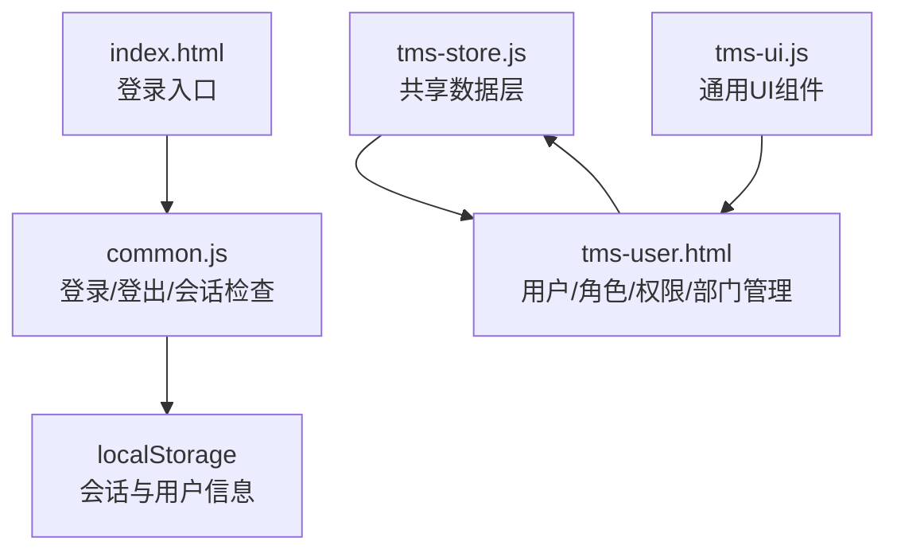
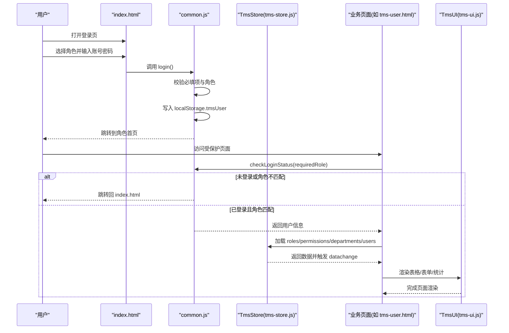
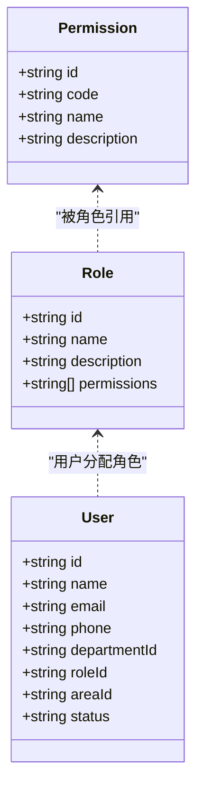
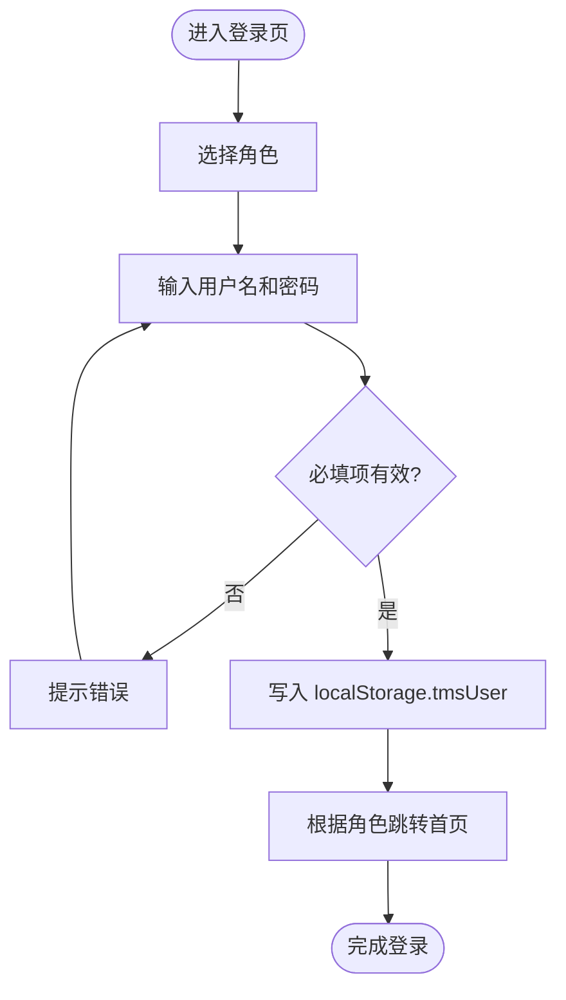
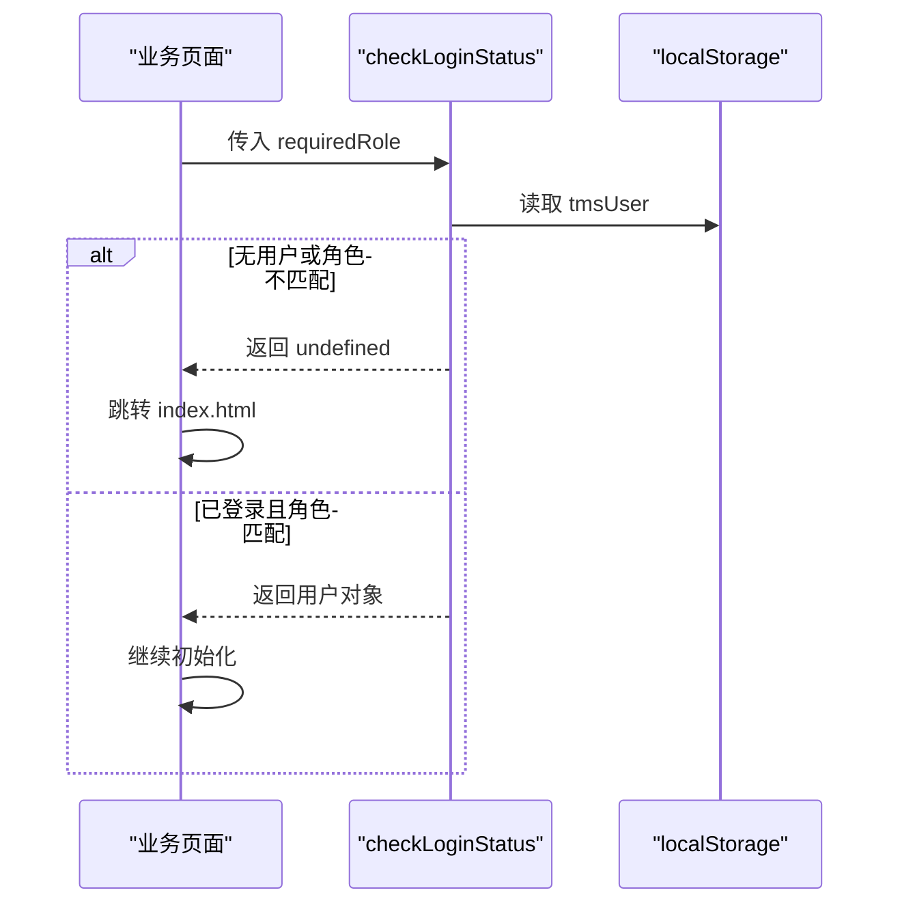
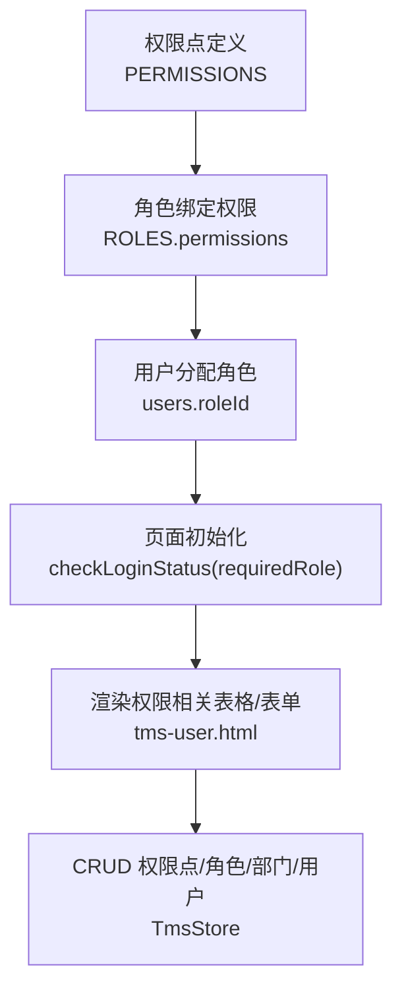
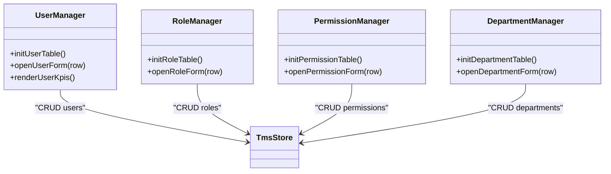
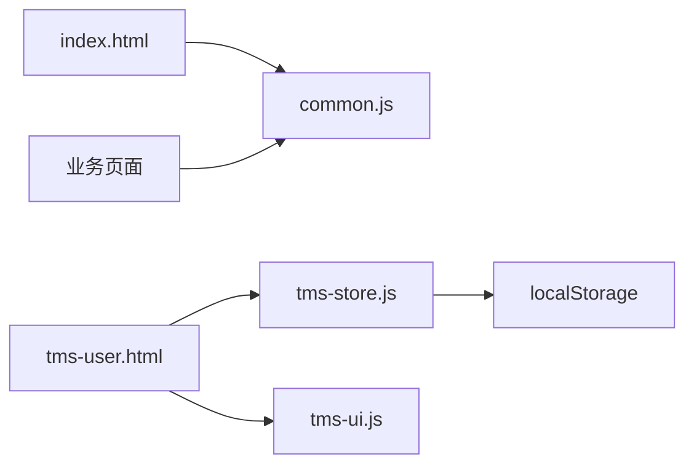

# 认证与权限系统

<cite>
**本文引用的文件**   
- [index.html](file://index.html)
- [common.js](file://common.js)
- [tms-store.js](file://tms-store.js)
- [tms-user.html](file://tms-user.html)
- [tms-ui.js](file://tms-ui.js)
</cite>

## 目录
1. [引言](#引言)
2. [项目结构](#项目结构)
3. [核心组件](#核心组件)
4. [架构总览](#架构总览)
5. [详细组件分析](#详细组件分析)
6. [依赖关系分析](#依赖关系分析)
7. [性能与安全考量](#性能与安全考量)
8. [故障排查指南](#故障排查指南)
9. [结论](#结论)
10. [附录：权限配置最佳实践与常见问题](#附录权限配置最佳实践与常见问题)

## 引言
本设计文档聚焦 TMS 系统的认证与权限管理，围绕多角色权限模型、用户认证流程、页面访问控制、功能权限控制、用户信息管理以及安全策略展开。当前实现以浏览器端为主，使用 localStorage 保存会话与演示数据，并通过共享数据层 TmsStore 维护角色、权限、部门等基础主数据；登录入口在 index.html，通用认证逻辑在 common.js，权限与角色定义在 tms-store.js，管理员端的用户/角色/权限/部门管理界面在 tms-user.html，通用 UI 能力由 tms-ui.js 提供。

## 项目结构
从认证与权限视角，关键文件职责如下：
- index.html：登录页，提供角色选择与登录按钮。
- common.js：统一的用户登录、登出、会话检查、当前用户展示、个人信息与积分工具函数。
- tms-store.js：共享数据层，内置权限点、角色、部门字典及增删改查能力，供各页面共享。
- tms-user.html：管理员端“用户与权限管理”页面，基于 TmsUI 和 TmsStore 维护用户、角色、权限、部门。
- tms-ui.js：通用 UI 组件库（弹窗、表格、图表、Shell 外壳等），被管理页面复用。

**图示来源**
- [index.html:117-172](file://index.html#L117-L172)
- [common.js:135-218](file://common.js#L135-L218)
- [tms-store.js:144-164](file://tms-store.js#L144-L164)
- [tms-user.html:518-533](file://tms-user.html#L518-L533)
- [tms-ui.js:756-779](file://tms-ui.js#L756-L779)

**章节来源**
- [index.html:117-172](file://index.html#L117-L172)
- [common.js:135-218](file://common.js#L135-L218)
- [tms-store.js:144-164](file://tms-store.js#L144-L164)
- [tms-user.html:518-533](file://tms-user.html#L518-L533)
- [tms-ui.js:756-779](file://tms-ui.js#L756-L779)

## 核心组件
- 登录与会话组件（common.js）
  - login：读取用户名、密码与选中角色，写入 localStorage.tmsUser，并跳转到对应角色首页。
  - checkLoginStatus(requiredRole)：校验是否已登录且角色匹配，否则跳转登录页。
  - logout：清空会话并跳转登录页。
  - getCurrentUser/displayCurrentUser：获取当前用户并在页面显示用户名。
- 共享数据层（tms-store.js）
  - 内置 PERMISSIONS、ROLES、DEPARTMENTS 等字典数据。
  - 提供 create/update/remove/list/get 等通用 CRUD 接口，支持搜索、筛选、排序、分页。
  - 通过事件机制通知订阅者数据变更。
- 管理员权限管理界面（tms-user.html）
  - 使用 TmsUI.table/formModal 维护用户、角色、权限、部门。
  - 通过 TmsStore 读写 roles/permissions/departments/users 实体。
- 通用 UI 组件（tms-ui.js）
  - 提供表单弹窗、确认框、Toast、表格、KPI、图表、Shell 外壳等能力。

**章节来源**
- [common.js:135-218](file://common.js#L135-L218)
- [tms-store.js:144-164](file://tms-store.js#L144-L164)
- [tms-user.html:518-533](file://tms-user.html#L518-L533)
- [tms-ui.js:107-285](file://tms-ui.js#L107-L285)

## 架构总览
下图展示了从登录到页面访问控制的完整流程，以及权限数据如何驱动管理界面的展示与操作。

**图示来源**
- [index.html:145-168](file://index.html#L145-L168)
- [common.js:135-218](file://common.js#L135-L218)
- [tms-store.js:220-244](file://tms-store.js#L220-L244)
- [tms-user.html:518-533](file://tms-user.html#L518-L533)
- [tms-ui.js:756-779](file://tms-ui.js#L756-L779)

## 详细组件分析

### 多角色权限模型
- 角色与权限定义
  - tms-store.js 内置了 PERMISSIONS 列表，包含用户管理、角色管理、权限管理、部门管理、订单管理、围栏管理、车辆管理、仓储管理、财务管理、异常管理等权限点。
  - ROLES 定义了系统管理员、运营管理员、客服专员、仓储管理员、派送员、财务专员等角色，并通过 permissions 字段关联权限 ID 集合。
- 角色与页面的绑定
  - common.js 的 login 将角色映射到不同首页：client→client-index.html，branch→branch-index.html，admin→tms-index.html，sorter→sorter-index.html，transporter→transporter-index.html，deliveryman→deliveryman-index.html。
  - 各业务页面通过 checkLoginStatus(requiredRole) 进行角色校验，未匹配则跳转登录页。

**图示来源**
- [tms-store.js:144-164](file://tms-store.js#L144-L164)
- [tms-user.html:566-638](file://tms-user.html#L566-L638)

**章节来源**
- [tms-store.js:144-164](file://tms-store.js#L144-L164)
- [common.js:135-174](file://common.js#L135-L174)

### 用户认证流程
- 登录流程
  - 用户在 index.html 选择角色并输入用户名、密码。
  - 点击登录后调用 common.js 的 login，校验必填项后写入 localStorage.tmsUser，并根据角色跳转到对应首页。
- 会话检查
  - 业务页面在 DOMContentLoaded 中调用 checkLoginStatus(requiredRole)，若未登录或角色不匹配则跳转登录页。
- 退出登录
  - 调用 logout 删除 localStorage.tmsUser 并跳转登录页。

**图示来源**
- [index.html:145-168](file://index.html#L145-L168)
- [common.js:135-174](file://common.js#L135-L174)

**章节来源**
- [index.html:145-168](file://index.html#L145-L168)
- [common.js:135-218](file://common.js#L135-L218)

### 页面访问控制
- 页面级鉴权
  - 各业务页面在初始化时调用 checkLoginStatus(requiredRole)，例如 branch-index.html 要求 branch 角色，client-index.html 要求 client 角色，tms-user.html 要求 admin 角色。
  - 未通过校验时直接跳转 index.html，避免未授权访问。
- 动态导航与角标
  - tms-ui.js 的 initShell 会高亮当前导航项，并尝试为异常待办添加角标。

**图示来源**
- [common.js:176-199](file://common.js#L176-L199)
- [tms-user.html:524-533](file://tms-user.html#L524-L533)

**章节来源**
- [common.js:176-199](file://common.js#L176-L199)
- [tms-user.html:524-533](file://tms-user.html#L524-L533)

### 功能权限管理系统
- 权限点与角色绑定
  - tms-store.js 中的 PERMISSIONS 定义了细粒度权限点，ROLES 通过 permissions 数组绑定权限 ID。
- 管理界面实现
  - tms-user.html 提供“权限管理”Tab，可新增、编辑、删除权限点，并在“角色管理”中为角色勾选权限。
  - 删除权限时会检查是否被角色引用，防止破坏性变更。
- 前端可见性控制
  - 当前实现主要依靠页面级角色校验；功能级权限可通过扩展 TmsUI 或页面逻辑，依据角色的 permissions 控制按钮与模块显示。

**图示来源**
- [tms-store.js:144-164](file://tms-store.js#L144-L164)
- [tms-user.html:640-766](file://tms-user.html#L640-L766)

**章节来源**
- [tms-store.js:144-164](file://tms-store.js#L144-L164)
- [tms-user.html:640-766](file://tms-user.html#L640-L766)

### 用户信息管理
- 用户资料
  - tms-user.html 的“用户管理”Tab 支持新增、编辑、删除用户，字段包括用户名、邮箱、手机号、部门、角色、区域、状态。
- 角色分配
  - 通过“角色管理”Tab 创建/编辑角色，并为角色勾选权限点。
- 权限配置
  - “权限管理”Tab 维护权限点代码、名称与描述，支持删除前引用检查。
- 部门组织
  - “部门管理”Tab 维护部门树形结构，支持父子关系与用户数统计。

**图示来源**
- [tms-user.html:566-638](file://tms-user.html#L566-L638)
- [tms-user.html:640-766](file://tms-user.html#L640-L766)
- [tms-user.html:768-800](file://tms-user.html#L768-L800)

**章节来源**
- [tms-user.html:566-638](file://tms-user.html#L566-L638)
- [tms-user.html:640-766](file://tms-user.html#L640-L766)
- [tms-user.html:768-800](file://tms-user.html#L768-L800)

### 安全策略
- 密码加密
  - 当前实现未对密码进行哈希或加密处理，属于演示用途的前端本地存储方案。
- 会话安全
  - 会话保存在 localStorage.tmsUser，存在跨标签页共享与持久化风险；建议结合后端服务使用 HttpOnly Cookie 与短期 Token。
- CSRF 防护
  - 当前为纯前端静态页面，不涉及服务端请求；若后续接入后端，应启用 SameSite Cookie、CSRF Token 与同源策略。
- XSS 防护
  - tms-ui.js 提供了 esc 函数用于转义 HTML，减少 XSS 风险；建议在所有动态内容渲染中使用该函数。

**章节来源**
- [tms-ui.js:12-19](file://tms-ui.js#L12-L19)
- [common.js:135-218](file://common.js#L135-L218)

## 依赖关系分析
- 页面依赖
  - index.html 依赖 common.js 提供登录逻辑。
  - 各业务页面依赖 common.js 的 checkLoginStatus 与 displayCurrentUser。
  - tms-user.html 依赖 tms-store.js 与 tms-ui.js 实现权限管理界面。
- 数据依赖
  - tms-store.js 提供 PERMISSIONS、ROLES、DEPARTMENTS 等基础数据，供 tms-user.html 渲染与管理。
- 事件依赖
  - tms-store.js 在数据变更后触发 tms:datachange 事件，页面可订阅以刷新视图。

**图示来源**
- [index.html:145-168](file://index.html#L145-L168)
- [common.js:135-218](file://common.js#L135-L218)
- [tms-user.html:518-533](file://tms-user.html#L518-L533)
- [tms-store.js:220-244](file://tms-store.js#L220-L244)

**章节来源**
- [index.html:145-168](file://index.html#L145-L168)
- [common.js:135-218](file://common.js#L135-L218)
- [tms-user.html:518-533](file://tms-user.html#L518-L533)
- [tms-store.js:220-244](file://tms-store.js#L220-L244)

## 性能与安全考量
- 性能
  - TmsStore 基于 localStorage 的轻量数据库，适合演示与小规模数据；大数据量时应考虑分页与懒加载。
  - 表格与图表渲染使用 TmsUI，避免重复计算，通过订阅数据变更增量更新。
- 安全
  - 当前为前端演示方案，未实现服务端鉴权与密码加密；生产环境需引入后端鉴权、Token 管理、CSRF/XSS 防护。
  - 建议使用最小权限原则，仅授予必要权限点，定期审计角色与权限绑定。

[本节为通用指导，不直接分析具体文件]

## 故障排查指南
- 无法登录
  - 检查 index.html 是否正确引入 common.js，并确保 role-btn 有 data-role 属性。
  - 查看 localStorage 中是否存在 tmsUser，若无则说明登录未成功。
- 页面跳转异常
  - 检查业务页面是否正确调用 checkLoginStatus(requiredRole)，requiredRole 是否与登录角色一致。
- 权限管理界面空白
  - 确认 tms-store.js 已正确初始化 PERMISSIONS、ROLES、DEPARTMENTS。
  - 检查 tms-user.html 是否正确引入 tms-store.js 与 tms-ui.js。
- 删除权限/角色失败
  - 查看是否仍有用户或角色引用该权限/角色，tms-user.html 已做引用检查并提示。

**章节来源**
- [index.html:145-168](file://index.html#L145-L168)
- [common.js:135-218](file://common.js#L135-L218)
- [tms-user.html:640-766](file://tms-user.html#L640-L766)

## 结论
当前 TMS 认证与权限系统以浏览器端为核心，实现了基本的多角色登录、页面访问控制与权限管理界面。通过 common.js 提供统一的认证能力，tms-store.js 提供权限与角色数据，tms-user.html 提供可视化的权限管理界面。未来在生产环境中，建议引入后端鉴权、Token 管理、密码加密与 CSRF/XSS 防护，并将功能权限控制细化到按钮与模块级别，以提升安全性与可维护性。

[本节为总结性内容，不直接分析具体文件]

## 附录：权限配置最佳实践与常见问题
- 最佳实践
  - 使用最小权限原则，为每个角色仅分配必要的权限点。
  - 将权限点按领域划分（如 user:manage、order:manage），便于管理与审计。
  - 在页面初始化时集中进行角色与权限校验，避免分散判断。
  - 对敏感操作增加二次确认与日志记录。
- 常见问题
  - 角色与页面不匹配：确保 checkLoginStatus(requiredRole) 的 requiredRole 与实际登录角色一致。
  - 权限删除失败：先解除角色引用再删除权限点。
  - 用户信息未显示：确保 displayCurrentUser 被调用且 DOM 中存在对应元素。

[本节为通用指导，不直接分析具体文件]