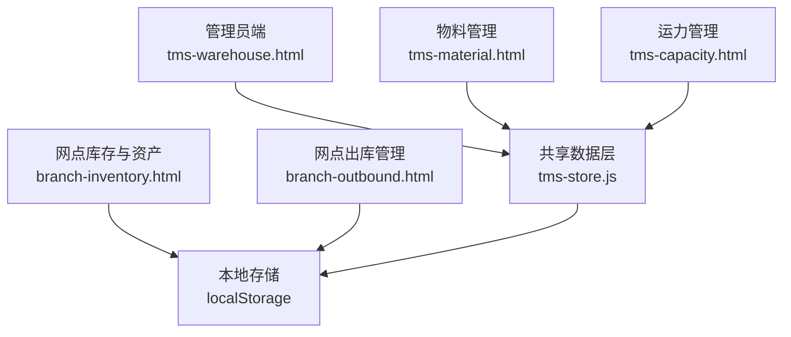
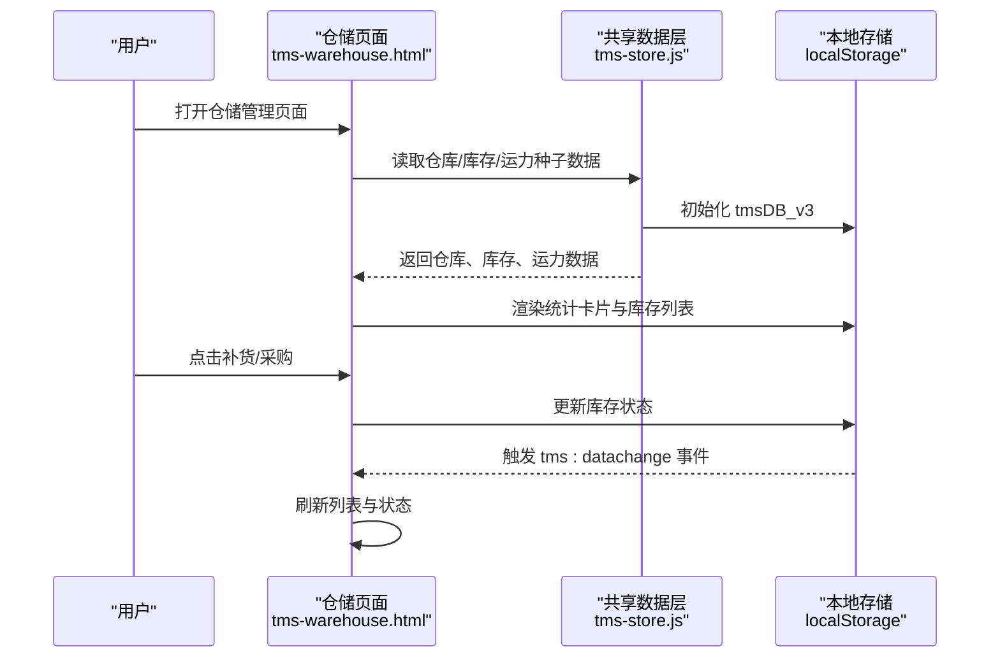
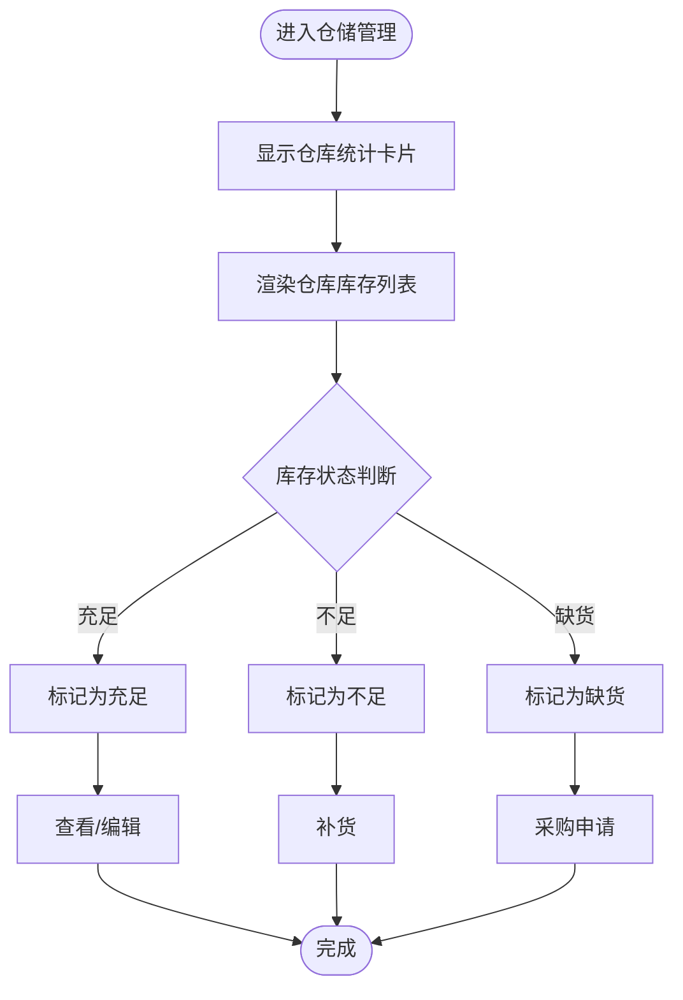
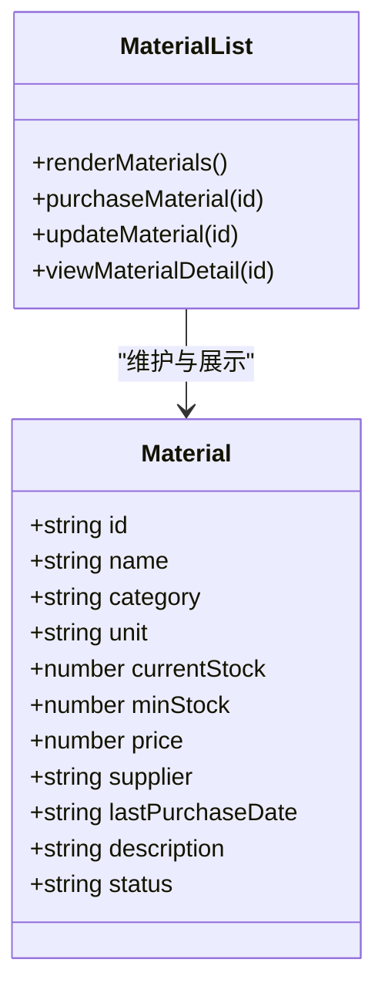
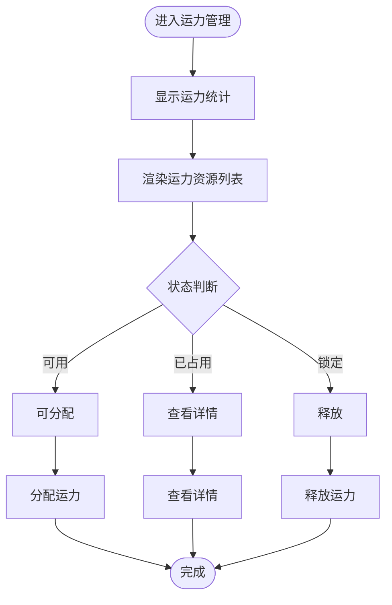
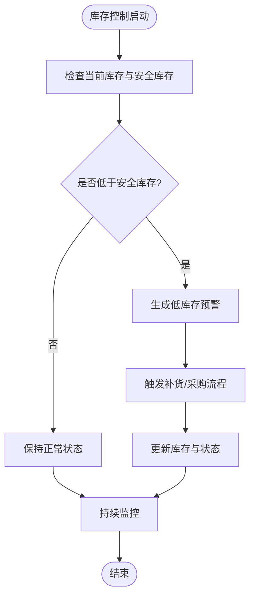
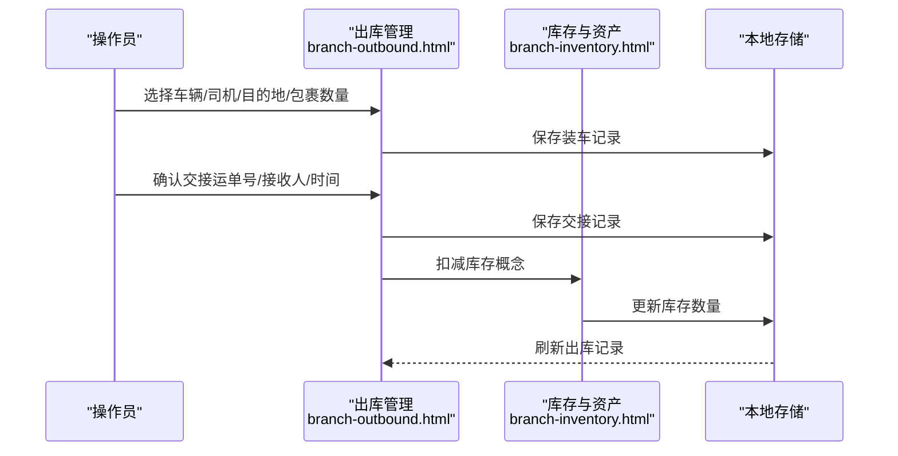
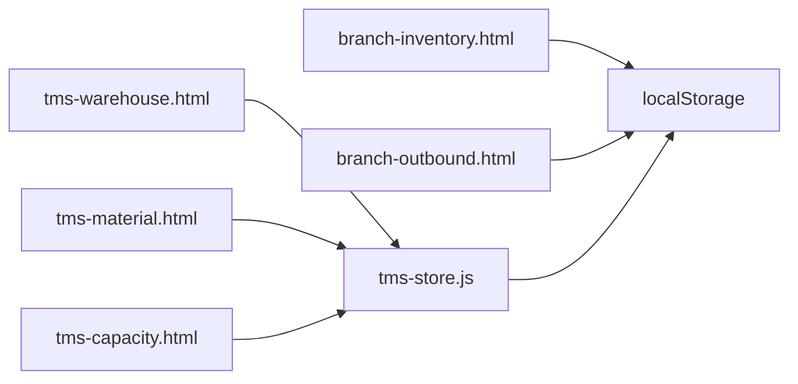

# 仓储管理

<cite>
**本文引用的文件**   
- [tms-warehouse.html](file://tms-warehouse.html)
- [tms-material.html](file://tms-material.html)
- [tms-capacity.html](file://tms-capacity.html)
- [branch-inventory.html](file://branch-inventory.html)
- [branch-outbound.html](file://branch-outbound.html)
- [tms-store.js](file://tms-store.js)
</cite>

## 目录
1. [引言](#引言)
2. [项目结构与仓储模块定位](#项目结构与仓储模块定位)
3. [核心组件与职责划分](#核心组件与职责划分)
4. [系统架构总览](#系统架构总览)
5. [仓库管理详解](#仓库管理详解)
6. [物料管理详解](#物料管理详解)
7. [容量管理与运力协同](#容量管理与运力协同)
8. [库存控制、预警与空间优化](#库存控制预警与空间优化)
9. [入库出库流程与业务模型](#入库出库流程与业务模型)
10. [接口、配置与返回值说明](#接口配置与返回值说明)
11. [依赖关系与耦合分析](#依赖关系与耦合分析)
12. [性能与可扩展性建议](#性能与可扩展性建议)
13. [常见问题与排障指南](#常见问题与排障指南)
14. [结论](#结论)

## 引言
本文件面向 TMS 系统的仓储管理模块，聚焦仓库管理、物料管理和容量管理的实现细节、调用关系、接口和业务模型。文档基于仓库页面、网点库存页、运力页以及共享数据层代码进行分析，给出仓库布局、库存控制、物料分类、容量规划、入库出库流程、库存预警和空间优化等核心能力的可落地说明，并附带来自实际代码库的引用路径，便于进一步扩展为后端服务或持久化方案。

## 项目结构与仓储模块定位
TMS 前端由多个运营页面组成，仓储相关能力分布在以下位置：
- 管理员端仓储入口与库存概览：[tms-warehouse.html](file://tms-warehouse.html)
- 内部物资（物料）管理页面：[tms-material.html](file://tms-material.html)
- 运力与容量资源管理页面：[tms-capacity.html](file://tms-capacity.html)
- 网点侧库存与资产、暂存件、物料管理：[branch-inventory.html](file://branch-inventory.html)
- 网点出库、装车、交接与车辆管理：[branch-outbound.html](file://branch-outbound.html)
- 共享数据层（订单、仓库、库存、运力、策略、路由等种子数据与工具）：[tms-store.js](file://tms-store.js)

**图表来源**
- [tms-warehouse.html:340-538](file://tms-warehouse.html#L340-L538)
- [tms-material.html:369-379](file://tms-material.html#L369-L379)
- [tms-capacity.html:526-536](file://tms-capacity.html#L526-L536)
- [branch-inventory.html:436-458](file://branch-inventory.html#L436-L458)
- [branch-outbound.html:662-696](file://branch-outbound.html#L662-L696)
- [tms-store.js:220-244](file://tms-store.js#L220-L244)

**章节来源**
- [tms-warehouse.html:340-538](file://tms-warehouse.html#L340-L538)
- [tms-material.html:369-379](file://tms-material.html#L369-L379)
- [tms-capacity.html:526-536](file://tms-capacity.html#L526-L536)
- [branch-inventory.html:436-458](file://branch-inventory.html#L436-L458)
- [branch-outbound.html:662-696](file://branch-outbound.html#L662-L696)
- [tms-store.js:220-244](file://tms-store.js#L220-L244)

## 核心组件与职责划分
- 仓库管理（管理员端）
  - 展示仓库数量、库存商品数、利用率、低库存预警等统计卡片。
  - 提供仓库库存列表，包含库存ID、商品名称、规格型号、仓库、存储位置、当前库存、安全库存、单位、状态和操作按钮。
  - 操作包括查看、编辑、补货、采购申请等。
- 物料管理（内部物资）
  - 维护物资种类、分类、单位、单价、供应商、最低库存、上次采购日期等。
  - 支持采购、更新库存、查看详情等操作。
- 容量管理（运力资源）
  - 展示总运力、可用运力、已占用、锁定运力等统计。
  - 维护运力资源类型、名称、供应商、承载量、剩余量、状态、有效日期，并提供分配、锁定、释放等操作。
- 网点库存与资产
  - 提供库存管理、暂存件管理、物料管理三个标签页。
  - 通过 localStorage 加载/渲染表格数据，支持添加、编辑、调整、删除、领用等操作占位。
- 网点出库管理
  - 提供装车发运、交接确认、车辆管理、出库记录四个标签页。
  - 维护装车记录、交接记录、出库记录，并通过 localStorage 初始化示例数据。
- 共享数据层
  - 提供仓库、库存、运力等资源种子数据，定义状态字典、计数器和事件机制。
  - 暴露统一的数据变更事件，供各页面订阅。

**章节来源**
- [tms-warehouse.html:415-521](file://tms-warehouse.html#L415-L521)
- [tms-material.html:337-364](file://tms-material.html#L337-L364)
- [tms-capacity.html:420-520](file://tms-capacity.html#L420-L520)
- [branch-inventory.html:369-430](file://branch-inventory.html#L369-L430)
- [branch-outbound.html:408-657](file://branch-outbound.html#L408-L657)
- [tms-store.js:520-571](file://tms-store.js#L520-L571)

## 系统架构总览
仓储模块采用“页面 + 共享数据层 + 本地存储”的前端架构：
- 页面负责 UI 与交互逻辑。
- 共享数据层提供种子数据、状态字典、工具函数和数据变更事件。
- 本地存储用于演示数据的持久化与跨页面共享。

**图表来源**
- [tms-warehouse.html:532-538](file://tms-warehouse.html#L532-L538)
- [tms-store.js:220-244](file://tms-store.js#L220-L244)
- [tms-store.js:520-571](file://tms-store.js#L520-L571)

## 仓库管理详解
仓库管理在管理员端提供仓库与库存的可视化与基础操作：
- 统计指标
  - 仓库数量、库存商品数、仓库利用率、低库存预警数量。
- 仓库库存列表字段
  - 库存ID、商品名称、规格型号、仓库、存储位置、当前库存、安全库存、单位、状态、操作。
- 状态样式
  - 充足、不足、缺货三类状态，对应不同颜色标签。
- 操作按钮
  - 查看、编辑、补货、采购申请等占位逻辑，后续可对接后端 API。

**图表来源**
- [tms-warehouse.html:420-438](file://tms-warehouse.html#L420-L438)
- [tms-warehouse.html:443-521](file://tms-warehouse.html#L443-L521)

**章节来源**
- [tms-warehouse.html:415-521](file://tms-warehouse.html#L415-L521)

## 物料管理详解
物料管理页面维护内部物资的基础信息与库存状态：
- 统计指标
  - 物资种类、低库存物资、缺货物资、总库存数量。
- 物资字段
  - ID、名称、分类、单位、当前库存、最低库存、单价、供应商、上次采购日期、描述。
- 状态映射
  - in_stock（库存充足）、low_stock（库存不足）、out_of_stock（缺货）。
- 操作
  - 采购、更新库存、查看详情。

**图表来源**
- [tms-material.html:453-528](file://tms-material.html#L453-L528)
- [tms-material.html:530-628](file://tms-material.html#L530-L628)

**章节来源**
- [tms-material.html:337-364](file://tms-material.html#L337-L364)
- [tms-material.html:453-628](file://tms-material.html#L453-L628)

## 容量管理与运力协同
容量管理页面展示运力资源的总体情况与明细：
- 统计指标
  - 总运力、可用运力、已占用、锁定运力。
- 运力资源字段
  - 运力ID、资源类型、资源名称、所属供应商、可承载量、剩余量、状态、有效日期。
- 状态
  - available（可用）、occupied（已占用）、locked（锁定）、unavailable（不可用）。
- 操作
  - 查看、分配、锁定、释放。

**图表来源**
- [tms-capacity.html:425-443](file://tms-capacity.html#L425-L443)
- [tms-capacity.html:448-520](file://tms-capacity.html#L448-L520)

**章节来源**
- [tms-capacity.html:420-520](file://tms-capacity.html#L420-L520)

## 库存控制、预警与空间优化
- 库存控制
  - 仓库库存与安全库存对比，自动标记充足、不足、缺货状态。
  - 物料库存与最低库存对比，驱动采购与补货流程。
- 库存预警
  - 管理员端统计低库存预警数量；物料页统计低库存与缺货数量。
- 空间优化
  - 仓库维度展示面积与利用率；库存维度展示存储位置（如 A区-01），便于按区域优化装载与拣选路径。
- 暂存件管理
  - 网点库存页提供暂存件管理，记录运单号、客户、暂存原因、状态、暂存时间、位置，支持处理与删除。

**图表来源**
- [tms-warehouse.html:443-521](file://tms-warehouse.html#L443-L521)
- [tms-material.html:530-628](file://tms-material.html#L530-L628)
- [branch-inventory.html:537-587](file://branch-inventory.html#L537-L587)

**章节来源**
- [tms-warehouse.html:443-521](file://tms-warehouse.html#L443-L521)
- [tms-material.html:530-628](file://tms-material.html#L530-L628)
- [branch-inventory.html:537-587](file://branch-inventory.html#L537-L587)

## 入库出库流程与业务模型
- 入库流程（概念）
  - 订单创建 → 待入库 → 已入库 → 已分拣 → 运输中 → 已到达 → 派送中 → 已签收。
  - 共享数据层定义了订单阶段与轨迹节点，并生成计划分段与截止时间。
- 出库流程（网点）
  - 装车发运：选择车辆、司机、目的地、包裹数量与备注，确认后生成装车记录。
  - 交接确认：录入运单号、车辆、接收人、交接时间与备注，确认后生成交接记录。
  - 车辆管理：维护车牌号、车型、司机、状态、载重等信息。
  - 出库记录：汇总车辆、司机、目的地、包裹数量、出库时间、状态。

**图表来源**
- [branch-outbound.html:441-516](file://branch-outbound.html#L441-L516)
- [branch-outbound.html:518-572](file://branch-outbound.html#L518-L572)
- [branch-outbound.html:716-800](file://branch-outbound.html#L716-L800)
- [branch-inventory.html:482-535](file://branch-inventory.html#L482-L535)

**章节来源**
- [branch-outbound.html:408-657](file://branch-outbound.html#L408-L657)
- [branch-inventory.html:482-535](file://branch-inventory.html#L482-L535)
- [tms-store.js:88-120](file://tms-store.js#L88-L120)

## 接口、配置与返回值说明
- 仓库库存（管理员端）
  - 输入：无（页面直接渲染）
  - 输出：仓库统计卡片与库存列表
  - 关键字段：库存ID、商品名称、规格型号、仓库、存储位置、当前库存、安全库存、单位、状态
  - 参考：[tms-warehouse.html:443-521](file://tms-warehouse.html#L443-L521)
- 物料管理（内部物资）
  - 输入：采购数量、新库存数量
  - 输出：更新后的物资列表与状态
  - 关键字段：ID、名称、分类、单位、当前库存、最低库存、单价、供应商、上次采购日期、描述、状态
  - 参考：[tms-material.html:453-628](file://tms-material.html#L453-L628)
- 运力管理
  - 输入：分配/锁定/释放操作
  - 输出：更新后的运力资源列表与状态
  - 关键字段：运力ID、资源类型、资源名称、所属供应商、可承载量、剩余量、状态、有效日期
  - 参考：[tms-capacity.html:448-520](file://tms-capacity.html#L448-L520)
- 网点库存与资产
  - 输入：添加/编辑/调整/删除/领用操作
  - 输出：更新的库存、暂存件、物料表格
  - 关键字段：库存ID、名称、分类、数量、位置、最后更新时间；暂存ID、运单号、客户、暂存原因、状态、暂存时间、位置；物料ID、名称、类型、数量、单位、供应商、最后采购
  - 参考：[branch-inventory.html:482-644](file://branch-inventory.html#L482-L644)
- 网点出库管理
  - 输入：车辆/司机/目的地/包裹数量；交接信息（运单号/接收人/时间）
  - 输出：装车记录、交接记录、出库记录
  - 关键字段：车辆、司机、目的地、包裹数量、出库时间、状态；运单号、接收人、交接时间、操作人
  - 参考：[branch-outbound.html:441-572](file://branch-outbound.html#L441-L572)
- 共享数据层（仓库/库存/运力种子数据）
  - 输入：无（首次访问自动生成）
  - 输出：仓库、库存、运力数据结构
  - 关键字段：仓库ID/名称/城市/负责人/面积/利用率/今日入库/今日出库/状态；库存ID/名称/规格/仓库/位置/库存/安全库存/单位/状态/更新时间；运力ID/类型/名称/供应商/容量/剩余/状态/有效期
  - 参考：[tms-store.js:520-571](file://tms-store.js#L520-L571)

**章节来源**
- [tms-warehouse.html:443-521](file://tms-warehouse.html#L443-L521)
- [tms-material.html:453-628](file://tms-material.html#L453-L628)
- [tms-capacity.html:448-520](file://tms-capacity.html#L448-L520)
- [branch-inventory.html:482-644](file://branch-inventory.html#L482-L644)
- [branch-outbound.html:441-572](file://branch-outbound.html#L441-L572)
- [tms-store.js:520-571](file://tms-store.js#L520-L571)

## 依赖关系与耦合分析
- 页面与共享数据层
  - 管理员端仓储页与物料页通过脚本引入共享数据层，但当前主要使用静态 HTML 与内联脚本渲染；共享数据层提供仓库、库存、运力种子数据。
- 页面与本地存储
  - 网点库存与出库页通过 localStorage 初始化与更新数据，形成页面级数据闭环。
- 状态与枚举
  - 共享数据层集中定义状态标签（订单、异常、运输、任务、工单、理赔、财务、员工、车辆、库存、运力、策略、网关、应收、账单、应付、费率、路线），便于跨页面一致展示。
- 潜在循环依赖
  - 当前页面之间无直接相互导入，耦合度较低；共享数据层作为中心数据源，避免页面间直接依赖。

**图表来源**
- [tms-warehouse.html:527-531](file://tms-warehouse.html#L527-L531)
- [tms-material.html:369-373](file://tms-material.html#L369-L373)
- [tms-capacity.html:526-530](file://tms-capacity.html#L526-L530)
- [branch-inventory.html:436-458](file://branch-inventory.html#L436-L458)
- [branch-outbound.html:662-696](file://branch-outbound.html#L662-L696)
- [tms-store.js:220-244](file://tms-store.js#L220-L244)

**章节来源**
- [tms-store.js:88-120](file://tms-store.js#L88-L120)
- [tms-store.js:220-244](file://tms-store.js#L220-L244)

## 性能与可扩展性建议
- 数据层扩展
  - 将共享数据层从 localStorage 迁移至 IndexedDB 或后端 API，提升大数据量下的查询与更新性能。
- 渲染优化
  - 对库存与物料列表使用虚拟滚动或分页，减少 DOM 节点数量。
- 事件解耦
  - 利用 tms:datachange 事件进行跨页面通知，避免轮询。
- 缓存策略
  - 对仓库统计与运力统计结果做短期缓存，降低重复计算。
- 校验前置
  - 在入库出库操作前增加表单校验与库存可用性校验，减少无效请求。

[本节为通用建议，不直接分析具体文件]

## 常见问题与排障指南
- 问题：库存状态未更新
  - 排查：检查补货/采购逻辑是否正确更新 localStorage 中的库存数据。
  - 解决：确保在更新后重新渲染列表，并触发 tms:datachange 事件。
  - 参考：[tms-material.html:570-618](file://tms-material.html#L570-L618)
- 问题：运力状态无法释放
  - 排查：检查锁定/释放按钮的事件绑定与状态判断逻辑。
  - 解决：确认状态字段与 UI 类名一致，并在变更后刷新列表。
  - 参考：[tms-capacity.html:585-603](file://tms-capacity.html#L585-L603)
- 问题：出库记录为空
  - 排查：检查 localStorage 中是否初始化了出库记录数据。
  - 解决：确保 initializeData 中写入默认出库记录，并调用 loadOutboundRecords。
  - 参考：[branch-outbound.html:770-800](file://branch-outbound.html#L770-L800)
- 问题：仓库利用率显示异常
  - 排查：检查仓库种子数据中 usedRate 字段是否正确赋值。
  - 解决：确认 tms-store.js 中仓库数据构造逻辑。
  - 参考：[tms-store.js:542-554](file://tms-store.js#L542-L554)

**章节来源**
- [tms-material.html:570-618](file://tms-material.html#L570-L618)
- [tms-capacity.html:585-603](file://tms-capacity.html#L585-L603)
- [branch-outbound.html:770-800](file://branch-outbound.html#L770-L800)
- [tms-store.js:542-554](file://tms-store.js#L542-L554)

## 结论
仓储管理模块通过管理员端仓库页面、物料页面、运力页面与网点库存/出库页面共同构成完整的仓储业务能力。共享数据层提供了仓库、库存、运力等种子数据与状态字典，配合本地存储实现演示环境的数据持久化。未来可在此基础上扩展后端 API、数据库与权限控制，完善入库出库流程、库存预警与空间优化算法，提升系统的可维护性与扩展性。