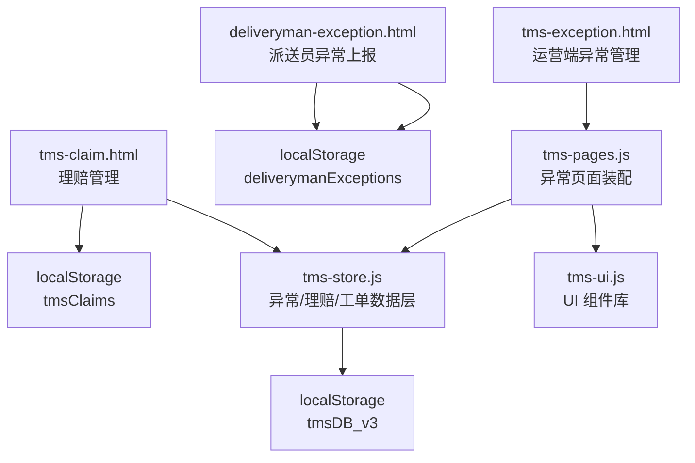
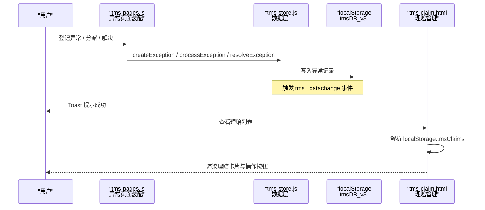
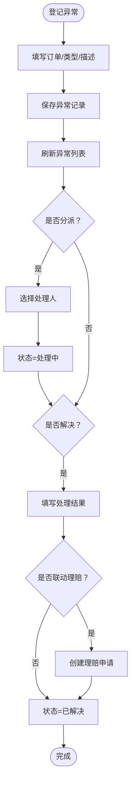
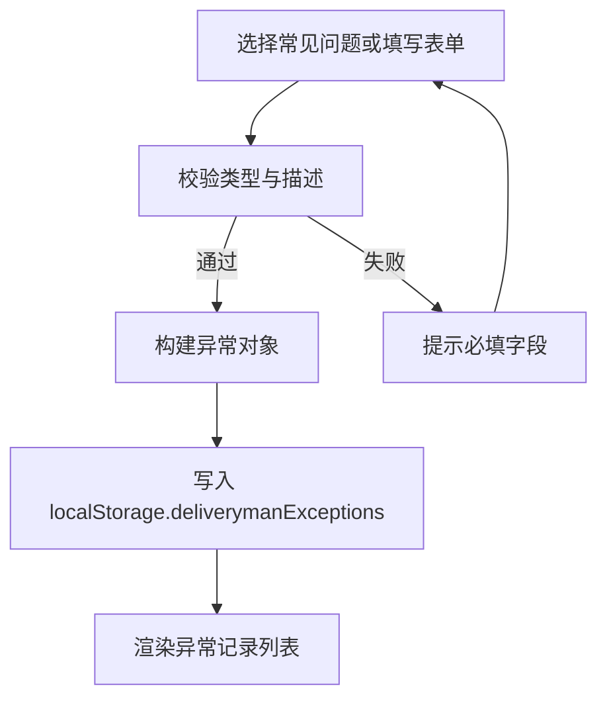
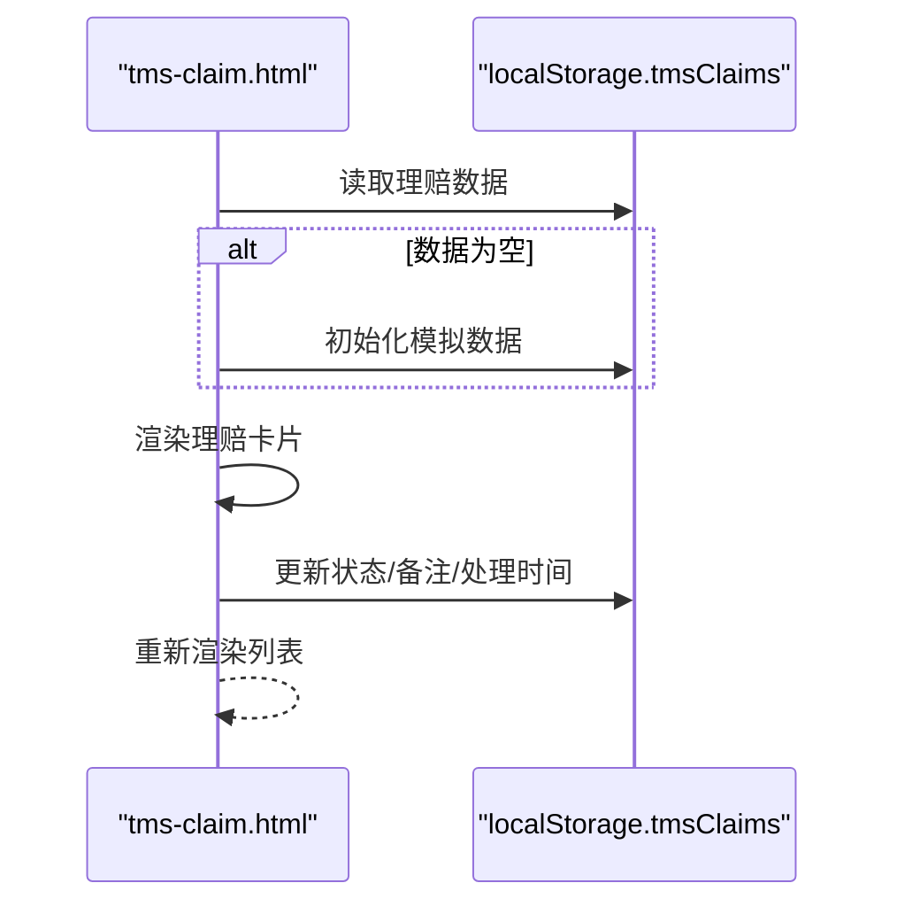
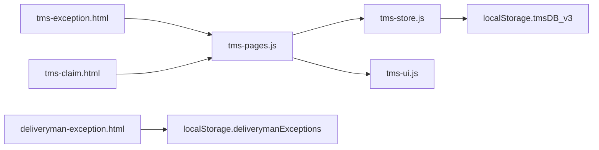

# 异常管理

<cite>
**本文引用的文件**   
- [tms-exception.html](file://tms-exception.html)
- [deliveryman-exception.html](file://deliveryman-exception.html)
- [tms-claim.html](file://tms-claim.html)
- [tms-pages.js](file://tms-pages.js)
- [tms-store.js](file://tms-store.js)
- [tms-ui.js](file://tms-ui.js)
</cite>

## 目录
1. [引言](#引言)
2. [项目结构](#项目结构)
3. [核心组件](#核心组件)
4. [架构总览](#架构总览)
5. [详细组件分析](#详细组件分析)
6. [依赖关系分析](#依赖关系分析)
7. [性能与可扩展性](#性能与可扩展性)
8. [故障排查指南](#故障排查指南)
9. [结论](#结论)

## 引言
本文件聚焦 TMS 系统的“异常管理”能力，覆盖异常上报、异常处理闭环、理赔申请与处理、客户服务工单等关键流程。文档基于仓库中的实际页面与共享逻辑，说明异常分类、状态流转、处理时效、联动理赔、服务质量监控等特性，并给出调用关系、数据模型、配置项与常见问题解决方案。

## 项目结构
异常相关功能由三类页面与三个共享模块组成：
- 运营端异常管理页面：用于登记、分派、解决异常，并可联动创建理赔。
- 派送员异常上报页面：面向一线人员快速上报常见异常。
- 理赔管理页面：展示理赔统计、列表与审批操作。
- 共享页面装配器：定义异常、客服等页面的表格、KPI、表单弹窗与动作。
- 共享数据层：提供异常、理赔、工单的增删改查、状态字典、种子数据与事件通知。
- 共享 UI 库：提供表格、弹窗、状态标签、时间/金额格式化等通用能力。

图表来源
- [tms-exception.html:309-447](file://tms-exception.html#L309-L447)
- [deliveryman-exception.html:320-422](file://deliveryman-exception.html#L320-L422)
- [tms-claim.html:280-384](file://tms-claim.html#L280-L384)
- [tms-pages.js:137-248](file://tms-pages.js#L137-L248)
- [tms-store.js:16-17](file://tms-store.js#L16-L17)
- [tms-ui.js:703-746](file://tms-ui.js#L703-L746)

章节来源
- [tms-exception.html:309-447](file://tms-exception.html#L309-L447)
- [deliveryman-exception.html:320-422](file://deliveryman-exception.html#L320-L422)
- [tms-claim.html:280-384](file://tms-claim.html#L280-L384)
- [tms-pages.js:137-248](file://tms-pages.js#L137-L248)
- [tms-store.js:16-17](file://tms-store.js#L16-L17)
- [tms-ui.js:703-746](file://tms-ui.js#L703-L746)

## 核心组件
- 异常管理（运营端）
  - 支持登记异常、查看异常详情、分派处理人、标记已解决，并可选择联动创建理赔申请。
  - KPI 展示待处理、处理中、已解决与异常总数。
- 异常上报（派送员端）
  - 提供常见问题一键上报与详细上报表单，记录任务关联、类型、描述、地点、时间与上报人。
- 理赔管理
  - 展示待处理、处理中、已通过、已拒绝的理赔统计与列表；支持开始处理、同意/拒绝理赔、查看详情。
- 共享数据层
  - 维护异常、理赔、服务工单等实体，提供统一 CRUD、搜索筛选排序、分页、订阅事件。
  - 维护状态字典，如异常状态、理赔状态、工单状态等。
- 共享 UI 库
  - 提供表格、弹窗、Toast、状态标签、时间/金额格式化、异常待办角标等。

章节来源
- [tms-pages.js:137-248](file://tms-pages.js#L137-L248)
- [deliveryman-exception.html:340-422](file://deliveryman-exception.html#L340-L422)
- [tms-claim.html:342-384](file://tms-claim.html#L342-L384)
- [tms-store.js:98-120](file://tms-store.js#L98-L120)
- [tms-ui.js:703-746](file://tms-ui.js#L703-L746)

## 架构总览
异常管理在系统中的位置如下：
- 前端页面通过 tms-pages.js 装配异常管理界面，调用 tms-store.js 的数据接口进行增删改查。
- 派送员异常上报页面直接读写 localStorage 中的 deliverymanExceptions。
- 理赔管理页面通过 tms-claim.html 内嵌脚本读写 localStorage 中的 tmsClaims。
- 运营端异常闭环可联动创建理赔申请，后续由理赔管理页面处理。
- 客服工单与服务类业务通过 tms-pages.js 的 service 页面装配，与异常、理赔形成协同。

图表来源
- [tms-pages.js:171-246](file://tms-pages.js#L171-L246)
- [tms-store.js:232-244](file://tms-store.js#L232-L244)
- [tms-claim.html:426-656](file://tms-claim.html#L426-L656)

## 详细组件分析

### 异常管理（运营端）
- 功能要点
  - 登记异常：选择关联订单、异常类型、填写描述。
  - 查看异常：显示异常ID、订单号、运单号、类型、发生时间、状态、处理人、解决时间、描述与处理结果，并附带订单轨迹。
  - 分派异常：从固定角色中选择处理人，将状态改为处理中。
  - 解决异常：填写处理结果，可选择联动创建理赔申请并填写理赔金额。
- 数据模型（异常）
  - 关键字段：id、orderId、waybillNo、type、occurredAt、status、handler、description、resolution、resolvedAt、linkedClaimId。
  - 状态：pending（待处理）、processing（处理中）、resolved（已解决）、closed（已关闭）。
- 交互流程
  - 登记异常 → 存储异常 → 刷新 KPI 与表格。
  - 分派异常 → 更新 handler 与 status → 提示成功。
  - 解决异常 → 更新 resolution、resolvedAt、status，可选创建理赔 → 提示成功。

图表来源
- [tms-pages.js:171-246](file://tms-pages.js#L171-L246)
- [tms-store.js:98-120](file://tms-store.js#L98-L120)

章节来源
- [tms-pages.js:137-248](file://tms-pages.js#L137-L248)
- [tms-store.js:98-120](file://tms-store.js#L98-L120)

### 异常上报（派送员端）
- 功能要点
  - 常见问题一键上报：地址错误/不详、收件人拒收、联系不上收件人、货物破损/少件、交通堵塞/车辆故障。
  - 详细上报表单：任务ID、异常类型、描述、地点、时间、上报人。
  - 异常记录列表：按时间倒序展示，包含状态、描述、地点、时间、上报人与上报时间。
- 数据模型（异常上报）
  - 关键字段：id、taskId、taskTitle、type、description、location、time、status、reporter、reportTime。
  - 状态：pending（待处理）、processed（已处理）。
- 交互流程
  - 选择问题类型或填写表单 → 校验必填 → 生成记录 → 存入 localStorage.deliverymanExceptions → 刷新列表。

图表来源
- [deliveryman-exception.html:340-422](file://deliveryman-exception.html#L340-L422)
- [deliveryman-exception.html:478-595](file://deliveryman-exception.html#L478-L595)

章节来源
- [deliveryman-exception.html:340-422](file://deliveryman-exception.html#L340-L422)
- [deliveryman-exception.html:478-595](file://deliveryman-exception.html#L478-L595)

### 理赔管理
- 功能要点
  - 统计卡片：待处理理赔、处理中理赔、已通过理赔、已拒绝理赔。
  - 理赔列表：客户信息、订单号、运单号、理赔类型、金额、原因、附件、申请时间、处理时间、处理人、决策与备注。
  - 操作：开始处理、同意理赔、拒绝理赔、查看详情。
- 数据模型（理赔）
  - 关键字段：id、customerName、customerPhone、orderId、waybillNumber、claimType、claimAmount、reason、status、createTime、processTime、processor、decision、remark、attachments。
  - 状态：pending（待审核）、processing（审核中）、approved（已通过）、rejected（已驳回）、paid（已赔付）。
- 交互流程
  - 初始化模拟数据（若本地无数据）→ 渲染列表 → 根据状态显示不同操作按钮 → 更新状态与备注 → 持久化到 localStorage.tmsClaims。

图表来源
- [tms-claim.html:426-656](file://tms-claim.html#L426-L656)

章节来源
- [tms-claim.html:342-384](file://tms-claim.html#L342-L384)
- [tms-claim.html:426-656](file://tms-claim.html#L426-L656)

### 客服管理与工单（与异常、理赔协同）
- 功能要点
  - 新建服务工单：关联订单、工单类型（物流查询、改派申请、投诉建议、延误催件、理赔咨询）、优先级、内容。
  - 受理与解决：将工单状态从 pending 转为 processing，最终 resolved。
  - 与异常、理赔的协同：理赔咨询工单可与理赔流程联动；异常闭环时可同步创建理赔申请。
- 数据模型（服务工单）
  - 关键字段：id、orderId、customer、type、priority、content、status、assignee、createdAt、result。
  - 状态：pending（待受理）、processing（处理中）、resolved（已解决）、closed（已关闭）。

章节来源
- [tms-pages.js:744-832](file://tms-pages.js#L744-L832)

## 依赖关系分析
- 页面与装配器
  - tms-exception.html 通过 TmsPages.render('exception', ...) 加载异常页面装配逻辑。
  - tms-claim.html 通过 TmsPages.render('claim', ...) 加载理赔页面装配逻辑。
  - deliveryman-exception.html 独立脚本实现异常上报。
- 数据层与 UI 库
  - tms-pages.js 依赖 tms-store.js 进行数据操作，依赖 tms-ui.js 进行表格、弹窗、状态标签等展示。
  - tms-store.js 维护全局状态字典与实体 CRUD，并通过 tms:datachange 事件驱动视图刷新。
  - tms-ui.js 提供 initShell 计算异常待办角标，提升运营端对异常处理的可见性。

图表来源
- [tms-exception.html:443-447](file://tms-exception.html#L443-L447)
- [tms-claim.html:379-384](file://tms-claim.html#L379-L384)
- [tms-pages.js:137-248](file://tms-pages.js#L137-L248)
- [tms-store.js:232-244](file://tms-store.js#L232-L244)
- [tms-ui.js:703-746](file://tms-ui.js#L703-L746)

章节来源
- [tms-exception.html:443-447](file://tms-exception.html#L443-L447)
- [tms-claim.html:379-384](file://tms-claim.html#L379-L384)
- [tms-pages.js:137-248](file://tms-pages.js#L137-L248)
- [tms-store.js:232-244](file://tms-store.js#L232-L244)
- [tms-ui.js:703-746](file://tms-ui.js#L703-L746)

## 性能与可扩展性
- 当前实现以 localStorage 为轻量数据库，适合演示与小型场景。
- 异常与理赔数据量增长时，建议在 tms-store.js 中增加分页、索引与缓存策略，避免全量遍历。
- 可通过 tms:datachange 事件机制扩展更多页面实时刷新能力。
- 建议将异常分类、处理时效规则、SLA 指标等配置外置，便于动态调整。

[本节为通用指导，不直接分析具体文件]

## 故障排查指南
- 异常待办角标不显示
  - 检查 tms-ui.js 中 initShell 是否正确计算 pending 与 processing 异常数量。
  - 确认导航链接 href 是否为 tms-exception.html。
- 理赔列表为空
  - 检查 localStorage.tmsClaims 是否存在且格式正确。
  - 若解析失败，页面会清理损坏数据并重新初始化模拟数据。
- 异常无法分派或解决
  - 检查 tms-pages.js 中 actions 的 show 条件是否符合当前状态。
  - 确认 tms-store.js 的状态字典与页面展示一致。
- 异常上报未保存
  - 检查 deliveryman-exception.html 表单校验逻辑与 localStorage 写入逻辑。
  - 确认浏览器允许 localStorage 存储。

章节来源
- [tms-ui.js:703-746](file://tms-ui.js#L703-L746)
- [tms-claim.html:531-556](file://tms-claim.html#L531-L556)
- [tms-pages.js:211-246](file://tms-pages.js#L211-L246)
- [deliveryman-exception.html:541-589](file://deliveryman-exception.html#L541-L589)

## 结论
TMS 异常管理模块通过运营端异常管理、派送员异常上报与理赔管理三大页面，结合共享数据层与 UI 库，实现了异常分类、状态流转、处理闭环与理赔联动的完整流程。系统以 localStorage 作为轻量数据存储，具备较好的演示性与可维护性。未来可在数据层引入更完善的分页、索引与配置化管理，以提升大规模场景下的性能与灵活性。

[本节为总结性内容，不直接分析具体文件]