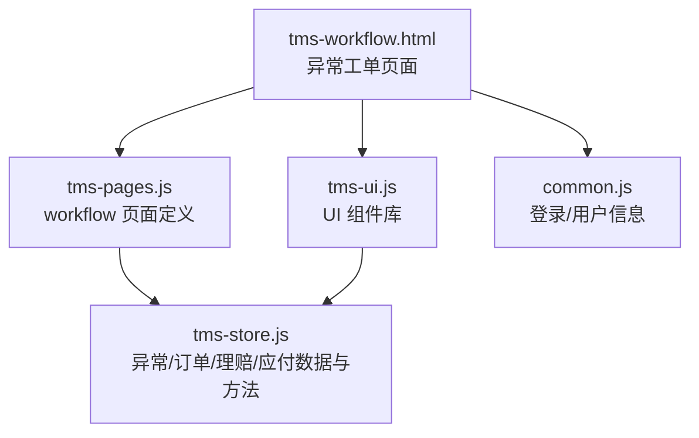
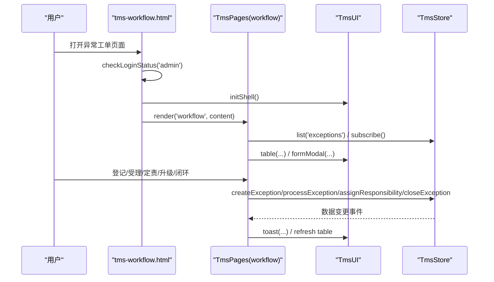
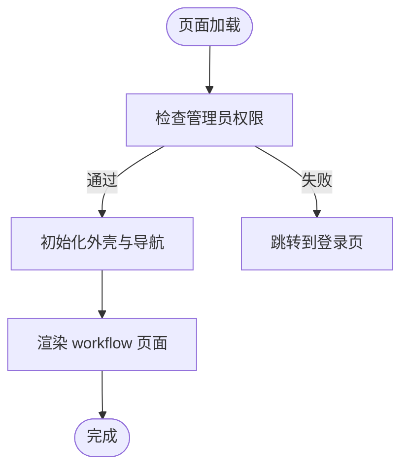
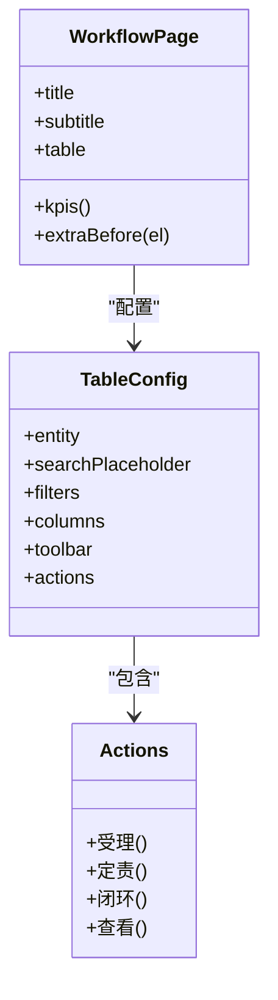
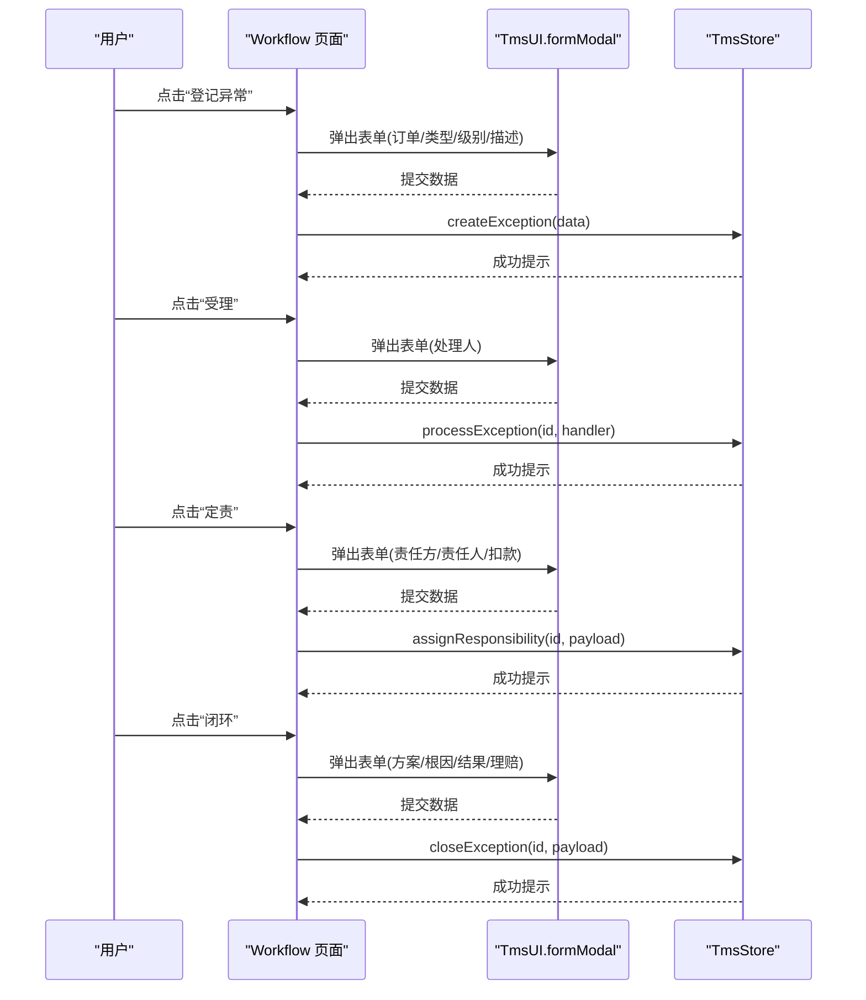
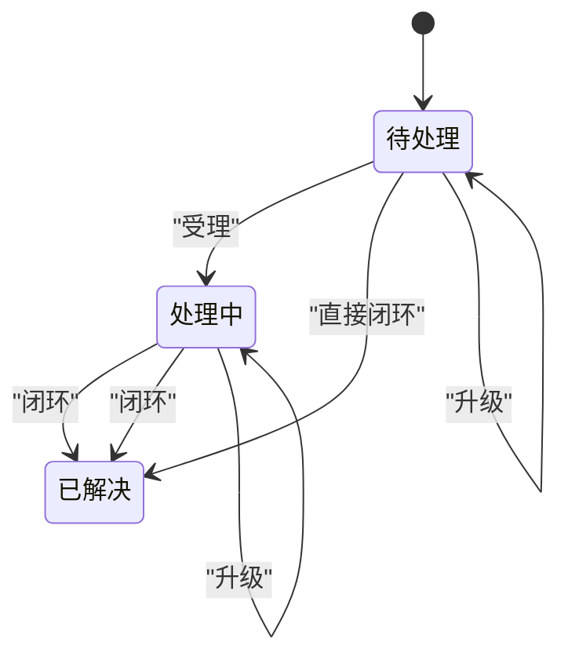
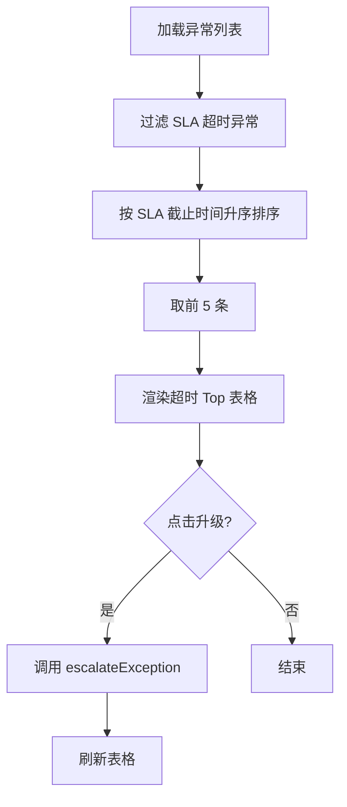
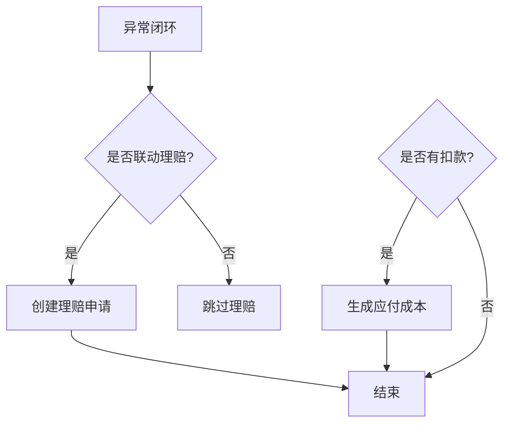
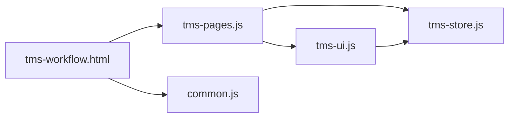

# 工作流管理模块

<cite>
**本文引用的文件**   
- [tms-workflow.html](file://tms-workflow.html)
- [common.js](file://common.js)
- [tms-ui.js](file://tms-ui.js)
- [tms-pages.js](file://tms-pages.js)
- [tms-store.js](file://tms-store.js)
</cite>

## 目录
1. [引言](#引言)
2. [项目结构定位](#项目结构定位)
3. [核心组件](#核心组件)
4. [架构总览](#架构总览)
5. [详细组件分析](#详细组件分析)
6. [依赖关系分析](#依赖关系分析)
7. [性能与扩展性](#性能与扩展性)
8. [故障排查指南](#故障排查指南)
9. [结论](#结论)

## 引言
本模块聚焦“异常工单闭环”这一端到端工作流，覆盖从异常登记、分派处理、定责扣款、升级预警到最终闭环与理赔联动的完整生命周期。该模块以管理员端页面为载体，通过共享 UI 组件库与本地数据层，实现可筛选、可分页、可操作的异常工单管理界面，并与订单、运输、财务等子系统联动。

## 项目结构定位
工作流管理模块由一个独立的管理员端页面承载，并通过统一页面装配器渲染业务表格与操作弹窗：

- 页面入口：`tms-workflow.html`
- 页面装配：`tms-pages.js` 中的 `workflow` 页面定义
- 通用 UI 能力：`tms-ui.js`（表单弹窗、确认框、列表、图表、状态徽章等）
- 登录与用户信息：`common.js`
- 数据层与业务规则：`tms-store.js`（异常、订单、理赔、应付等实体与流程方法）

**图示来源**  
- [tms-workflow.html:252-261](file://tms-workflow.html#L252-L261)  
- [tms-pages.js:2385-2537](file://tms-pages.js#L2385-L2537)  
- [tms-ui.js:703-781](file://tms-ui.js#L703-L781)  
- [common.js:136-218](file://common.js#L136-L218)  
- [tms-store.js:1-12](file://tms-store.js#L1-L12)

**章节来源**  
- [tms-workflow.html:1-266](file://tms-workflow.html#L1-L266)

## 核心组件
- 页面外壳与导航：`tms-workflow.html` 提供顶部导航、侧边栏与内容区，并在加载时校验管理员权限、初始化外壳并渲染 workflow 页面。
- 页面装配器：`tms-pages.js` 中 `define('workflow', ...)` 定义 KPI、图表、表格、工具栏与行操作。
- UI 组件库：`tms-ui.js` 提供表单弹窗、确认框、Toast、表格、KPI、图表、详情展示等能力。
- 数据层：`tms-store.js` 提供异常创建、受理、定责、升级、关闭、理赔联动、应付生成等方法，以及异常、订单、理赔、应付等实体的增删改查与订阅机制。
- 登录与用户信息：`common.js` 提供登录、登出、当前用户显示与角色校验。

**章节来源**  
- [tms-workflow.html:252-261](file://tms-workflow.html#L252-L261)  
- [tms-pages.js:2385-2537](file://tms-pages.js#L2385-L2537)  
- [tms-ui.js:86-287](file://tms-ui.js#L86-L287)  
- [tms-store.js:1-12](file://tms-store.js#L1-L12)

## 架构总览
工作流管理模块采用“页面 + 装配器 + UI 组件 + 数据层”的分层结构：

- 页面层：负责路由、权限校验与容器挂载。
- 装配层：将业务逻辑配置化，驱动表格、弹窗与统计。
- UI 层：提供跨页面复用的交互与展示能力。
- 数据层：集中维护业务实体、状态流转与关联记录，并通过事件通知各页面刷新。

**图示来源**  
- [tms-workflow.html:257-261](file://tms-workflow.html#L257-L261)  
- [tms-pages.js:108-135](file://tms-pages.js#L108-L135)  
- [tms-pages.js:2445-2537](file://tms-pages.js#L2445-L2537)  
- [tms-ui.js:165-287](file://tms-ui.js#L165-L287)  
- [tms-store.js:232-244](file://tms-store.js#L232-L244)

## 详细组件分析

### 页面外壳与权限控制
- 页面在 DOMContentLoaded 中调用 `checkLoginStatus('admin')`，未通过则跳转登录页。
- 通过 `TmsUI.initShell()` 高亮当前菜单、绑定退出按钮、显示当前用户名。
- 最后调用 `TmsPages.render('workflow', '.content')` 渲染工作流页面。

**图示来源**  
- [tms-workflow.html:257-261](file://tms-workflow.html#L257-L261)  
- [common.js:176-199](file://common.js#L176-L199)  
- [tms-ui.js:703-746](file://tms-ui.js#L703-L746)

**章节来源**  
- [tms-workflow.html:252-261](file://tms-workflow.html#L252-L261)  
- [common.js:136-218](file://common.js#L136-L218)  
- [tms-ui.js:703-746](file://tms-ui.js#L703-L746)

### 工作流页面装配（workflow）
- KPI：统计待处理、处理中、已解决异常数量及总数。
- 超时 Top：展示 SLA 超时的异常，支持一键升级。
- 表格：支持搜索、筛选（状态、级别、类型）、排序、分页。
- 工具栏：登记异常。
- 行操作：受理、定责、闭环、查看。

**图示来源**  
- [tms-pages.js:2400-2537](file://tms-pages.js#L2400-L2537)

**章节来源**  
- [tms-pages.js:2400-2537](file://tms-pages.js#L2400-L2537)

### 异常登记与处理流程
- 登记异常：选择关联订单、类型、级别、描述，调用 `S.createException`。
- 受理：填写处理人，调用 `S.processException`。
- 定责：选择责任方、责任人/单位、扣款金额，调用 `S.assignResponsibility`。
- 闭环：选择处理方案、根因、结果，可选择联动理赔，调用 `S.closeException`。
- 升级：对超时未闭环异常进行升级，调用 `S.escalateException`。

**图示来源**  
- [tms-pages.js:2445-2537](file://tms-pages.js#L2445-L2537)

**章节来源**  
- [tms-pages.js:2445-2537](file://tms-pages.js#L2445-L2537)

### 数据模型与状态流转
- 异常实体字段包括：id、orderId、waybillNo、type、level、status、handler、description、slaDeadline、responsibleParty、deductionAmount、solution、rootCause、resolution、linkedClaimId、flow 等。
- 状态流转：pending → processing → resolved；期间可进行定责、升级、闭环等操作。
- 与订单联动：异常登记需关联订单，闭环时可联动理赔；定责扣款可生成应付成本。

**图示来源**  
- [tms-pages.js:2463-2537](file://tms-pages.js#L2463-L2537)

**章节来源**  
- [tms-pages.js:2463-2537](file://tms-pages.js#L2463-L2537)

### 超时预警与升级
- 超时判断：基于 SLA 截止时间与当前时间比较。
- 超时 Top：按 SLA 截止时间升序取前 5 条，展示异常 ID、订单、类型、级别、SLA 与操作列。
- 升级操作：对未升级的异常执行升级，更新异常级别并提示成功。

**图示来源**  
- [tms-pages.js:2401-2424](file://tms-pages.js#L2401-L2424)

**章节来源**  
- [tms-pages.js:2401-2424](file://tms-pages.js#L2401-L2424)

### 与理赔和应付的联动
- 闭环时可选择联动理赔：若勾选，则在闭环后创建理赔申请，并携带理赔金额。
- 定责扣款：当责任方非客户且扣款金额大于 0 时，系统会生成对应的应付成本记录。

**图示来源**  
- [tms-pages.js:2493-2512](file://tms-pages.js#L2493-L2512)  
- [tms-pages.js:2475-2492](file://tms-pages.js#L2475-L2492)

**章节来源**  
- [tms-pages.js:2475-2512](file://tms-pages.js#L2475-L2512)

## 依赖关系分析
- 页面依赖装配器：`tms-workflow.html` 通过 `TmsPages.render('workflow', ...)` 装配业务逻辑。
- 装配器依赖 UI 组件：使用 `U.table`、`U.formModal`、`U.detailModal`、`U.statusBadge`、`U.fmt` 等。
- 装配器依赖数据层：通过 `S.list`、`S.createException`、`S.processException`、`S.assignResponsibility`、`S.closeException`、`S.escalateException` 等接口操作数据。
- 数据层提供订阅机制：数据变更后触发监听器，页面自动刷新。

**图示来源**  
- [tms-workflow.html:252-261](file://tms-workflow.html#L252-L261)  
- [tms-pages.js:10-12](file://tms-pages.js#L10-L12)  
- [tms-ui.js:758-781](file://tms-ui.js#L758-L781)  
- [tms-store.js:232-244](file://tms-store.js#L232-L244)

**章节来源**  
- [tms-workflow.html:252-261](file://tms-workflow.html#L252-L261)  
- [tms-pages.js:10-12](file://tms-pages.js#L10-L12)  
- [tms-ui.js:758-781](file://tms-ui.js#L758-L781)  
- [tms-store.js:232-244](file://tms-store.js#L232-L244)

## 性能与扩展性
- 前端渲染：表格支持分页与虚拟滚动可扩展；当前实现为客户端分页，适合中小规模数据。
- 数据订阅：通过 `TmsStore.subscribe` 实现局部刷新，避免全量重绘。
- 扩展点：
  - 新增异常类型或级别：在 `tms-pages.js` 的 filters 与 columns 中扩展选项。
  - 新增处理步骤：在 actions 中增加新操作，并在 `tms-store.js` 中实现对应方法。
  - 新增联动业务：如理赔、应付、考核等，可在闭环或定责回调中扩展。

[本节为通用指导，不直接分析具体文件]

## 故障排查指南
- 无法进入页面：检查 `checkLoginStatus('admin')` 是否返回有效用户对象；确认 localStorage 中 `tmsUser` 是否存在且 role 为 admin。
- 表格无数据：确认 `S.list('exceptions')` 是否返回数据；检查异常是否已登记。
- 弹窗无效：确认 `TmsUI.formModal` 是否正确调用；检查 fields 配置与 onSubmit 回调。
- 数据未刷新：确认 `TmsStore.persist` 是否被调用；检查订阅是否在页面中注册。

**章节来源**  
- [common.js:176-199](file://common.js#L176-L199)  
- [tms-store.js:232-244](file://tms-store.js#L232-L244)

## 结论
工作流管理模块以异常工单为核心，构建了完整的闭环流程，涵盖登记、受理、定责、升级、闭环与理赔联动。通过统一的页面装配器与 UI 组件库，实现了高度可配置的表格与弹窗交互；依托本地数据层，提供了可靠的状态流转与关联记录能力。该模块具备良好的扩展性与可维护性，适合作为 TMS 系统中运营与客服协同的关键枢纽。