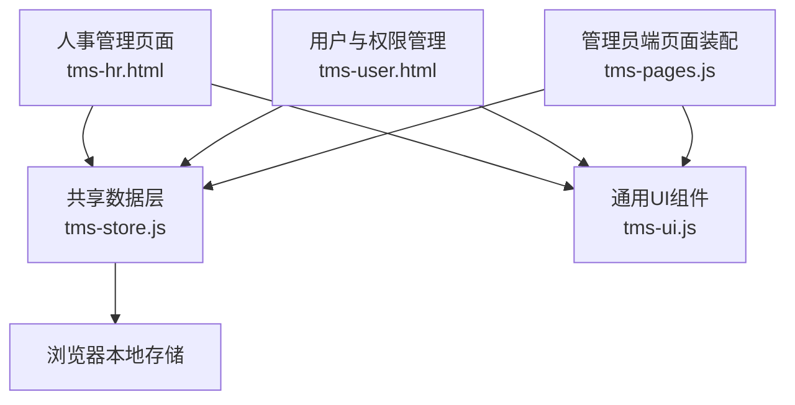
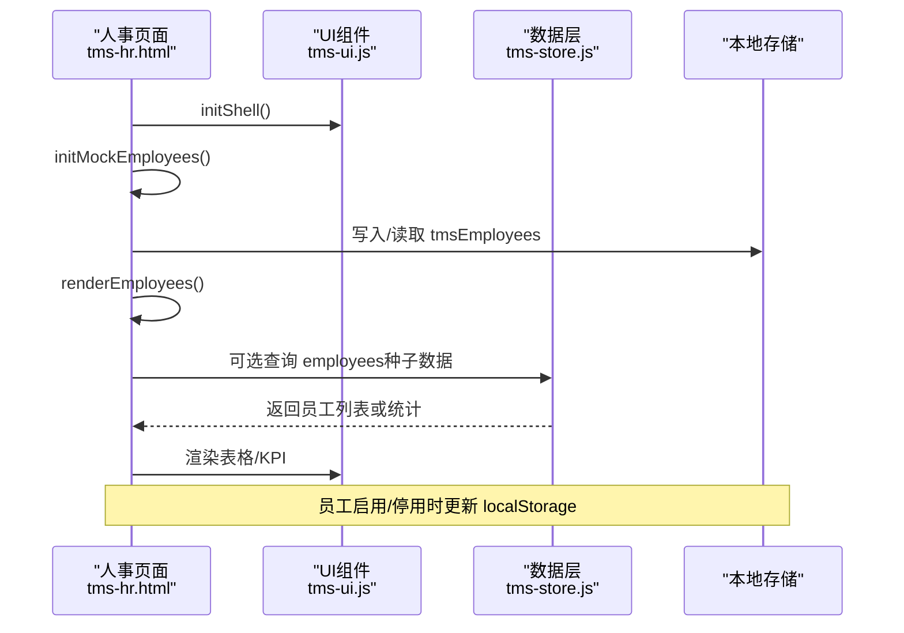
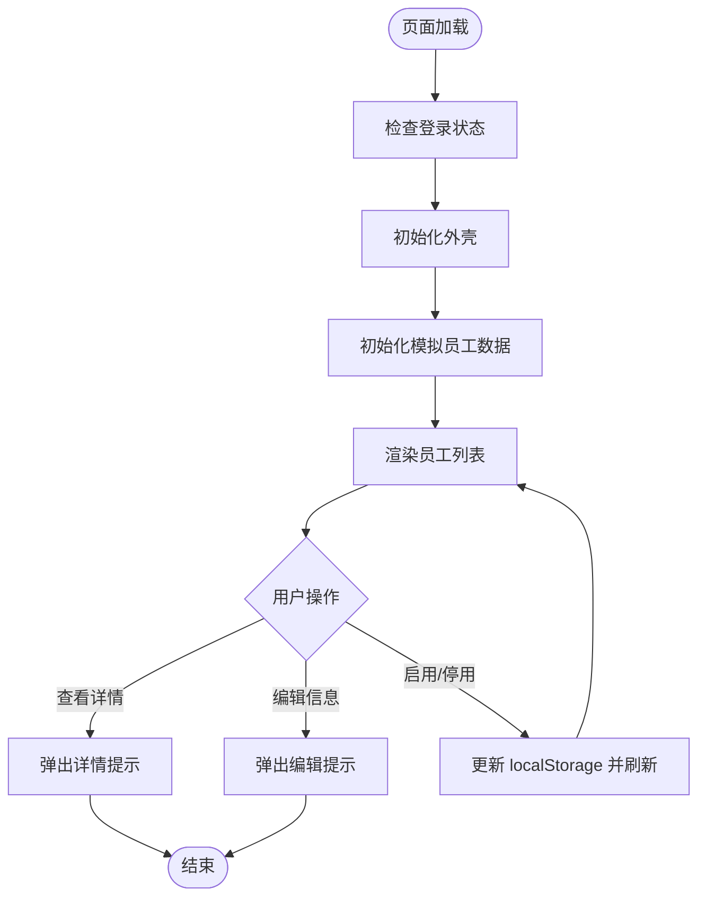
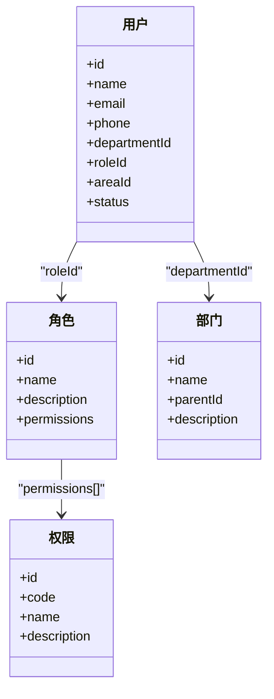
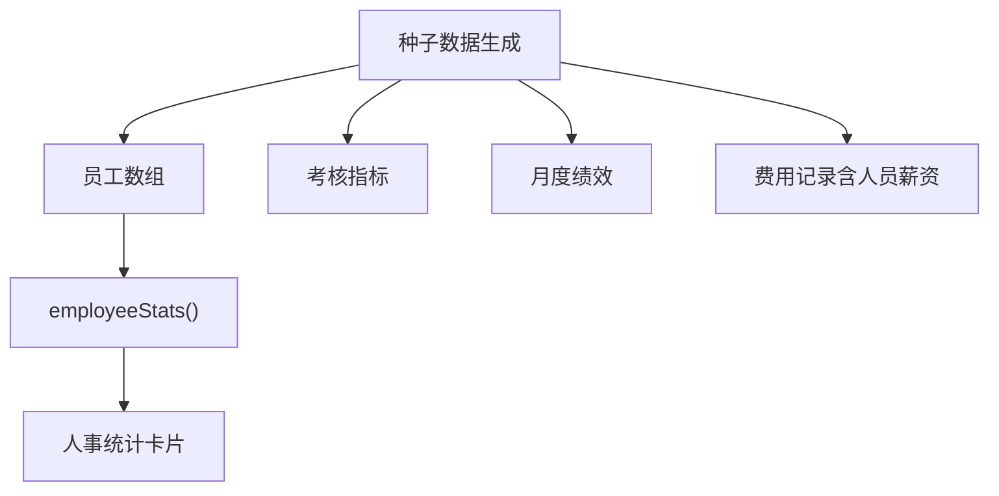
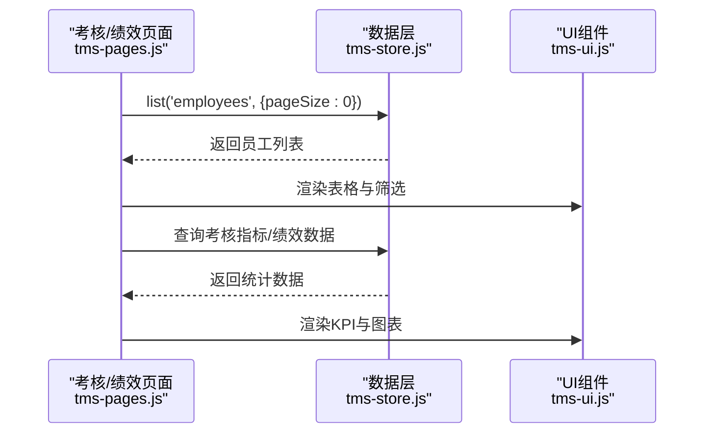
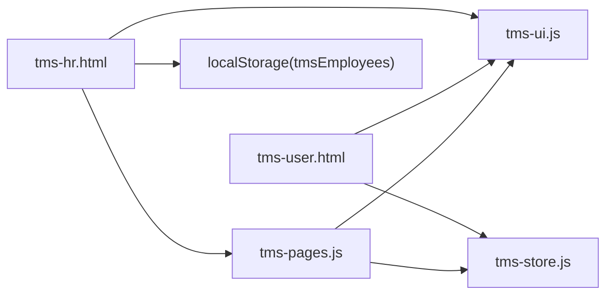

# 人事管理

<cite>
**本文引用的文件 **
- [tms-hr.html](file://tms-hr.html)
- [tms-user.html](file://tms-user.html)
- [tms-store.js](file://tms-store.js)
- [tms-ui.js](file://tms-ui.js)
- [tms-pages.js](file://tms-pages.js)
</cite>

## 目录
1. [引言](#引言)
2. [项目结构](#项目结构)
3. [核心组件](#核心组件)
4. [架构总览](#架构总览)
5. [详细组件分析](#详细组件分析)
6. [依赖关系分析](#依赖关系分析)
7. [性能与扩展性](#性能与扩展性)
8. [故障排查指南](#故障排查指南)
9. [结论](#结论)
10. [附录：数据模型与接口说明](#附录数据模型与接口说明)

## 引言
本文件面向TMS系统的人事管理功能，聚焦员工信息管理、考勤与薪资相关能力、绩效考核与培训等HR核心业务在代码库中的实现现状与调用关系。当前仓库以纯前端演示为主，人事模块通过本地存储模拟数据，并与用户权限体系、运营考核页面形成联动。文档将基于实际源码，给出业务流程、数据模型、关键函数与交互时序的可视化说明，帮助读者快速理解并在此基础上扩展真实后端与规则引擎。

## 项目结构
人事管理相关的代码主要分布在以下文件中：
- tms-hr.html：人事管理页面骨架、侧边导航、员工列表渲染与基础操作（启用/停用）。
- tms-user.html：用户与权限管理页面，提供账号、角色、权限、部门维护，是人事数据的组织与权限基础。
- tms-store.js：共享数据层，生成种子数据（含员工、考核、绩效、财务支出等），并提供统一的CRUD与统计方法。
- tms-ui.js：通用UI组件库，提供表格、表单弹窗、KPI、图表等能力。
- tms-pages.js：管理员端页面装配器，定义各业务页的KPI、表格、工具栏与动作；其中包含“考核评级”“绩效管理”等与HR强相关的页面。

图示来源
- [tms-hr.html:375-385](file://tms-hr.html#L375-L385)
- [tms-user.html:524-539](file://tms-user.html#L524-L539)
- [tms-store.js:1-12](file://tms-store.js#L1-L12)
- [tms-ui.js:1-6](file://tms-ui.js#L1-L6)
- [tms-pages.js:1-12](file://tms-pages.js#L1-L12)

章节来源
- [tms-hr.html:1-385](file://tms-hr.html#L1-L385)
- [tms-user.html:1-539](file://tms-user.html#L1-L539)
- [tms-store.js:1-12](file://tms-store.js#L1-L12)
- [tms-ui.js:1-6](file://tms-ui.js#L1-L6)
- [tms-pages.js:1-12](file://tms-pages.js#L1-L12)

## 核心组件
- 人事管理页面（tms-hr.html）
  - 负责展示员工总数、在职、休假、离职等统计卡片。
  - 初始化本地模拟员工数据（localStorage键名：tmsEmployees），渲染员工列表，支持查看详情、编辑信息、启用/停用。
  - 使用 TmsUI.initShell() 统一外壳，并通过 TmsPages.render('hr', ...) 注入内容区域。
- 用户与权限管理（tms-user.html）
  - 提供用户、角色、权限、部门的增删改查，统一通过 TmsStore 读写。
  - 作为人事组织架构与权限的基础，人事员工可映射到部门与角色。
- 共享数据层（tms-store.js）
  - 维护全局字典：部门、角色、权限、状态标签等。
  - 生成种子数据：包括员工、订单、运输、异常、财务支出、考核指标、绩效等。
  - 提供 list/get/create/update/remove 等通用API，以及 employeeStats 等聚合统计。
- 通用UI组件（tms-ui.js）
  - 提供 table/formModal/kpis/charts/statusBadge 等组件，被人事与用户页面复用。
- 管理员端页面装配（tms-pages.js）
  - 定义“考核评级”“绩效管理”等业务页，涉及员工维度统计与排名，与人事数据关联。

章节来源
- [tms-hr.html:342-385](file://tms-hr.html#L342-L385)
- [tms-user.html:488-539](file://tms-user.html#L488-L539)
- [tms-store.js:134-171](file://tms-store.js#L134-L171)
- [tms-store.js:483-498](file://tms-store.js#L483-L498)
- [tms-ui.js:303-544](file://tms-ui.js#L303-L544)
- [tms-pages.js:108-135](file://tms-pages.js#L108-L135)

## 架构总览
人事管理在当前仓库中采用“页面 + 数据层 + UI组件”的分层结构：
- 页面层：tms-hr.html 承载人事界面逻辑，tms-user.html 承载用户与权限逻辑。
- 数据层：tms-store.js 提供统一的数据访问与事件通知，所有变更触发 tms:datachange 事件。
- UI层：tms-ui.js 提供通用组件，降低重复开发成本。
- 装配层：tms-pages.js 将各业务页按统一模式装配为 KPI+图表+表格+CRUD。

图示来源
- [tms-hr.html:380-385](file://tms-hr.html#L380-L385)
- [tms-hr.html:458-541](file://tms-hr.html#L458-L541)
- [tms-hr.html:543-629](file://tms-hr.html#L543-L629)
- [tms-store.js:220-244](file://tms-store.js#L220-L244)

## 详细组件分析

### 员工信息管理（人事页面）
- 功能要点
  - 初始化模拟员工数据，字段包括 id、name、department、position、email、phone、hireDate、status、role、description。
  - 渲染员工列表，显示状态文本（在职/休假/离职）与系统角色文本（管理员/网点人员/客户端用户）。
  - 支持查看、编辑、启用/停用；启用/停用直接修改 localStorage 中的 tmsEmployees 并重新渲染。
- 关键流程
  - DOMContentLoaded 后检查登录状态，初始化外壳，渲染人事页面。
  - 首次加载时若不存在 tmsEmployees，则写入模拟数据。
  - 每次启用/停用后，更新 localStorage 并刷新列表。

图示来源
- [tms-hr.html:380-385](file://tms-hr.html#L380-L385)
- [tms-hr.html:458-541](file://tms-hr.html#L458-L541)
- [tms-hr.html:543-629](file://tms-hr.html#L543-L629)

章节来源
- [tms-hr.html:342-385](file://tms-hr.html#L342-L385)
- [tms-hr.html:458-629](file://tms-hr.html#L458-L629)

### 用户与权限管理（人事组织与权限基础）
- 功能要点
  - 提供用户、角色、权限、部门的CRUD，统一通过 TmsStore 操作。
  - 用户表包含 departmentId、roleId、areaId、status 等字段，用于组织与权限控制。
  - 角色绑定权限集合，权限具有 code/name/description。
  - 部门支持 parentId，形成层级结构。
- 与人事的关系
  - 人事员工可映射到部门与角色，从而获得相应菜单与操作权限。
  - 人事页面的“系统角色”字段与用户角色的 role 字段存在概念对应，但人事页面目前使用本地模拟数据，未直接引用 TmsStore 的用户数据。

图示来源
- [tms-user.html:572-644](file://tms-user.html#L572-L644)
- [tms-user.html:646-715](file://tms-user.html#L646-L715)
- [tms-user.html:717-772](file://tms-user.html#L717-L772)
- [tms-user.html:774-800](file://tms-user.html#L774-L800)

章节来源
- [tms-user.html:488-539](file://tms-user.html#L488-L539)
- [tms-user.html:572-800](file://tms-user.html#L572-L800)

### 共享数据层（员工、考核、绩效、财务）
- 员工数据
  - 种子数据中生成20名员工，字段包括 id、name、department、position、email、phone、hireDate、status、salary。
  - 提供 employeeStats 聚合统计：total、active、onLeave、resigned。
- 考核与绩效
  - 生成考核指标（签收率、准时率、异常处理时效、客户满意度、扫描完整率、投诉率）与权重。
  - 生成月度绩效数据，包含员工、部门、岗位、评分等。
- 财务支出
  - 生成费用记录，类别包含“车辆油费”“人员薪资”，体现薪资与支出的关联。

图示来源
- [tms-store.js:483-498](file://tms-store.js#L483-L498)
- [tms-store.js:669-678](file://tms-store.js#L669-L678)
- [tms-store.js:1039-1062](file://tms-store.js#L1039-L1062)
- [tms-store.js:957-959](file://tms-store.js#L957-L959)
- [tms-store.js:2210-2216](file://tms-store.js#L2210-L2216)

章节来源
- [tms-store.js:483-498](file://tms-store.js#L483-L498)
- [tms-store.js:669-678](file://tms-store.js#L669-L678)
- [tms-store.js:1039-1062](file://tms-store.js#L1039-L1062)
- [tms-store.js:957-959](file://tms-store.js#L957-L959)
- [tms-store.js:2210-2216](file://tms-store.js#L2210-L2216)

### 管理员端页面装配（考核与绩效）
- 考核评级
  - 页面标题与副标题明确“按月度对员工签收率、准时率与满意度进行综合评级”。
  - 表格搜索字段包含 employee、department、position、period，选项来源于 S.list('employees')。
- 绩效管理
  - 页面标题明确“按员工维度统计单量、签收率与异常，形成绩效排名”。
  - 表格搜索字段包含 employee、department。

图示来源
- [tms-pages.js:1104-1157](file://tms-pages.js#L1104-L1157)
- [tms-pages.js:1193-1215](file://tms-pages.js#L1193-L1215)

章节来源
- [tms-pages.js:1104-1157](file://tms-pages.js#L1104-L1157)
- [tms-pages.js:1193-1215](file://tms-pages.js#L1193-L1215)

### 考勤管理与薪资计算（现状与建议）
- 现状
  - 仓库未提供专门的考勤页面或考勤规则引擎。
  - 薪资计算未在人事页面实现；财务支出种子数据中包含“人员薪资”类别，但未与员工薪资字段联动计算。
- 建议扩展
  - 考勤规则引擎：基于日期、班次、迟到早退、请假类型等规则，输出考勤结果（出勤天数、迟到次数、缺勤天数等）。
  - 薪资计算逻辑：结合基本工资、岗位津贴、加班时长、扣款规则、社保公积金比例等，生成月度薪资明细。
  - 与绩效考核联动：将考核得分转化为奖金系数，影响最终薪资发放。

[本节为概念性扩展建议，不直接分析具体文件]

## 依赖关系分析
- 人事页面依赖 TmsUI 外壳与 TmsPages 渲染器。
- 人事页面使用 localStorage 维护 tmsEmployees，未直接依赖 TmsStore 的员工数据。
- 用户与权限管理完全依赖 TmsStore 的 users/roles/permissions/departments 实体。
- 管理员端页面装配依赖 TmsStore 的 employees 与考核/绩效数据。

图示来源
- [tms-hr.html:375-385](file://tms-hr.html#L375-L385)
- [tms-user.html:524-539](file://tms-user.html#L524-L539)
- [tms-pages.js:1-12](file://tms-pages.js#L1-L12)

章节来源
- [tms-hr.html:375-385](file://tms-hr.html#L375-L385)
- [tms-user.html:524-539](file://tms-user.html#L524-L539)
- [tms-pages.js:1-12](file://tms-pages.js#L1-L12)

## 性能与扩展性
- 当前实现为纯前端演示，数据存储在 localStorage，适合小规模演示与原型验证。
- 对于大规模数据，建议：
  - 引入后端API与分页/筛选服务化。
  - 将考勤规则与薪资计算移至服务端，避免前端复杂逻辑与安全风险。
  - 使用数据库事务保证人事数据一致性（如员工状态变更与权限同步）。

[本节为一般性指导，不直接分析具体文件]

## 故障排查指南
- 人事页面无法加载
  - 检查是否已登录且角色为 admin。
  - 确认 TmsUI.initShell() 与 TmsPages.render('hr', ...) 已执行。
- 员工列表为空
  - 检查 localStorage 中是否存在 tmsEmployees。
  - 确认 initMockEmployees() 已执行并成功写入。
- 启用/停用无效果
  - 检查 deactivateEmployee/activateEmployee 是否正确更新 localStorage 并调用 renderEmployees。
- 用户与权限管理数据异常
  - 检查 TmsStore 的 users/roles/permissions/departments 是否初始化。
  - 确认表单提交回调中调用了 create/update/remove。

章节来源
- [tms-hr.html:428-453](file://tms-hr.html#L428-L453)
- [tms-hr.html:458-541](file://tms-hr.html#L458-L541)
- [tms-hr.html:601-629](file://tms-hr.html#L601-L629)
- [tms-user.html:524-539](file://tms-user.html#L524-L539)

## 结论
当前TMS系统的人事管理功能以演示为主，实现了员工档案的基本维护与状态切换，并与用户权限体系形成组织与权限基础。考核与绩效页面提供了员工维度的统计与排名能力，但考勤规则引擎与薪资计算尚未实现。建议在现有架构基础上，扩展考勤与薪资模块，将其与服务端规则引擎集成，并与绩效考核联动，形成完整的人力资源闭环。

[本节为总结性内容，不直接分析具体文件]

## 附录：数据模型与接口说明

### 员工数据模型（人事页面）
- 字段
  - id：员工编号
  - name：姓名
  - department：部门
  - position：职位
  - email：邮箱
  - phone：电话
  - hireDate：入职日期
  - status：状态（active/on_leave/inactive）
  - role：系统角色（admin/branch/client）
  - description：描述

章节来源
- [tms-hr.html:465-538](file://tms-hr.html#L465-L538)

### 员工数据模型（共享数据层）
- 字段
  - id：员工编号
  - name：姓名
  - department：部门
  - position：职位
  - email：邮箱
  - phone：电话
  - hireDate：入职日期
  - status：状态（active/on_leave/resigned）
  - salary：薪资

章节来源
- [tms-store.js:483-498](file://tms-store.js#L483-L498)

### 用户与权限数据模型
- 用户
  - id、name、email、phone、departmentId、roleId、areaId、status
- 角色
  - id、name、description、permissions[]
- 权限
  - id、code、name、description
- 部门
  - id、name、parentId、description

章节来源
- [tms-user.html:572-800](file://tms-user.html#L572-L800)

### 关键接口与返回值
- TmsUI.initShell()
  - 作用：初始化页面外壳，高亮当前菜单，绑定退出登录按钮。
  - 返回值：无
- TmsPages.render(pageId, root)
  - 作用：将业务页装配为 KPI+图表+表格+CRUD 结构。
  - 参数：pageId（如 'hr'）、root（DOM容器）
  - 返回值：无
- TmsStore.list(entity, options)
  - 作用：查询实体列表，支持 search、filters、sort、page、pageSize。
  - 参数：entity（实体名）、options（查询选项）
  - 返回值：{ rows, total, page }
- TmsStore.get(entity, id)
  - 作用：根据ID获取实体。
  - 参数：entity、id
  - 返回值：实体对象或 null
- TmsStore.create(entity, data)
  - 作用：创建实体。
  - 参数：entity、data
  - 返回值：无
- TmsStore.update(entity, id, data)
  - 作用：更新实体。
  - 参数：entity、id、data
  - 返回值：无
- TmsStore.remove(entity, id)
  - 作用：删除实体。
  - 参数：entity、id
  - 返回值：无
- TmsStore.employeeStats()
  - 作用：统计员工数量与状态分布。
  - 返回值：{ total, active, onLeave, resigned }

章节来源
- [tms-ui.js:703-746](file://tms-ui.js#L703-L746)
- [tms-pages.js:108-135](file://tms-pages.js#L108-L135)
- [tms-store.js:220-244](file://tms-store.js#L220-L244)
- [tms-store.js:2210-2216](file://tms-store.js#L2210-L2216)