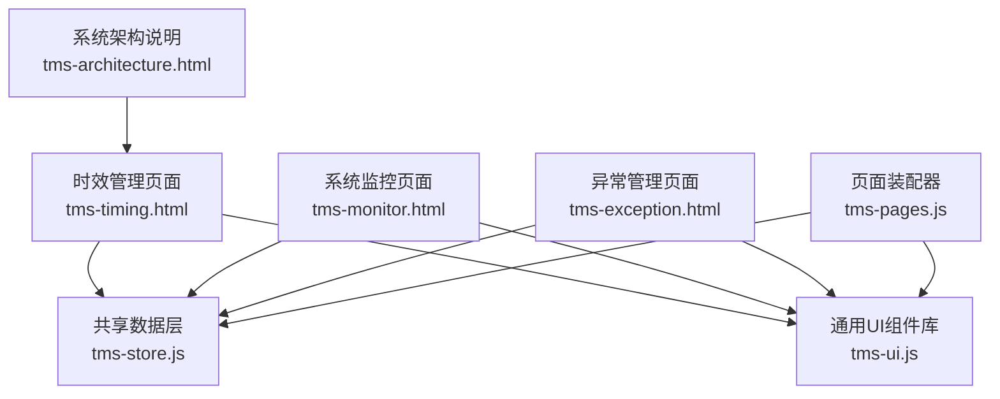
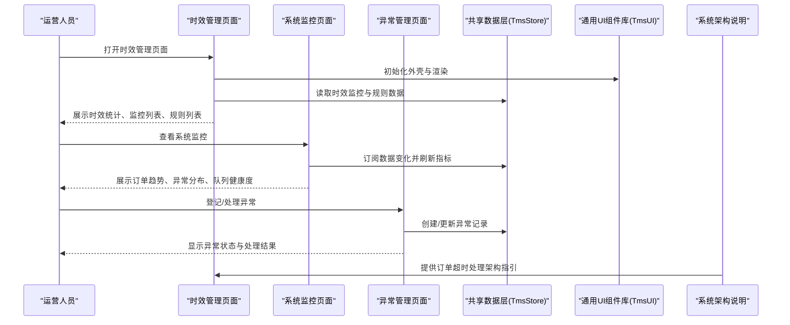
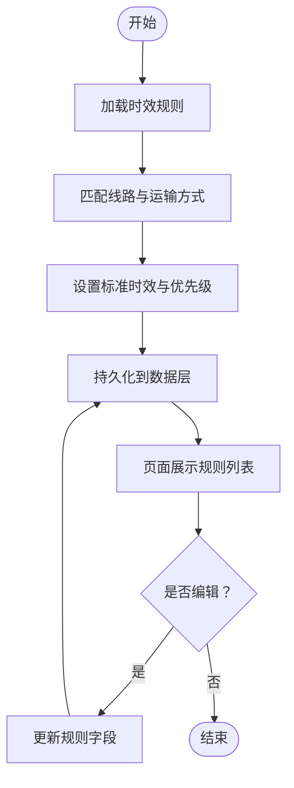
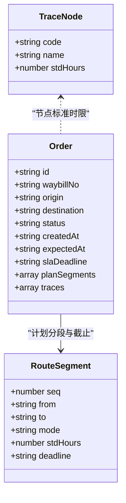
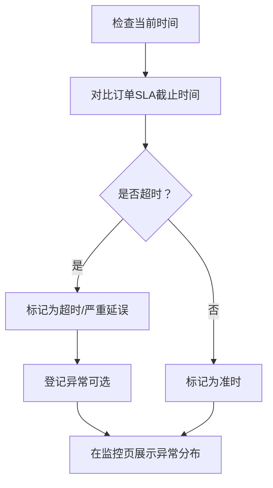
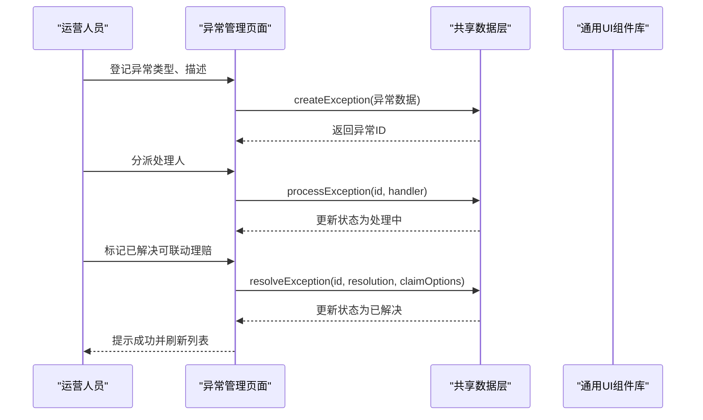
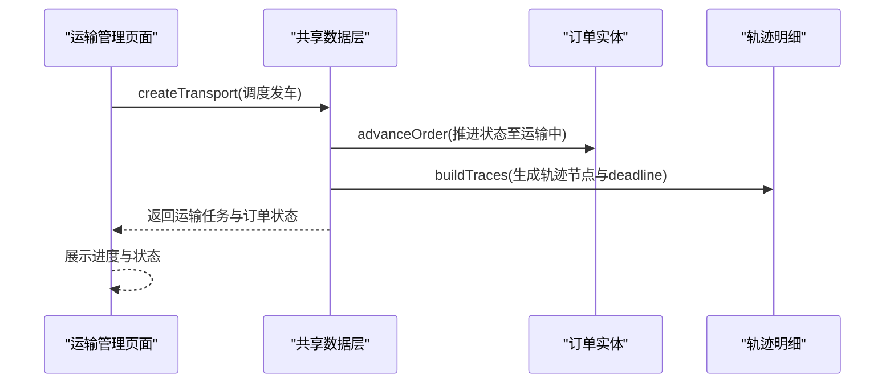
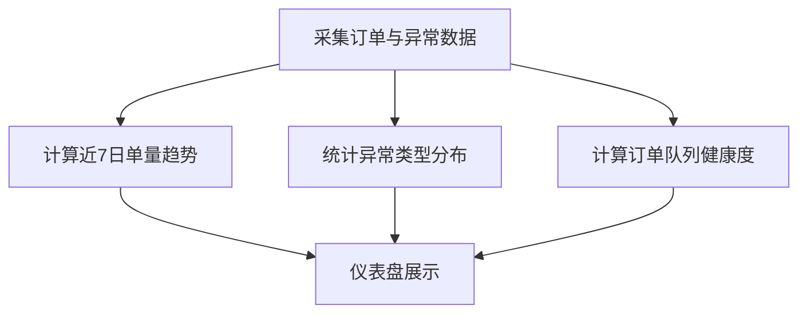
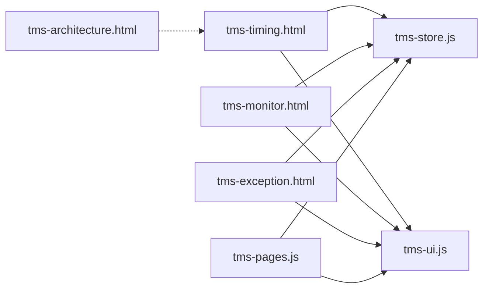

# 时效管理

<cite>
**本文引用的文件**   
- [tms-timing.html](file://tms-timing.html)
- [tms-monitor.html](file://tms-monitor.html)
- [tms-exception.html](file://tms-exception.html)
- [tms-store.js](file://tms-store.js)
- [tms-ui.js](file://tms-ui.js)
- [tms-pages.js](file://tms-pages.js)
- [tms-architecture.html](file://tms-architecture.html)
</cite>

## 目录
1. [引言](#引言)
2. [项目结构](#项目结构)
3. [核心组件](#核心组件)
4. [架构总览](#架构总览)
5. [详细组件分析](#详细组件分析)
6. [依赖关系分析](#依赖关系分析)
7. [性能与可扩展性](#性能与可扩展性)
8. [故障排查指南](#故障排查指南)
9. [结论](#结论)
10. [附录：接口与模型参考](#附录接口与模型参考)

## 引言
本文件面向TMS系统的“时效管理”能力，围绕时效规则配置、SLA监控、超时预警、节点时间控制、违约处理等关键机制展开。系统以浏览器端本地数据为核心，通过共享数据层统一维护订单、轨迹、异常、运输任务等实体，并在多个运营页面中复用同一套KPI、图表与表格组件。时效管理在现有代码中以“时效监控+时效规则”的界面形态呈现，同时由底层数据层提供路由计划、轨迹节点标准时限、订单SLA截止时间等支撑能力。

## 项目结构
时效管理相关的前端页面与脚本分布如下：
- tms-timing.html：时效管理主页面，包含时效统计、时效监控列表、时效规则列表及基础交互。
- tms-monitor.html：系统监控页，展示订单趋势、异常分布、队列健康度、设备状态等，可作为时效异常的宏观观察入口。
- tms-exception.html：异常管理页，承接时效违约产生的延迟送达等异常事件。
- tms-store.js：共享业务数据层，负责种子数据生成、CRUD、状态流转、路由与轨迹计算、时效相关字段（如slaDeadline、planSegments、traces）构造。
- tms-ui.js：通用UI组件库，提供表格、表单弹窗、KPI、SVG图表、详情展示等。
- tms-pages.js：管理员端页面装配器，将各业务模块装配为“KPI + 图表 + 表格 + CRUD”的统一结构。
- tms-architecture.html：系统架构说明，包含定时任务与订单超时处理的架构描述。

**图示来源**
- [tms-timing.html:319-573](file://tms-timing.html#L319-L573)
- [tms-monitor.html:289-436](file://tms-monitor.html#L289-L436)
- [tms-exception.html:296-453](file://tms-exception.html#L296-L453)
- [tms-store.js:1-12](file://tms-store.js#L1-L12)
- [tms-ui.js:1-6](file://tms-ui.js#L1-L6)
- [tms-pages.js:1-6](file://tms-pages.js#L1-L6)
- [tms-architecture.html:1452-1467](file://tms-architecture.html#L1452-L1467)

**章节来源**
- [tms-timing.html:319-573](file://tms-timing.html#L319-L573)
- [tms-monitor.html:289-436](file://tms-monitor.html#L289-L436)
- [tms-exception.html:296-453](file://tms-exception.html#L296-L453)
- [tms-store.js:1-12](file://tms-store.js#L1-L12)
- [tms-ui.js:1-6](file://tms-ui.js#L1-L6)
- [tms-pages.js:1-6](file://tms-pages.js#L1-L6)
- [tms-architecture.html:1452-1467](file://tms-architecture.html#L1452-L1467)

## 核心组件
- 共享数据层（TmsStore）
  - 职责：基于localStorage的轻量业务数据库；首次访问生成真实感种子数据；提供统一的增删改查、搜索、筛选、排序、分页；维护订单全生命周期状态流转并自动写入扫描、运输、财务等关联记录；提供各页面所需的统计聚合（KPI、趋势、分布、日报）。
  - 时效相关能力：定义轨迹节点字典（含标准时限stdHours）、订单阶段索引、路由计划与逐段deadline、订单SLA截止时间（slaDeadline）、轨迹明细（含isOvertime/isDeviant标记）。
- 通用UI组件库（TmsUI）
  - 职责：提供列表、搜索/筛选/分页、表单弹窗、确认框、Toast、SVG图表等能力；所有组件以tms-前缀命名避免样式冲突。
  - 时效相关能力：KPI卡片、折线图/环形图用于时效趋势与异常分布、详情时间线用于订单轨迹展示。
- 页面装配器（TmsPages）
  - 职责：将各业务页统一装配为“KPI + 图表 + 可筛选分页表格 + CRUD操作”的结构；每个页面只需调用render(pageId)。
  - 时效相关能力：异常管理、运输管理等页面与时效流程紧密耦合，例如调度发车会推进订单状态，影响时效评估。
- 时效管理页面（tms-timing.html）
  - 职责：展示时效统计（准时率、平均延误小时、今日时效订单、待处理延误）、时效监控列表（订单号、运单号、起点、终点、预计送达、实际送达、时效状态、延误时长）、时效规则列表（规则ID、线路、运输方式、标准时效、优先级、状态）。
  - 交互：查看时效详情、编辑时效规则、分析时效数据（当前为占位逻辑，可接入后端或数据层扩展）。

**章节来源**
- [tms-store.js:1-12](file://tms-store.js#L1-L12)
- [tms-ui.js:1-6](file://tms-ui.js#L1-L6)
- [tms-pages.js:1-6](file://tms-pages.js#L1-L6)
- [tms-timing.html:400-557](file://tms-timing.html#L400-L557)

## 架构总览
时效管理的整体架构由“页面层—数据层—UI组件层—架构说明”构成：
- 页面层：时效管理、系统监控、异常管理等页面负责用户交互与指标展示。
- 数据层：TmsStore集中维护订单、轨迹、异常、运输任务等实体，并提供时效相关的计算与数据结构。
- UI组件层：TmsUI提供一致的表格、表单、图表、详情展示能力。
- 架构说明：tms-architecture.html描述了定时任务与订单超时处理的高层设计。

**图示来源**
- [tms-timing.html:568-573](file://tms-timing.html#L568-L573)
- [tms-monitor.html:419-436](file://tms-monitor.html#L419-L436)
- [tms-exception.html:448-453](file://tms-exception.html#L448-L453)
- [tms-store.js:1-12](file://tms-store.js#L1-L12)
- [tms-ui.js:758-781](file://tms-ui.js#L758-L781)
- [tms-architecture.html:1452-1467](file://tms-architecture.html#L1452-L1467)

## 详细组件分析

### 时效规则配置与标准时效设置
- 时效规则模型
  - 字段包括：规则ID、线路、运输方式、标准时效、优先级、状态。
  - 数据来源：种子数据中从路由规则映射生成时效规则，体现不同线路与运输方式的时效目标。
- 标准时效与SLA
  - 订单对象包含slaDeadline字段，表示SLA截止时间；该值通常由下单时间与预期送达时间决定。
  - 路由计划（planSegments）为每段节点设定deadline，结合轨迹节点的标准时限（stdHours）形成节点级时效控制。
- 配置选项与参数
  - 线路：起终点城市或全国范围。
  - 运输方式：陆运、空运等。
  - 标准时效：以小时或天为单位（如“12小时”“1天”）。
  - 优先级：高/中/低，影响规则匹配与资源分配。
  - 状态：生效中/已暂停/已失效。
- 返回值与展示
  - 时效规则列表返回上述字段，支持查看与编辑（当前为占位逻辑）。

**图示来源**
- [tms-timing.html:503-557](file://tms-timing.html#L503-L557)
- [tms-store.js:646-655](file://tms-store.js#L646-L655)

**章节来源**
- [tms-timing.html:503-557](file://tms-timing.html#L503-L557)
- [tms-store.js:646-655](file://tms-store.js#L646-L655)

### 节点时间控制与轨迹时效
- 轨迹节点字典
  - 定义揽收、入库、分拣、装车、发车、干线在途、到达、派送、签收等节点及其标准时限（stdHours）。
- 订单阶段索引
  - 将订单状态映射到轨迹节点，便于按阶段生成轨迹明细。
- 路由计划与逐段deadline
  - planRoute根据起终点匹配路由，累加各段stdHours计算每段的deadline。
- 轨迹明细构建
  - buildTraces根据订单进度与节点标准时限生成轨迹条目，并标记isOvertime与isDeviant，用于超时与偏差识别。

**图示来源**
- [tms-store.js:194-213](file://tms-store.js#L194-L213)
- [tms-store.js:426-440](file://tms-store.js#L426-L440)
- [tms-store.js:442-460](file://tms-store.js#L442-L460)

**章节来源**
- [tms-store.js:194-213](file://tms-store.js#L194-L213)
- [tms-store.js:426-440](file://tms-store.js#L426-L440)
- [tms-store.js:442-460](file://tms-store.js#L442-L460)

### SLA监控与超时预警
- 时效监控列表
  - 展示订单号、运单号、起点、终点、预计送达、实际送达、时效状态（准时/延误/严重延误）、延误时长。
- 超时判定
  - 依据订单slaDeadline与当前时间比较，结合轨迹节点的isOvertime标记判断是否超时。
- 预警与异常联动
  - 当出现延迟送达等异常时，可在异常管理页面登记并处理；系统监控页展示异常类型分布，辅助时效问题定位。
- 监控指标
  - 准时率、平均延误小时、今日时效订单数、待处理延误数。

**图示来源**
- [tms-timing.html:425-500](file://tms-timing.html#L425-L500)
- [tms-exception.html:378-437](file://tms-exception.html#L378-L437)
- [tms-monitor.html:447-489](file://tms-monitor.html#L447-L489)

**章节来源**
- [tms-timing.html:425-500](file://tms-timing.html#L425-L500)
- [tms-exception.html:378-437](file://tms-exception.html#L378-L437)
- [tms-monitor.html:447-489](file://tms-monitor.html#L447-L489)

### 违约处理与异常闭环
- 异常类型
  - 延迟送达、货物损坏、信息不符、地址错误、丢件、拒收等。
- 处理流程
  - 登记异常 → 分派处理人 → 处理中 → 解决并闭环（可联动理赔）。
- 与时效的关系
  - 时效违约（超时）常触发“延迟送达”异常；异常处理结果影响时效统计与考核。

**图示来源**
- [tms-pages.js:171-246](file://tms-pages.js#L171-L246)
- [tms-exception.html:448-503](file://tms-exception.html#L448-L503)

**章节来源**
- [tms-pages.js:171-246](file://tms-pages.js#L171-L246)
- [tms-exception.html:448-503](file://tms-exception.html#L448-L503)

### 与订单流转、运输调度的关联
- 订单状态流转
  - 待入库 → 已入库 → 已分拣 → 运输中 → 已到达 → 派送中 → 已签收。
- 运输调度
  - 调度发车会创建运输任务并推进订单状态至“运输中”，影响时效评估与轨迹生成。
- 轨迹与SLA
  - 订单轨迹与SLA截止时间共同决定时效状态；运输任务ETA与订单expectedAt/slaDeadline联动。

**图示来源**
- [tms-pages.js:289-318](file://tms-pages.js#L289-L318)
- [tms-store.js:442-460](file://tms-store.js#L442-L460)

**章节来源**
- [tms-pages.js:289-318](file://tms-pages.js#L289-L318)
- [tms-store.js:442-460](file://tms-store.js#L442-L460)

### 时效评估模型、KPI指标与统计分析
- KPI指标
  - 准时率、平均延误小时、今日时效订单数、待处理延误数。
  - 系统监控页展示在线用户、待作业订单、在途运输、扫描设备在线、待处理异常等宏观指标。
- 统计分析
  - 近7日单量趋势（新建订单/签收订单）。
  - 异常类型分布（环形图）。
  - 订单队列健康度（状态分布）。
- 高级功能
  - 轨迹中心检索汇总全部轨迹（tracePool），支持按节点、地点、超时/偏差标记查询。
  - 考核指标（如签收率、准时率、异常处理时效、客户满意度、扫描完整率、投诉率）与权重，用于绩效评估。

**图示来源**
- [tms-monitor.html:447-489](file://tms-monitor.html#L447-L489)
- [tms-store.js:669-678](file://tms-store.js#L669-L678)

**章节来源**
- [tms-monitor.html:447-489](file://tms-monitor.html#L447-L489)
- [tms-store.js:669-678](file://tms-store.js#L669-L678)

## 依赖关系分析
- 页面与数据层
  - tms-timing.html、tms-monitor.html、tms-exception.html均依赖tms-store.js获取业务数据。
- 页面与UI组件
  - 所有页面通过tms-ui.js使用表格、表单、图表、详情展示等能力。
- 页面装配器
  - tms-pages.js统一装配各业务页面，并与tms-store.js和tms-ui.js协作。
- 架构说明
  - tms-architecture.html提供定时任务与订单超时处理的设计背景，指导时效管理扩展。

**图示来源**
- [tms-timing.html:563-573](file://tms-timing.html#L563-L573)
- [tms-monitor.html:415-436](file://tms-monitor.html#L415-L436)
- [tms-exception.html:443-453](file://tms-exception.html#L443-L453)
- [tms-store.js:1-12](file://tms-store.js#L1-L12)
- [tms-ui.js:758-781](file://tms-ui.js#L758-L781)
- [tms-pages.js:1-6](file://tms-pages.js#L1-L6)
- [tms-architecture.html:1452-1467](file://tms-architecture.html#L1452-L1467)

**章节来源**
- [tms-timing.html:563-573](file://tms-timing.html#L563-L573)
- [tms-monitor.html:415-436](file://tms-monitor.html#L415-L436)
- [tms-exception.html:443-453](file://tms-exception.html#L443-L453)
- [tms-store.js:1-12](file://tms-store.js#L1-L12)
- [tms-ui.js:758-781](file://tms-ui.js#L758-L781)
- [tms-pages.js:1-6](file://tms-pages.js#L1-L6)
- [tms-architecture.html:1452-1467](file://tms-architecture.html#L1452-L1467)

## 性能与可扩展性
- 性能特性
  - 数据层基于localStorage，适合演示与轻量场景；大数据量时需考虑分页与缓存优化。
  - 监控页每15秒自动刷新，避免频繁DOM重绘。
- 可扩展点
  - 时效规则与SLA可对接后端API，实现动态配置与实时校验。
  - 超时检测可由定时任务驱动，结合消息通知与工单升级策略。
  - 轨迹与SLA计算可引入更复杂的地理围栏与运力约束。

[本节为通用建议，不直接分析具体文件]

## 故障排查指南
- 时效监控无数据
  - 检查数据层是否正确初始化与持久化；确认订单与轨迹数据是否存在。
- 异常无法登记或处理
  - 检查异常管理页面的表单字段与提交逻辑；确认数据层方法是否被调用。
- 监控指标不更新
  - 检查订阅机制与定时器；确认localStorage变更事件是否触发。
- 时效规则编辑无效
  - 当前为占位逻辑，需扩展后端或数据层保存逻辑。

**章节来源**
- [tms-monitor.html:419-436](file://tms-monitor.html#L419-L436)
- [tms-exception.html:448-503](file://tms-exception.html#L448-L503)
- [tms-timing.html:598-627](file://tms-timing.html#L598-L627)

## 结论
TMS时效管理在当前代码库中以“时效监控+时效规则”的界面形态呈现，并由共享数据层提供路由计划、轨迹节点标准时限、订单SLA截止时间等核心能力。时效违约通过异常管理进行闭环处理，系统监控页提供宏观指标与趋势分析。未来可进一步对接后端API、引入定时任务与消息通知，完善时效评估模型与KPI体系，提升时效管控的自动化与智能化水平。

[本节为总结性内容，不直接分析具体文件]

## 附录：接口与模型参考
- 时效规则模型
  - 字段：id、route、mode、standard、priority、status。
  - 用途：定义线路与运输方式的时效目标，供时效监控与SLA评估使用。
- 订单模型（时效相关）
  - 字段：slaDeadline、expectedAt、planSegments、traces。
  - 用途：SLA截止时间、计划分段与截止、轨迹明细（含超时/偏差标记）。
- 轨迹节点模型
  - 字段：code、name、stdHours。
  - 用途：定义各作业环节的标准时限，支撑节点级时效控制。
- 异常模型
  - 字段：id、orderId、waybillNo、type、occurredAt、status、handler、resolution。
  - 用途：记录和处理时效违约及其他异常情况。

**章节来源**
- [tms-store.js:646-655](file://tms-store.js#L646-L655)
- [tms-store.js:739-777](file://tms-store.js#L739-L777)
- [tms-store.js:194-213](file://tms-store.js#L194-L213)
- [tms-pages.js:171-246](file://tms-pages.js#L171-L246)