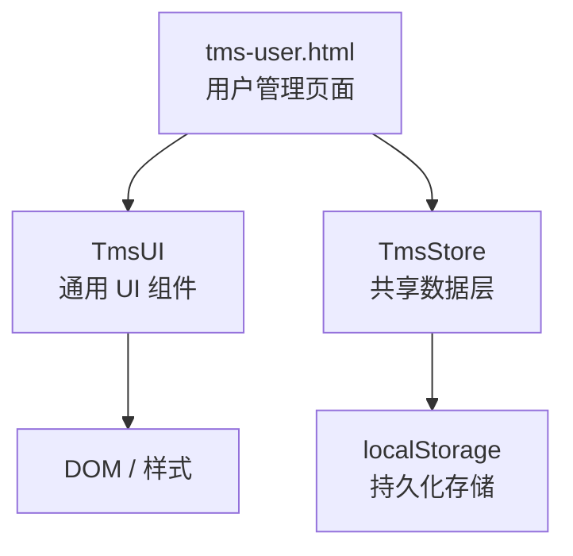
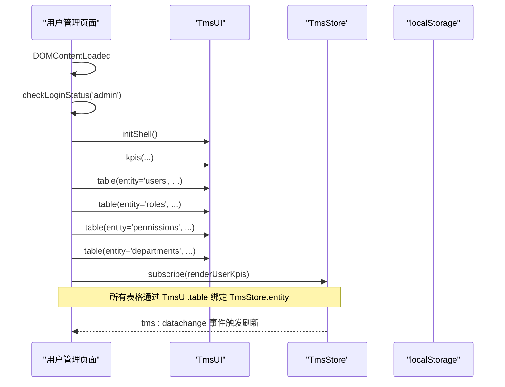
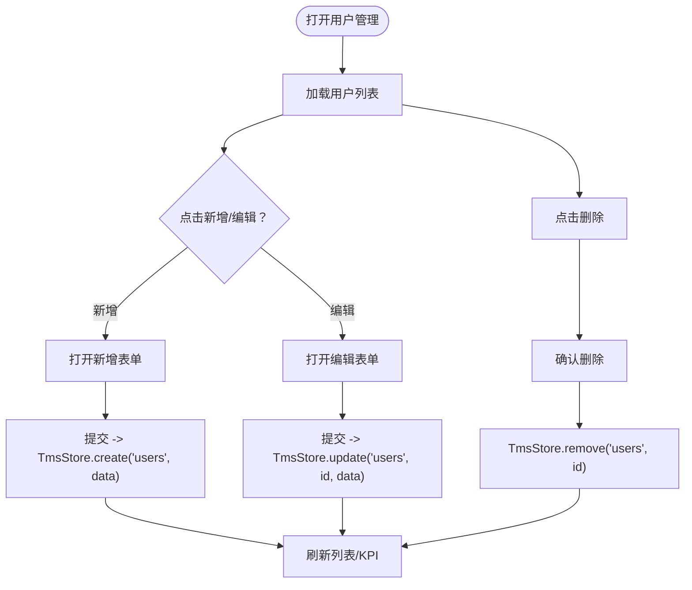
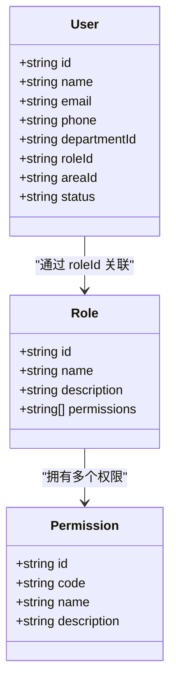
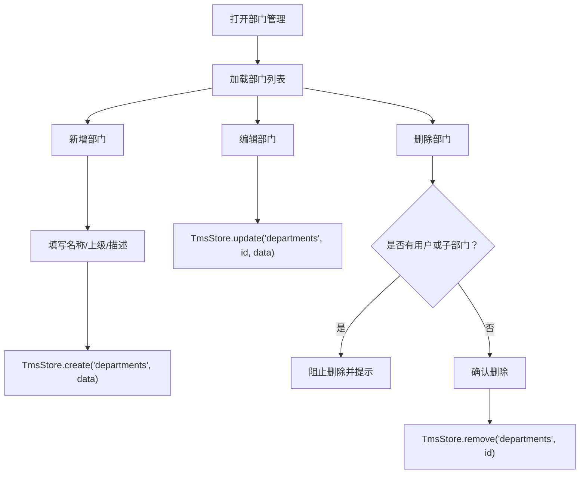
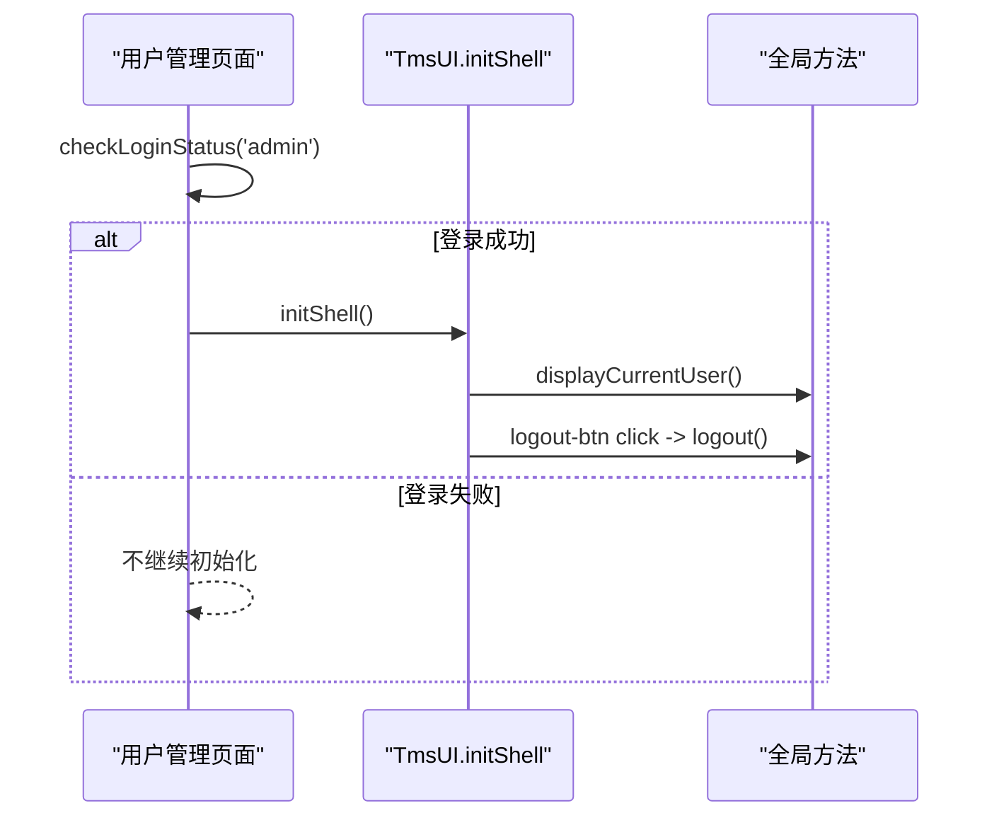
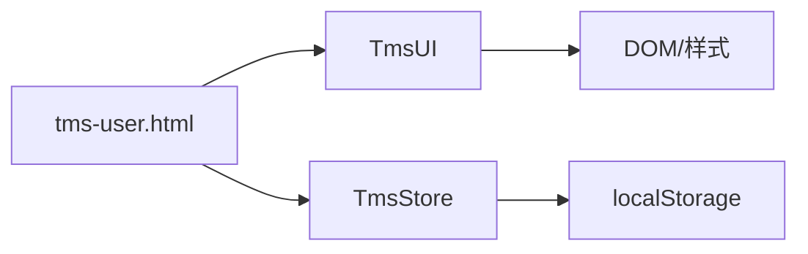

# 用户管理

<cite>
**本文引用的文件**   
- [tms-user.html](file://tms-user.html)
- [tms-store.js](file://tms-store.js)
- [tms-ui.js](file://tms-ui.js)
</cite>

## 目录
1. [引言](#引言)
2. [项目结构](#项目结构)
3. [核心组件](#核心组件)
4. [架构总览](#架构总览)
5. [详细组件分析](#详细组件分析)
6. [依赖关系分析](#依赖关系分析)
7. [性能与扩展性](#性能与扩展性)
8. [故障排查指南](#故障排查指南)
9. [结论](#结论)

## 引言
本文件聚焦 TMS 系统的“用户管理”功能，围绕以下目标展开：
- 用户账号管理：用户的增删改查、状态控制、部门与角色绑定。
- 角色权限分配：基于 RBAC 的角色-权限模型，支持按功能点授权。
- 部门组织架构：树形部门结构、父子关系、删除保护。
- 数据层集成：通过 TmsStore 统一读写 localStorage 中的业务数据。
- UI 组件集成：通过 TmsUI 提供表格、表单弹窗、确认框、Toast、KPI 等通用能力。
- 认证与权限：页面级登录校验、当前用户展示、退出登录；RBAC 权限点在种子数据中定义，为后续权限控制提供基础。

该文档既适合前端开发者理解实现细节，也适合产品与运营人员理解业务流程与配置项。

## 项目结构
用户管理功能由三个关键文件组成：
- tms-user.html：用户管理页面视图与交互逻辑，负责渲染 KPI、初始化四个子模块（用户、角色、权限、部门）的表格与表单。
- tms-store.js：共享数据层，维护 users、roles、permissions、departments 等实体，并提供统一的 CRUD、搜索、筛选、分页、订阅事件能力。
- tms-ui.js：共享 UI 组件库，提供 table、formModal、confirm、toast、kpis、initShell 等通用能力。

**图表来源**
- [tms-user.html:521-533](file://tms-user.html#L521-L533)
- [tms-ui.js:758-781](file://tms-ui.js#L758-L781)
- [tms-store.js:1-12](file://tms-store.js#L1-L12)

**章节来源**
- [tms-user.html:521-533](file://tms-user.html#L521-L533)
- [tms-ui.js:758-781](file://tms-ui.js#L758-L781)
- [tms-store.js:1-12](file://tms-store.js#L1-L12)

## 核心组件
本节从系统视角梳理用户管理的核心组件及其职责：

- 用户管理页面（tms-user.html）
  - 入口：DOMContentLoaded 后检查登录状态、初始化外壳、绑定标签页、渲染 KPI、初始化四个表格与表单。
  - 子模块：
    - 用户管理：列表、新增/编辑、删除；字段包括用户名、邮箱、手机号、部门、角色、区域、状态。
    - 角色管理：列表、新增/编辑、删除；字段包括名称、描述、权限集合。
    - 权限管理：列表、新增/编辑、删除；字段包括名称、代码、描述。
    - 部门管理：列表、新增/编辑、删除；字段包括名称、上级部门、描述；支持层级结构与删除保护。

- 共享数据层（tms-store.js）
  - 实体：users、roles、permissions、departments。
  - 能力：list、get、create、update、remove、subscribe、emit。
  - 种子数据：内置部门、权限、角色示例，便于演示与测试。

- 共享 UI 组件（tms-ui.js）
  - 表格：支持 entity 模式自动绑定 TmsStore，具备搜索、筛选、排序、分页、工具栏、行操作。
  - 表单弹窗：动态生成表单，支持必填校验、异步提交、错误提示、成功反馈。
  - 确认框：Promise 风格的用户确认。
  - Toast：轻量消息提示。
  - KPI：统计卡片渲染。
  - initShell：导航高亮、退出按钮绑定、当前用户展示。

**章节来源**
- [tms-user.html:521-834](file://tms-user.html#L521-L834)
- [tms-store.js:1-12](file://tms-store.js#L1-L12)
- [tms-ui.js:160-287](file://tms-ui.js#L160-L287)
- [tms-ui.js:303-544](file://tms-ui.js#L303-L544)

## 架构总览
用户管理采用“页面 + 数据层 + UI 组件”的分层架构：
- 页面层（tms-user.html）负责业务编排与交互流程。
- 数据层（tms-store.js）负责数据持久化与变更通知。
- UI 层（tms-ui.js）负责通用界面能力与用户体验。

**图表来源**
- [tms-user.html:521-533](file://tms-user.html#L521-L533)
- [tms-ui.js:303-544](file://tms-ui.js#L303-L544)
- [tms-store.js:232-244](file://tms-store.js#L232-L244)

## 详细组件分析

### 用户账号管理（CRUD）
用户管理提供完整的增删改查能力，并通过 TmsUI.table 与 TmsStore.users 实体联动。

- 列表与筛选
  - 搜索字段：id、name、email、phone。
  - 过滤器：status（启用/禁用）。
  - 默认排序：id 升序。
  - 列显示：用户ID、用户名、邮箱、手机号、部门、角色、管理区域、状态。
  - 部门与角色列通过 nameOf 函数解析 ID 为名称。

- 新增与编辑
  - 使用 TmsUI.formModal 动态构建表单。
  - 字段：name、email、phone、departmentId、roleId、areaId、status。
  - 提交时根据是否已有 row 调用 TmsStore.create 或 TmsStore.update。

- 删除
  - 二次确认：TmsUI.confirm。
  - 成功后调用 TmsStore.remove，并 toast 提示。

**图表来源**
- [tms-user.html:566-638](file://tms-user.html#L566-L638)
- [tms-ui.js:160-287](file://tms-ui.js#L160-L287)
- [tms-ui.js:303-544](file://tms-ui.js#L303-L544)

**章节来源**
- [tms-user.html:566-638](file://tms-user.html#L566-L638)
- [tms-ui.js:160-287](file://tms-ui.js#L160-L287)
- [tms-ui.js:303-544](file://tms-ui.js#L303-L544)

### 角色权限分配（RBAC）
角色与权限采用 RBAC 模型：
- 权限（permissions）：最小授权单元，包含 code、name、description。
- 角色（roles）：一组权限的集合，包含 permissions 数组。
- 用户（users）：通过 roleId 关联角色，从而继承角色拥有的权限。

- 权限管理
  - 列表：id、code、name、description。
  - 新增/编辑：name、code、description。
  - 删除保护：若权限被任何角色引用，则禁止删除。

- 角色管理
  - 列表：id、name、description、permissions 数量。
  - 新增/编辑：name、description、权限多选（动态生成 checkbox）。
  - 删除保护：若角色下仍有用户，则禁止删除。

**图表来源**
- [tms-store.js:144-164](file://tms-store.js#L144-L164)
- [tms-user.html:640-709](file://tms-user.html#L640-L709)
- [tms-user.html:711-766](file://tms-user.html#L711-L766)

**章节来源**
- [tms-store.js:144-164](file://tms-store.js#L144-L164)
- [tms-user.html:640-709](file://tms-user.html#L640-L709)
- [tms-user.html:711-766](file://tms-user.html#L711-L766)

### 部门组织架构管理
部门采用树形结构，通过 parentId 表示父子关系。

- 列表：id、name、parentId（解析为父部门名称）、description、users（账号数）。
- 新增/编辑：name、parentId（可选，排除自身）、description。
- 删除保护：若部门下有用户或子部门，则禁止删除。

**图表来源**
- [tms-user.html:768-829](file://tms-user.html#L768-L829)

**章节来源**
- [tms-user.html:768-829](file://tms-user.html#L768-L829)

### 用户状态管理与认证体系
- 页面级认证：tms-user.html 在 DOMContentLoaded 中调用 checkLoginStatus('admin')，未通过则不继续初始化。
- 当前用户展示：TmsUI.initShell 会尝试调用 global.displayCurrentUser。
- 退出登录：TmsUI.initShell 绑定 logout-btn，调用 global.logout。

注意：checkLoginStatus、displayCurrentUser、logout 的具体实现不在本仓库片段中，但页面已预留钩子。

**图表来源**
- [tms-user.html:521-533](file://tms-user.html#L521-L533)
- [tms-ui.js:703-746](file://tms-ui.js#L703-L746)

**章节来源**
- [tms-user.html:521-533](file://tms-user.html#L521-L533)
- [tms-ui.js:703-746](file://tms-ui.js#L703-L746)

### 接口与数据模型
本节总结用户管理涉及的数据实体与常用操作。

- 实体定义（来自种子数据与页面使用）
  - users：id、name、email、phone、departmentId、roleId、areaId、status。
  - roles：id、name、description、permissions（字符串数组）。
  - permissions：id、code、name、description。
  - departments：id、name、parentId、description。

- 常用操作
  - TmsStore.list(entity, options)：获取列表，支持 search、searchFields、filters、sort、page、pageSize。
  - TmsStore.get(entity, id)：按 ID 获取单条记录。
  - TmsStore.create(entity, data)：新增记录。
  - TmsStore.update(entity, id, data)：更新记录。
  - TmsStore.remove(entity, id)：删除记录。
  - TmsStore.subscribe(fn)：监听数据变更事件。

- 返回值约定
  - list：返回 { rows, total, page } 或纯数组（当 pageSize=0 时通常返回完整 rows）。
  - get：返回对象或 undefined。
  - create/update/remove：同步写入 localStorage 并触发 tms:datachange。

**章节来源**
- [tms-store.js:134-171](file://tms-store.js#L134-L171)
- [tms-store.js:232-244](file://tms-store.js#L232-L244)
- [tms-user.html:548-558](file://tms-user.html#L548-L558)
- [tms-user.html:604-608](file://tms-user.html#L604-L608)

### 与 TmsStore 和 TmsUI 的集成方式
- TmsStore 集成
  - 页面通过 TmsStore.list 读取 users、roles、permissions、departments。
  - 页面通过 TmsStore.create/update/remove 修改数据。
  - 页面通过 TmsStore.subscribe 订阅数据变更，用于刷新 KPI 与表格。

- TmsUI 集成
  - 表格：U.table(container, config)，config 指定 entity、columns、actions、toolbar、filters、searchFields 等。
  - 表单：U.formModal(options)，options.fields 动态生成表单控件，onSubmit 处理保存逻辑。
  - 确认：U.confirm({ title, message, okText, danger }) 返回 Promise。
  - Toast：U.toast(message, type)。
  - KPI：U.kpis(container, items)。
  - 外壳：U.initShell() 处理导航高亮、退出按钮、当前用户展示。

**章节来源**
- [tms-user.html:521-533](file://tms-user.html#L521-L533)
- [tms-user.html:566-638](file://tms-user.html#L566-L638)
- [tms-user.html:640-709](file://tms-user.html#L640-L709)
- [tms-user.html:711-766](file://tms-user.html#L711-L766)
- [tms-user.html:768-829](file://tms-user.html#L768-L829)
- [tms-ui.js:160-287](file://tms-ui.js#L160-L287)
- [tms-ui.js:303-544](file://tms-ui.js#L303-L544)
- [tms-ui.js:703-746](file://tms-ui.js#L703-L746)

## 依赖关系分析
用户管理页面的依赖关系如下：
- tms-user.html 依赖 TmsUI 与 TmsStore。
- TmsUI 提供通用 UI 能力，不直接依赖业务数据。
- TmsStore 提供数据访问与事件机制，不依赖 UI。

**图表来源**
- [tms-user.html:518-520](file://tms-user.html#L518-L520)
- [tms-ui.js:758-781](file://tms-ui.js#L758-L781)
- [tms-store.js:1-12](file://tms-store.js#L1-L12)

**章节来源**
- [tms-user.html:518-520](file://tms-user.html#L518-L520)
- [tms-ui.js:758-781](file://tms-ui.js#L758-L781)
- [tms-store.js:1-12](file://tms-store.js#L1-L12)

## 性能与扩展性
- 性能
  - 表格分页：默认 pageSize=8，减少 DOM 渲染压力。
  - 搜索防抖：TmsUI.table 对搜索输入进行 220ms 防抖，避免频繁重绘。
  - 事件订阅：TmsStore.subscribe 仅在必要时刷新，避免全量重渲染。

- 扩展性
  - 权限点可扩展：在 PERMISSIONS 中添加新权限，并在 ROLES 中组合。
  - 部门层级可扩展：通过 parentId 自由扩展组织树。
  - 用户字段可扩展：在 users 实体上增加字段，并在表单中配置 fields。

[本节为通用指导，不涉及具体文件分析]

## 故障排查指南
- 无法加载用户列表
  - 检查 TmsStore.list('users') 是否返回数据。
  - 检查 localStorage 中 tmsDB_v3 是否存在且版本匹配。
  - 检查 TmsUI.table 的 entity 配置是否正确。

- 表单提交无响应
  - 检查 onSubmit 是否调用 TmsStore.create/update。
  - 检查必填字段是否满足 required 校验。
  - 检查 TmsUI.formModal 的 successText 与 toast 是否正常显示。

- 删除被阻止
  - 角色删除：检查是否有用户 roleId 指向该角色。
  - 权限删除：检查是否有角色的 permissions 包含该权限。
  - 部门删除：检查是否有用户 departmentId 指向该部门，或是否有子部门。

- 认证相关
  - checkLoginStatus('admin') 返回 undefined 时页面不会初始化。
  - displayCurrentUser 与 logout 需在全局作用域实现，否则 initShell 不会报错但功能不可用。

**章节来源**
- [tms-user.html:521-533](file://tms-user.html#L521-L533)
- [tms-user.html:640-709](file://tms-user.html#L640-L709)
- [tms-user.html:711-766](file://tms-user.html#L711-L766)
- [tms-user.html:768-829](file://tms-user.html#L768-L829)
- [tms-ui.js:160-287](file://tms-ui.js#L160-L287)
- [tms-ui.js:303-544](file://tms-ui.js#L303-L544)

## 结论
TMS 用户管理功能以清晰的三层架构实现：页面负责业务编排，数据层负责持久化与事件通知，UI 组件负责通用界面能力。通过 RBAC 模型与树形部门结构，系统具备良好的可扩展性与可维护性。在实际使用中，建议：
- 完善认证与权限校验逻辑，确保前后端一致。
- 扩展权限点与角色组合，贴合企业实际岗位需求。
- 优化大数据量下的表格性能，考虑服务端分页与虚拟滚动。
- 增强错误提示与审计日志，提升运维可观测性。

[本节为总结性内容，不涉及具体文件分析]