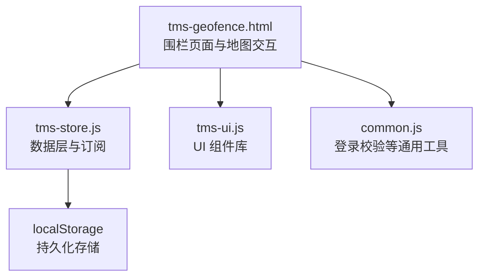
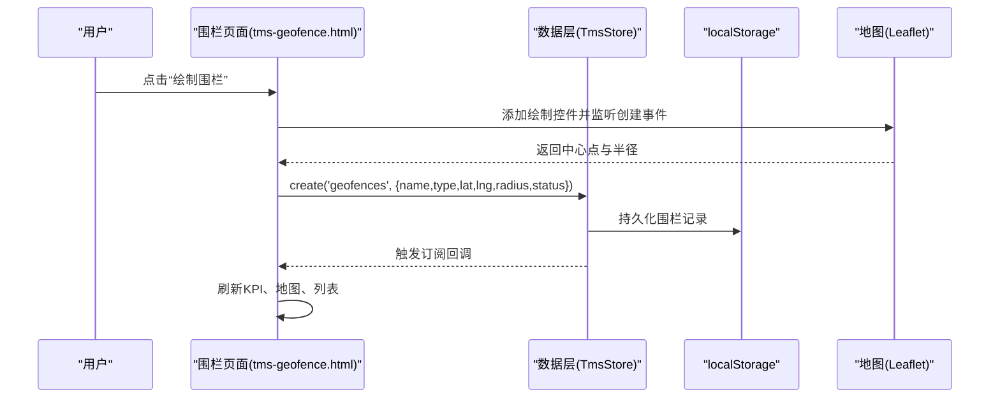
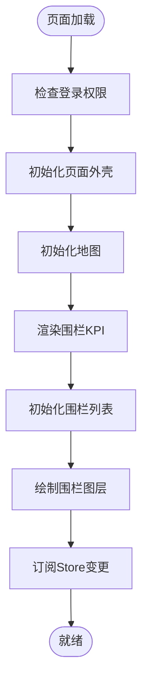
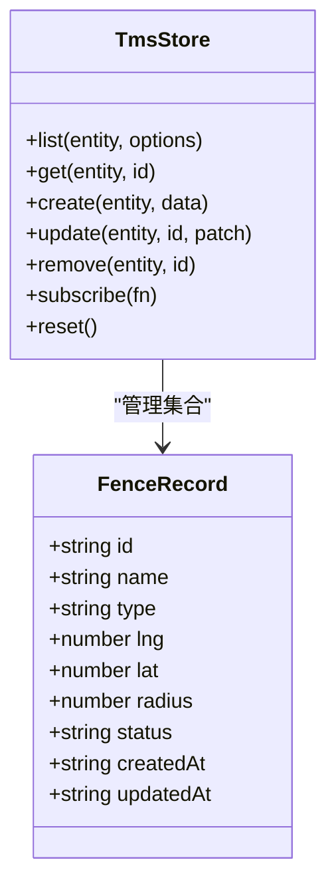
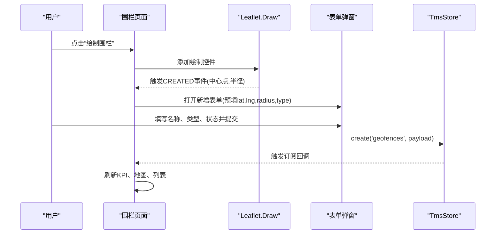
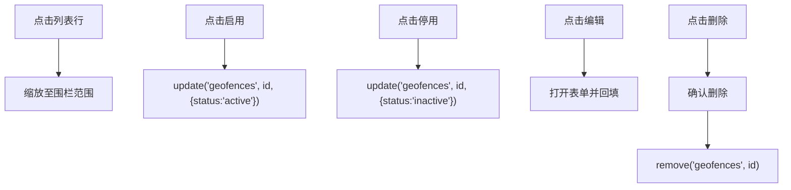
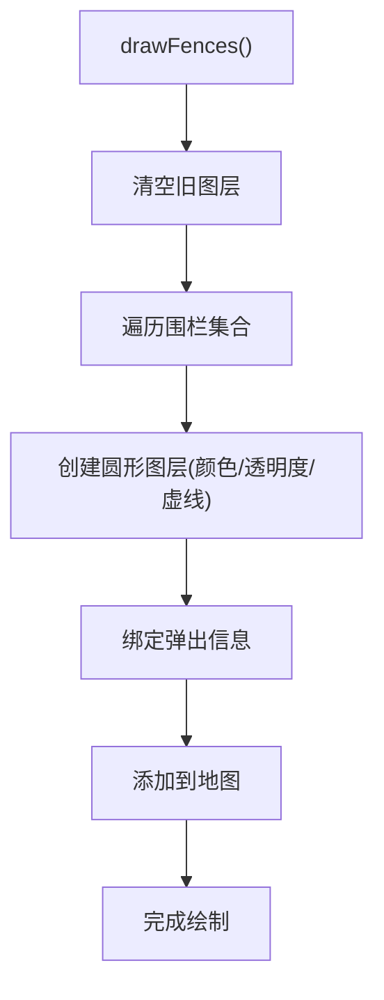
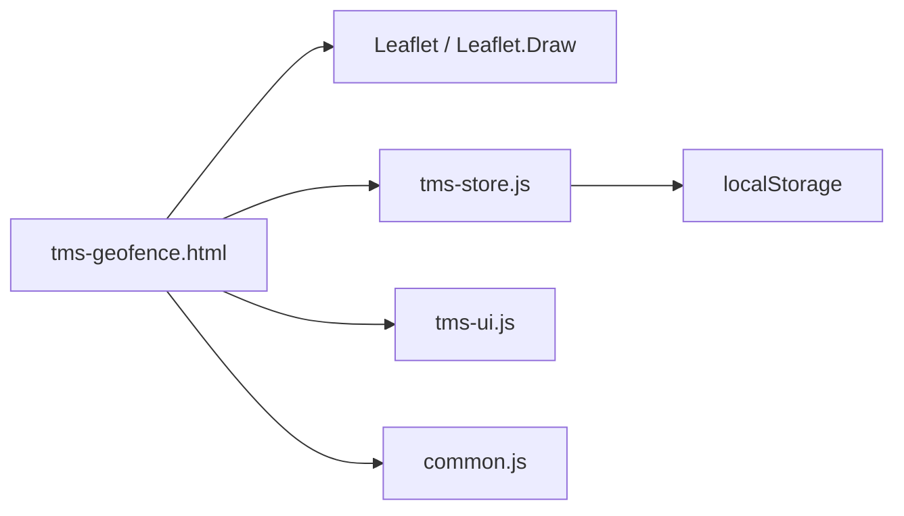

# 电子围栏

<cite>
**本文引用的文件**   
- [tms-geofence.html](file://tms-geofence.html)
- [tms-store.js](file://tms-store.js)
- [common.js](file://common.js)
- [tms-ui.js](file://tms-ui.js)
</cite>

## 目录
1. [引言](#引言)
2. [项目结构](#项目结构)
3. [核心组件](#核心组件)
4. [架构总览](#架构总览)
5. [详细组件分析](#详细组件分析)
6. [依赖关系分析](#依赖关系分析)
7. [性能与扩展性](#性能与扩展性)
8. [故障排查指南](#故障排查指南)
9. [结论](#结论)
10. [附录：数据模型与接口约定](#附录数据模型与接口约定)

## 引言
本章节面向 TMS 系统的“电子围栏”能力，围绕地理围栏定义、区域管理、进出告警等空间位置管控进行系统化说明。当前仓库实现以浏览器端地图交互为主，结合本地存储的数据层，提供围栏的可视化绘制、列表维护、启停控制以及与业务数据的联动展示。文档将基于实际代码，解释围栏绘制、区域设置、状态管理等核心流程，并给出后续接入 GPS 定位、车辆跟踪、GIS 计算与实时告警的技术建议。

## 项目结构
电子围栏功能主要由以下文件协作完成：
- tms-geofence.html：围栏页面 UI、地图初始化、围栏绘制与列表渲染逻辑。
- tms-store.js：系统统一数据层，包含围栏种子数据、CRUD 操作、订阅机制与持久化。
- common.js：通用工具（如登录校验）。
- tms-ui.js：通用 UI 组件（表格、表单弹窗、KPI、Toast 等）。

**图表来源**
- [tms-geofence.html:577-589](file://tms-geofence.html#L577-L589)
- [tms-store.js:1187-1195](file://tms-store.js#L1187-L1195)
- [tms-store.js:1265-1286](file://tms-store.js#L1265-L1286)

**章节来源**
- [tms-geofence.html:577-589](file://tms-geofence.html#L577-L589)
- [tms-store.js:1187-1195](file://tms-store.js#L1187-L1195)

## 核心组件
- 围栏页面控制器：负责地图初始化、围栏绘制、列表渲染、KPI 统计、围栏启用/停用/删除等操作。
- 数据层 Store：提供围栏实体集合的查询、新增、更新、删除、订阅通知与持久化。
- UI 组件库：封装表格、表单弹窗、KPI、Toast 等通用交互。
- 通用工具：登录权限校验、时间处理等基础能力。

关键职责边界：
- 页面只负责用户交互与视图渲染，不直接操作 localStorage。
- Store 负责数据一致性、ID 生成、审计字段填充与持久化。
- UI 组件降低重复代码，提升可维护性。

**章节来源**
- [tms-geofence.html:600-790](file://tms-geofence.html#L600-L790)
- [tms-store.js:1204-1319](file://tms-store.js#L1204-L1319)
- [tms-ui.js](file://tms-ui.js)
- [common.js](file://common.js)

## 架构总览
电子围栏在系统中的整体调用链如下：
- 用户点击“绘制围栏”或“新增围栏”，触发页面函数。
- 页面通过 TmsStore.create/update/remove 修改围栏数据。
- Store 写入内存数据库并持久化到 localStorage，同时触发订阅回调。
- 页面订阅回调刷新 KPI、地图图层与列表。

**图表来源**
- [tms-geofence.html:748-776](file://tms-geofence.html#L748-L776)
- [tms-store.js:1265-1286](file://tms-store.js#L1265-L1286)
- [tms-store.js:1308-1313](file://tms-store.js#L1308-L1313)

## 详细组件分析

### 围栏页面控制器（tms-geofence.html）
- 页面初始化：检查登录权限、初始化 Shell、地图、KPI、围栏列表与围栏图层。
- 地图初始化：使用 Leaflet 加载 OpenStreetMap 底图；若地图组件加载失败，降级为仅列表模式。
- KPI 统计：从 Store 读取围栏集合，统计总数、生效中、已停用、仓储围栏、禁行区域数量。
- 围栏列表：使用 TmsUI.table 渲染，支持搜索、过滤、排序、分页、定位、启用/停用、编辑、删除。
- 围栏绘制：使用 Leaflet.Draw 绘制圆形围栏，获取中心经纬度与半径后打开新增表单预填。
- 地图交互：单个围栏定位、查看所有围栏、取消绘制、重置地图。

**图表来源**
- [tms-geofence.html:577-589](file://tms-geofence.html#L577-L589)
- [tms-geofence.html:600-623](file://tms-geofence.html#L600-L623)
- [tms-geofence.html:633-684](file://tms-geofence.html#L633-L684)
- [tms-geofence.html:723-746](file://tms-geofence.html#L723-L746)

**章节来源**
- [tms-geofence.html:577-589](file://tms-geofence.html#L577-L589)
- [tms-geofence.html:600-623](file://tms-geofence.html#L600-L623)
- [tms-geofence.html:633-684](file://tms-geofence.html#L633-L684)
- [tms-geofence.html:723-746](file://tms-geofence.html#L723-L746)

### 数据层 Store（tms-store.js）
- 围栏种子数据：内置多个城市仓/网点/禁行区域的围栏中心点与半径，按规则分配类型与状态。
- 数据导出：围栏集合挂载到根对象 geofences，供各页面读取。
- CRUD 接口：list/get/create/update/remove 提供统一的增删改查能力，自动填充审计字段与 ID。
- 订阅机制：subscribe 注册回调，数据变更后触发所有订阅者刷新视图。
- 持久化：所有写操作均持久化到 localStorage，保证刷新后数据不丢失。

**图表来源**
- [tms-store.js:573-591](file://tms-store.js#L573-L591)
- [tms-store.js:1120-1127](file://tms-store.js#L1120-L1127)
- [tms-store.js:1204-1319](file://tms-store.js#L1204-L1319)

**章节来源**
- [tms-store.js:573-591](file://tms-store.js#L573-L591)
- [tms-store.js:1120-1127](file://tms-store.js#L1120-L1127)
- [tms-store.js:1204-1319](file://tms-store.js#L1204-L1319)

### 围栏绘制与表单交互
- 绘制流程：
  - 点击“绘制围栏”后，页面添加 Leaflet.Draw 控件，仅允许绘制圆形。
  - 监听 CREATED 事件，提取中心点与半径，移除绘制控件。
  - 打开新增表单，预填经纬度、半径与围栏类型。
- 表单字段：
  - 名称、类型、中心纬度、中心经度、半径（米）、状态。
  - 类型选项包括：仓储围栏、网点围栏、禁行区域、派送围栏、到货围栏、派送员围栏。
  - 状态选项包括：生效中、已停用。
- 提交行为：
  - 新增时调用 TmsStore.create，编辑时调用 TmsStore.update。

**图表来源**
- [tms-geofence.html:748-776](file://tms-geofence.html#L748-L776)
- [tms-geofence.html:686-719](file://tms-geofence.html#L686-L719)
- [tms-store.js:1265-1286](file://tms-store.js#L1265-L1286)

**章节来源**
- [tms-geofence.html:748-776](file://tms-geofence.html#L748-L776)
- [tms-geofence.html:686-719](file://tms-geofence.html#L686-L719)
- [tms-store.js:1265-1286](file://tms-store.js#L1265-L1286)

### 围栏列表与状态管理
- 列表列：围栏ID、名称、类型、纬度、经度、半径、状态。
- 过滤器：类型（仓储围栏、网点围栏、禁行区域、派送围栏、到货围栏、派送员围栏）、状态（生效中、已停用）。
- 动作：
  - 定位：将地图缩放到该围栏范围。
  - 启用/停用：切换 status 为 active/inactive。
  - 编辑：打开表单回填数据。
  - 删除：确认后调用 remove。

**图表来源**
- [tms-geofence.html:633-684](file://tms-geofence.html#L633-L684)
- [tms-store.js:1289-1306](file://tms-store.js#L1289-L1306)

**章节来源**
- [tms-geofence.html:633-684](file://tms-geofence.html#L633-L684)
- [tms-store.js:1289-1306](file://tms-store.js#L1289-L1306)

### 地图图层渲染
- 渲染逻辑：
  - 清空旧图层，遍历围栏集合，为每个围栏创建圆形图层。
  - 根据围栏类型设置颜色，根据状态设置透明度与虚线样式。
  - 绑定弹出信息框显示名称、类型、半径与状态。
- 交互：
  - 点击列表项或“定位”按钮，使用 fitBounds 聚焦围栏范围。
  - “查看所有围栏”聚合所有围栏边界进行适配。

**图表来源**
- [tms-geofence.html:723-746](file://tms-geofence.html#L723-L746)
- [tms-geofence.html:786-800](file://tms-geofence.html#L786-L800)

**章节来源**
- [tms-geofence.html:723-746](file://tms-geofence.html#L723-L746)
- [tms-geofence.html:786-800](file://tms-geofence.html#L786-L800)

## 依赖关系分析
- 外部依赖：
  - Leaflet 与 Leaflet.Draw：用于地图渲染与围栏绘制。
  - OpenStreetMap 瓦片服务：作为地图底图。
- 内部依赖：
  - TmsStore：统一数据访问与持久化。
  - TmsUI：通用 UI 组件。
  - Common：登录校验等通用工具。

**图表来源**
- [tms-geofence.html:563-568](file://tms-geofence.html#L563-L568)
- [tms-store.js:1187-1195](file://tms-store.js#L1187-L1195)

**章节来源**
- [tms-geofence.html:563-568](file://tms-geofence.html#L563-L568)
- [tms-store.js:1187-1195](file://tms-store.js#L1187-L1195)

## 性能与扩展性
- 性能特性：
  - 列表渲染采用分页与过滤，避免一次性渲染大量数据。
  - 地图图层每次重绘前清空旧图层，防止内存泄漏。
  - Store 的 list 方法支持 filters、search、sort、page、pageSize，便于按需查询。
- 扩展建议：
  - 增加围栏几何类型（多边形、折线）以提升复杂区域建模能力。
  - 引入 GIS 后端服务，提供空间索引与高性能距离/包含判断。
  - 接入 GPS 定位与车辆轨迹流，实现实时围栏检测与告警。
  - 增加围栏规则引擎，支持时间段、车辆类型、订单类型等条件组合。

[本节为通用指导，不直接分析具体文件]

## 故障排查指南
- 地图组件加载失败：
  - 现象：提示“地图组件加载失败，围栏列表仍可正常使用”。
  - 原因：Leaflet 脚本未成功加载或网络不可用。
  - 处理：检查 CDN 可用性，降级为仅列表模式继续工作。
- 围栏无法绘制：
  - 现象：点击“绘制围栏”无响应。
  - 原因：地图未初始化或 Leaflet.Draw 未加载。
  - 处理：确认 initMap 执行成功，检查 drawControl 是否正确添加与移除。
- 围栏状态未生效：
  - 现象：启用/停用后地图或列表未刷新。
  - 原因：Store 订阅未触发或页面未重新渲染。
  - 处理：确认 update 调用成功且 subscribe 回调执行，检查 drawFences 与 renderGeoKpis 是否被调用。

**章节来源**
- [tms-geofence.html:600-609](file://tms-geofence.html#L600-L609)
- [tms-geofence.html:748-784](file://tms-geofence.html#L748-L784)
- [tms-store.js:1289-1313](file://tms-store.js#L1289-L1313)

## 结论
当前电子围栏实现以浏览器端地图交互为核心，配合本地数据层提供围栏的可视化绘制、列表管理与状态控制。其优势在于快速上手、易于维护；不足在于缺乏后端空间计算与实时告警能力。建议在现有基础上逐步引入 GIS 服务、GPS 定位与车辆跟踪集成，完善围栏检测与告警闭环，提升运输过程的空间管控能力。

[本节为总结性内容，不直接分析具体文件]

## 附录：数据模型与接口约定

### 围栏实体模型
- 字段说明：
  - id：围栏唯一标识，默认前缀 GF。
  - name：围栏名称。
  - type：围栏类型，可选值包括仓储围栏、网点围栏、禁行区域、派送围栏、到货围栏、派送员围栏。
  - lng：中心经度。
  - lat：中心纬度。
  - radius：半径（米），有效范围 50~50000。
  - status：状态，active 表示生效中，inactive 表示已停用。
  - createdAt：创建时间。
  - updatedAt：更新时间。

**章节来源**
- [tms-store.js:573-591](file://tms-store.js#L573-L591)
- [tms-store.js:1265-1286](file://tms-store.js#L1265-L1286)
- [tms-geofence.html:699-712](file://tms-geofence.html#L699-L712)

### 围栏相关接口约定
- 查询列表：
  - 接口：TmsStore.list('geofences', options)
  - 参数：
    - search：关键词
    - searchFields：['id','name','type']
    - filters：{type, status}
    - sort：{key, dir}
    - page：页码
    - pageSize：每页条数
  - 返回：{rows, total, page, pageSize, pages}
- 新增围栏：
  - 接口：TmsStore.create('geofences', data)
  - 参数：{name, type, lat, lng, radius, status}
  - 返回：新增后的围栏记录
- 更新围栏：
  - 接口：TmsStore.update('geofences', id, patch)
  - 参数：patch 可为 {status} 或其他可更新字段
  - 返回：更新后的围栏记录
- 删除围栏：
  - 接口：TmsStore.remove('geofences', id)
  - 返回：布尔值

**章节来源**
- [tms-store.js:1204-1319](file://tms-store.js#L1204-L1319)
- [tms-geofence.html:633-684](file://tms-geofence.html#L633-L684)
- [tms-geofence.html:714-718](file://tms-geofence.html#L714-L718)

### 与 GPS 定位与车辆跟踪的集成建议
- 数据源对接：
  - 接收 GPS 上报点位（经度、纬度、时间戳、设备ID、车辆ID）。
  - 将点位序列与车辆主数据关联，形成轨迹流。
- 围栏检测算法：
  - 对每个新点位，遍历生效中的围栏，判断是否在圆内（或更复杂的几何形状）。
  - 记录进入/离开事件，合并去抖，避免频繁告警。
- 告警规则配置：
  - 支持按围栏类型、时间段、车辆类型、订单类型等维度配置告警策略。
  - 告警消息推送至监控中心或运营工作台。
- 实时监控：
  - 使用 WebSocket 或 Server-Sent Events 推送围栏检测结果。
  - 前端实时更新地图标记与告警列表。

[本节为概念性设计，不直接分析具体文件]