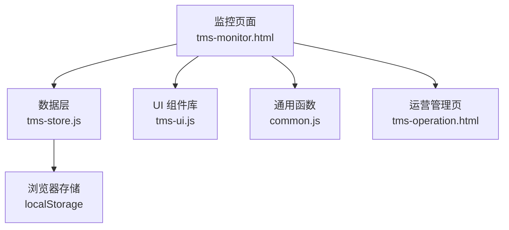
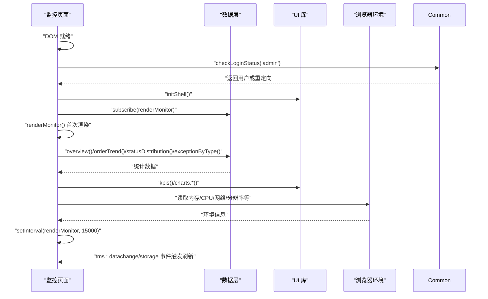
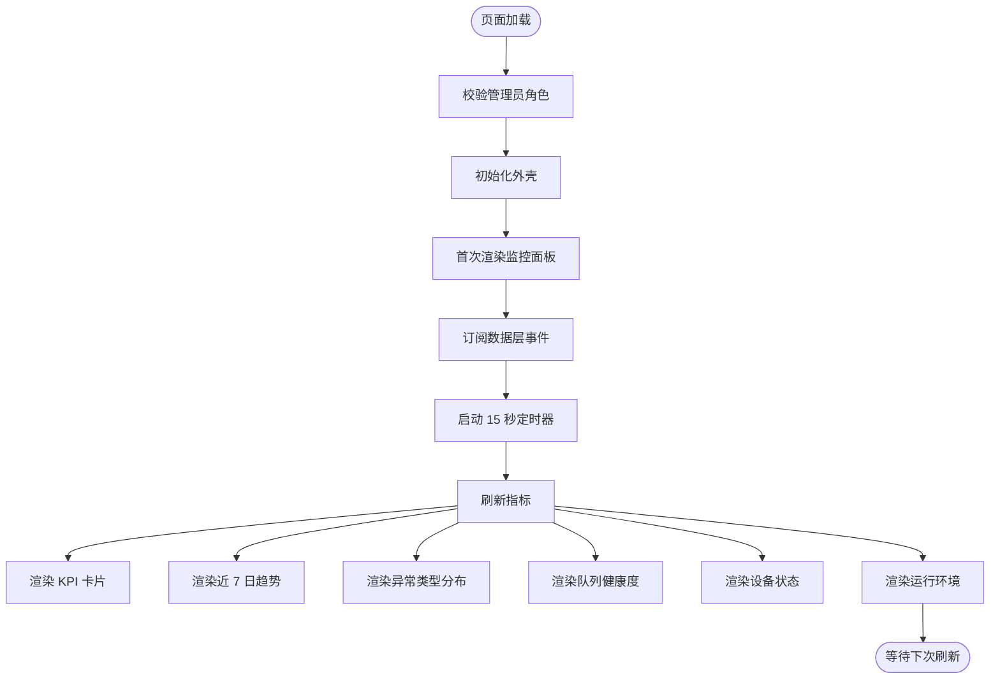
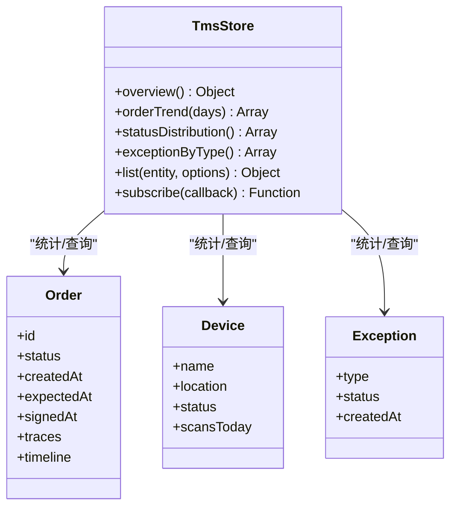
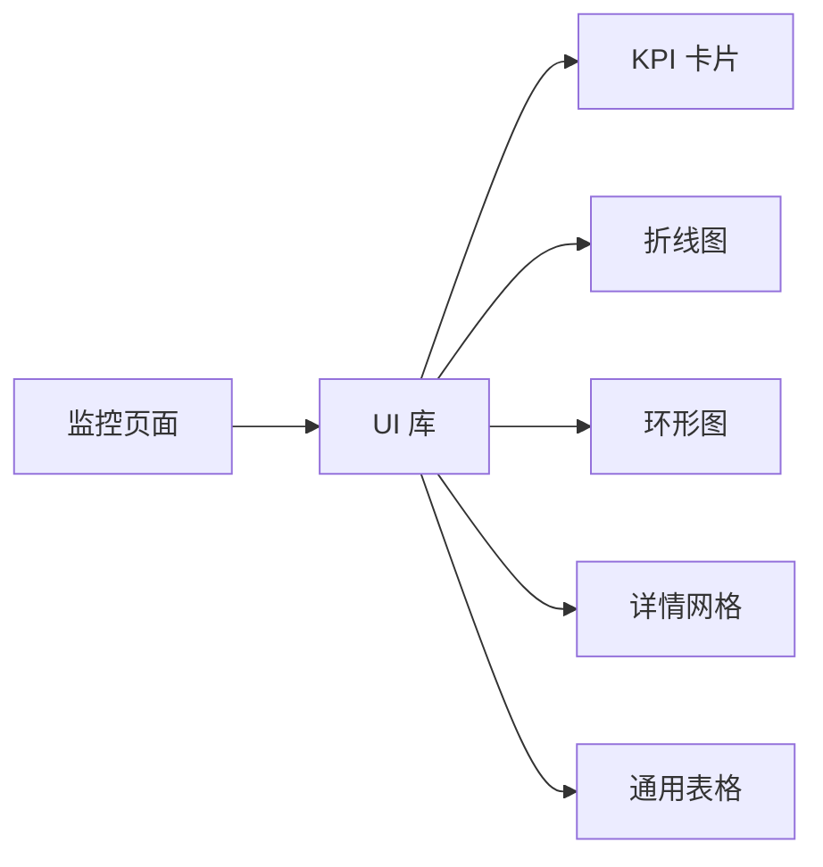
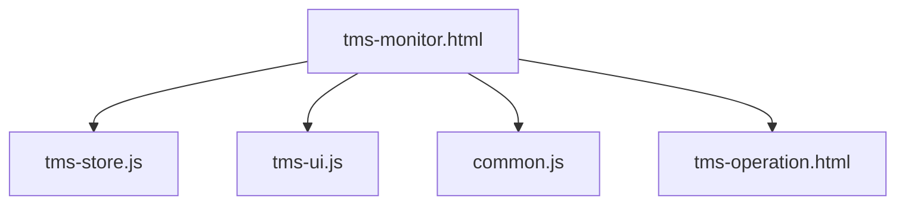

# 系统监控

<cite>
**本文引用的文件**   
- [tms-monitor.html](file://tms-monitor.html)
- [tms-store.js](file://tms-store.js)
- [tms-ui.js](file://tms-ui.js)
- [common.js](file://common.js)
- [tms-operation.html](file://tms-operation.html)
</cite>

## 目录
1. [引言](#引言)
2. [项目结构](#项目结构)
3. [核心组件](#核心组件)
4. [架构总览](#架构总览)
5. [详细组件分析](#详细组件分析)
6. [依赖关系分析](#依赖关系分析)
7. [性能与容量规划](#性能与容量规划)
8. [故障预警与告警机制](#故障预警与告警机制)
9. [运维排障指南](#运维排障指南)
10. [结论](#结论)

## 引言
本文件面向 TMS 系统的“系统监控”能力，围绕运行状态监控、性能指标采集、故障预警、仪表盘配置、日志与历史分析、容量规划等运维保障主题展开。当前仓库采用前端单页应用模式：业务数据由基于 `localStorage` 的轻量数据层提供，监控页面通过订阅数据变更事件实现近实时刷新；图表与通用 UI 由共享 UI 库渲染。该方案适合演示、原型和小型本地化部署场景，便于快速理解监控数据采集、展示与联动逻辑。

## 项目结构
监控功能主要涉及以下文件：
- 监控页面：负责权限校验、初始化、定时刷新、指标渲染与环境信息采集。
- 数据层：负责种子数据生成、统一增删改查、统计聚合（KPI、趋势、分布）、事件发布。
- UI 库：负责 KPI 卡片、SVG 折线图/柱状图/环形图、表格、弹窗、Toast 等通用能力。
- 通用函数：负责登录态检查、用户信息展示等基础能力。
- 运营管理页：作为监控页跳转目标，承载运营指标与考核指标配置。

**图示来源**
- [tms-monitor.html:419-436](file://tms-monitor.html#L419-L436)
- [tms-store.js:220-244](file://tms-store.js#L220-L244)
- [tms-ui.js:758-781](file://tms-ui.js#L758-L781)

**章节来源**
- [tms-monitor.html:1-546](file://tms-monitor.html#L1-L546)
- [tms-store.js:1-800](file://tms-store.js#L1-L800)
- [tms-ui.js:1-783](file://tms-ui.js#L1-L783)
- [common.js:1-383](file://common.js#L1-L383)

## 核心组件
- 监控页面控制器：负责页面生命周期、权限校验、刷新策略、指标渲染与环境信息采集。
- 数据层接口：提供 `overview()`、`orderTrend(days)`、`statusDistribution()`、`exceptionByType()`、`list(entity, options)` 等。
- UI 组件库：提供 `kpis()`、`charts.line/bar/donut()`、`table()`、`detailGrid()`、`initShell()` 等。
- 通用函数：提供 `checkLoginStatus(requiredRole)`、`displayCurrentUser()` 等。

关键职责边界：
- 监控页面不直接操作 `localStorage`，而是通过 `TmsStore` 获取数据。
- UI 库只负责渲染，不持有业务状态。
- 数据层负责数据一致性、统计聚合与事件通知。

**章节来源**
- [tms-monitor.html:419-542](file://tms-monitor.html#L419-L542)
- [tms-store.js:2015-2089](file://tms-store.js#L2015-L2089)
- [tms-ui.js:548-781](file://tms-ui.js#L548-L781)
- [common.js:176-199](file://common.js#L176-L199)

## 架构总览
监控体系采用“页面驱动 + 数据订阅”的模式：
- 页面加载后校验管理员角色，初始化外壳并首次渲染监控面板。
- 监听数据层事件与浏览器 `storage` 事件，同时设置 15 秒定时器轮询刷新。
- 从数据层拉取订单、设备、异常等指标，结合浏览器环境 API 展示运行环境。
- 图表与 KPI 由 UI 库统一渲染，保证视觉一致性与可维护性。

**图示来源**
- [tms-monitor.html:419-436](file://tms-monitor.html#L419-L436)
- [tms-monitor.html:447-542](file://tms-monitor.html#L447-L542)
- [tms-store.js:237-244](file://tms-store.js#L237-L244)

## 详细组件分析

### 监控页面控制器
监控页面承担以下职责：
- 权限控制：仅允许管理员访问。
- 刷新策略：手动刷新按钮、数据层事件订阅、浏览器 `storage` 事件、15 秒定时器。
- 指标渲染：
  - KPI 卡片：在线用户、待作业订单、在途运输、扫描设备在线、待处理异常。
  - 趋势图：近 7 日新建订单与签收订单。
  - 异常分布：按异常类型环形图。
  - 队列健康度：订单状态分布条形进度条。
  - 设备状态：扫描设备名称、位置、今日扫描次数、状态徽章。
  - 运行环境：会话时长、数据库版本、业务库占用、JS 堆内存、CPU 核数、网络状态、屏幕分辨率、浏览器信息。

关键调用路径：
- `renderMonitor()` 汇总各子模块渲染。
- `renderQueue()` 使用 `S.statusDistribution()` 计算百分比并渲染。
- `renderDevices(devices)` 将设备列表映射为行项。
- `renderEnv()` 读取 `performance.memory`、`navigator`、`localStorage` 等环境信息。

**图示来源**
- [tms-monitor.html:419-436](file://tms-monitor.html#L419-L436)
- [tms-monitor.html:447-542](file://tms-monitor.html#L447-L542)

**章节来源**
- [tms-monitor.html:419-542](file://tms-monitor.html#L419-L542)

### 数据层接口与模型
数据层提供统一的业务数据访问与统计聚合能力，监控页面依赖的关键接口如下：

- `overview()`：返回全局概览指标，包括活跃用户、在途运输、待处理异常等。
- `orderTrend(days)`：返回近 N 日的订单新建与签收趋势数组。
- `statusDistribution()`：返回订单状态分布键值对，用于队列健康度计算。
- `exceptionByType()`：返回异常类型及数量，用于环形图。
- `list(entity, options)`：通用查询接口，支持分页、排序、筛选、搜索。

数据模型要点：
- 订单实体包含状态、时间线、轨迹、计费信息等。
- 设备实体包含名称、位置、状态、今日扫描次数等。
- 异常实体包含类型、状态、处理进度等。
- 统计结果以轻量对象数组形式返回，便于前端渲染。

**图示来源**
- [tms-store.js:2015-2089](file://tms-store.js#L2015-L2089)
- [tms-store.js:1210-1280](file://tms-store.js#L1210-L1280)

**章节来源**
- [tms-store.js:2015-2089](file://tms-store.js#L2015-L2089)
- [tms-store.js:1210-1280](file://tms-store.js#L1210-L1280)

### UI 组件库
UI 库为监控页面提供一致的可视化能力：
- KPI 卡片：`kpis(container, items)`，支持标签、数值、副标题与颜色。
- 图表：
  - 折线图：`charts.line(container, options)`，支持多系列、面积填充、图例。
  - 柱状图：`charts.bar(container, options)`，支持分组柱状。
  - 环形图：`charts.donut(container, options)`，支持图例与总计显示。
- 详情网格：`detailGrid(items)`，用于运行环境信息展示。
- 表格：`table(container, config)`，支持搜索、筛选、排序、分页、工具栏。
- 外壳初始化：`initShell(options)`，高亮当前菜单、绑定退出登录、异常角标。

监控页面使用示例：
- 使用 `U.kpis()` 渲染在线用户、待作业订单等。
- 使用 `U.charts.line()` 渲染近 7 日订单趋势。
- 使用 `U.charts.donut()` 渲染异常类型分布。
- 使用 `U.detailGrid()` 渲染运行环境信息。

**图示来源**
- [tms-ui.js:548-781](file://tms-ui.js#L548-L781)

**章节来源**
- [tms-ui.js:548-781](file://tms-ui.js#L548-L781)

### 通用函数与权限控制
通用函数提供登录态检查与用户信息显示：
- `checkLoginStatus(requiredRole)`：校验是否已登录且角色匹配，否则重定向至登录页。
- `displayCurrentUser()`：更新页面中用户名显示元素。

监控页面在加载时调用 `checkLoginStatus('admin')`，确保只有管理员能进入监控页。

**章节来源**
- [common.js:176-199](file://common.js#L176-L199)
- [tms-monitor.html:423-426](file://tms-monitor.html#L423-L426)

## 依赖关系分析
监控页面的依赖关系清晰：
- 监控页面依赖数据层获取业务指标。
- 监控页面依赖 UI 库进行可视化渲染。
- 监控页面依赖通用函数进行权限校验。
- 监控页面可跳转到运营管理页查看更详细的运营指标与考核指标配置。

**图示来源**
- [tms-monitor.html:415-418](file://tms-monitor.html#L415-L418)

**章节来源**
- [tms-monitor.html:415-418](file://tms-monitor.html#L415-L418)

## 性能与容量规划
监控页面的性能特征：
- 刷新频率：默认每 15 秒自动刷新一次，避免频繁 DOM 操作。
- 数据源：全部来自 `localStorage`，无后端请求开销。
- 图表渲染：使用 SVG 原生绘制，轻量且兼容性好。
- 内存观察：当浏览器支持 `performance.memory` 时，展示 JS 堆内存使用情况。

容量规划建议：
- 若业务库数据量增长，应关注 `localStorage` 占用大小，监控页面会显示业务库占用 KB。
- 对于大规模数据，建议将 `localStorage` 替换为 IndexedDB 或后端服务，以降低前端解析与渲染压力。
- 图表数据量较大时，可考虑分页或采样展示，减少 SVG 节点数量。

**章节来源**
- [tms-monitor.html:518-542](file://tms-monitor.html#L518-L542)

## 故障预警与告警机制
当前监控页面未实现复杂的智能告警引擎，但具备以下预警能力：
- 运行状态看板：通过 KPI 与趋势图直观反映异常波动。
- 队列健康度：通过订单状态分布识别积压风险。
- 设备状态：通过设备在线/离线/维修状态提示潜在问题。
- 异常类型分布：通过环形图识别高频异常类型。

扩展建议：
- 增加阈值规则：例如当“待处理异常”超过阈值时触发 Toast 或角标。
- 增加告警规则表：在数据层新增 `alertRules` 实体，定义指标、阈值、级别、通知渠道。
- 增加告警历史：记录告警触发时间、指标值、处理状态，便于审计与分析。

**章节来源**
- [tms-monitor.html:463-515](file://tms-monitor.html#L463-L515)

## 运维排障指南
常见问题与排查步骤：
- 页面无法加载监控数据：
  - 检查是否已登录且角色为管理员。
  - 检查 `localStorage` 中是否存在有效业务库数据。
  - 检查控制台是否有数据层事件错误。
- 图表不显示或显示异常：
  - 检查传入图表的数据是否为空或格式不正确。
  - 检查容器元素是否存在且可见。
- 刷新无效：
  - 检查定时器是否被其他脚本覆盖。
  - 检查数据层事件是否正常触发。

推荐诊断方法：
- 打开浏览器开发者工具，查看 Network、Console、LocalStorage。
- 使用 `TmsStore.list()` 验证数据是否正确写入。
- 使用 `TmsStore.overview()` 验证统计结果是否符合预期。

**章节来源**
- [tms-monitor.html:423-436](file://tms-monitor.html#L423-L436)
- [tms-store.js:237-244](file://tms-store.js#L237-L244)

## 结论
TMS 系统监控功能在当前仓库中以轻量、易用的方式实现，涵盖运行状态监控、性能指标采集、故障预警等核心运维能力。监控页面通过数据层订阅与 UI 库渲染，实现了近实时的仪表盘展示。虽然尚未实现复杂的智能告警引擎，但已具备良好的扩展基础。未来可引入阈值规则、告警历史、后端集成等高级特性，进一步提升运维自动化水平与可观测性。