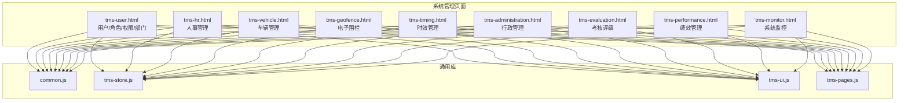
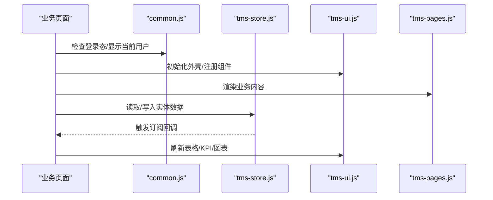
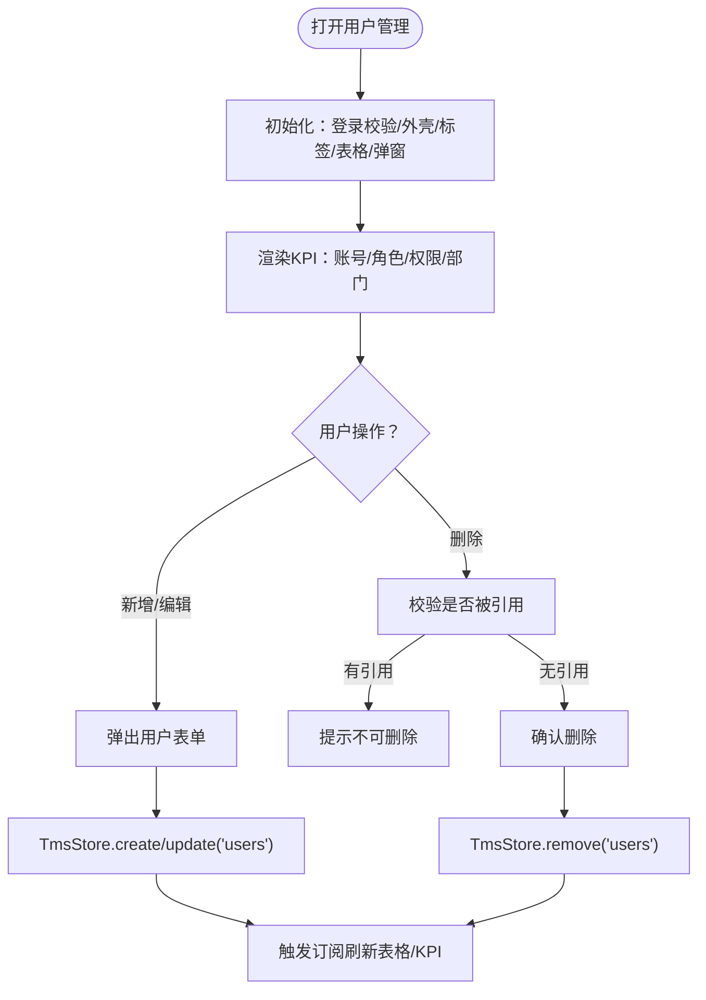
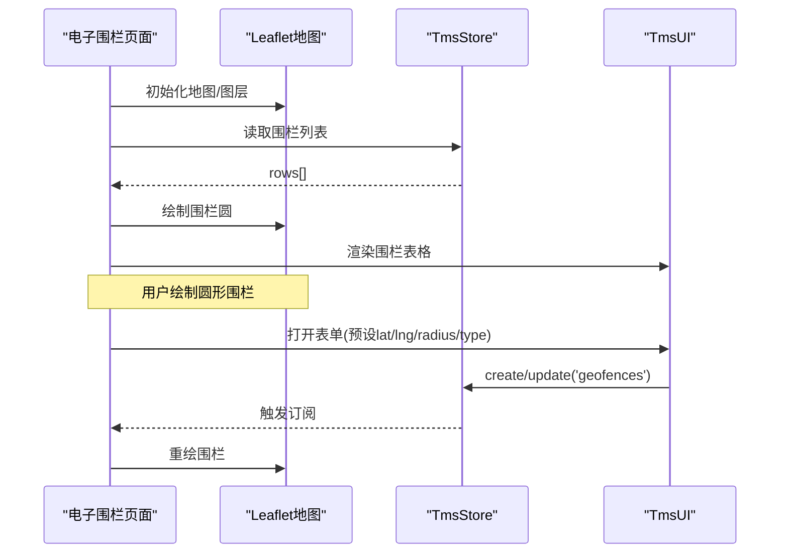
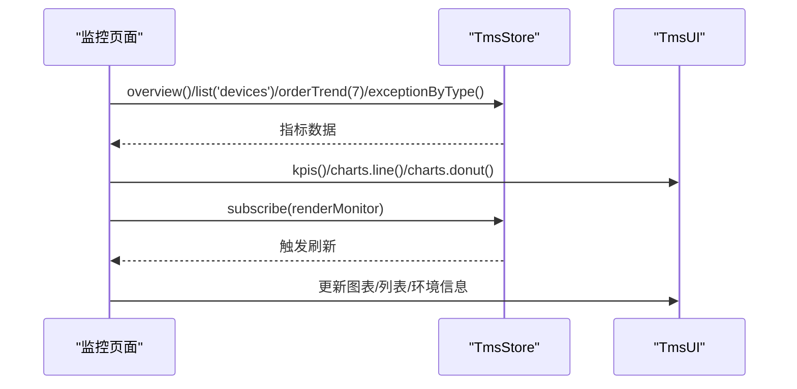
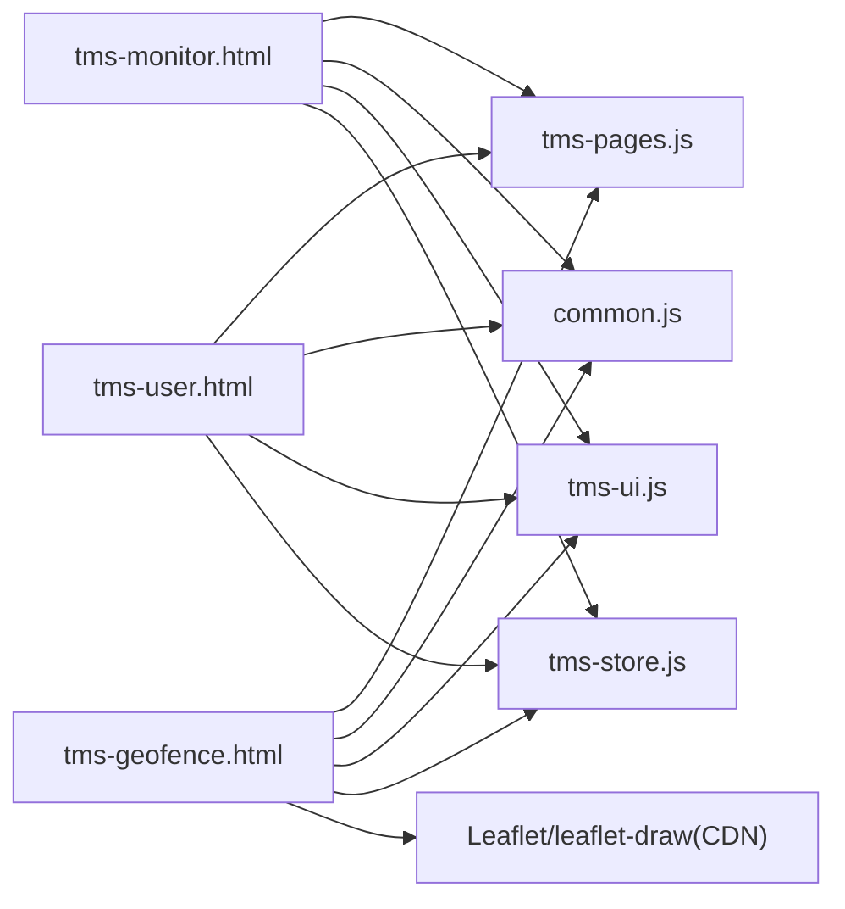

# 系统管理

<cite>
**本文引用的文件**   
- [tms-user.html](file://tms-user.html)
- [tms-hr.html](file://tms-hr.html)
- [tms-vehicle.html](file://tms-vehicle.html)
- [tms-geofence.html](file://tms-geofence.html)
- [tms-timing.html](file://tms-timing.html)
- [tms-administration.html](file://tms-administration.html)
- [tms-evaluation.html](file://tms-evaluation.html)
- [tms-performance.html](file://tms-performance.html)
- [tms-monitor.html](file://tms-monitor.html)
- [common.js](file://common.js)
- [tms-store.js](file://tms-store.js)
- [tms-ui.js](file://tms-ui.js)
- [tms-pages.js](file://tms-pages.js)
</cite>

## 目录
1. [简介](#简介)
2. [项目结构](#项目结构)
3. [核心组件](#核心组件)
4. [架构总览](#架构总览)
5. [详细组件分析](#详细组件分析)
6. [依赖关系分析](#依赖关系分析)
7. [性能与容量](#性能与容量)
8. [故障排查指南](#故障排查指南)
9. [结论](#结论)

## 简介
本章节面向TMS系统的“系统管理”模块，覆盖用户管理、人事管理、车辆管理、电子围栏、时效管理、行政管理、考核评级、绩效管理与系统监控等系统级功能。文档从代码实现出发，梳理各页面的职责边界、数据模型、调用链路与交互流程，并给出配置项、参数与返回约定的说明，帮助读者快速理解系统权限体系、组织架构、设备资产与运行监控等关键能力。

## 项目结构
系统管理相关页面采用“页面HTML + 通用JS库”的轻量前端架构：
- 业务页面：以 tms-*.html 命名，承载具体管理功能的UI与交互逻辑。
- 通用库：
  - common.js：登录校验、退出登录、当前用户展示等基础能力。
  - tms-store.js：本地数据层（基于 localStorage），提供增删改查、订阅通知、统计聚合等能力。
  - tms-ui.js：通用UI组件（表格、表单弹窗、图表、KPI卡片等）。
  - tms-pages.js：页面渲染器，将业务页面内容注入到指定容器。

图示来源
- [tms-user.html:521-533](file://tms-user.html#L521-L533)
- [tms-monitor.html:417-430](file://tms-monitor.html#L417-L430)

章节来源
- [tms-user.html:521-533](file://tms-user.html#L521-L533)
- [tms-monitor.html:417-430](file://tms-monitor.html#L417-L430)

## 核心组件
- 数据层（TmsStore）
  - 提供实体列表查询、单条记录获取、创建/更新/删除、状态分布、趋势统计、异常类型分布、全局概览等能力。
  - 通过订阅机制（subscribe）驱动视图刷新，支持 storage 事件监听，实现跨标签页数据同步。
- UI层（TmsUI）
  - 提供表格、表单弹窗、KPI卡片、图表（折线/环形）、徽章、详情网格等通用组件。
  - 提供工具方法：转义、格式化数字/时间、确认对话框、Toast提示等。
- 页面层（TmsPages）
  - 根据业务标识（如 hr、vehicle、timing 等）将对应模板渲染到页面容器。
- 公共能力（common.js）
  - 登录态检查、退出登录、当前用户信息展示等。

章节来源
- [tms-user.html:521-533](file://tms-user.html#L521-L533)
- [tms-monitor.html:417-430](file://tms-monitor.html#L417-L430)

## 架构总览
系统管理模块遵循“页面-通用库-本地存储”的分层模式：
- 页面负责路由、初始化、事件绑定与业务编排。
- 通用库封装数据访问与UI渲染，降低页面复杂度。
- 本地存储作为持久化介质，支撑多页面共享数据。

图示来源
- [tms-user.html:521-533](file://tms-user.html#L521-L533)
- [tms-monitor.html:417-430](file://tms-monitor.html#L417-L430)

## 详细组件分析

### 用户管理（用户/角色/权限/部门）
- 功能要点
  - 用户CRUD：用户名、邮箱、手机号、所属部门、角色、管理区域、状态。
  - 角色CRUD：名称、描述、权限集合；删除时校验是否被用户引用。
  - 权限CRUD：名称、代码、描述；删除时校验是否被角色引用。
  - 部门CRUD：名称、上级部门、描述；删除时校验是否有子部门或用户。
  - KPI看板：账号总数、启用账号、角色数量、权限点、部门数量。
- 数据模型（字段约定）
  - users：id, name, email, phone, departmentId, roleId, areaId, status
  - roles：id, name, description, permissions[]
  - permissions：id, code, name, description
  - departments：id, name, parentId, description
- 调用关系
  - 页面初始化后，绑定标签切换、渲染KPI、初始化四张表格与表单弹窗。
  - 所有写操作通过 TmsStore.create/update/remove 完成，并触发订阅刷新。
- 配置与参数
  - 表格分页 pageSize=8，搜索字段按实体定义，默认排序 id asc。
  - 表单必填字段在 fields 中声明 required=true。
- 错误处理
  - 删除前进行引用校验，若存在引用则阻止删除并提示。
  - 删除二次确认，避免误删。

图示来源
- [tms-user.html:548-637](file://tms-user.html#L548-L637)
- [tms-user.html:640-708](file://tms-user.html#L640-L708)
- [tms-user.html:711-765](file://tms-user.html#L711-L765)
- [tms-user.html:768-800](file://tms-user.html#L768-L800)

章节来源
- [tms-user.html:521-533](file://tms-user.html#L521-L533)
- [tms-user.html:548-637](file://tms-user.html#L548-L637)
- [tms-user.html:640-708](file://tms-user.html#L640-L708)
- [tms-user.html:711-765](file://tms-user.html#L711-L765)
- [tms-user.html:768-800](file://tms-user.html#L768-L800)

### 人事管理
- 功能要点
  - 员工统计：在职、休假、离职人数。
  - 员工列表：查看、编辑、启用/停用。
  - 使用 localStorage 维护模拟数据，便于演示。
- 数据模型（示例字段）
  - id, name, department, position, email, phone, hireDate, status, role, description
- 调用关系
  - 页面初始化后，通过 TmsPages.render('hr', container) 渲染内容。
  - 业务逻辑直接读写 localStorage 中的 tmsEmployees。
- 配置与参数
  - 状态映射：active/on_leave/inactive。
  - 角色映射：admin/branch/client。
- 错误处理
  - 未登录或角色不匹配时跳转至登录页。

章节来源
- [tms-hr.html:374-379](file://tms-hr.html#L374-L379)
- [tms-hr.html:453-535](file://tms-hr.html#L453-L535)
- [tms-hr.html:537-623](file://tms-hr.html#L537-L623)

### 车辆管理
- 功能要点
  - 车辆统计：总数、在线、维修中、运输中。
  - 车辆列表：查看、编辑、送修等动作入口。
  - 使用 TmsPages.render('vehicle', container) 渲染。
- 数据模型（示例字段）
  - vehicleId, plate, type, model, driver, branch, status, location, lastUpdate
- 调用关系
  - 页面初始化后，绑定按钮事件（查看/编辑/维修），预留扩展接口。
- 配置与参数
  - 状态枚举：online/offline/maintenance/transporting。
  - 类型枚举：truck/van/container。
- 错误处理
  - 未登录或角色不匹配时跳转至登录页。

章节来源
- [tms-vehicle.html:560-565](file://tms-vehicle.html#L560-L565)
- [tms-vehicle.html:594-623](file://tms-vehicle.html#L594-L623)

### 电子围栏
- 功能要点
  - 地图绘制圆形围栏，支持新增/编辑/启用/停用/删除。
  - 围栏列表与地图双向联动，点击定位围栏。
  - 使用 Leaflet 与 leaflet-draw 实现地图交互。
- 数据模型（字段约定）
  - geofences：id, name, type, lat, lng, radius, status
- 调用关系
  - 初始化地图与围栏表，订阅数据变更自动重绘。
  - 绘制完成后回填中心经纬度与半径到表单。
- 配置与参数
  - 围栏类型：仓储围栏/网点围栏/禁行区域/派送围栏/到货围栏/派送员围栏。
  - 半径范围：50~50000米；经纬度范围：纬度±90，经度±180。
- 错误处理
  - 地图加载失败时降级为仅使用围栏列表。
  - 未绘制时提示手动新增。

图示来源
- [tms-geofence.html:571-583](file://tms-geofence.html#L571-L583)
- [tms-geofence.html:605-617](file://tms-geofence.html#L605-L617)
- [tms-geofence.html:627-677](file://tms-geofence.html#L627-L677)
- [tms-geofence.html:680-713](file://tms-geofence.html#L680-L713)
- [tms-geofence.html:717-770](file://tms-geofence.html#L717-L770)

章节来源
- [tms-geofence.html:571-583](file://tms-geofence.html#L571-L583)
- [tms-geofence.html:605-617](file://tms-geofence.html#L605-L617)
- [tms-geofence.html:627-677](file://tms-geofence.html#L627-L677)
- [tms-geofence.html:680-713](file://tms-geofence.html#L680-L713)
- [tms-geofence.html:717-770](file://tms-geofence.html#L717-L770)

### 时效管理
- 功能要点
  - 时效监控：准时/延误/严重延误订单列表。
  - 时效规则：线路、运输方式、标准时效、优先级、状态。
  - 使用 TmsPages.render('timing', container) 渲染。
- 数据模型（示例字段）
  - orderId, waybill, origin, destination, eta, actual, timingStatus, delayHours
  - ruleId, route, transportMode, standardTiming, priority, status
- 调用关系
  - 页面初始化后，绑定查看/编辑/分析按钮事件，预留扩展接口。
- 配置与参数
  - 时效状态：on-time/delayed/overdue。
- 错误处理
  - 未登录或角色不匹配时跳转至登录页。

章节来源
- [tms-timing.html:563-567](file://tms-timing.html#L563-L567)
- [tms-timing.html:592-620](file://tms-timing.html#L592-L620)

### 行政管理
- 功能要点
  - 行政记录：会议/通知/文档三类，包含组织者/发布者/作者、时间、受众/版本、状态等。
  - 使用 TmsPages.render('administration', container) 渲染。
- 数据模型（示例字段）
  - meeting: id, title, category='meeting', organizer, date, time, location, participants, status, description
  - notice: id, title, category='notice', issuer, date, audience, status, content
  - document: id, title, category='document', author, date, version, status, description
- 调用关系
  - 初始化模拟数据并渲染列表，支持查看详情与处理待办。
- 配置与参数
  - 分类映射：meeting/notice/document。
  - 状态映射：upcoming/published/approved/completed/cancelled。
- 错误处理
  - 未登录或角色不匹配时跳转至登录页。

章节来源
- [tms-administration.html:374-379](file://tms-administration.html#L374-L379)
- [tms-administration.html:453-517](file://tms-administration.html#L453-L517)
- [tms-administration.html:519-599](file://tms-administration.html#L519-L599)

### 考核评级
- 功能要点
  - 员工考核：等级（优秀/良好/合格/需改进）、得分、表现、改进方向、下一步计划、状态。
  - 使用 TmsPages.render('evaluation', container) 渲染。
- 数据模型（示例字段）
  - id, employeeName, employeeId, department, position, evaluationDate, period, grade, score, performance, areasForImprovement, nextPlan, status
- 调用关系
  - 初始化模拟数据并渲染列表，支持批准/查看/编辑。
- 配置与参数
  - 等级映射：excellent/good/average/poor。
  - 状态映射：pending/completed/rejected。
- 错误处理
  - 未登录或角色不匹配时跳转至登录页。

章节来源
- [tms-evaluation.html:379-384](file://tms-evaluation.html#L379-L384)
- [tms-evaluation.html:458-543](file://tms-evaluation.html#L458-L543)
- [tms-evaluation.html:545-623](file://tms-evaluation.html#L545-L623)

### 绩效管理
- 功能要点
  - 员工绩效：当前得分、上期得分、趋势（提升/稳定/下降）、关键绩效、挑战、改进计划、状态。
  - 使用 TmsPages.render('performance', container) 渲染。
- 数据模型（示例字段）
  - id, employeeName, employeeId, department, position, performanceDate, period, currentScore, previousScore, trend, keyPerformance[], challenges[], improvementPlan[], status
- 调用关系
  - 初始化模拟数据并渲染列表，支持批准/查看/编辑。
- 配置与参数
  - 趋势映射：improving/stable/declining。
  - 状态映射：pending/completed/rejected。
- 错误处理
  - 未登录或角色不匹配时跳转至登录页。

章节来源
- [tms-performance.html:374-379](file://tms-performance.html#L374-L379)
- [tms-performance.html:453-543](file://tms-performance.html#L453-L543)
- [tms-performance.html:545-623](file://tms-performance.html#L545-L623)

### 系统监控
- 功能要点
  - KPI指标：在线用户、待作业订单、在途运输、扫描设备在线、待处理异常。
  - 近7日订单趋势折线图、异常类型环形图。
  - 订单队列健康度、扫描设备状态、运行环境信息。
  - 定时刷新（15秒）与手动刷新。
- 数据模型（来自TmsStore）
  - overview(): activeUsers, inTransit, pendingExceptions
  - list('devices'): name, location, scansToday, status
  - orderTrend(7): labels[], created[], signed[]
  - exceptionByType(): [{label, value}]
  - statusDistribution(): [{key, label, value}]
- 调用关系
  - 初始化后订阅 TmsStore 变化与 storage 事件，周期性刷新。
  - 使用 TmsUI.charts.line / donut 渲染图表。
- 配置与参数
  - 刷新间隔：15秒。
  - 环境信息：会话时长、数据库版本、业务库占用、JS堆内存、CPU核数、网络状态、屏幕分辨率、浏览器UA。
- 错误处理
  - 当 TmsStore/TmsUI 未就绪时跳过渲染。

图示来源
- [tms-monitor.html:417-430](file://tms-monitor.html#L417-L430)
- [tms-monitor.html:441-483](file://tms-monitor.html#L441-L483)
- [tms-monitor.html:485-536](file://tms-monitor.html#L485-L536)

章节来源
- [tms-monitor.html:417-430](file://tms-monitor.html#L417-L430)
- [tms-monitor.html:441-483](file://tms-monitor.html#L441-L483)
- [tms-monitor.html:485-536](file://tms-monitor.html#L485-L536)

## 依赖关系分析
- 页面与通用库
  - 所有系统管理页面均依赖 common.js（登录态）、tms-store.js（数据层）、tms-ui.js（UI组件）、tms-pages.js（页面渲染）。
- 数据层与业务实体
  - users/roles/permissions/departments/geofences/devices/orders/exceptions 等实体由 TmsStore 统一管理。
- 外部依赖
  - 电子围栏页面依赖 Leaflet 与 leaflet-draw 的CDN资源。

图示来源
- [tms-user.html:518-520](file://tms-user.html#L518-L520)
- [tms-geofence.html:10-12](file://tms-geofence.html#L10-L12)
- [tms-geofence.html:557-562](file://tms-geofence.html#L557-L562)
- [tms-monitor.html:409-412](file://tms-monitor.html#L409-L412)

章节来源
- [tms-user.html:518-520](file://tms-user.html#L518-L520)
- [tms-geofence.html:10-12](file://tms-geofence.html#L10-L12)
- [tms-geofence.html:557-562](file://tms-geofence.html#L557-L562)
- [tms-monitor.html:409-412](file://tms-monitor.html#L409-L412)

## 性能与容量
- 数据层
  - 基于 localStorage 的键值存储，适合中小规模数据；建议对大列表使用分页（pageSize）与按需加载。
  - 订阅机制会触发全量重绘，建议在大数据集场景下优化渲染（如虚拟滚动、增量更新）。
- 图表渲染
  - 折线与环形图在频繁刷新场景下可能带来一定开销，可考虑节流刷新频率或缓存中间结果。
- 地图渲染
  - 大量围栏会导致地图重绘压力，建议限制同时显示的围栏数量或使用聚合策略。
- 内存与环境
  - 监控页面采集JS堆内存、CPU核数等信息，有助于评估前端性能瓶颈。

[本节为通用指导，不涉及具体文件分析]

## 故障排查指南
- 登录与权限
  - 现象：页面无法进入或跳转到登录页。
  - 排查：检查 common.js 的登录态校验逻辑与用户角色是否符合页面要求。
  - 参考：[tms-hr.html:439-444](file://tms-hr.html#L439-L444)、[tms-administration.html:439-444](file://tms-administration.html#L439-L444)、[tms-evaluation.html:444-449](file://tms-evaluation.html#L444-L449)、[tms-performance.html:439-444](file://tms-performance.html#L439-L444)
- 数据不更新
  - 现象：修改数据后界面未刷新。
  - 排查：确认是否调用 TmsStore.create/update/remove，并检查订阅是否生效。
  - 参考：[tms-user.html:532-533](file://tms-user.html#L532-L533)、[tms-monitor.html:427-429](file://tms-monitor.html#L427-L429)
- 地图加载失败
  - 现象：电子围栏地图空白或报错。
  - 排查：检查 CDN 资源是否加载成功；若失败，页面应降级为仅使用围栏列表。
  - 参考：[tms-geofence.html:594-598](file://tms-geofence.html#L594-L598)
- 删除受限
  - 现象：删除角色/权限/部门时报错。
  - 排查：检查是否存在引用（用户/角色/子部门），先解除引用再删除。
  - 参考：[tms-user.html:661-673](file://tms-user.html#L661-L673)、[tms-user.html:729-743](file://tms-user.html#L729-L743)、[tms-user.html:792-800](file://tms-user.html#L792-L800)
- 监控指标不刷新
  - 现象：监控面板长时间无更新。
  - 排查：检查定时器与订阅是否正常工作；确认 TmsStore 与 TmsUI 已就绪。
  - 参考：[tms-monitor.html:427-430](file://tms-monitor.html#L427-L430)、[tms-monitor.html:441-443](file://tms-monitor.html#L441-L443)

章节来源
- [tms-hr.html:439-444](file://tms-hr.html#L439-L444)
- [tms-administration.html:439-444](file://tms-administration.html#L439-L444)
- [tms-evaluation.html:444-449](file://tms-evaluation.html#L444-L449)
- [tms-performance.html:439-444](file://tms-performance.html#L439-L444)
- [tms-user.html:532-533](file://tms-user.html#L532-L533)
- [tms-monitor.html:427-430](file://tms-monitor.html#L427-L430)
- [tms-geofence.html:594-598](file://tms-geofence.html#L594-L598)
- [tms-user.html:661-673](file://tms-user.html#L661-L673)
- [tms-user.html:729-743](file://tms-user.html#L729-L743)
- [tms-user.html:792-800](file://tms-user.html#L792-L800)
- [tms-monitor.html:441-443](file://tms-monitor.html#L441-L443)

## 结论
系统管理模块以轻量前端架构为基础，通过统一的数据层与UI组件，实现了用户权限、组织架构、设备资产、地理围栏、时效规则、行政事务、考核与绩效以及系统监控等核心能力。页面之间通过 TmsStore 共享数据，借助订阅机制保持视图一致性。在实际使用中，建议关注数据规模与渲染性能，合理设置分页与刷新频率，并结合监控页面持续观察系统健康度。

[本节为总结性内容，不涉及具体文件分析]