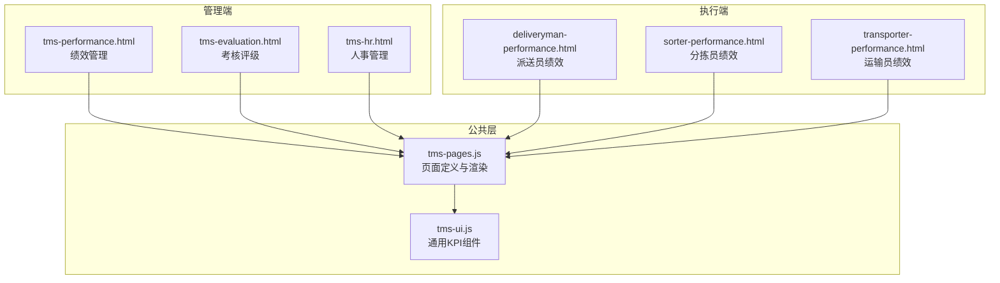
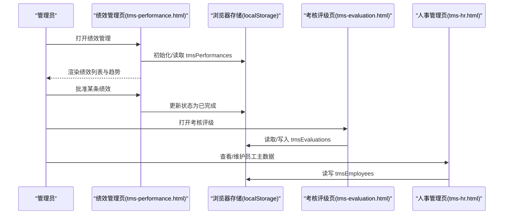
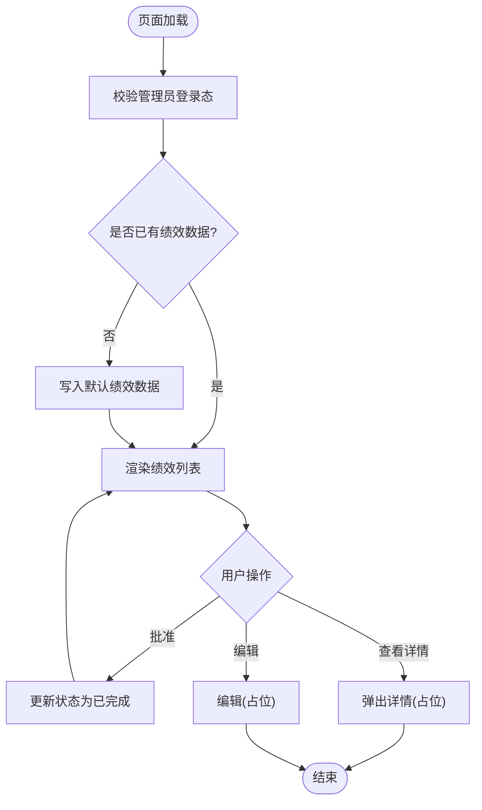
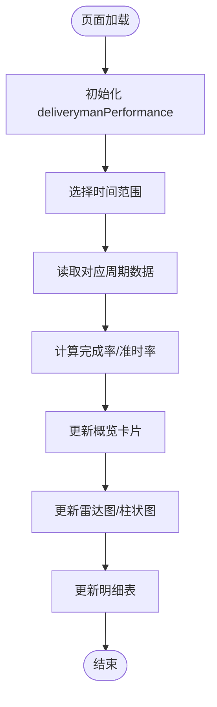
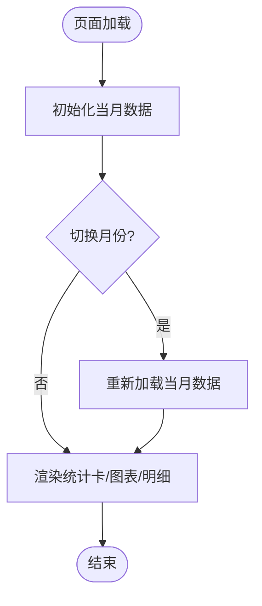
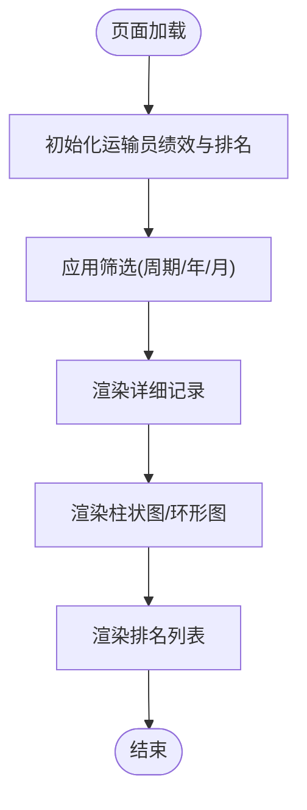
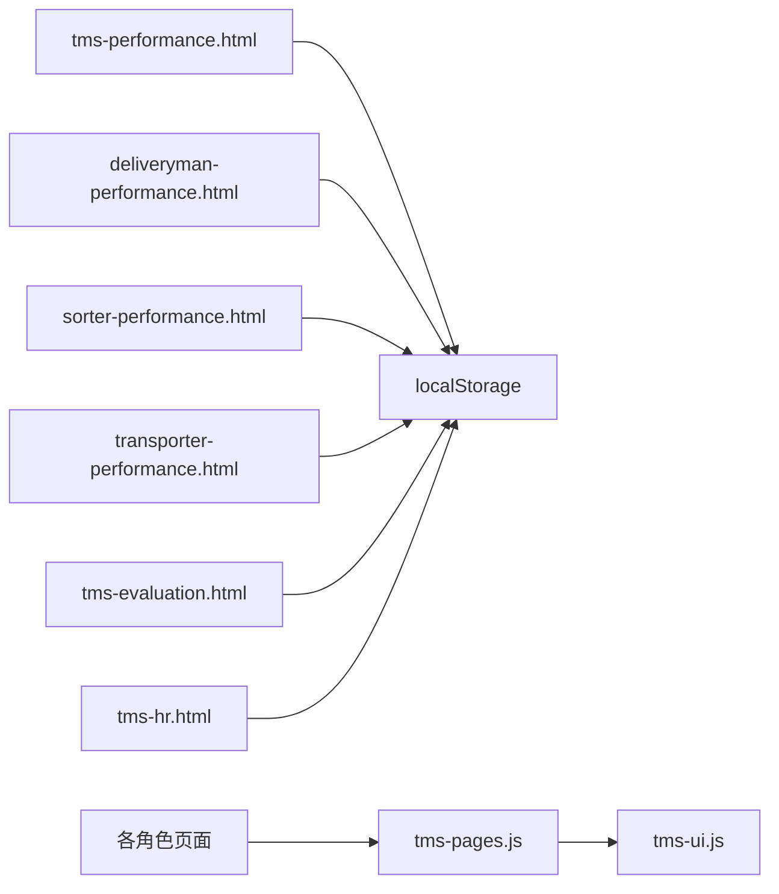

# 绩效管理

<cite>
**本文引用的文件**   
- [tms-performance.html](file://tms-performance.html)
- [deliveryman-performance.html](file://deliveryman-performance.html)
- [sorter-performance.html](file://sorter-performance.html)
- [transporter-performance.html](file://transporter-performance.html)
- [tms-evaluation.html](file://tms-evaluation.html)
- [tms-hr.html](file://tms-hr.html)
- [tms-pages.js](file://tms-pages.js)
- [tms-ui.js](file://tms-ui.js)
</cite>

## 目录
1. [引言](#引言)
2. [项目结构](#项目结构)
3. [核心组件](#核心组件)
4. [架构总览](#架构总览)
5. [详细组件分析](#详细组件分析)
6. [依赖关系分析](#依赖关系分析)
7. [性能与可扩展性](#性能与可扩展性)
8. [故障排查指南](#故障排查指南)
9. [结论](#结论)
10. [附录：指标、参数与返回值说明](#附录指标参数与返回值说明)

## 引言
本文件面向TMS系统的“绩效管理”模块，围绕绩效目标设定、过程跟踪、结果应用三大环节，结合仓库中的前端页面与脚本，梳理KPI设定、进度跟踪、奖金计算（以评分与等级映射为基准）等关键流程的实现细节、调用关系、接口约定与业务模型。文档同时给出与考核评级、人事管理的协同方式，并补充数据分析、趋势预测与激励策略的扩展建议。

## 项目结构
绩效管理相关能力由多个角色页面与公共UI/页面框架组成：
- 管理端：绩效考核与评级、人事信息
- 执行端：派送员、分拣员、运输员的个人绩效视图
- 公共层：页面路由与渲染、通用KPI卡片组件

图表来源
- [tms-performance.html:380-385](file://tms-performance.html#L380-L385)
- [tms-evaluation.html:385-390](file://tms-evaluation.html#L385-L390)
- [tms-hr.html:380-385](file://tms-hr.html#L380-L385)
- [deliveryman-performance.html:407-440](file://deliveryman-performance.html#L407-L440)
- [sorter-performance.html:451-499](file://sorter-performance.html#L451-L499)
- [transporter-performance.html:564-593](file://transporter-performance.html#L564-L593)
- [tms-pages.js:1191-1200](file://tms-pages.js#L1191-L1200)
- [tms-ui.js:548-554](file://tms-ui.js#L548-L554)

章节来源
- [tms-performance.html:380-385](file://tms-performance.html#L380-L385)
- [tms-evaluation.html:385-390](file://tms-evaluation.html#L385-L390)
- [tms-hr.html:380-385](file://tms-hr.html#L380-L385)
- [deliveryman-performance.html:407-440](file://deliveryman-performance.html#L407-L440)
- [sorter-performance.html:451-499](file://sorter-performance.html#L451-L499)
- [transporter-performance.html:564-593](file://transporter-performance.html#L564-L593)
- [tms-pages.js:1191-1200](file://tms-pages.js#L1191-L1200)
- [tms-ui.js:548-554](file://tms-ui.js#L548-L554)

## 核心组件
- 管理端绩效列表与审批流：提供员工绩效记录展示、趋势标签、状态流转（待批准/已完成）。
- 执行端个人绩效看板：按周/月/季/年维度聚合任务完成率、准时率、异常率、效率指数等指标，并以雷达图/柱状图呈现。
- 考核评级：基于签收率、准时率、满意度等指标综合打分，映射A/B/C/D等级，支持查看与编辑。
- 人事管理：员工主数据（部门、岗位、状态、角色），作为绩效与考核评级的基础实体。
- 公共渲染与KPI组件：页面通过统一入口渲染，并提供KPI卡片组件用于指标展示。

章节来源
- [tms-performance.html:459-629](file://tms-performance.html#L459-L629)
- [deliveryman-performance.html:442-574](file://deliveryman-performance.html#L442-L574)
- [sorter-performance.html:501-677](file://sorter-performance.html#L501-L677)
- [transporter-performance.html:595-749](file://transporter-performance.html#L595-L749)
- [tms-evaluation.html:463-628](file://tms-evaluation.html#L463-L628)
- [tms-hr.html:458-629](file://tms-hr.html#L458-L629)
- [tms-pages.js:1191-1200](file://tms-pages.js#L1191-L1200)
- [tms-ui.js:548-554](file://tms-ui.js#L548-L554)

## 架构总览
系统采用“页面即功能”的前端架构，各角色页面独立维护本地模拟数据（localStorage），并通过公共UI组件进行指标展示；管理端页面负责汇总与审批，执行端页面侧重个人维度的可视化与交互。

图表来源
- [tms-performance.html:459-629](file://tms-performance.html#L459-L629)
- [tms-evaluation.html:463-628](file://tms-evaluation.html#L463-L628)
- [tms-hr.html:458-629](file://tms-hr.html#L458-L629)

## 详细组件分析

### 管理端：绩效管理（tms-performance.html）
- 功能要点
  - 初始化模拟绩效数据，包含当前得分、上期得分、趋势标签（提升/稳定/下降）、关键绩效、挑战、改进计划、状态（待批准/已完成）。
  - 渲染绩效列表，支持“批准”“查看详情”“编辑”。
  - 使用 localStorage 持久化 tmsPerformances。
- 关键流程
  - 页面加载时检查登录态并渲染。
  - 首次进入时写入默认数据。
  - 点击“批准”将状态从 pending 改为 completed。
- 数据模型（示例字段）
  - id, employeeName, employeeId, department, position, performanceDate, period, currentScore, previousScore, trend, keyPerformance[], challenges[], improvementPlan[], status
- 调用关系
  - 直接操作 localStorage，无后端API。
  - 与人事管理共享员工ID与部门/岗位信息（逻辑关联）。

图表来源
- [tms-performance.html:459-629](file://tms-performance.html#L459-L629)

章节来源
- [tms-performance.html:459-629](file://tms-performance.html#L459-L629)

### 执行端：派送员绩效（deliveryman-performance.html）
- 功能要点
  - 时间范围选择（本周/本月/本季度/本年）。
  - 概览指标：完成任务数、完成率、准时率、绩效评分。
  - 雷达图对比“当前绩效 vs 目标绩效”，柱状图展示任务完成情况。
  - 明细表展示各周期指标与目标值对比。
- 关键流程
  - 初始化 localStorage 中 deliverymanPerformance。
  - 根据所选范围加载数据，计算完成率/准时率，更新图表与明细。
- 数据模型（示例字段）
  - week/month/quarter/year 下：totalTasks, completedTasks, onTimeTasks, lateTasks, exceptionTasks, totalHours, performanceScore
- 算法与复杂度
  - 比率计算 O(1)，图表渲染 O(n)（n为数据点数量）。
- 调用关系
  - 仅依赖 localStorage 与 Chart.js（外部库）。

图表来源
- [deliveryman-performance.html:442-574](file://deliveryman-performance.html#L442-L574)
- [deliveryman-performance.html:580-764](file://deliveryman-performance.html#L580-L764)

章节来源
- [deliveryman-performance.html:442-574](file://deliveryman-performance.html#L442-L574)
- [deliveryman-performance.html:580-764](file://deliveryman-performance.html#L580-L764)

### 执行端：分拣员绩效（sorter-performance.html）
- 功能要点
  - 按月切换，统计总扫描量、总分拣量、准确率、效率指数。
  - 每日扫描量/分拣量柱状图（纯DOM实现）。
  - 明细表按日期降序展示。
- 关键流程
  - 初始化当月数据（含 dailyDetails）。
  - 月份切换触发重新加载与渲染。
- 数据模型（示例字段）
  - totalScans, totalSorted, accuracyRate, efficiency, dailyDetails[]（date, scans, sorted, accuracy, completionRate, score）
- 调用关系
  - 仅依赖 localStorage。

图表来源
- [sorter-performance.html:501-677](file://sorter-performance.html#L501-L677)

章节来源
- [sorter-performance.html:501-677](file://sorter-performance.html#L501-L677)

### 执行端：运输员绩效（transporter-performance.html）
- 功能要点
  - 筛选周期（月/季/年/自定义）、年份、月份。
  - 统计总运输量、总里程、准时率、客户满意度。
  - 月度运输量柱状图、环形图展示准时率。
  - 详细记录表格与排名列表。
- 关键流程
  - 初始化 transporterPerformance 与 transporterRanking。
  - 渲染表格与图表，排名列表。
- 数据模型（示例字段）
  - 周期键（如 '2025-07'）下：totalVolume, totalDistance, onTimeRate, satisfaction, dailyData[]（date, task, volume, distance, plannedTime, actualTime, status, satisfaction）
- 调用关系
  - 仅依赖 localStorage。

图表来源
- [transporter-performance.html:595-749](file://transporter-performance.html#L595-L749)

章节来源
- [transporter-performance.html:595-749](file://transporter-performance.html#L595-L749)

### 考核评级（tms-evaluation.html）
- 功能要点
  - 展示优秀/良好/合格/需改进人数统计。
  - 列表展示员工考核记录，支持批准、查看、编辑。
  - 通过 localStorage 存取 tmsEvaluations。
- 与绩效的关系
  - 考核评级可视为对绩效结果的阶段性总结与等级化，通常与绩效评分联动（例如分数区间映射等级）。
- 数据模型（示例字段）
  - id, employeeName, employeeId, department, position, evaluationDate, period, grade, score, performance, areasForImprovement, nextPlan, status

章节来源
- [tms-evaluation.html:463-628](file://tms-evaluation.html#L463-L628)

### 人事管理（tms-hr.html）
- 功能要点
  - 员工总数、在职、休假、离职统计。
  - 员工列表展示与维护（启用/停用、查看详情、编辑信息）。
  - 通过 localStorage 存取 tmsEmployees。
- 与绩效/考核的协同
  - 员工主数据（部门、岗位、状态、角色）为绩效与考核的基础维度。

章节来源
- [tms-hr.html:458-629](file://tms-hr.html#L458-L629)

### 公共渲染与KPI组件（tms-pages.js, tms-ui.js）
- tms-pages.js
  - 定义“考核评级”“绩效管理”等页面的标题、副标题与KPI项。
  - 在“考核评级”中定义了表单字段（签收率、准时率、满意度、综合得分）及提交逻辑（自动计算等级与评语）。
- tms-ui.js
  - 提供 kpis(container, items) 方法，用于渲染KPI卡片（label/value/sub）。

章节来源
- [tms-pages.js:1100-1164](file://tms-pages.js#L1100-L1164)
- [tms-pages.js:1191-1200](file://tms-pages.js#L1191-L1200)
- [tms-ui.js:548-554](file://tms-ui.js#L548-L554)

## 依赖关系分析
- 页面到公共层的依赖
  - 所有角色页面均通过 TmsUI.initShell() 与 TmsPages.render(...) 完成壳层与内容渲染。
  - KPI卡片通过 tms-ui.js 的 kpis 方法统一渲染。
- 数据持久化
  - 全部使用 localStorage 作为本地存储，键名包括：
    - tmsPerformances（管理端绩效）
    - deliverymanPerformance（派送员绩效）
    - sorterPerformance_{year}_{month}（分拣员绩效）
    - transporterPerformance（运输员绩效）
    - transporterRanking（运输员排名）
    - tmsEvaluations（考核评级）
    - tmsEmployees（人事管理）
- 外部依赖
  - deliveryman-performance.html 引入 Chart.js 用于雷达图/柱状图。

图表来源
- [tms-performance.html:380-385](file://tms-performance.html#L380-L385)
- [deliveryman-performance.html:407-440](file://deliveryman-performance.html#L407-L440)
- [sorter-performance.html:451-499](file://sorter-performance.html#L451-L499)
- [transporter-performance.html:564-593](file://transporter-performance.html#L564-L593)
- [tms-evaluation.html:385-390](file://tms-evaluation.html#L385-L390)
- [tms-hr.html:380-385](file://tms-hr.html#L380-L385)
- [tms-pages.js:1191-1200](file://tms-pages.js#L1191-L1200)
- [tms-ui.js:548-554](file://tms-ui.js#L548-L554)

章节来源
- [tms-performance.html:380-385](file://tms-performance.html#L380-L385)
- [deliveryman-performance.html:407-440](file://deliveryman-performance.html#L407-L440)
- [sorter-performance.html:451-499](file://sorter-performance.html#L451-L499)
- [transporter-performance.html:564-593](file://transporter-performance.html#L564-L593)
- [tms-evaluation.html:385-390](file://tms-evaluation.html#L385-L390)
- [tms-hr.html:380-385](file://tms-hr.html#L380-L385)
- [tms-pages.js:1191-1200](file://tms-pages.js#L1191-L1200)
- [tms-ui.js:548-554](file://tms-ui.js#L548-L554)

## 性能与可扩展性
- 当前实现特点
  - 轻量级前端原型，数据全量落盘至 localStorage，适合演示与小规模场景。
  - 图表渲染按需销毁旧实例，避免内存泄漏（Chart.js）。
- 潜在瓶颈
  - 大数据量下的 DOM 重绘与 localStorage 序列化开销。
  - 多页面重复初始化模拟数据，存在冗余。
- 优化建议
  - 引入分页/虚拟滚动，减少首屏渲染压力。
  - 将模拟数据抽取为配置中心或后端API，统一数据源。
  - 对高频计算（如比率、排序）增加缓存与增量更新。
  - 图表库按需懒加载，减少首屏体积。

[本节为通用指导，不直接分析具体文件]

## 故障排查指南
- 常见问题
  - 图表未显示：确认 Chart.js 已正确加载，canvas 元素存在且上下文可用。
  - 数据为空：检查 localStorage 键是否存在，或首次初始化是否被跳过。
  - 权限问题：非管理员访问管理端页面会被拦截跳转。
- 定位步骤
  - 打开浏览器控制台，查看是否有 Chart.js 未加载或 canvas 上下文错误日志。
  - 在 Storage 面板检查对应键值是否写入成功。
  - 验证登录态与角色判断逻辑。

章节来源
- [deliveryman-performance.html:580-764](file://deliveryman-performance.html#L580-L764)
- [tms-performance.html:428-450](file://tms-performance.html#L428-L450)

## 结论
本项目的绩效管理模块以轻量前端原型的方式实现了绩效目标设定、过程跟踪与结果应用的闭环：管理端负责绩效记录与审批，执行端提供多维度的个人绩效看板，考核评级与人事管理与之协同形成完整的人力资源管理视图。后续可通过后端服务化、指标引擎与激励策略扩展，逐步完善智能分析与决策支持能力。

[本节为总结性内容，不直接分析具体文件]

## 附录：指标、参数与返回值说明

### 指标体系与计算
- 派送员
  - 任务完成率 = completedTasks / totalTasks
  - 准时率 = onTimeTasks / completedTasks
  - 异常率 = exceptionTasks / totalTasks
  - 效率指数 = completedTasks / totalHours（单位换算见代码）
- 分拣员
  - 准确率 = 累计准确分拣 / 累计扫描
  - 效率指数 = 综合评分（页面内数值）
- 运输员
  - 准时率 = 准时任务占比（页面统计）
  - 客户满意度 = 平均评分（页面统计）

章节来源
- [deliveryman-performance.html:490-574](file://deliveryman-performance.html#L490-L574)
- [sorter-performance.html:574-677](file://sorter-performance.html#L574-L677)
- [transporter-performance.html:674-749](file://transporter-performance.html#L674-L749)

### 配置选项与参数
- 时间范围
  - 派送员：week/month/quarter/year
  - 运输员：month/quarter/year/custom + year + month
- 存储键名
  - tmsPerformances, deliverymanPerformance, sorterPerformance_{year}_{month}, transporterPerformance, transporterRanking, tmsEvaluations, tmsEmployees

章节来源
- [deliveryman-performance.html:442-574](file://deliveryman-performance.html#L442-L574)
- [transporter-performance.html:595-749](file://transporter-performance.html#L595-L749)

### 业务流程与调用关系
- 绩效审批流
  - 管理端发起“批准”动作，更新状态为 completed。
- 考核评级
  - 依据签收率、准时率、满意度计算综合得分，映射等级（A/B/C/D），生成评语。
- 人事协同
  - 员工主数据（部门、岗位、状态、角色）作为绩效与考核评级的维度基础。

章节来源
- [tms-performance.html:603-629](file://tms-performance.html#L603-L629)
- [tms-evaluation.html:463-628](file://tms-evaluation.html#L463-L628)
- [tms-hr.html:458-629](file://tms-hr.html#L458-L629)

### 高级特性扩展建议
- 绩效模型构建
  - 将KPI权重、阈值、目标值抽象为可配置规则，支持不同岗位差异化。
- 智能分析与趋势预测
  - 基于历史绩效序列进行移动平均/季节性分解，输出趋势预警。
- 激励策略
  - 将等级与奖金系数联动，结合出勤、安全、质量等多维指标动态计算奖金。

[本节为概念性扩展，不直接分析具体文件]