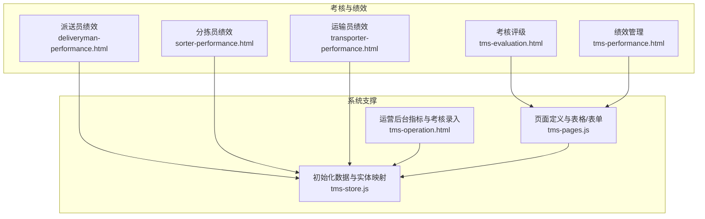
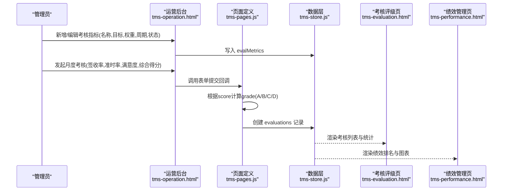
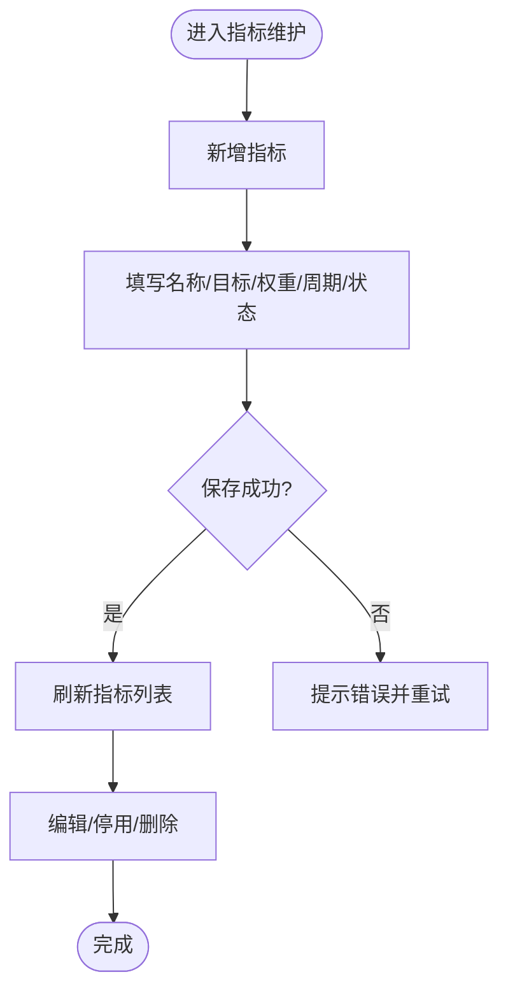
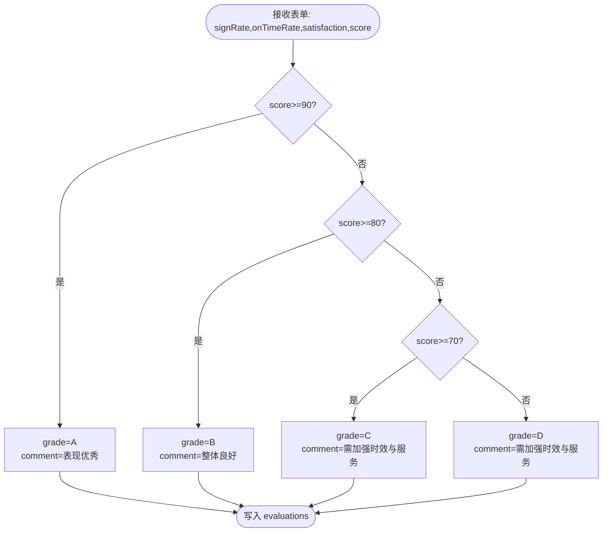
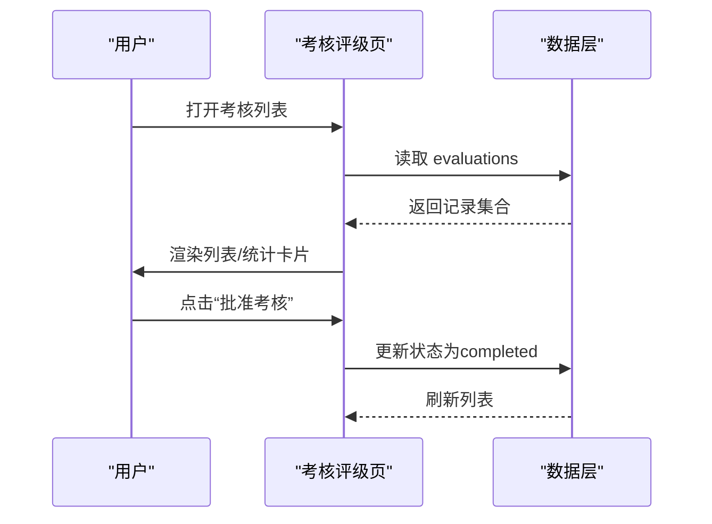
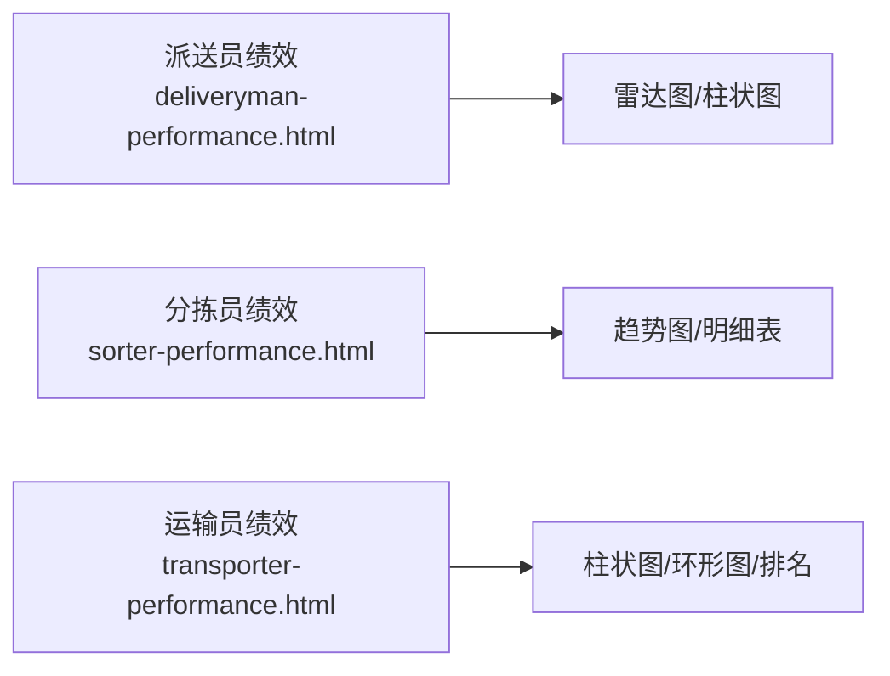
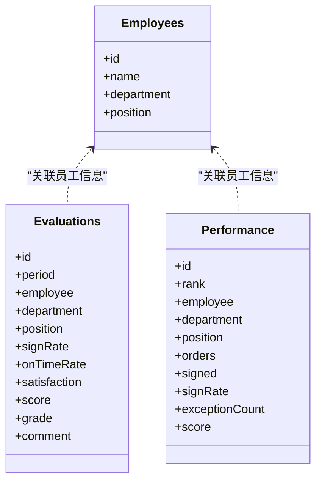
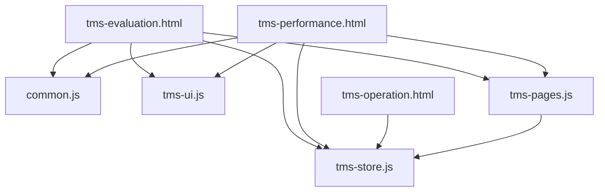

# 考核评级

<cite>
**本文引用的文件**   
- [tms-evaluation.html](file://tms-evaluation.html)
- [tms-performance.html](file://tms-performance.html)
- [deliveryman-performance.html](file://deliveryman-performance.html)
- [sorter-performance.html](file://sorter-performance.html)
- [transporter-performance.html](file://transporter-performance.html)
- [tms-pages.js](file://tms-pages.js)
- [tms-operation.html](file://tms-operation.html)
- [tms-store.js](file://tms-store.js)
</cite>

## 目录
1. [引言](#引言)
2. [项目结构](#项目结构)
3. [核心组件](#核心组件)
4. [架构总览](#架构总览)
5. [详细组件分析](#详细组件分析)
6. [依赖关系分析](#依赖关系分析)
7. [性能与可扩展性](#性能与可扩展性)
8. [故障排查指南](#故障排查指南)
9. [结论](#结论)
10. [附录：数据模型与接口约定](#附录数据模型与接口约定)

## 引言
本文件面向TMS系统的“考核评级”能力，围绕考核指标设定、评级标准制定、绩效评估等人才评价体系进行系统化说明。文档从页面入口、业务逻辑、数据模型、可视化报告以及与其他模块（人事管理、绩效管理）的集成关系出发，给出可追溯的代码级来源与流程图示，帮助读者快速理解并扩展该功能。

## 项目结构
考核评级相关能力由以下前端页面与脚本共同实现：
- 考核评级主界面：tms-evaluation.html
- 绩效管理主界面：tms-performance.html
- 角色化绩效看板：deliveryman-performance.html、sorter-performance.html、transporter-performance.html
- 页面路由与表格/表单配置：tms-pages.js
- 运营后台指标与考核录入：tms-operation.html
- 初始化数据与实体映射：tms-store.js

图表来源
- [tms-pages.js:1100-1187](file://tms-pages.js#L1100-L1187)
- [tms-operation.html:831-883](file://tms-operation.html#L831-L883)
- [tms-store.js:1040-1073](file://tms-store.js#L1040-L1073)

章节来源
- [tms-evaluation.html:348-376](file://tms-evaluation.html#L348-L376)
- [tms-performance.html:342-371](file://tms-performance.html#L342-L371)
- [tms-pages.js:1100-1187](file://tms-pages.js#L1100-L1187)
- [tms-operation.html:831-883](file://tms-operation.html#L831-L883)
- [tms-store.js:1040-1073](file://tms-store.js#L1040-L1073)

## 核心组件
- 考核评级页面（tms-evaluation.html）
  - 提供员工考核列表、等级统计卡片、审批与详情查看等交互。
  - 使用本地存储模拟考核记录，支持批准、查看详情、编辑等操作。
- 绩效管理页面（tms-performance.html）
  - 展示员工绩效得分、趋势与明细，支持批准、查看详情、编辑。
- 角色化绩效看板
  - 派送员/分拣员/运输员分别提供多维指标与图表展示，用于个人绩效回顾与改进。
- 页面路由与表格/表单（tms-pages.js）
  - 定义“考核评级”和“绩效管理”两个页面的表格列、筛选、排序、工具栏与弹窗表单。
  - 包含综合得分到等级的判定规则与KPI汇总。
- 运营后台（tms-operation.html）
  - 提供“考核指标”维护（名称、目标值、权重、周期、状态）与“发起考核”表单。
- 数据初始化（tms-store.js）
  - 生成初始考核与绩效数据，建立实体ID前缀与默认字段。

章节来源
- [tms-evaluation.html:432-629](file://tms-evaluation.html#L432-L629)
- [tms-performance.html:427-630](file://tms-performance.html#L427-L630)
- [deliveryman-performance.html:407-800](file://deliveryman-performance.html#L407-L800)
- [sorter-performance.html:444-677](file://sorter-performance.html#L444-L677)
- [transporter-performance.html:564-750](file://transporter-performance.html#L564-L750)
- [tms-pages.js:1100-1244](file://tms-pages.js#L1100-L1244)
- [tms-operation.html:831-883](file://tms-operation.html#L831-L883)
- [tms-store.js:1040-1073](file://tms-store.js#L1040-L1073)

## 架构总览
考核评级体系由“指标配置—数据采集—评分计算—等级评定—结果展示—审批归档”构成闭环。

图表来源
- [tms-operation.html:831-883](file://tms-operation.html#L831-L883)
- [tms-pages.js:1132-1152](file://tms-pages.js#L1132-L1152)
- [tms-store.js:1040-1073](file://tms-store.js#L1040-L1073)

## 详细组件分析

### 考核指标配置（evalMetrics）
- 目的：定义考核维度、目标值、权重与适用周期，作为后续评分与排名的依据。
- 关键字段
  - name：指标名称
  - target：目标值（如≥95%）
  - weight：权重（%）
  - period：考核周期（月度/季度/年度）
  - status：启用/停用
- 操作
  - 新增/编辑/删除/停用
  - 在运营后台以表格形式展示与维护

图表来源
- [tms-operation.html:831-849](file://tms-operation.html#L831-L849)
- [tms-pages.js:1171-1186](file://tms-pages.js#L1171-L1186)

章节来源
- [tms-operation.html:721-741](file://tms-operation.html#L721-L741)
- [tms-pages.js:1171-1186](file://tms-pages.js#L1171-L1186)

### 评分计算与等级评定
- 输入
  - 签收率 signRate（%）
  - 准时率 onTimeRate（%）
  - 满意度 satisfaction（分）
  - 综合得分 score（0-100）
- 规则
  - 等级判定：score≥90为A；≥80为B；≥70为C；否则D
  - 评语自动生成：A级“表现优秀”，其他等级给出改进建议
- 位置
  - tms-pages.js 中“发起考核”提交回调内计算 grade 与 comment
  - tms-operation.html 中“发起考核”同样执行相同规则

图表来源
- [tms-pages.js:1143-1150](file://tms-pages.js#L1143-L1150)
- [tms-operation.html:871-879](file://tms-operation.html#L871-L879)

章节来源
- [tms-pages.js:1132-1152](file://tms-pages.js#L1132-L1152)
- [tms-operation.html:852-883](file://tms-operation.html#L852-L883)

### 考核结果展示与审批
- 列表展示
  - 周期、员工、部门、岗位、签收率、准时率、满意度、综合得分、等级
  - 支持按等级筛选、按得分排序
- 审批流程
  - 待批准项可“批准考核”，批准后状态变为已完成
  - 详情弹窗展示完整信息
- 数据来源
  - evaluations 实体，由 tms-store.js 初始化示例数据

图表来源
- [tms-evaluation.html:551-629](file://tms-evaluation.html#L551-L629)
- [tms-store.js:1040-1073](file://tms-store.js#L1040-L1073)

章节来源
- [tms-evaluation.html:348-376](file://tms-evaluation.html#L348-L376)
- [tms-evaluation.html:551-629](file://tms-evaluation.html#L551-L629)
- [tms-store.js:1040-1073](file://tms-store.js#L1040-L1073)

### 多维度绩效评估与可视化
- 派送员绩效（deliveryman-performance.html）
  - 指标：任务完成率、准时率、异常率、效率指数、绩效评分
  - 图表：雷达图对比当前与目标绩效；柱状图展示任务完成情况
- 分拣员绩效（sorter-performance.html）
  - 指标：扫描量、分拣量、准确率、效率指数
  - 图表：每日扫描/分拣量趋势；明细表按日展示
- 运输员绩效（transporter-performance.html）
  - 指标：运输量、里程、准时率、客户满意度
  - 图表：月度运输量柱状图；环形图展示准时率；明细表与排名

图表来源
- [deliveryman-performance.html:580-674](file://deliveryman-performance.html#L580-L674)
- [sorter-performance.html:596-677](file://sorter-performance.html#L596-L677)
- [transporter-performance.html:706-738](file://transporter-performance.html#L706-L738)

章节来源
- [deliveryman-performance.html:407-800](file://deliveryman-performance.html#L407-L800)
- [sorter-performance.html:444-677](file://sorter-performance.html#L444-L677)
- [transporter-performance.html:564-750](file://transporter-performance.html#L564-L750)

### 与人事管理与绩效管理的集成
- 人事管理（hr）
  - 通过 employees 实体关联员工基本信息（姓名、部门、岗位），在“发起考核”时自动填充部门与岗位。
- 绩效管理（performance）
  - 基于 performance 实体聚合单量、签收率、异常数与得分，形成排名与图表。
  - KPI汇总平均得分、总完成单量、平均签收率等。

图表来源
- [tms-pages.js:1132-1152](file://tms-pages.js#L1132-L1152)
- [tms-pages.js:1191-1244](file://tms-pages.js#L1191-L1244)
- [tms-store.js:1040-1073](file://tms-store.js#L1040-L1073)

章节来源
- [tms-pages.js:1191-1244](file://tms-pages.js#L1191-L1244)
- [tms-store.js:1040-1073](file://tms-store.js#L1040-L1073)

## 依赖关系分析
- 页面与脚本
  - tms-evaluation.html 与 tms-performance.html 通过 common.js、tms-store.js、tms-ui.js、tms-pages.js 加载运行。
  - 角色化绩效页通过 common.js 与各自脚本实现独立的数据与图表逻辑。
- 数据层
  - tms-store.js 负责初始化 evaluations、performance、employees、evalMetrics 等实体数据，并提供 ID 前缀与默认字段。
- 业务耦合
  - “发起考核”表单依赖 employees 实体获取部门与岗位信息。
  - 等级判定逻辑在 tms-pages.js 与 tms-operation.html 两处保持一致，确保一致性。

图表来源
- [tms-evaluation.html:380-390](file://tms-evaluation.html#L380-L390)
- [tms-performance.html:375-385](file://tms-performance.html#L375-L385)
- [tms-pages.js:1100-1244](file://tms-pages.js#L1100-L1244)
- [tms-store.js:1040-1073](file://tms-store.js#L1040-L1073)

章节来源
- [tms-evaluation.html:380-390](file://tms-evaluation.html#L380-L390)
- [tms-performance.html:375-385](file://tms-performance.html#L375-L385)
- [tms-pages.js:1100-1244](file://tms-pages.js#L1100-L1244)
- [tms-store.js:1040-1073](file://tms-store.js#L1040-L1073)

## 性能与可扩展性
- 前端渲染
  - 列表与图表采用原生DOM与Chart.js渲染，适合中小规模数据；大数据量场景建议分页与虚拟滚动。
- 数据存储
  - 当前使用 localStorage 模拟持久化；生产环境应迁移至后端API与数据库，避免浏览器容量限制与跨设备同步问题。
- 扩展点
  - 指标权重与阈值可通过 evalMetrics 动态配置，便于不同部门差异化考核。
  - 等级判定规则可在 tms-pages.js 与 tms-operation.html 统一调整，保证前后端一致。

[本节为通用指导，不直接分析具体文件]

## 故障排查指南
- 考核列表为空或无数据
  - 检查 tms-store.js 是否已初始化 evaluations 数据。
  - 确认页面是否正确加载 tms-store.js 与 tms-pages.js。
- 等级显示不正确
  - 核对 score 字段是否在 0-100 范围内，且判定规则与代码一致。
- 图表不显示
  - 检查 Chart.js 是否加载成功，canvas 元素是否存在。
- 审批失败
  - 确认 evaluations 记录存在且状态为 pending，更新逻辑正确。

章节来源
- [tms-evaluation.html:551-629](file://tms-evaluation.html#L551-L629)
- [deliveryman-performance.html:580-674](file://deliveryman-performance.html#L580-L674)
- [tms-store.js:1040-1073](file://tms-store.js#L1040-L1073)

## 结论
TMS系统的考核评级功能以“指标配置—评分计算—等级评定—结果展示—审批归档”为主线，结合人事与绩效模块形成完整的人才评价闭环。当前实现以页面+本地存储为主，具备清晰的扩展点与一致的规则定义，便于向服务端与数据库迁移，并支持多维度指标与可视化报告。

[本节为总结性内容，不直接分析具体文件]

## 附录：数据模型与接口约定

### 考核记录（evaluations）
- 字段
  - id：记录ID
  - period：考核周期（如2026-10）
  - employee：员工姓名
  - department：部门
  - position：岗位
  - signRate：签收率（%）
  - onTimeRate：准时率（%）
  - satisfaction：满意度（分）
  - score：综合得分（0-100）
  - grade：等级（A/B/C/D）
  - comment：评语
- 行为
  - 新增：通过“发起考核”表单提交
  - 查询：列表、详情、按等级筛选、按得分排序
  - 更新：批准/拒绝/编辑
  - 删除：运营后台可删除（视权限）

章节来源
- [tms-pages.js:1115-1167](file://tms-pages.js#L1115-L1167)
- [tms-operation.html:852-883](file://tms-operation.html#L852-L883)
- [tms-store.js:1040-1073](file://tms-store.js#L1040-L1073)

### 考核指标（evalMetrics）
- 字段
  - id：指标ID
  - name：指标名称
  - target：目标值
  - weight：权重（%）
  - period：考核周期（月度/季度/年度）
  - status：启用/停用
- 行为
  - 新增/编辑/删除/停用

章节来源
- [tms-operation.html:831-849](file://tms-operation.html#L831-L849)
- [tms-pages.js:1171-1186](file://tms-pages.js#L1171-L1186)

### 绩效记录（performance）
- 字段
  - id：记录ID
  - rank：排名
  - employee：员工姓名
  - department：部门
  - position：岗位
  - orders：完成单量
  - signed：签收单量
  - signRate：签收率（%）
  - exceptionCount：异常数
  - score：绩效得分
- 行为
  - 查询：列表、详情、图表排名

章节来源
- [tms-pages.js:1191-1244](file://tms-pages.js#L1191-L1244)
- [tms-store.js:1058-1073](file://tms-store.js#L1058-L1073)