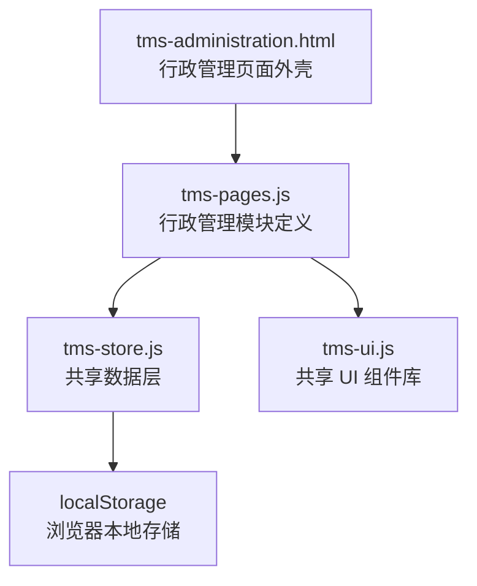
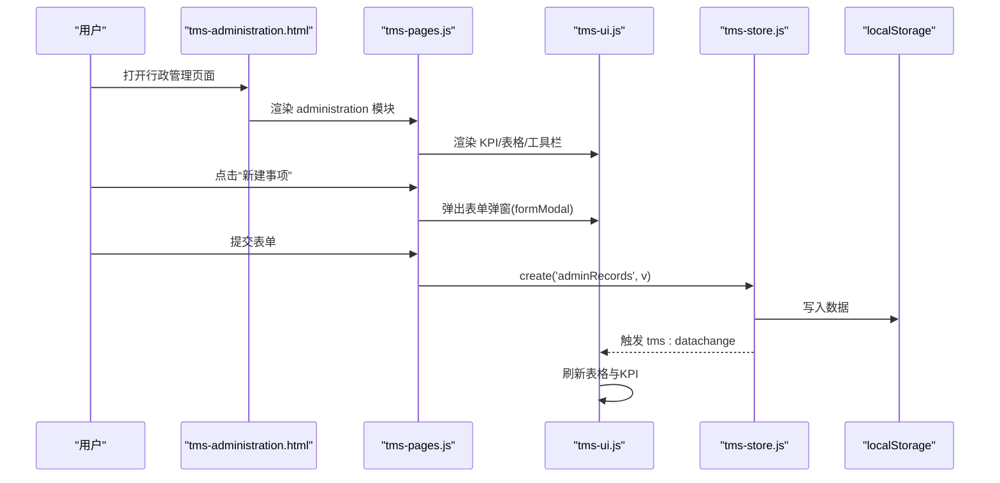
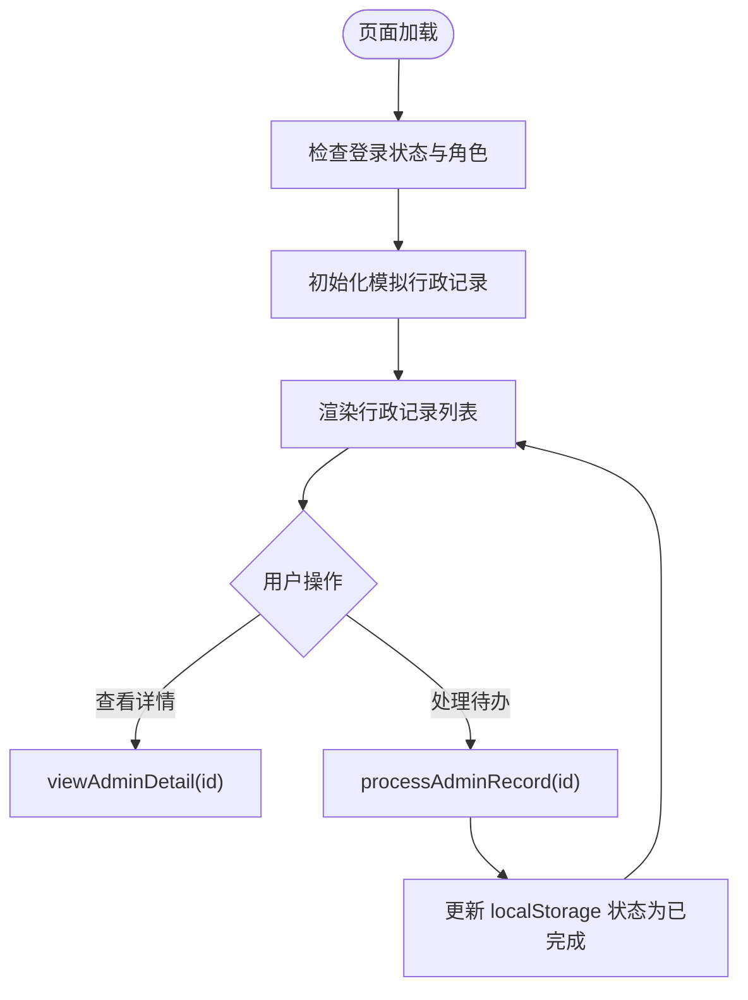
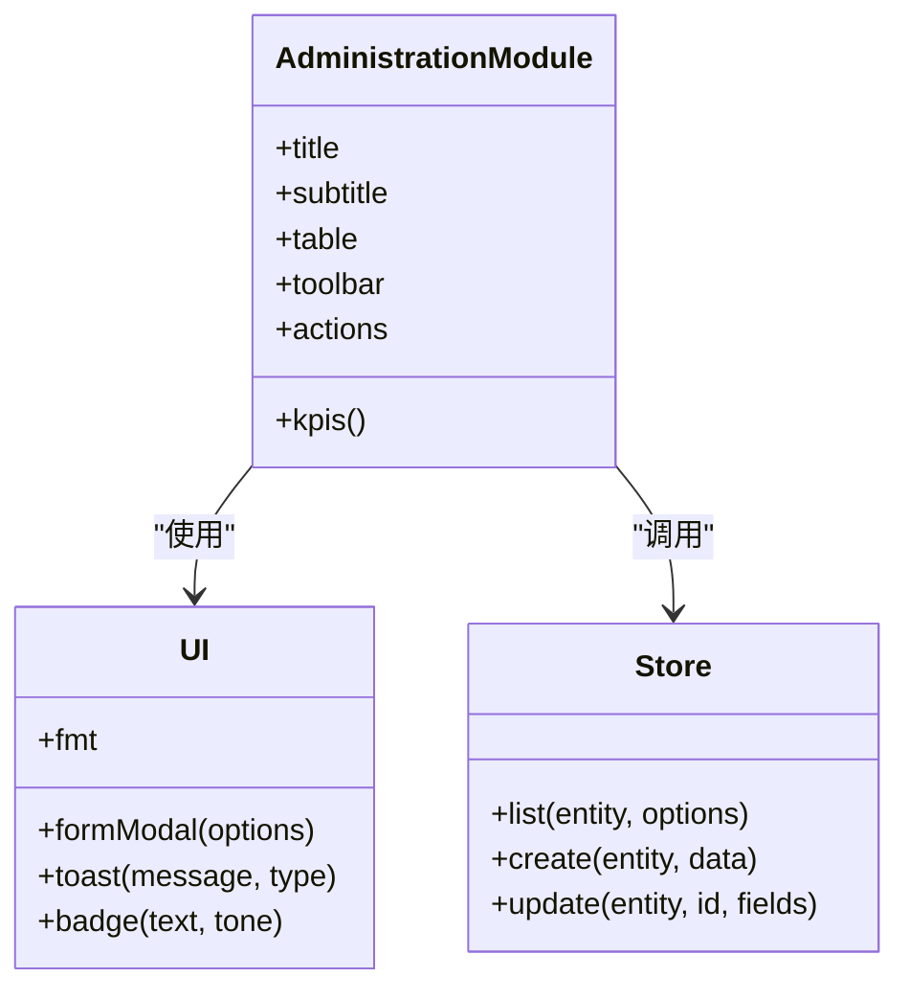
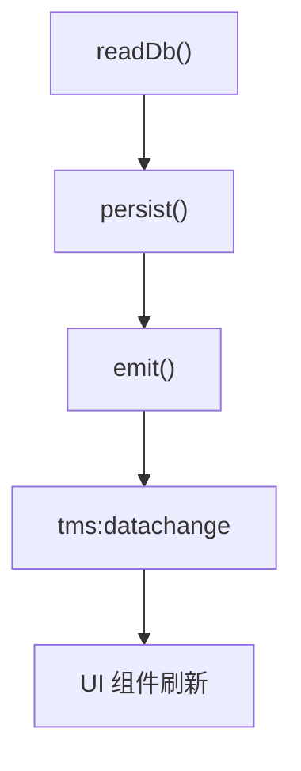
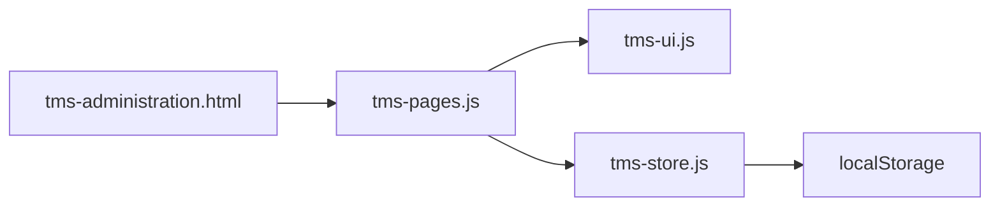

# 行政管理

<cite>
**本文引用的文件**   
- [tms-administration.html](file://tms-administration.html)
- [tms-pages.js](file://tms-pages.js)
- [tms-store.js](file://tms-store.js)
- [tms-ui.js](file://tms-ui.js)
</cite>

## 目录
1. [引言](#引言)
2. [项目结构](#项目结构)
3. [核心组件](#核心组件)
4. [架构总览](#架构总览)
5. [详细组件分析](#详细组件分析)
6. [依赖关系分析](#依赖关系分析)
7. [性能与可扩展性](#性能与可扩展性)
8. [故障排查指南](#故障排查指南)
9. [结论](#结论)
10. [附录：行政数据模型与接口规范](#附录行政数据模型与接口规范)

## 引言
本章节面向 TMS 系统的“行政管理”能力，聚焦后台支持功能在代码中的实现方式。系统通过共享数据层、UI 组件库与页面路由组织，提供行政事项申请、审批、统计等能力；同时包含一个独立的会议/通知/文档展示页，用于演示办公资源类场景。本文从系统架构、组件职责、数据流、业务模型、调用关系、配置项与返回值等方面展开说明，并结合仓库中的实际代码路径给出可追溯的示例。

## 项目结构
TMS 采用多页面 HTML + 共享 JS 的模式：
- 页面级入口：如 tms-administration.html 负责行政管理页面的基础布局、样式与本地模拟数据。
- 页面路由与业务定义：tms-pages.js 中 define('administration', ...) 注册行政管理模块的 KPI、表格、工具栏与操作。
- 共享数据层：tms-store.js 提供基于 localStorage 的数据读写、种子数据、事件广播与通用查询能力。
- 共享 UI 库：tms-ui.js 提供表单弹窗、确认框、列表、图表、状态徽章等通用 UI 能力。

**图示来源**
- [tms-administration.html:262-386](file://tms-administration.html#L262-L386)
- [tms-pages.js:1027-1098](file://tms-pages.js#L1027-L1098)
- [tms-store.js:1-12](file://tms-store.js#L1-L12)
- [tms-ui.js:1-6](file://tms-ui.js#L1-L6)

**章节来源**
- [tms-administration.html:262-386](file://tms-administration.html#L262-L386)
- [tms-pages.js:1027-1098](file://tms-pages.js#L1027-L1098)
- [tms-store.js:1-12](file://tms-store.js#L1-L12)
- [tms-ui.js:1-6](file://tms-ui.js#L1-L6)

## 核心组件
- 行政管理页面外壳（tms-administration.html）
  - 提供侧边导航、用户信息、退出登录按钮。
  - 初始化时检查登录角色并渲染页面内容。
  - 内嵌一段独立脚本，使用 localStorage 维护“会议/通知/文档”三类行政记录，并提供查看与处理操作。
- 行政管理模块定义（tms-pages.js）
  - 定义行政管理模块的标题、副标题、KPI、表格列、筛选、搜索、分页、工具栏与行操作。
  - 通过 S.create/S.update 调用共享数据层，完成新建、审批、驳回等操作。
- 共享数据层（tms-store.js）
  - 提供 list/create/update 等统一 API，内部基于 localStorage 持久化。
  - 生成种子数据，包括行政记录 adminRecords。
  - 变更数据后触发 tms:datachange 事件，供 UI 订阅刷新。
- 共享 UI 组件库（tms-ui.js）
  - 提供 formModal、confirm、toast、table、statusBadge、fmt 等能力。
  - 行政管理模块通过 U.formModal 创建表单弹窗，通过 U.badge/U.fmt.money 渲染状态与金额。

**章节来源**
- [tms-administration.html:262-386](file://tms-administration.html#L262-L386)
- [tms-administration.html:458-606](file://tms-administration.html#L458-L606)
- [tms-pages.js:1027-1098](file://tms-pages.js#L1027-L1098)
- [tms-store.js:1-12](file://tms-store.js#L1-L12)
- [tms-store.js:1024-1139](file://tms-store.js#L1024-L1139)
- [tms-ui.js:160-287](file://tms-ui.js#L160-L287)
- [tms-ui.js:289-544](file://tms-ui.js#L289-L544)

## 架构总览
行政管理功能由“页面外壳 + 模块定义 + 数据层 + UI 组件”共同组成。典型流程如下：
- 用户打开行政管理页面，页面外壳加载公共脚本，并调用页面路由渲染行政管理模块。
- 行政管理模块通过 UI 组件渲染 KPI、表格、工具栏与操作按钮。
- 用户发起新建、审批或驳回操作时，模块调用共享数据层的 create/update 方法。
- 数据层更新 localStorage 并触发 tms:datachange 事件，UI 组件监听事件后刷新列表。

**图示来源**
- [tms-administration.html:380-386](file://tms-administration.html#L380-L386)
- [tms-pages.js:1027-1098](file://tms-pages.js#L1027-L1098)
- [tms-store.js:220-244](file://tms-store.js#L220-L244)
- [tms-ui.js:160-287](file://tms-ui.js#L160-L287)

## 详细组件分析

### 行政管理页面外壳（tms-administration.html）
- 作用
  - 提供行政管理页面的基础布局与样式。
  - 初始化时检查登录状态与角色，显示当前用户信息。
  - 内嵌脚本维护“会议/通知/文档”三类行政记录，并在本地存储中持久化。
- 关键逻辑
  - 初始化：检查登录状态、渲染页面外壳、初始化模拟数据、渲染列表。
  - 交互：查看详情、处理待办事项。
  - 分类与状态映射：将 meeting/notice/document 与 upcoming/published/approved/completed/cancelled 转换为中文文本。
- 数据模型（本地模拟）
  - id、title、category、organizer/issuer/author、date/time/location/participants/audience/version/status/description/content。
- 调用关系
  - 直接操作 localStorage，不经过共享数据层。
  - 与公共脚本 common.js、tms-store.js、tms-ui.js、tms-pages.js 共存于同一页面。

**图示来源**
- [tms-administration.html:428-453](file://tms-administration.html#L428-L453)
- [tms-administration.html:458-523](file://tms-administration.html#L458-L523)
- [tms-administration.html:525-606](file://tms-administration.html#L525-L606)

**章节来源**
- [tms-administration.html:262-386](file://tms-administration.html#L262-L386)
- [tms-administration.html:428-606](file://tms-administration.html#L428-L606)

### 行政管理模块定义（tms-pages.js）
- 作用
  - 定义行政管理模块的元信息与界面行为。
  - 提供 KPI 统计、表格列定义、筛选器、搜索字段、排序默认值。
  - 提供工具栏“新建事项”与行操作“通过/驳回”。
- 关键逻辑
  - KPI：统计待审批、已通过、已完成数量与涉及金额。
  - 新建事项：通过 U.formModal 收集 type/title/applicant/department/amount，设置 status=pending，调用 S.create('adminRecords', v)。
  - 通过：S.update('adminRecords', row.id, { status: 'approved' })。
  - 驳回：弹出原因输入框，S.update('adminRecords', row.id, { status: 'rejected', reason: ... })。
- 数据模型（行政事项）
  - id、type、title、applicant、department、amount、status、createdAt、reason（可选）。
- 调用关系
  - 依赖 U（tms-ui.js）进行弹窗与提示。
  - 依赖 S（tms-store.js）进行数据读写。

**图示来源**
- [tms-pages.js:1027-1098](file://tms-pages.js#L1027-L1098)
- [tms-ui.js:160-287](file://tms-ui.js#L160-L287)
- [tms-store.js:220-244](file://tms-store.js#L220-L244)

**章节来源**
- [tms-pages.js:1027-1098](file://tms-pages.js#L1027-L1098)

### 共享数据层（tms-store.js）
- 作用
  - 提供统一的增删改查、搜索、筛选、排序、分页能力。
  - 维护各实体（含 adminRecords）的种子数据。
  - 变更数据后触发 tms:datachange 事件，供 UI 订阅刷新。
- 关键逻辑
  - 读取/持久化：readDb()/persist() 封装 localStorage 读写。
  - 事件广播：emit() 分发 tms:datachange 事件。
  - 行政记录种子：生成 adminRecords 数组，并挂载到 db.adminRecords。
- 接口约定
  - list(entity, options)：返回 rows/total/page 等。
  - create(entity, data)：新增记录。
  - update(entity, id, fields)：更新记录字段。
- 扩展点
  - 可通过订阅 tms:datachange 事件实现跨组件联动刷新。

**图示来源**
- [tms-store.js:220-244](file://tms-store.js#L220-L244)
- [tms-store.js:1024-1139](file://tms-store.js#L1024-L1139)

**章节来源**
- [tms-store.js:1-12](file://tms-store.js#L1-L12)
- [tms-store.js:220-244](file://tms-store.js#L220-L244)
- [tms-store.js:1024-1139](file://tms-store.js#L1024-L1139)

### 共享 UI 组件库（tms-ui.js）
- 作用
  - 提供表单弹窗、确认框、Toast、通用表格、状态徽章、格式化器等。
- 关键逻辑
  - formModal：根据 fields 动态生成表单，支持必填校验、异步提交、错误提示。
  - table：支持 entity 绑定、搜索、筛选、排序、分页、工具栏与行操作。
  - statusBadge/badge：根据状态映射样式与标签。
  - fmt：日期、时间、金额、百分比格式化。
- 行政管理使用点
  - 新建事项弹窗：U.formModal(...)
  - 操作提示：U.toast(...)
  - 状态与金额渲染：U.badge(...), U.fmt.money(...)

**章节来源**
- [tms-ui.js:160-287](file://tms-ui.js#L160-L287)
- [tms-ui.js:289-544](file://tms-ui.js#L289-L544)
- [tms-ui.js:758-781](file://tms-ui.js#L758-L781)

## 依赖关系分析
- 页面外壳依赖公共脚本与共享模块：
  - tms-administration.html 引入 common.js、tms-store.js、tms-ui.js、tms-pages.js。
- 行政管理模块依赖 UI 与数据层：
  - tms-pages.js 的 administration 模块通过 U 与 S 完成交互与数据操作。
- 数据层与 UI 解耦：
  - tms-store.js 仅负责数据与事件，UI 通过事件订阅刷新。

**图示来源**
- [tms-administration.html:375-386](file://tms-administration.html#L375-L386)
- [tms-pages.js:1027-1098](file://tms-pages.js#L1027-L1098)
- [tms-store.js:220-244](file://tms-store.js#L220-L244)

**章节来源**
- [tms-administration.html:375-386](file://tms-administration.html#L375-L386)
- [tms-pages.js:1027-1098](file://tms-pages.js#L1027-L1098)
- [tms-store.js:220-244](file://tms-store.js#L220-L244)

## 性能与可扩展性
- 性能特性
  - 数据量较小且基于 localStorage，适合演示与轻量场景。
  - 列表渲染与筛选在内存中进行，翻页与排序开销较低。
- 优化建议
  - 若数据量增长，可在 store 层增加索引与分页优化。
  - 对高频操作（如批量审批）可增加事务与批量更新接口。
- 可扩展性
  - 通过 define('administration', ...) 扩展更多行政子模块（如办公用品采购、会议室预订、资产领用）。
  - 通过订阅 tms:datachange 事件实现跨模块联动（如财务流水与行政费用关联）。

[本节为通用指导，不直接分析具体文件]

## 故障排查指南
- 常见问题
  - 页面未渲染：检查是否成功加载 tms-pages.js 与 tms-ui.js。
  - 数据不更新：检查 localStorage 是否被清空或权限受限。
  - 表单提交失败：检查必填字段与类型校验。
- 定位方法
  - 查看控制台错误日志。
  - 检查 localStorage 中 tmsDB_v3 与 tmsAdminRecords 是否存在。
  - 验证 tms:datachange 事件是否触发。

**章节来源**
- [tms-store.js:220-244](file://tms-store.js#L220-L244)
- [tms-administration.html:458-606](file://tms-administration.html#L458-L606)

## 结论
TMS 的行政管理功能以模块化方式组织，通过共享数据层与 UI 组件库实现低耦合、高复用。行政管理模块定义了完整的申请、审批、驳回流程，并提供 KPI 与表格视图；页面外壳则提供了会议/通知/文档的本地演示能力。整体架构清晰，便于扩展至办公用品管理、会议室预订、资产登记等日常行政流程。

[本节为总结性内容，不直接分析具体文件]

## 附录：行政数据模型与接口规范

### 行政事项数据模型（adminRecords）
- 字段
  - id：记录号（自动生成）
  - type：事项类型（如“办公用品采购”“差旅报销”“会议安排”“资产领用”“车辆使用”）
  - title：事项名称
  - applicant：申请人
  - department：部门
  - amount：金额（元）
  - status：状态（pending/approved/rejected/completed）
  - createdAt：申请时间
  - reason：驳回原因（可选）
- 状态语义
  - pending：待审批
  - approved：已通过
  - rejected：已驳回
  - completed：已完成

**章节来源**
- [tms-pages.js:1041-1098](file://tms-pages.js#L1041-L1098)
- [tms-store.js:1024-1139](file://tms-store.js#L1024-L1139)

### 行政管理接口规范
- 新建事项
  - 调用：S.create('adminRecords', v)
  - 参数：{ type, title, applicant, department, amount }
  - 返回：无（数据层写入后触发事件）
- 审批通过
  - 调用：S.update('adminRecords', id, { status: 'approved' })
  - 返回：无
- 驳回
  - 调用：S.update('adminRecords', id, { status: 'rejected', reason })
  - 返回：无
- 查询列表
  - 调用：S.list('adminRecords', { search, filters, sort, page, pageSize })
  - 返回：{ rows, total, page }

**章节来源**
- [tms-pages.js:1057-1098](file://tms-pages.js#L1057-L1098)
- [tms-store.js:220-244](file://tms-store.js#L220-L244)

### 办公资源演示（会议/通知/文档）
- 数据模型（本地模拟）
  - 会议：id、title、category=meeting、organizer、date、time、location、participants、status、description
  - 通知：id、title、category=notice、issuer、date、audience、status、content
  - 文档：id、title、category=document、author、date、version、status、description
- 交互
  - 查看详情：viewAdminDetail(id)
  - 处理待办：processAdminRecord(id)，将状态更新为 completed

**章节来源**
- [tms-administration.html:458-606](file://tms-administration.html#L458-L606)