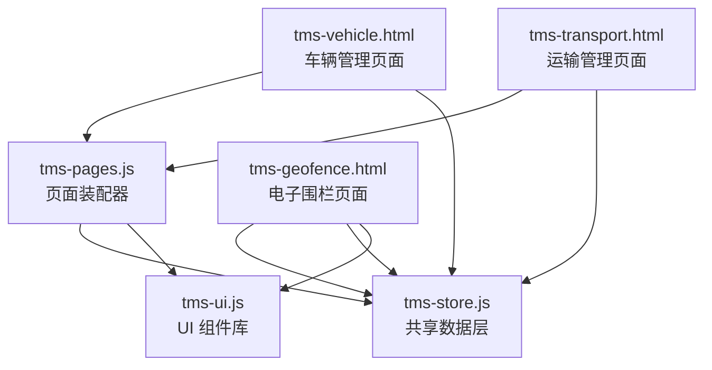
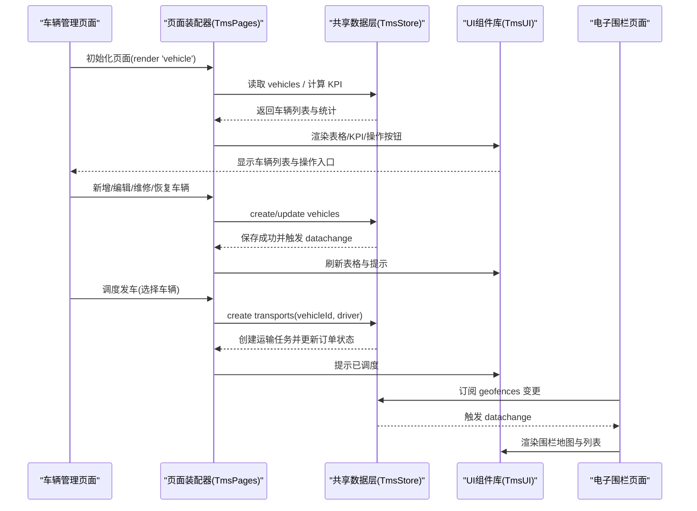
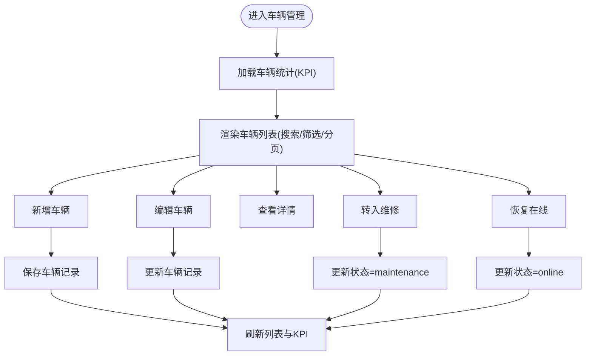
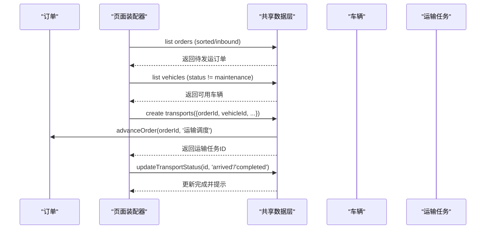
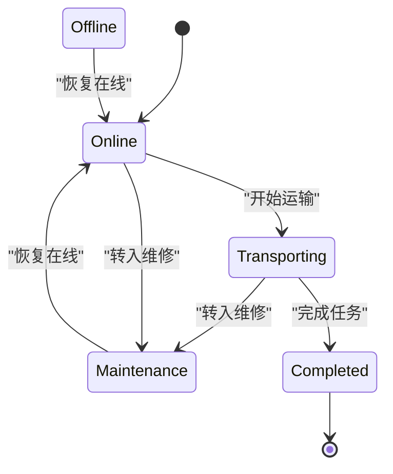
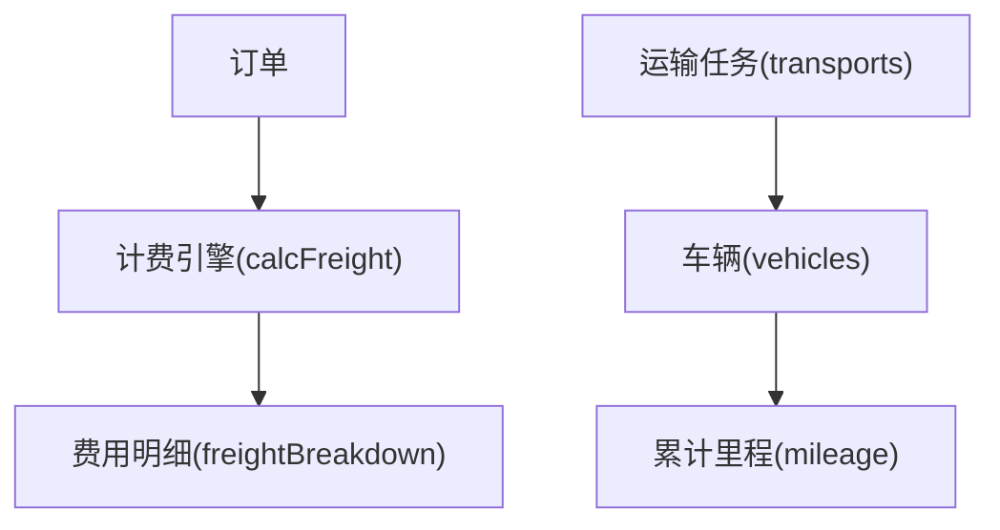
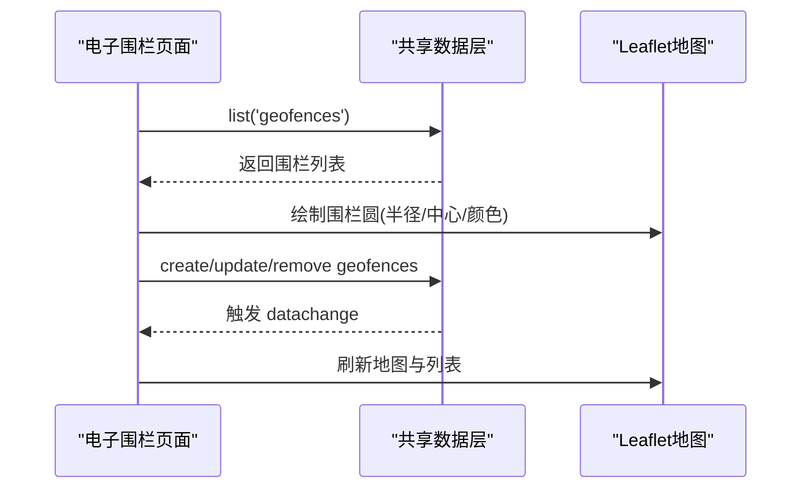
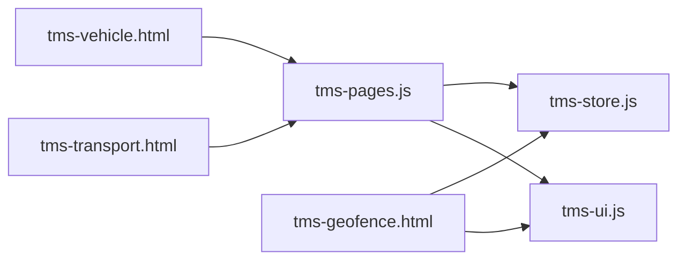

# 车辆管理

<cite>
**本文引用的文件**   
- [tms-vehicle.html](file://tms-vehicle.html)
- [tms-transport.html](file://tms-transport.html)
- [tms-geofence.html](file://tms-geofence.html)
- [tms-store.js](file://tms-store.js)
- [tms-ui.js](file://tms-ui.js)
- [tms-pages.js](file://tms-pages.js)
</cite>

## 目录
1. [引言](#引言)
2. [项目结构](#项目结构)
3. [核心组件](#核心组件)
4. [架构总览](#架构总览)
5. [详细组件分析](#详细组件分析)
6. [依赖关系分析](#依赖关系分析)
7. [性能与扩展性](#性能与扩展性)
8. [故障排查指南](#故障排查指南)
9. [结论](#结论)
10. [附录：数据模型与接口约定](#附录数据模型与接口约定)

## 引言
本文件面向 TMS 系统的“车辆管理”能力，围绕车辆档案管理、调度管理、维护保养、状态监控、里程统计、费用关联以及电子围栏联动等主题展开。文档基于仓库中的前端页面与共享数据层实现进行说明，重点解释：
- 车辆信息录入、编辑、查看、维修/恢复等全生命周期操作
- 运输任务与车辆的绑定、发车、到达、完成等调度流程
- 车辆状态与里程、位置、所属网点等业务字段
- 与电子围栏系统的数据联动和可视化展示
- 与订单、运费、轨迹等上下游模块的集成点

## 项目结构
TMS 的前端采用多页 HTML + 共享 JS 的模式：
- tms-vehicle.html：车辆管理页面骨架与基础样式
- tms-transport.html：运输管理页面骨架与基础样式
- tms-geofence.html：电子围栏地图与围栏列表
- tms-store.js：基于 localStorage 的轻量业务数据库，负责种子数据、CRUD、事件通知、KPI 聚合
- tms-ui.js：通用 UI 组件库（表格、弹窗、表单、图表、状态标签等）
- tms-pages.js：管理员端页面装配器，将各业务页统一为 KPI + 图表 + 表格 + CRUD 的结构

**图示来源**
- [tms-vehicle.html:567-571](file://tms-vehicle.html#L567-L571)
- [tms-transport.html:471-475](file://tms-transport.html#L471-L475)
- [tms-geofence.html:577-588](file://tms-geofence.html#L577-L588)
- [tms-pages.js:108-135](file://tms-pages.js#L108-L135)
- [tms-store.js:220-244](file://tms-store.js#L220-L244)
- [tms-ui.js:758-781](file://tms-ui.js#L758-L781)

**章节来源**
- [tms-vehicle.html:1-669](file://tms-vehicle.html#L1-L669)
- [tms-transport.html:1-581](file://tms-transport.html#L1-L581)
- [tms-geofence.html:1-814](file://tms-geofence.html#L1-L814)
- [tms-store.js:1-800](file://tms-store.js#L1-L800)
- [tms-ui.js:1-783](file://tms-ui.js#L1-L783)
- [tms-pages.js:1-800](file://tms-pages.js#L1-L800)

## 核心组件
- 共享数据层（TmsStore）
  - 提供 vehicles、transports、orders、geofences 等实体的增删改查、搜索、筛选、分页
  - 维护状态字典（如 vehicle、transport、order 等），并触发 tms:datachange 事件
  - 生成种子数据，包括车辆、运输、订单、电子围栏等
- 页面装配器（TmsPages）
  - 定义 vehicle、transport 等页面的 KPI、表格、工具栏、动作按钮
  - 通过 TmsStore 读取/写入数据，驱动界面刷新
- UI 组件库（TmsUI）
  - 提供表格、表单弹窗、确认框、Toast、状态标签、详情弹窗等
- 页面视图
  - tms-vehicle.html：车辆管理主视图（静态示例表 + 交互占位）
  - tms-transport.html：运输管理主视图（静态示例表 + 交互占位）
  - tms-geofence.html：电子围栏地图与围栏列表（Leaflet 地图 + 围栏 CRUD）

**章节来源**
- [tms-store.js:1-12](file://tms-store.js#L1-L12)
- [tms-store.js:220-244](file://tms-store.js#L220-L244)
- [tms-store.js:500-518](file://tms-store.js#L500-L518)
- [tms-store.js:573-591](file://tms-store.js#L573-L591)
- [tms-pages.js:474-575](file://tms-pages.js#L474-L575)
- [tms-ui.js:303-544](file://tms-ui.js#L303-L544)
- [tms-ui.js:758-781](file://tms-ui.js#L758-L781)

## 架构总览
TMS 的车辆管理由“页面视图 → 页面装配器 → 共享数据层 → UI 组件库”构成。车辆档案在 TmsStore 中持久化，页面通过 TmsPages 渲染表格与 KPI；运输调度通过创建 transports 记录并与 vehicles 关联；电子围栏通过 Leaflet 地图与 TmsStore.geofences 双向联动。

**图示来源**
- [tms-pages.js:108-135](file://tms-pages.js#L108-L135)
- [tms-pages.js:289-318](file://tms-pages.js#L289-L318)
- [tms-pages.js:474-575](file://tms-pages.js#L474-L575)
- [tms-store.js:220-244](file://tms-store.js#L220-L244)
- [tms-geofence.html:577-588](file://tms-geofence.html#L577-L588)

## 详细组件分析

### 车辆档案管理
- 数据实体
  - id、plate、type、model、driver、branch、status、location、capacityTon、mileage、lastUpdate
- 生命周期
  - 新增：填写车牌、类型、车型、司机、所属网点、载重、当前位置、初始状态
  - 编辑：修改基本信息、位置、载重
  - 维修：将状态切换为 maintenance
  - 恢复：从 maintenance/offline 恢复到 online
- 展示与统计
  - KPI：车辆总数、在线（含运输中）、维修中、离线
  - 表格：支持按车牌/司机/位置搜索，按状态筛选，显示最后更新时间
  - 详情：展示车辆基本信息、累计里程、运输任务数

**图示来源**
- [tms-pages.js:474-575](file://tms-pages.js#L474-L575)
- [tms-store.js:500-518](file://tms-store.js#L500-L518)

**章节来源**
- [tms-pages.js:474-575](file://tms-pages.js#L474-L575)
- [tms-store.js:500-518](file://tms-store.js#L500-L518)
- [tms-vehicle.html:448-556](file://tms-vehicle.html#L448-L556)

### 调度管理与车辆绑定
- 调度发车
  - 选择待发运订单、承运商、车辆（过滤掉 maintenance 状态）
  - 创建 transports 记录，包含 orderId、waybillNo、origin、destination、carrier、vehicleId、driver、departAt、eta、status=shipping、progress=0
  - 自动推进订单状态至 shipping
- 状态流转
  - 到达：将 transport 状态更新为 arrived
  - 完成：将 transport 状态更新为 completed，并联动订单签收
- 与车辆的关系
  - transports.vehicleId 指向 vehicles.id
  - 车辆详情可查看其参与过的运输任务数量

**图示来源**
- [tms-pages.js:289-318](file://tms-pages.js#L289-L318)
- [tms-pages.js:341-355](file://tms-pages.js#L341-L355)
- [tms-store.js:1395-1414](file://tms-store.js#L1395-L1414)

**章节来源**
- [tms-pages.js:250-357](file://tms-pages.js#L250-L357)
- [tms-store.js:1395-1414](file://tms-store.js#L1395-L1414)
- [tms-transport.html:381-459](file://tms-transport.html#L381-L459)

### 维护保养与状态监控
- 状态字典
  - vehicle: online、transporting、maintenance、offline
- 维护流程
  - 点击“维修”：确认后更新 status=maintenance，并更新时间戳
  - 点击“恢复”：将 maintenance/offline 恢复为 online，并更新时间戳
- 监控指标
  - KPI 汇总在线、运输中、维修中、离线数量
  - 表格显示 lastUpdate，便于判断最近一次状态更新

**图示来源**
- [tms-store.js:110](file://tms-store.js#L110)
- [tms-pages.js:557-572](file://tms-pages.js#L557-L572)

**章节来源**
- [tms-store.js:110](file://tms-store.js#L110)
- [tms-pages.js:557-572](file://tms-pages.js#L557-L572)

### 里程统计与费用关联
- 里程统计
  - vehicles.mileage 表示累计里程（km）
  - 车辆详情展示累计里程
- 费用关联
  - 订单 freightBreakdown 包含首重、续重、燃油附加、偏远附加、保价费、到付手续费、折扣、合计等
  - 计费引擎 calcFreight 根据运价卡与服务等级计算费用明细
  - 车辆本身不直接产生费用，但运输任务与订单关联后，可间接反映运力成本

**图示来源**
- [tms-store.js:327-383](file://tms-store.js#L327-L383)
- [tms-pages.js:524-535](file://tms-pages.js#L524-L535)

**章节来源**
- [tms-store.js:327-383](file://tms-store.js#L327-L383)
- [tms-pages.js:524-535](file://tms-pages.js#L524-L535)

### 电子围栏与车辆联动
- 围栏数据结构
  - id、name、type、lat、lng、radius、status、createdAt
- 地图展示
  - 使用 Leaflet 绘制圆形围栏，颜色与状态区分生效/停用
  - 支持新增、编辑、启用/停用、删除围栏
- 与车辆的关系
  - 当前代码未直接对车辆位置做围栏判定逻辑，但可通过后续扩展将车辆 location 或 GPS 坐标与围栏规则结合，实现禁行区域提醒、进出仓告警等

**图示来源**
- [tms-geofence.html:611-683](file://tms-geofence.html#L611-L683)
- [tms-geofence.html:723-746](file://tms-geofence.html#L723-L746)
- [tms-store.js:573-591](file://tms-store.js#L573-L591)

**章节来源**
- [tms-geofence.html:577-814](file://tms-geofence.html#L577-L814)
- [tms-store.js:573-591](file://tms-store.js#L573-L591)

## 依赖关系分析
- 页面与装配器
  - tms-vehicle.html 与 tms-transport.html 通过 TmsUI.initShell() 与 TmsPages.render() 初始化
- 装配器与数据层
  - TmsPages 通过 TmsStore.list/create/update 访问 vehicles、transports、geofences 等实体
- 数据层与 UI
  - TmsStore 触发 tms:datachange 事件，TmsUI.table 订阅该事件以刷新表格
- 电子围栏与地图
  - tms-geofence.html 依赖 Leaflet 与 leaflet-draw，通过 TmsStore 读写围栏数据

**图示来源**
- [tms-vehicle.html:567-571](file://tms-vehicle.html#L567-L571)
- [tms-transport.html:471-475](file://tms-transport.html#L471-L475)
- [tms-geofence.html:577-588](file://tms-geofence.html#L577-L588)
- [tms-pages.js:108-135](file://tms-pages.js#L108-L135)
- [tms-store.js:220-244](file://tms-store.js#L220-L244)
- [tms-ui.js:758-781](file://tms-ui.js#L758-L781)

**章节来源**
- [tms-vehicle.html:567-571](file://tms-vehicle.html#L567-L571)
- [tms-transport.html:471-475](file://tms-transport.html#L471-L475)
- [tms-geofence.html:577-588](file://tms-geofence.html#L577-L588)
- [tms-pages.js:108-135](file://tms-pages.js#L108-L135)
- [tms-store.js:220-244](file://tms-store.js#L220-L244)
- [tms-ui.js:758-781](file://tms-ui.js#L758-L781)

## 性能与扩展性
- 本地存储
  - 所有数据存储在 localStorage，适合演示与轻量场景；大数据量时需考虑分页与索引优化
- 事件驱动
  - 通过 tms:datachange 事件减少重复查询，提升界面响应速度
- 可扩展点
  - 车辆 GPS 与围栏联动：可在 Store 层增加围栏校验函数，结合车辆位置实时告警
  - 维护计划：新增 maintenancePlans 实体，关联 vehicles，支持到期提醒与工单联动
  - 费用分摊：将运费明细与车辆/线路维度关联，用于成本核算与绩效评估

[本节为通用指导，不涉及具体文件分析]

## 故障排查指南
- 页面无法加载地图
  - 检查 Leaflet 资源是否加载成功；若失败，围栏列表仍可正常使用
- 数据不刷新
  - 确认 TmsStore.subscribe 是否正确注册；检查 tms:datachange 事件是否触发
- 状态标签异常
  - 检查 STATUS_CLASS 与 TmsStore.labels 映射是否完整
- 调度失败
  - 确认选择的车辆状态非 maintenance；检查订单状态是否为 sorted/inbound

**章节来源**
- [tms-geofence.html:600-609](file://tms-geofence.html#L600-L609)
- [tms-store.js:220-244](file://tms-store.js#L220-L244)
- [tms-ui.js:57-76](file://tms-ui.js#L57-L76)
- [tms-pages.js:289-318](file://tms-pages.js#L289-L318)

## 结论
TMS 的车辆管理功能以 TmsStore 为核心数据层，配合 TmsPages 与 TmsUI 构建出完整的车辆档案、调度与维护界面。当前实现覆盖了车辆信息录入、状态管理、里程统计、运输任务绑定与电子围栏可视化。未来可进一步扩展车辆 GPS 与围栏联动、维护计划与工单闭环、费用分摊与成本核算等高级能力，以提升运输资源的精细化管理水平。

[本节为总结性内容，不涉及具体文件分析]

## 附录：数据模型与接口约定

### 车辆实体（vehicles）
- 字段
  - id: string（VEH-xxx）
  - plate: string（车牌号）
  - type: string（卡车/厢货/集装箱/冷链车）
  - model: string（车型）
  - driver: string（司机）
  - branch: string（所属网点）
  - status: enum（online/transporting/maintenance/offline）
  - location: string（当前位置）
  - capacityTon: number（载重吨）
  - mileage: number（累计里程 km）
  - lastUpdate: ISO datetime（最后更新时间）

**章节来源**
- [tms-store.js:500-518](file://tms-store.js#L500-L518)
- [tms-pages.js:488-503](file://tms-pages.js#L488-L503)

### 运输任务实体（transports）
- 字段
  - id: string（TR-yyy）
  - orderId: string（订单号）
  - waybillNo: string（运单号）
  - origin: string（起点）
  - destination: string（终点）
  - carrier: string（承运商）
  - vehicleId: string（车辆ID）
  - driver: string（司机）
  - departAt: ISO datetime（出发时间）
  - eta: ISO datetime（预计到达）
  - status: enum（pending/shipping/arrived/delivering/completed/cancelled）
  - progress: number（进度百分比）

**章节来源**
- [tms-store.js:819-856](file://tms-store.js#L819-L856)
- [tms-pages.js:264-288](file://tms-pages.js#L264-L288)

### 电子围栏实体（geofences）
- 字段
  - id: string（GF-zzz）
  - name: string（围栏名称）
  - type: string（仓储围栏/网点围栏/禁行区域/派送围栏/到货围栏/派送员围栏）
  - lat: number（中心纬度）
  - lng: number（中心经度）
  - radius: number（半径米）
  - status: enum（active/inactive）
  - createdAt: ISO datetime（创建时间）

**章节来源**
- [tms-store.js:573-591](file://tms-store.js#L573-L591)
- [tms-geofence.html:633-683](file://tms-geofence.html#L633-L683)

### 关键接口与调用关系
- TmsStore
  - list(entity, options): 获取实体列表（支持 search、filters、sort、page、pageSize）
  - get(entity, id): 获取单条记录
  - create(entity, data): 新增记录
  - update(entity, id, data): 更新记录
  - remove(entity, id): 删除记录
  - subscribe(fn): 订阅数据变更事件
  - vehicleStats(): 车辆统计（total、online、transporting、maintenance、offline）
- TmsPages
  - render(pageId, root): 渲染页面（KPI、图表、表格、CRUD）
- TmsUI
  - table(container, config): 渲染表格（搜索、筛选、分页、排序、动作）
  - formModal(options): 表单弹窗
  - confirm(options): 确认弹窗
  - toast(message, type): 消息提示
  - statusBadge(status, entity): 状态标签
  - detailModal(title, html): 详情弹窗

**章节来源**
- [tms-store.js:220-244](file://tms-store.js#L220-L244)
- [tms-pages.js:108-135](file://tms-pages.js#L108-L135)
- [tms-ui.js:303-544](file://tms-ui.js#L303-L544)
- [tms-ui.js:758-781](file://tms-ui.js#L758-L781)