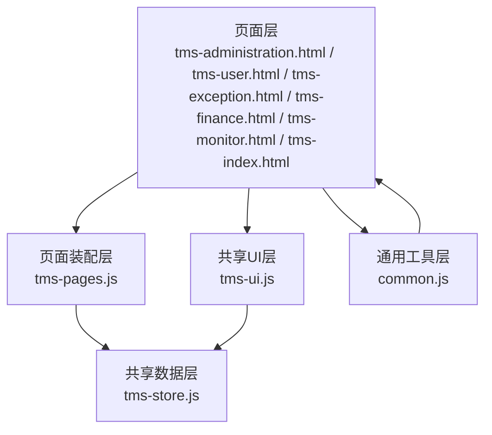
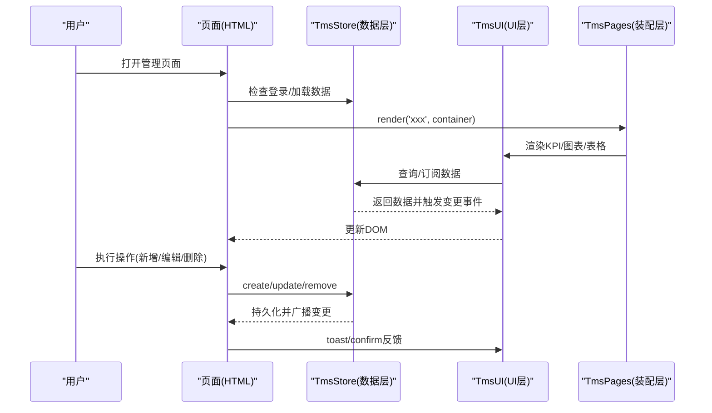
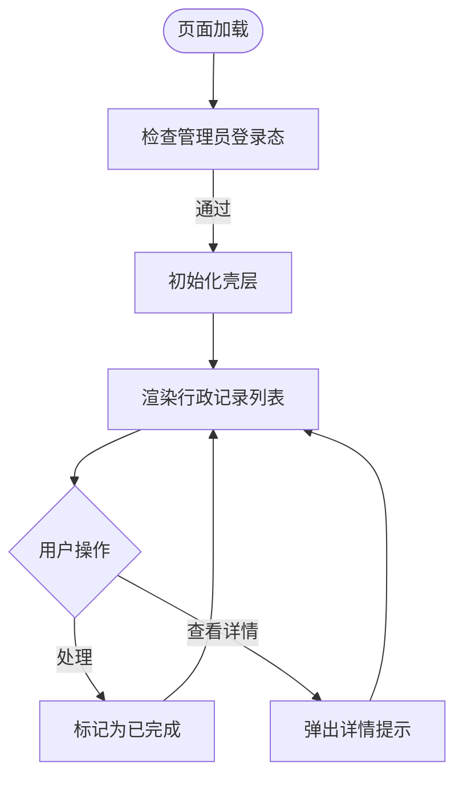
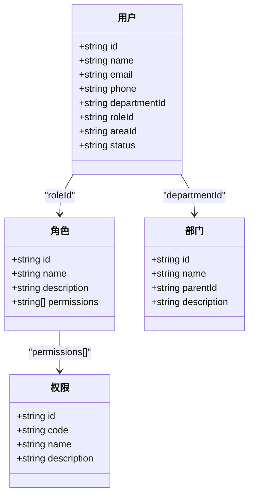
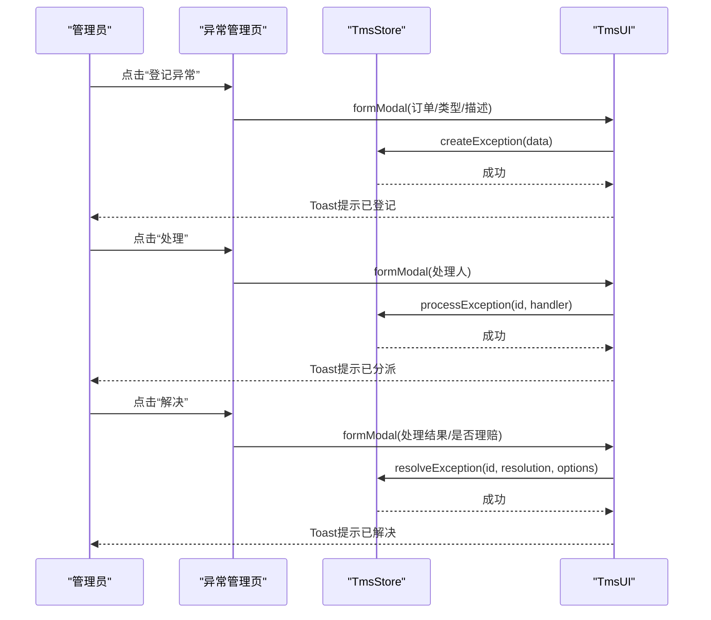
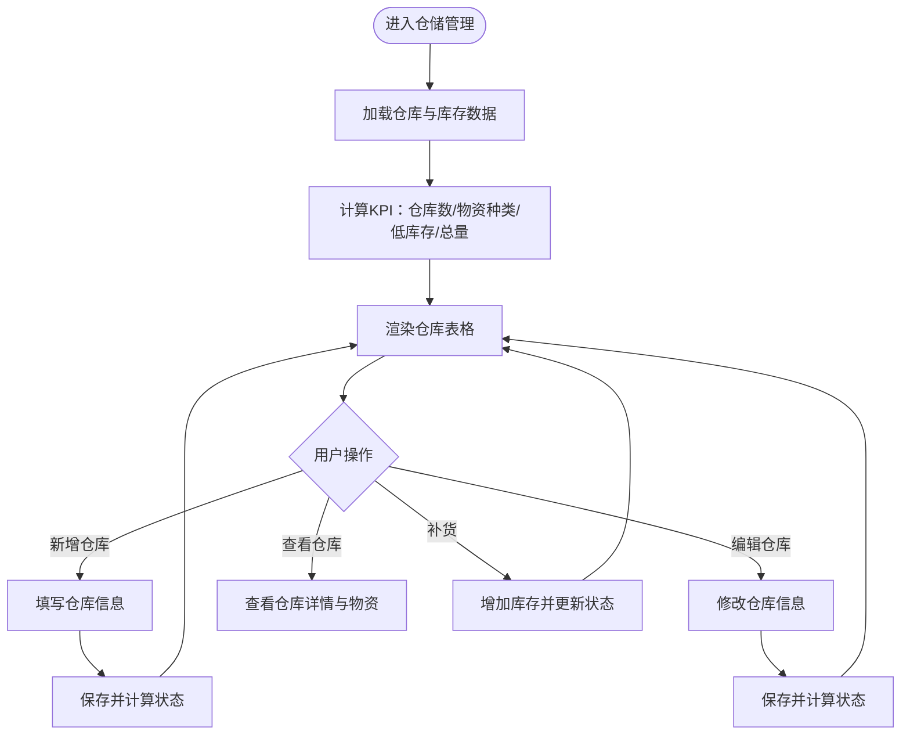
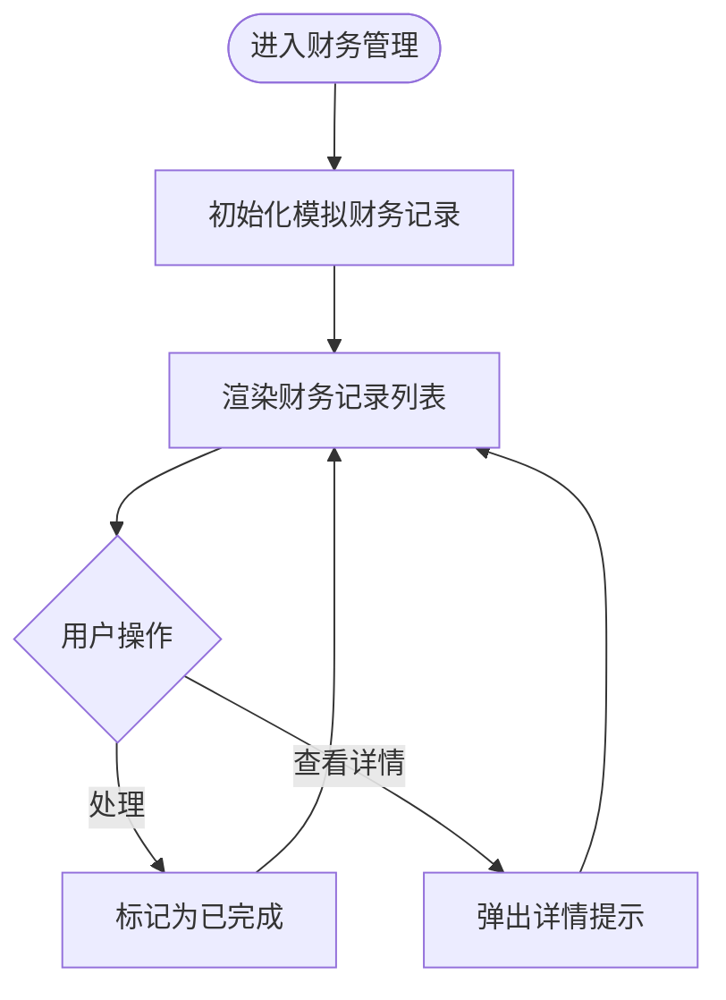
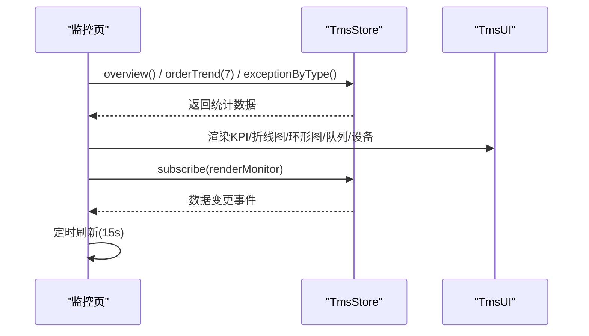
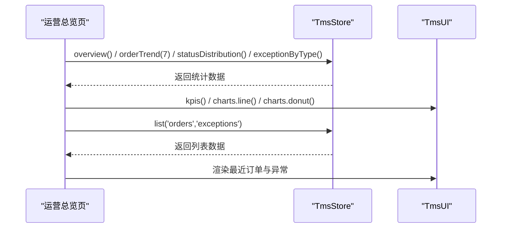
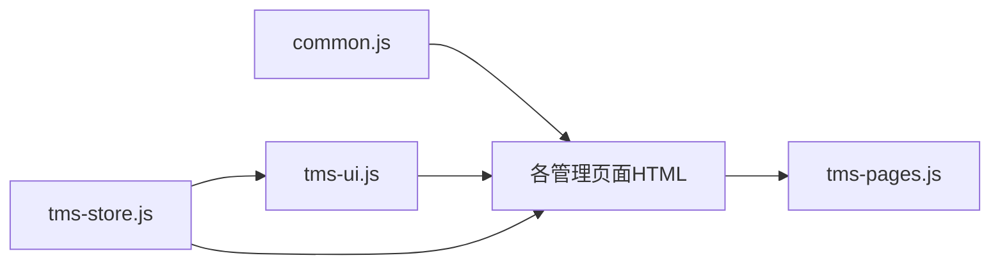

# 系统管理模块

<cite>
**本文引用的文件**   
- [tms-administration.html](file://tms-administration.html)
- [tms-index.html](file://tms-index.html)
- [tms-monitor.html](file://tms-monitor.html)
- [tms-user.html](file://tms-user.html)
- [tms-exception.html](file://tms-exception.html)
- [tms-finance.html](file://tms-finance.html)
- [common.js](file://common.js)
- [tms-ui.js](file://tms-ui.js)
- [tms-store.js](file://tms-store.js)
- [tms-pages.js](file://tms-pages.js)
</cite>

## 目录
1. [引言](#引言)
2. [项目结构](#项目结构)
3. [核心组件](#核心组件)
4. [架构总览](#架构总览)
5. [详细组件分析](#详细组件分析)
6. [依赖关系分析](#依赖关系分析)
7. [性能与容量特性](#性能与容量特性)
8. [故障排查指南](#故障排查指南)
9. [结论](#结论)
10. [附录：配置项、参数与返回值](#附录配置项参数与返回值)

## 引言
本文件面向TMS系统的“管理模块”，聚焦运营管理、仓储管理、财务管理、异常管理、系统管理等后台管理能力，并结合仓库中的实际代码说明其实现细节、调用关系、接口与业务模型。文档同时覆盖管理员权限控制、数据监控、报表生成与系统配置等能力，并提供操作指南与最佳实践建议。

## 项目结构
管理模块由一组HTML页面与共享JS库组成：
- 页面层：各业务管理页（如行政管理、用户管理、异常管理、财务管理、系统监控、运营首页）。
- 共享UI层：通用表单、表格、弹窗、图表、状态标签等。
- 共享数据层：基于localStorage的轻量业务数据库，提供增删改查、统计聚合、事件订阅。
- 页面装配层：将业务页统一装配为“KPI + 图表 + 可筛选分页表格 + CRUD”的结构。
- 通用工具层：登录鉴权、用户信息展示、按钮样式注入等。

**图示来源**
- [tms-administration.html:374-379](file://tms-administration.html#L374-L379)
- [tms-user.html:521-533](file://tms-user.html#L521-L533)
- [tms-exception.html:443-447](file://tms-exception.html#L443-L447)
- [tms-finance.html:369-374](file://tms-finance.html#L369-L374)
- [tms-monitor.html:417-429](file://tms-monitor.html#L417-L429)
- [tms-index.html:437-457](file://tms-index.html#L437-L457)
- [tms-pages.js:87-114](file://tms-pages.js#L87-L114)
- [tms-ui.js:756-779](file://tms-ui.js#L756-L779)
- [tms-store.js:220-244](file://tms-store.js#L220-L244)
- [common.js:136-209](file://common.js#L136-L209)

**章节来源**
- [tms-administration.html:374-379](file://tms-administration.html#L374-L379)
- [tms-user.html:521-533](file://tms-user.html#L521-L533)
- [tms-exception.html:443-447](file://tms-exception.html#L443-L447)
- [tms-finance.html:369-374](file://tms-finance.html#L369-L374)
- [tms-monitor.html:417-429](file://tms-monitor.html#L417-L429)
- [tms-index.html:437-457](file://tms-index.html#L437-L457)
- [tms-pages.js:87-114](file://tms-pages.js#L87-L114)
- [tms-ui.js:756-779](file://tms-ui.js#L756-L779)
- [tms-store.js:220-244](file://tms-store.js#L220-L244)
- [common.js:136-209](file://common.js#L136-L209)

## 核心组件
- 共享数据层（TmsStore）
  - 职责：维护订单、运单、运输、异常、扫描、财务、库存、车辆、运力、电子围栏、策略、路由、员工、部门、角色、权限等实体；提供统一的CRUD、搜索、筛选、排序、分页；维护订单生命周期并联动关联记录；提供统计聚合（KPI、趋势、分布、日报）。
  - 关键机制：localStorage持久化、版本号校验、事件广播（tms:datachange）、订阅者模式。
- 共享UI层（TmsUI）
  - 职责：提供Toast、Modal、Confirm、FormModal、Table、KPI、Charts（折线/柱状/环形）、状态标签、详情展示、页面外壳初始化等。
- 页面装配层（TmsPages）
  - 职责：定义各业务页（如异常、运输、仓储、车辆、运力、物资、客服等），统一渲染KPI、图表、表格与工具栏/动作。
- 通用工具层（common.js）
  - 职责：登录、鉴权、退出、显示当前用户、按钮样式注入等。

**章节来源**
- [tms-store.js:1-12](file://tms-store.js#L1-L12)
- [tms-store.js:220-244](file://tms-store.js#L220-L244)
- [tms-ui.js:84-285](file://tms-ui.js#L84-L285)
- [tms-ui.js:301-542](file://tms-ui.js#L301-L542)
- [tms-ui.js:544-779](file://tms-ui.js#L544-L779)
- [tms-pages.js:1-16](file://tms-pages.js#L1-L16)
- [common.js:136-209](file://common.js#L136-L209)

## 架构总览
管理模块采用“页面层 → 装配层/UI层 → 数据层”的分层架构，所有页面通过TmsStore访问数据，通过TmsUI渲染界面，通过TmsPages统一装配业务视图。

**图示来源**
- [tms-store.js:220-244](file://tms-store.js#L220-L244)
- [tms-ui.js:301-542](file://tms-ui.js#L301-L542)
- [tms-pages.js:87-114](file://tms-pages.js#L87-L114)
- [tms-index.html:437-457](file://tms-index.html#L437-L457)

## 详细组件分析

### 行政管理
- 功能要点
  - 行政记录分类：会议、通知、文档。
  - 本地模拟数据初始化与列表渲染。
  - 处理与查看详情操作。
- 交互流程
  - 页面加载时检查管理员登录态，初始化壳层，渲染行政记录。
  - 点击“处理”将记录状态置为已完成；点击“查看详情”弹出提示。
- 数据模型
  - 记录字段：id、title、category、organizer/issuer/author、date/time/location/audience/version、status、description/content。
- 权限控制
  - 仅允许admin角色进入。

**图示来源**
- [tms-administration.html:374-379](file://tms-administration.html#L374-L379)
- [tms-administration.html:421-447](file://tms-administration.html#L421-L447)
- [tms-administration.html:452-517](file://tms-administration.html#L452-L517)
- [tms-administration.html:519-599](file://tms-administration.html#L519-L599)

**章节来源**
- [tms-administration.html:374-379](file://tms-administration.html#L374-L379)
- [tms-administration.html:421-447](file://tms-administration.html#L421-L447)
- [tms-administration.html:452-517](file://tms-administration.html#L452-L517)
- [tms-administration.html:519-599](file://tms-administration.html#L519-L599)

### 用户与权限管理
- 功能要点
  - 用户、角色、权限、部门四个维度的CRUD。
  - 角色绑定权限点，用户绑定角色与部门，支持区域管理。
  - 删除保护：若角色被用户引用或权限被角色引用，禁止删除。
- 数据模型
  - 用户：id、name、email、phone、departmentId、roleId、areaId、status。
  - 角色：id、name、description、permissions[]。
  - 权限：id、code、name、description。
  - 部门：id、name、parentId、description。
- 交互流程
  - 使用TmsUI.formModal构建表单，提交后调用TmsStore.create/update。
  - 删除前进行存在性校验与确认。

**图示来源**
- [tms-user.html:566-638](file://tms-user.html#L566-L638)
- [tms-user.html:640-709](file://tms-user.html#L640-L709)
- [tms-user.html:711-766](file://tms-user.html#L711-L766)
- [tms-user.html:768-800](file://tms-user.html#L768-L800)

**章节来源**
- [tms-user.html:521-533](file://tms-user.html#L521-L533)
- [tms-user.html:566-638](file://tms-user.html#L566-L638)
- [tms-user.html:640-709](file://tms-user.html#L640-L709)
- [tms-user.html:711-766](file://tms-user.html#L711-L766)
- [tms-user.html:768-800](file://tms-user.html#L768-L800)

### 异常管理
- 功能要点
  - 登记异常、分派处理人、闭环解决，可选择联动创建理赔申请。
  - 列表支持按状态、类型筛选，默认排序为发生时间倒序。
- 数据模型
  - 异常：id、orderId、waybillNo、type、occurredAt、status、handler、resolution、resolvedAt。
- 交互流程
  - 登记异常：选择订单与类型，填写描述。
  - 分派处理：选择处理人，状态变为处理中。
  - 解决闭环：填写处理结果，可选联动理赔。

**图示来源**
- [tms-pages.js:118-227](file://tms-pages.js#L118-L227)
- [tms-exception.html:443-447](file://tms-exception.html#L443-L447)

**章节来源**
- [tms-pages.js:118-227](file://tms-pages.js#L118-L227)
- [tms-exception.html:443-447](file://tms-exception.html#L443-L447)

### 仓储管理
- 功能要点
  - 仓库维度查看使用率、今日出入库、低库存预警与补货。
  - 支持新增/编辑仓库，自动根据使用率计算状态。
- 数据模型
  - 仓库：id、name、city、manager、area、usedRate、inboundToday、outboundToday、status。
  - 库存：id、name、spec、warehouse、location、stock、safetyStock、unit、status、updatedAt。
- 交互流程
  - 新增仓库：填写基本信息与使用率，自动判定busy/normal。
  - 低库存预警：列出低于安全库存的物资，支持一键补货。

**图示来源**
- [tms-pages.js:340-451](file://tms-pages.js#L340-L451)

**章节来源**
- [tms-pages.js:340-451](file://tms-pages.js#L340-L451)

### 财务管理
- 功能要点
  - 收入/支出记录展示，支持查看详情与处理未完成的记录。
  - 与订单、运单、理赔等业务对象关联。
- 数据模型
  - 财务记录：id、date、type(income/expense)、amount、description、orderId、waybillNumber、customer、paymentMethod、vehicleId、driver、repairShop、claimId、status。
- 交互流程
  - 初始化模拟数据，渲染列表，支持处理与查看详情。

**图示来源**
- [tms-finance.html:416-599](file://tms-finance.html#L416-L599)

**章节来源**
- [tms-finance.html:369-374](file://tms-finance.html#L369-L374)
- [tms-finance.html:416-599](file://tms-finance.html#L416-L599)

### 系统监控
- 功能要点
  - 在线用户、待作业订单、在途运输、扫描设备在线、待处理异常等指标。
  - 近7日单量趋势、异常类型分布、订单队列健康度、扫描设备状态、运行环境信息。
- 数据源
  - TmsStore提供的overview、orderTrend、exceptionByType、list('devices')等。
- 刷新机制
  - 订阅数据变更与storage事件，定时每15秒刷新。

**图示来源**
- [tms-monitor.html:417-429](file://tms-monitor.html#L417-L429)
- [tms-monitor.html:441-536](file://tms-monitor.html#L441-L536)

**章节来源**
- [tms-monitor.html:417-429](file://tms-monitor.html#L417-L429)
- [tms-monitor.html:441-536](file://tms-monitor.html#L441-L536)

### 运营总览
- 功能要点
  - KPI：今日新增订单、在途运输、待处理异常、近7日签收率、今日收入。
  - 图表：近7日订单趋势、订单状态分布。
  - 列表：最新订单、待处理异常。
  - 快捷入口：跳转至运输、分拣、装卸、扫描、仓储、车辆、财务、监控等。
- 数据源
  - TmsStore.overview、orderTrend、statusDistribution、exceptionByType、list('orders'/'exceptions')。

**图示来源**
- [tms-index.html:437-457](file://tms-index.html#L437-L457)
- [tms-index.html:469-577](file://tms-index.html#L469-L577)

**章节来源**
- [tms-index.html:437-457](file://tms-index.html#L437-L457)
- [tms-index.html:469-577](file://tms-index.html#L469-L577)

## 依赖关系分析
- 页面依赖
  - 所有管理页面依赖common.js进行登录鉴权与用户信息显示。
  - 页面通过TmsUI.initShell初始化壳层与导航高亮。
  - 业务页面通过TmsPages.render装配标准布局与表格。
- 数据依赖
  - 页面与UI均依赖TmsStore进行数据读写与订阅。
- 外部依赖
  - localStorage作为持久化存储。
  - 浏览器API用于时间格式化、内存与网络状态检测等。

**图示来源**
- [common.js:136-209](file://common.js#L136-L209)
- [tms-ui.js:756-779](file://tms-ui.js#L756-L779)
- [tms-store.js:220-244](file://tms-store.js#L220-L244)
- [tms-pages.js:87-114](file://tms-pages.js#L87-L114)

**章节来源**
- [common.js:136-209](file://common.js#L136-L209)
- [tms-ui.js:756-779](file://tms-ui.js#L756-L779)
- [tms-store.js:220-244](file://tms-store.js#L220-L244)
- [tms-pages.js:87-114](file://tms-pages.js#L87-L114)

## 性能与容量特性
- 数据层
  - 基于localStorage的同步读写，适合小规模演示数据；大数据量场景需考虑分页与索引优化。
  - 事件广播机制避免频繁重绘，仅在数据变更时触发订阅者更新。
- UI层
  - 表格组件内置搜索、筛选、排序、分页，减少前端计算压力。
  - 图表使用SVG绘制，避免引入第三方库，降低体积。
- 监控页
  - 定时刷新间隔15秒，避免过度刷新导致卡顿。

[本节为通用指导，不直接分析具体文件]

## 故障排查指南
- 无法进入管理页面
  - 检查是否已登录且角色为admin；common.js的checkLoginStatus会拦截非admin访问。
- 数据不更新
  - 确认TmsStore.subscribe已注册；检查localStorage中业务库键值是否存在且版本匹配。
- 表格为空
  - 检查entity名称是否正确；确认TmsStore.list(entity)返回数据。
- 表单提交失败
  - 检查必填字段校验逻辑；确认TmsStore.create/update的参数结构与字段名一致。
- 图表不显示
  - 检查容器ID是否存在；确认传入的数据格式符合TmsUI.charts要求。

**章节来源**
- [common.js:176-199](file://common.js#L176-L199)
- [tms-store.js:220-244](file://tms-store.js#L220-L244)
- [tms-ui.js:301-542](file://tms-ui.js#L301-L542)

## 结论
TMS管理模块以清晰的层次划分与共享组件为基础，实现了运营管理、仓储管理、财务管理、异常管理与系统监控等核心能力。通过TmsStore集中管理数据与事件，TmsUI提供一致的交互体验，TmsPages统一装配页面结构，使各业务模块具备良好的一致性与扩展性。结合管理员权限控制、数据监控与报表生成，系统可满足日常运维与管理需求。

[本节为总结性内容，不直接分析具体文件]

## 附录：配置项、参数与返回值

### 共享UI层（TmsUI）
- 表单弹窗formModal
  - 输入fields数组：key、label、type、options、required、placeholder、value、help、min、max、step、rows、checkboxLabel。
  - onSubmit(values, modal)：返回false或抛错保持弹窗打开；返回Promise支持异步。
  - 返回值：modal实例，包含close方法。
- 通用表格table
  - 配置：entity、rows、columns、actions、search、searchFields、searchPlaceholder、filters、pageSize、defaultSort、toolbar、emptyText、onRowClick、rowClass。
  - 行为：支持搜索、筛选、排序、分页、行点击、工具栏按钮、行操作。
- 图表
  - lineChart(container, options)：labels、series[{name,color,data}]、height。
  - barChart(container, options)：labels、series、height。
  - donutChart(container, options)：data[{label,value,color}]、height。
- 其他
  - toast(message,type,duration)、modal(options)、confirmDialog(options)、detailModal(title,html,width)、detailGrid(items)、timeline(items)、initShell(options)。

**章节来源**
- [tms-ui.js:158-285](file://tms-ui.js#L158-L285)
- [tms-ui.js:301-542](file://tms-ui.js#L301-L542)
- [tms-ui.js:573-678](file://tms-ui.js#L573-L678)
- [tms-ui.js:682-779](file://tms-ui.js#L682-L779)

### 共享数据层（TmsStore）
- 基础方法
  - create(entity, data)：新增记录。
  - update(entity, id, data)：更新记录。
  - remove(entity, id)：删除记录。
  - get(entity, id)：获取单条记录。
  - list(entity, options)：分页查询，返回{rows,total,page}。
  - subscribe(fn)：订阅数据变更。
- 统计方法
  - overview()：返回订单总数、今日新增、在途、待处理异常、签收率、今日收入等。
  - orderTrend(days)：返回近N日新建与签收趋势。
  - statusDistribution()：返回订单状态分布。
  - exceptionByType()：返回异常类型分布。
  - warehouseStats()/vehicleStats()：仓库/车辆统计。
- 业务方法
  - createException(data)、processException(id, handler)、resolveException(id, resolution, options)。
  - createTicket(data)、processTicket(id, assignee)、resolveTicket(id, result)。
  - advanceOrder(orderId, actor)：推进订单状态。
  - calcFreight(params, cards)：计费试算，返回费用明细。
  - buildRateCards()/pickRateCard(cards, origin, destination, service)：运价卡构建与选择。
  - buildRoutes()/findRoute(database, origin, destination)/planRoute(order, database)：路线规划。
  - buildTraces(order, progression, statusIndex, rng)：轨迹明细生成。

**章节来源**
- [tms-store.js:263-383](file://tms-store.js#L263-L383)
- [tms-store.js:385-460](file://tms-store.js#L385-L460)
- [tms-store.js:462-800](file://tms-store.js#L462-L800)

### 页面装配层（TmsPages）
- 定义页面define(id, config)
  - config：title、subtitle、kpis()、charts(container)、table配置、extraBefore(el)、extraAfter(el)。
- 常用辅助
  - orderOptions(statuses)、allOrdersOptions()、orderLink(orderId)、orderDetail(orderId)、priorityBadge(p)、gradeBadge(g)、stockStatus(row)。

**章节来源**
- [tms-pages.js:14-37](file://tms-pages.js#L14-L37)
- [tms-pages.js:87-114](file://tms-pages.js#L87-L114)
- [tms-pages.js:118-227](file://tms-pages.js#L118-L227)

### 通用工具（common.js）
- login()：登录并跳转到对应角色页面。
- checkLoginStatus(requiredRole)：校验登录与角色，未通过则跳转登录页。
- logout()：清除用户信息并跳转登录页。
- getCurrentUser()/displayCurrentUser()：获取与显示当前用户。
- 用户信息与积分相关函数：saveUserProfile/getUserProfile/updateUserProfile/initUserPoints/addUserPoints/deductUserPoints/getUserPointsHistory。

**章节来源**
- [common.js:136-209](file://common.js#L136-L209)
- [common.js:211-383](file://common.js#L211-L383)