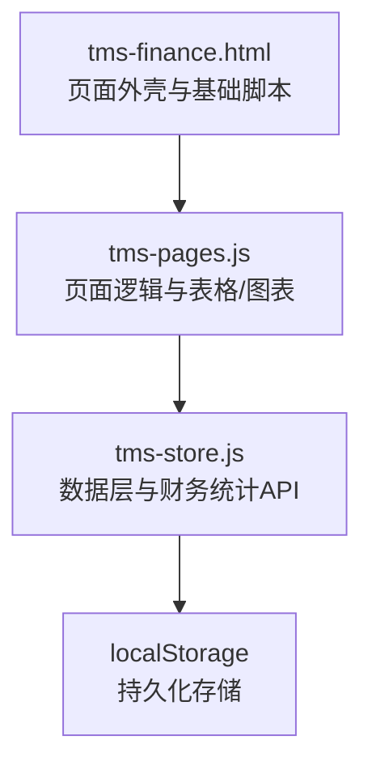
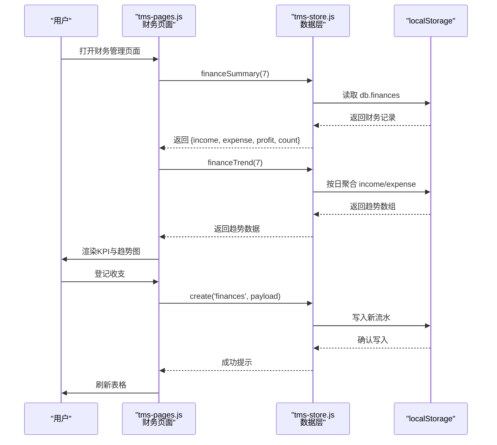
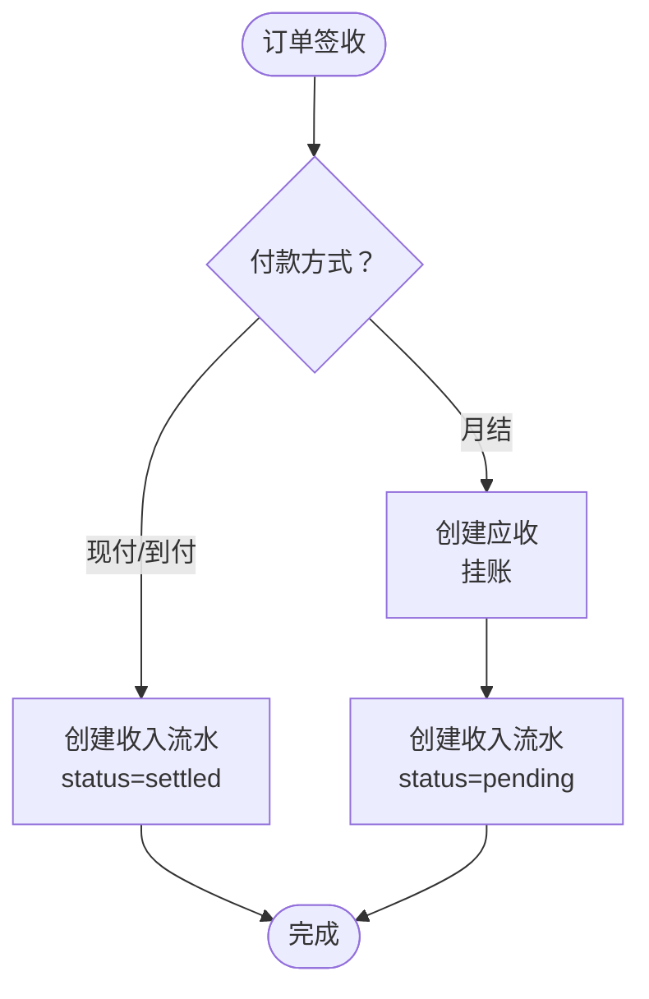
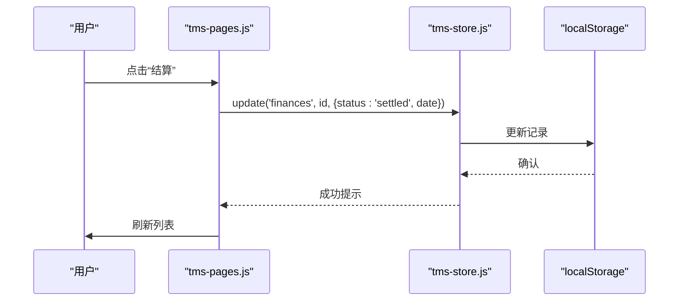
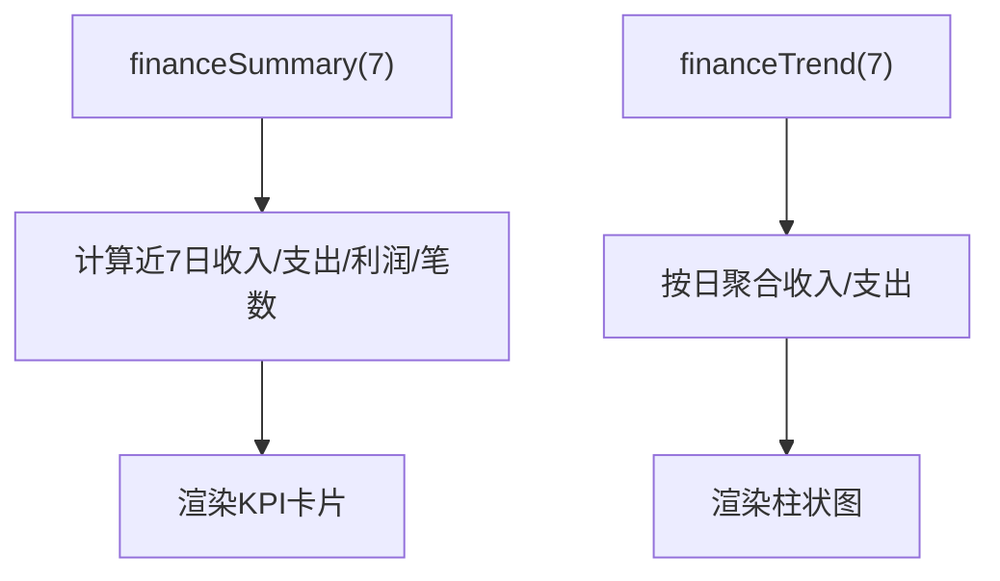
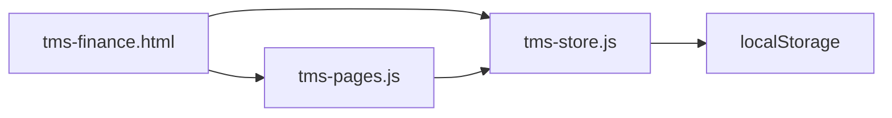

# 财务管理

<cite>
**本文引用的文件**   
- [tms-finance.html](file://tms-finance.html)
- [tms-pages.js](file://tms-pages.js)
- [tms-store.js](file://tms-store.js)
</cite>

## 目录
1. [引言](#引言)
2. [项目结构](#项目结构)
3. [核心组件](#核心组件)
4. [架构总览](#架构总览)
5. [详细组件分析](#详细组件分析)
6. [依赖关系分析](#依赖关系分析)
7. [性能与扩展性](#性能与扩展性)
8. [故障排查指南](#故障排查指南)
9. [结论](#结论)

## 引言
本文件面向 TMS 系统的“财务管理”模块，围绕收入管理、支出管理与结算管理进行系统化说明。内容涵盖：
- 财务数据模型与分类（运费收入、月结挂账、车辆油费、人员薪资、理赔支出等）
- 业务处理流程（订单签收触发应收/流水、月结挂账、回款核销、收支登记、作废与结算）
- 统计与报表（近 N 日收支汇总、趋势图、利润分析、应收应付与账单聚合）
- 前端页面与后端数据层的调用关系
- 配置项、参数与返回值说明
- 与其他模块的集成点（订单、异常、理赔、运输、仓储、行政等）
- 常见问题与解决方案

## 项目结构
TMS 财务管理由以下关键文件共同实现：
- tms-finance.html：财务管理页面的静态结构与基础交互入口
- tms-pages.js：页面路由与表格、图表、工具栏等业务 UI 行为定义
- tms-store.js：共享数据层，包含种子数据、CRUD、计费引擎、生命周期联动、财务统计 API

图示来源
- [tms-finance.html:364-374](file://tms-finance.html#L364-L374)
- [tms-pages.js:904-990](file://tms-pages.js#L904-L990)
- [tms-store.js:2351-2352](file://tms-store.js#L2351-L2352)

章节来源
- [tms-finance.html:364-374](file://tms-finance.html#L364-L374)
- [tms-pages.js:904-990](file://tms-pages.js#L904-L990)
- [tms-store.js:2351-2352](file://tms-store.js#L2351-L2352)

## 核心组件
- 财务记录实体 finances
  - 关键字段：id、type（income/expense）、category、orderId、amount、status（pending/settled/void）、date、remark
  - 状态含义：待结算、已结算、已作废
- 财务统计 API
  - financeSummary(days)：返回近 N 日的收入、支出、利润与笔数
  - financeTrend(days)：返回近 N 日每日收入与支出序列
- 页面渲染与交互
  - KPI 卡片：近 7 日收入、支出、利润、流水笔数
  - 柱状图：近 7 日收支趋势
  - 表格：收支流水列表，支持搜索、筛选、排序、登记、结算、作废
- 数据持久化
  - 基于 localStorage 的轻量数据库，所有变更通过 S.create/S.update/S.list 等操作

章节来源
- [tms-store.js:2180-2206](file://tms-store.js#L2180-L2206)
- [tms-pages.js:904-990](file://tms-pages.js#L904-L990)

## 架构总览
财务管理在 TMS 中处于“运营结果→财务核算”的关键位置。其核心调用链如下：

图示来源
- [tms-pages.js:904-990](file://tms-pages.js#L904-L990)
- [tms-store.js:2180-2206](file://tms-store.js#L2180-L2206)
- [tms-store.js:2297-2363](file://tms-store.js#L2297-L2363)

## 详细组件分析

### 财务数据模型与分类
- 类型 type
  - income：收入（如运费收入、增值服务费）
  - expense：支出（如车辆油费、人员薪资、理赔支出）
- 分类 category
  - 示例：运费收入、运费收入（月结）、车辆油费、人员薪资
- 关联 orderId
  - 收入通常关联订单；支出可关联车辆、维修店、理赔单等
- 金额 amount
  - 以元为单位，保留两位小数
- 状态 status
  - pending：待结算（如月结挂账）
  - settled：已结算（如现付/到付直接确认收入）
  - void：已作废（如订单取消冲销）
- 时间 date
  - ISO 时间字符串，用于统计与排序

章节来源
- [tms-store.js:933-946](file://tms-store.js#L933-L946)
- [tms-store.js:954-959](file://tms-store.js#L954-L959)
- [tms-store.js:1418-1433](file://tms-store.js#L1418-L1433)
- [tms-store.js:1465-1493](file://tms-store.js#L1465-L1493)

### 收入管理
- 触发时机
  - 订单签收后，根据付款方式生成应收或收入流水
- 现付/到付
  - 直接确认收入，状态为 settled
- 月结
  - 生成应收并挂账，收入流水状态为 pending，等待回款核销
- 字段要点
  - type=income、category=运费收入或运费收入（月结）、orderId、amount=订单运费、status=pending/settled、date=签收时间

图示来源
- [tms-store.js:918-948](file://tms-store.js#L918-L948)
- [tms-store.js:1465-1493](file://tms-store.js#L1465-L1493)

章节来源
- [tms-store.js:918-948](file://tms-store.js#L918-L948)
- [tms-store.js:1465-1493](file://tms-store.js#L1465-L1493)

### 支出管理
- 常见类别
  - 车辆油费、人员薪资、理赔支出、异常扣款
- 数据来源
  - 每日固定支出（种子数据）
  - 异常定责扣款自动生成应付
  - 理赔审批通过后生成支出流水
- 字段要点
  - type=expense、category=具体费用名称、amount、status=settled、date

章节来源
- [tms-store.js:952-959](file://tms-store.js#L952-L959)
- [tms-store.js:906-915](file://tms-store.js#L906-L915)

### 结算管理
- 结算动作
  - 将 pending 状态的财务流水更新为 settled，并记录结算时间
- 作废动作
  - 将 pending 状态的财务流水标记为 void
- 界面操作
  - 表格工具栏提供“登记收支”、“结算”、“作废”按钮
- 数据更新
  - 通过 S.update('finances', id, { status, date }) 完成

图示来源
- [tms-pages.js:971-987](file://tms-pages.js#L971-L987)
- [tms-store.js:2297-2363](file://tms-store.js#L2297-L2363)

章节来源
- [tms-pages.js:971-987](file://tms-pages.js#L971-L987)

### 统计与报表
- 近 N 日收支汇总
  - financeSummary(days)：返回 {income, expense, profit, count}
- 近 N 日收支趋势
  - financeTrend(days)：返回 [{label, income, expense}, ...]
- 页面展示
  - KPI 卡片显示近 7 日收入、支出、利润、流水笔数
  - 柱状图展示近 7 日收入与支出趋势

图示来源
- [tms-store.js:2180-2206](file://tms-store.js#L2180-L2206)
- [tms-pages.js:907-926](file://tms-pages.js#L907-L926)

章节来源
- [tms-store.js:2180-2206](file://tms-store.js#L2180-L2206)
- [tms-pages.js:907-926](file://tms-pages.js#L907-L926)

### 与其他组件的关系
- 订单模块
  - 订单签收触发应收/收入流水生成
  - 订单取消冲销未核销应收与 pending 收入
- 异常模块
  - 异常定责扣款生成应付
- 理赔模块
  - 理赔审批通过后生成理赔支出流水
- 运输模块
  - 运输状态变化影响车辆状态与轨迹
- 仓储模块
  - 入库/出库扫描与分拣/装卸任务联动
- 行政模块
  - 行政事项与报销不直接产生财务流水，但可作为成本参考

章节来源
- [tms-store.js:1418-1433](file://tms-store.js#L1418-L1433)
- [tms-store.js:1651-1663](file://tms-store.js#L1651-L1663)
- [tms-store.js:906-915](file://tms-store.js#L906-L915)

## 依赖关系分析
- 页面依赖
  - tms-finance.html 引入 common.js、tms-store.js、tms-ui.js、tms-pages.js
  - 通过 TmsPages.render('finance', ...) 渲染财务页面
- 数据层依赖
  - tms-store.js 暴露 S.list/S.create/S.update/S.financeSummary/S.financeTrend 等 API
  - 所有财务数据存储在 localStorage 的 tmsDB_v3 结构中

图示来源
- [tms-finance.html:364-374](file://tms-finance.html#L364-L374)
- [tms-store.js:2297-2363](file://tms-store.js#L2297-L2363)

章节来源
- [tms-finance.html:364-374](file://tms-finance.html#L364-L374)
- [tms-store.js:2297-2363](file://tms-store.js#L2297-L2363)

## 性能与扩展性
- 性能特性
  - 基于内存对象 + localStorage 的轻量实现，适合演示与中小规模数据
  - 统计函数对 finances 进行过滤与 reduce，N 较小（默认 7 日）时性能良好
- 优化建议
  - 大数据量时考虑分页加载与索引（如对 date、type、status 建立索引）
  - 趋势计算可缓存最近一次结果，避免重复计算
- 扩展方向
  - 增加更多分类维度（部门、线路、承运商）
  - 增加预算控制与预警
  - 对接外部支付与银行接口，实现自动核销

[本节为通用指导，不直接分析具体文件]

## 故障排查指南
- 问题：财务记录为空或不显示
  - 检查是否初始化了种子数据（首次访问会生成）
  - 检查 localStorage 中是否存在 tmsDB_v3 键值
- 问题：结算/作废无效
  - 确认流水状态是否为 pending
  - 检查 S.update 调用是否正确传入 id 与 status
- 问题：统计数值异常
  - 检查 financeSummary/financeTrend 的 days 参数
  - 检查流水 date 字段是否为有效 ISO 时间
- 问题：月结挂账未核销
  - 检查应收状态与回款核销流程
  - 确认订单取消时是否冲销了 pending 收入

章节来源
- [tms-store.js:2180-2206](file://tms-store.js#L2180-L2206)
- [tms-pages.js:971-987](file://tms-pages.js#L971-L987)

## 结论
TMS 财务管理模块以订单签收为核心触发点，结合付款方式差异生成应收与收入流水，并通过结算与作废机制完成闭环。统计与报表功能提供直观的收支趋势与利润分析，支撑管理层决策。整体架构简洁清晰，便于扩展与集成其他业务模块。