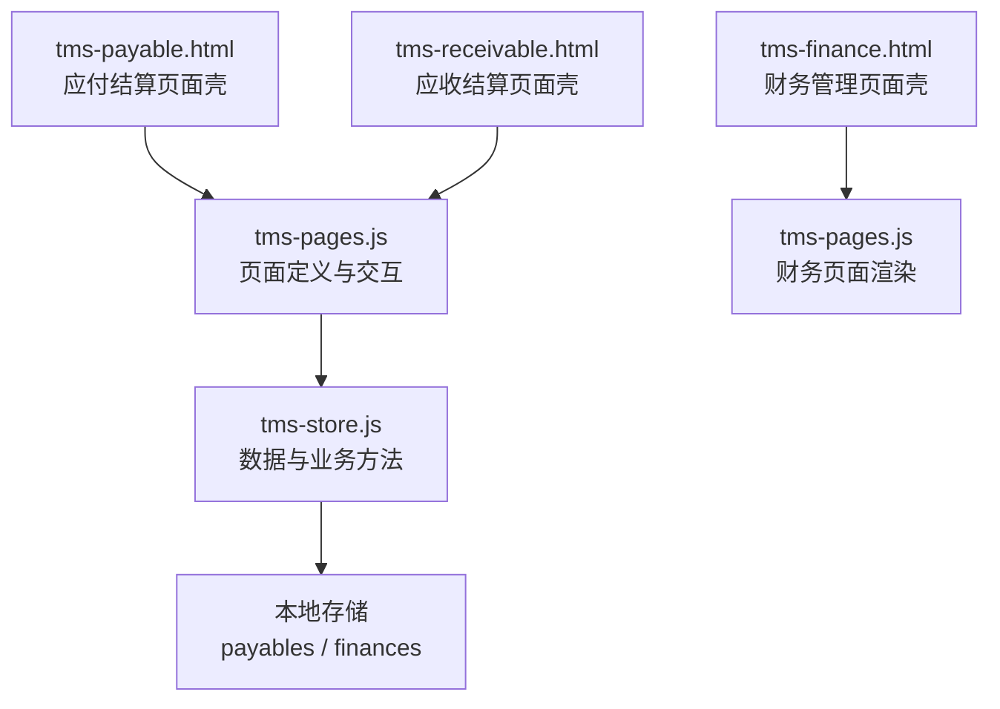
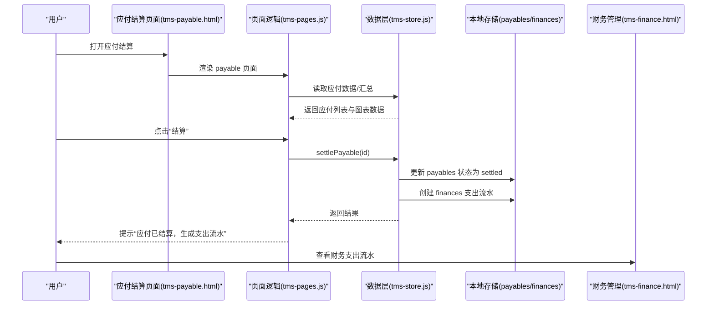
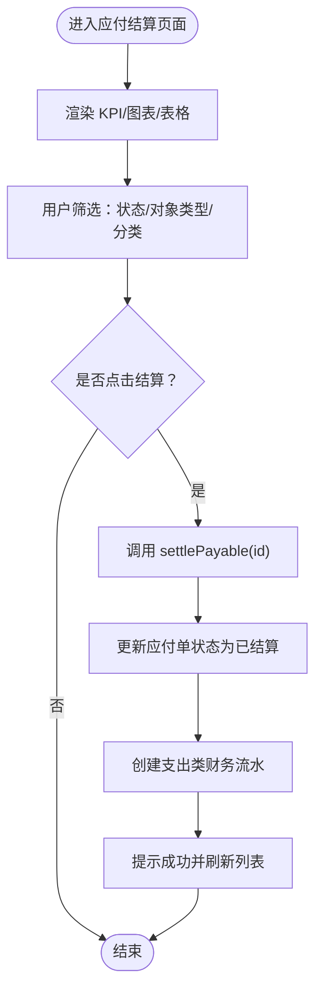
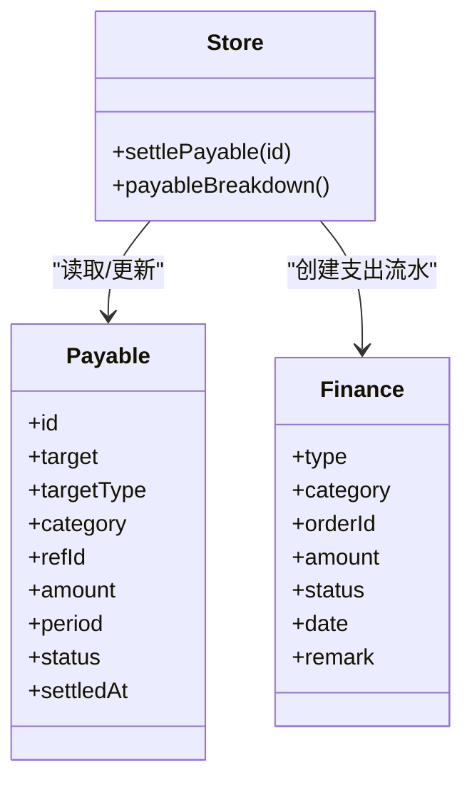
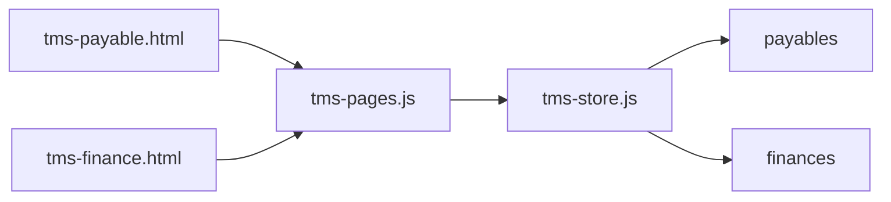

# 应付结算模块

<cite>
**本文引用的文件**   
- [tms-payable.html](file://tms-payable.html)
- [tms-receivable.html](file://tms-receivable.html)
- [tms-finance.html](file://tms-finance.html)
- [tms-pages.js](file://tms-pages.js)
- [tms-store.js](file://tms-store.js)
</cite>

## 目录
1. [引言](#引言)
2. [项目结构](#项目结构)
3. [核心组件](#核心组件)
4. [架构总览](#架构总览)
5. [详细组件分析](#详细组件分析)
6. [依赖关系分析](#依赖关系分析)
7. [性能与扩展建议](#性能与扩展建议)
8. [故障排查指南](#故障排查指南)
9. [结论](#结论)

## 引言
本章节面向“应付结算”业务，说明该模块在 TMS 运输管理系统中的定位、数据流转与关键能力。应付结算用于管理与承运商、司机、网点的成本应付（如干线运费、异常扣款），支持按对象类型和分类进行可视化统计，并在结算后自动生成财务支出流水，联动财务管理模块。

## 项目结构
应付结算由以下前端页面与脚本共同实现：
- tms-payable.html：应付结算页面壳，负责加载公共 UI 与页面渲染入口。
- tms-receivable.html：应收结算页面壳，作为应付/应收对称的对照页。
- tms-finance.html：财务管理页面壳，展示收入/支出等财务记录。
- tms-pages.js：页面定义与交互逻辑，包含应付结算表格、筛选、图表与操作按钮。
- tms-store.js：数据层封装，提供应付结算、汇总统计、财务流水写入等接口。

图示来源
- [tms-payable.html:258-263](file://tms-payable.html#L258-L263)
- [tms-pages.js:2087-2147](file://tms-pages.js#L2087-L2147)
- [tms-store.js:1971-2001](file://tms-store.js#L1971-L2001)
- [tms-finance.html:379-384](file://tms-finance.html#L379-L384)
- [tms-receivable.html:258-263](file://tms-receivable.html#L258-L263)

章节来源
- [tms-payable.html:1-268](file://tms-payable.html#L1-L268)
- [tms-receivable.html:1-268](file://tms-receivable.html#L1-L268)
- [tms-finance.html:1-612](file://tms-finance.html#L1-L612)
- [tms-pages.js:2080-2147](file://tms-pages.js#L2080-L2147)
- [tms-store.js:1970-2001](file://tms-store.js#L1970-L2001)

## 核心组件
- 应付结算页面壳：通过路由渲染“payable”页面，承载 KPI、图表与应付列表。
- 应付结算页面逻辑：定义标题、副标题、KPI、饼图/柱状图、表格列、筛选器与“结算”操作。
- 数据层方法：
  - settlePayable：将应付单置为已结算，并生成一笔支出类财务流水。
  - payableBreakdown：按分类与结算对象类型汇总应付金额，供图表使用。
- 财务管理页面壳：展示财务统计与记录列表，承接应付结算产生的支出流水。

章节来源
- [tms-payable.html:258-263](file://tms-payable.html#L258-L263)
- [tms-pages.js:2087-2147](file://tms-pages.js#L2087-L2147)
- [tms-store.js:1971-2001](file://tms-store.js#L1971-L2001)
- [tms-finance.html:379-384](file://tms-finance.html#L379-L384)

## 架构总览
应付结算的整体流程如下：
- 用户进入应付结算页面，系统渲染 KPI、图表与应付列表。
- 用户在列表中点击“结算”，调用数据层 settlePayable。
- settlePayable 更新应付单状态为已结算，并创建一笔 expense 类型的财务流水。
- 财务管理页面可查看生成的支出流水，完成对账与审计。

图示来源
- [tms-payable.html:258-263](file://tms-payable.html#L258-L263)
- [tms-pages.js:2137-2144](file://tms-pages.js#L2137-L2144)
- [tms-store.js:1971-1984](file://tms-store.js#L1971-L1984)
- [tms-finance.html:379-384](file://tms-finance.html#L379-L384)

## 详细组件分析

### 应付结算页面壳（tms-payable.html）
- 作用：提供页面骨架、侧边导航与内容区容器，并通过 TmsPages.render('payable', ...) 渲染应付结算内容。
- 关键点：
  - 登录校验通过后初始化外壳并渲染应付结算页面。
  - 引入公共样式与脚本，确保与其他运营页面一致的 UI 体验。

章节来源
- [tms-payable.html:258-263](file://tms-payable.html#L258-L263)

### 应付结算页面逻辑（tms-pages.js）
- 页面定义：
  - 标题与副标题：明确应付结算的业务范围（承运商/司机/网点）。
  - KPI：应付总额、待结算、已结算、应付笔数。
  - 图表：按分类的饼图；按结算对象类型的柱状图。
  - 表格：字段包括应付单号、结算对象、对象类型、分类、关联订单、金额、账期、状态。
  - 筛选：状态、对象类型、分类。
  - 操作：对未结算的应付单执行“结算”，成功后提示生成支出流水。
- 行为要点：
  - 点击“结算”时调用 S.settlePayable(row.id)。
  - 若存在关联订单（HL 开头），提供“查看订单”跳转。

图示来源
- [tms-pages.js:2087-2147](file://tms-pages.js#L2087-L2147)
- [tms-store.js:1971-1984](file://tms-store.js#L1971-L1984)

章节来源
- [tms-pages.js:2087-2147](file://tms-pages.js#L2087-L2147)

### 数据层方法（tms-store.js）
- settlePayable(id)：
  - 查找应付单，若不存在或已结算则直接返回。
  - 更新应付单状态为 settled，并记录结算时间。
  - 创建一笔 finances 支出流水，类别取自应付单分类，金额一致，备注包含结算对象与分类。
  - 若 refId 以 HL 开头，则将 orderId 回填到财务流水中，便于后续追溯。
- payableBreakdown()：
  - 遍历 payables，按 category 与 targetType 聚合金额。
  - 返回 byCategory 与 byTargetType 两个数组，供图表渲染。

图示来源
- [tms-store.js:1971-2001](file://tms-store.js#L1971-L2001)

章节来源
- [tms-store.js:1971-2001](file://tms-store.js#L1971-L2001)

### 财务管理页面（tms-finance.html）
- 作用：展示财务统计卡片与财务记录列表，承接应付结算产生的支出流水。
- 关键点：
  - 登录后初始化外壳并渲染财务页面。
  - 提供财务记录的增删改查与处理操作（示例中包含模拟数据与本地存储）。

章节来源
- [tms-finance.html:379-384](file://tms-finance.html#L379-L384)

## 依赖关系分析
- 页面壳依赖：
  - tms-payable.html 依赖 tms-pages.js 的页面定义与渲染。
  - tms-pages.js 依赖 tms-store.js 的数据方法与字典。
- 数据依赖：
  - 应付结算依赖 payables 实体（应付单）与 finances 实体（财务流水）。
  - 图表依赖 payableBreakdown 返回的结构化数据。
- 外部联动：
  - 应付结算与财务管理通过 finances 实体解耦，形成“业务动作 → 财务记账”的闭环。

图示来源
- [tms-payable.html:258-263](file://tms-payable.html#L258-L263)
- [tms-pages.js:2087-2147](file://tms-pages.js#L2087-L2147)
- [tms-store.js:1971-2001](file://tms-store.js#L1971-L2001)
- [tms-finance.html:379-384](file://tms-finance.html#L379-L384)

章节来源
- [tms-payable.html:258-263](file://tms-payable.html#L258-L263)
- [tms-pages.js:2087-2147](file://tms-pages.js#L2087-L2147)
- [tms-store.js:1971-2001](file://tms-store.js#L1971-L2001)
- [tms-finance.html:379-384](file://tms-finance.html#L379-L384)

## 性能与扩展建议
- 分页与筛选：应付列表默认分页，建议在大数据量场景下增加服务端分页与后端筛选，减少前端渲染压力。
- 批量结算：当前为逐条结算，可扩展批量结算功能，提升效率。
- 审计留痕：可在 settlePayable 中追加操作人、审批流与变更日志，增强合规性。
- 对账与导出：对接财务系统时，增加应付结算报表导出与对账差异处理。
- 图表优化：当分类与对象类型较多时，考虑懒加载与虚拟滚动，避免 DOM 节点过多。

[本节为通用建议，不直接分析具体文件]

## 故障排查指南
- 无法进入应付结算页面：
  - 检查登录态与角色权限，确认页面壳是否正确初始化外壳与渲染。
- 点击“结算”无反应：
  - 检查 S.settlePayable 是否被正确调用，确认 payables 数据是否存在且状态非已结算。
- 结算后未生成财务流水：
  - 检查 settlePayable 中 finances 创建逻辑，确认 remark、amount、category 等字段是否正确填充。
- 图表数据为空：
  - 检查 payableBreakdown 是否返回有效数据，确认 payables 集合是否为空或字段缺失。

章节来源
- [tms-payable.html:258-263](file://tms-payable.html#L258-L263)
- [tms-pages.js:2137-2144](file://tms-pages.js#L2137-L2144)
- [tms-store.js:1971-2001](file://tms-store.js#L1971-L2001)

## 结论
应付结算模块通过清晰的前端页面与数据层方法，实现了从应付单管理、可视化统计到财务流水生成的完整闭环。其设计简洁、职责分明，易于扩展与集成。建议在生产环境中补充批量操作、审计留痕与对账导出能力，以提升运营效率与合规性。