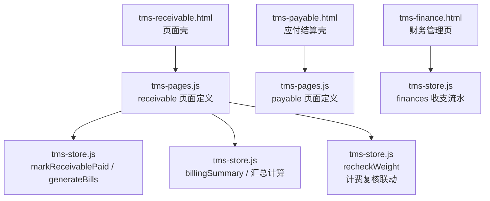
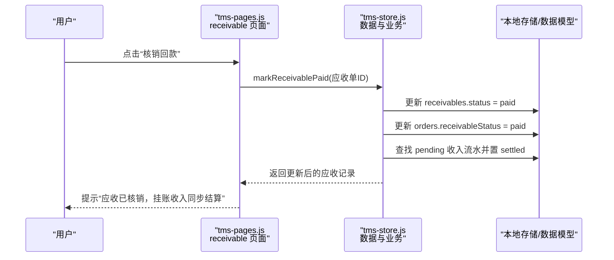
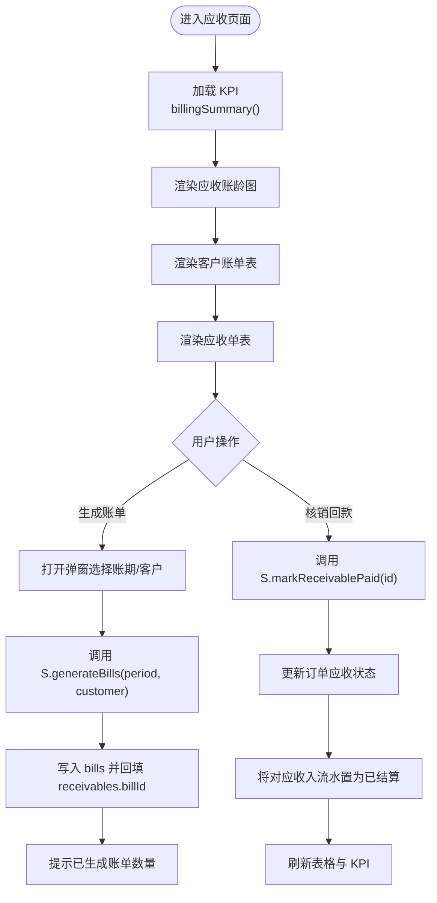
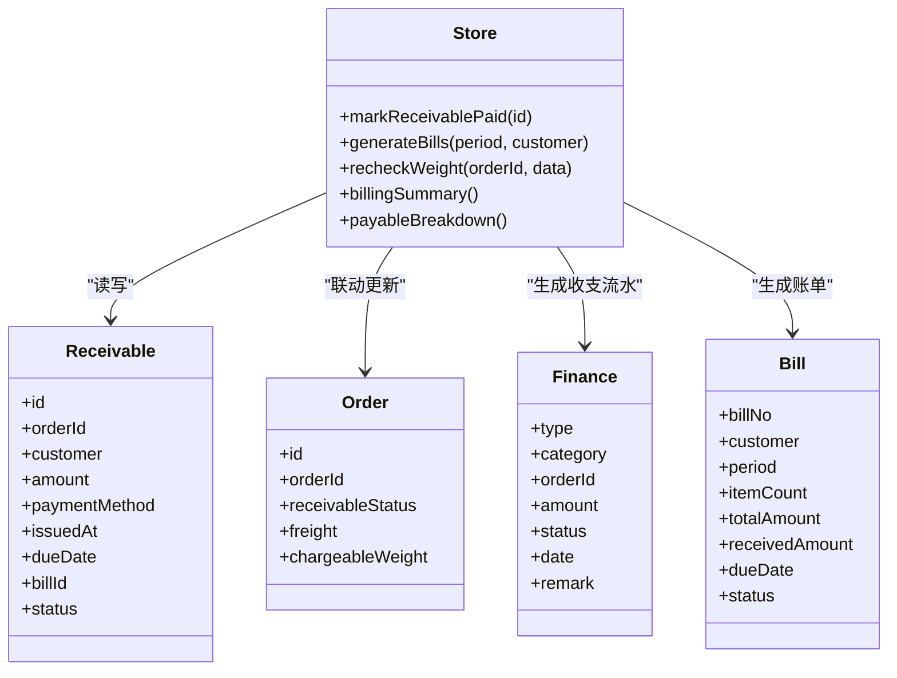
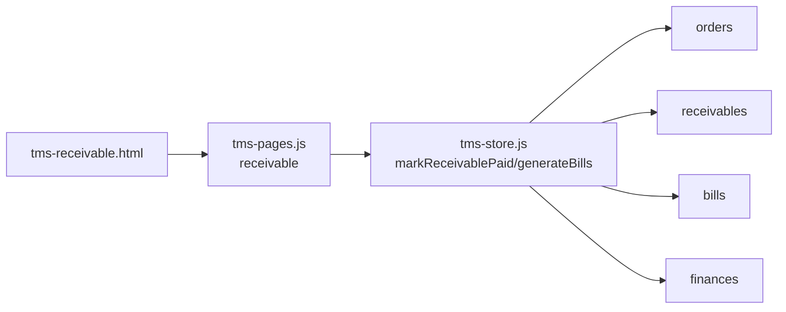

# 应收结算模块

<cite>
**本文引用的文件**   
- [tms-receivable.html](file://tms-receivable.html)
- [tms-payable.html](file://tms-payable.html)
- [tms-finance.html](file://tms-finance.html)
- [tms-pages.js](file://tms-pages.js)
- [tms-store.js](file://tms-store.js)
</cite>

## 目录
1. [引言](#引言)
2. [项目结构](#项目结构)
3. [核心组件](#核心组件)
4. [架构总览](#架构总览)
5. [详细组件分析](#详细组件分析)
6. [依赖关系分析](#依赖关系分析)
7. [性能与扩展性](#性能与扩展性)
8. [故障排查指南](#故障排查指南)
9. [结论](#结论)

## 引言
本文件聚焦“应收结算”模块，围绕运输管理系统中的客户应收、账单聚合、回款核销以及与财务流水的联动进行系统化说明。该模块以页面壳（HTML）+ 页面渲染器（tms-pages.js）+ 数据层（tms-store.js）的方式组织，提供：
- 应收单列表与状态管理
- 按账期/客户生成月度账单
- 回款核销并同步订单与财务收入
- 与应付结算、计费复核、财务管理等模块的数据联动

## 项目结构
应收结算在系统中的入口与关联如下：
- 页面壳：tms-receivable.html 负责加载通用 UI 外壳，并通过 TmsPages.render('receivable', ...) 渲染应收内容
- 页面逻辑：tms-pages.js 中定义 receivable 页面的 KPI、图表、账单表格与应收表格
- 数据与业务：tms-store.js 提供 markReceivablePaid、generateBills 等核心方法
- 关联模块：
  - 应付结算：tms-payable.html + tms-pages.js 中的 payable 定义
  - 财务管理：tms-finance.html 展示收支统计与记录

图示来源
- [tms-receivable.html:257-261](file://tms-receivable.html#L257-L261)
- [tms-pages.js:1968-2061](file://tms-pages.js#L1968-L2061)
- [tms-store.js:1875-1912](file://tms-store.js#L1875-L1912)
- [tms-payable.html:257-261](file://tms-payable.html#L257-L261)
- [tms-finance.html:377-382](file://tms-finance.html#L377-L382)

章节来源
- [tms-receivable.html:257-261](file://tms-receivable.html#L257-L261)
- [tms-payable.html:257-261](file://tms-payable.html#L257-L261)
- [tms-finance.html:377-382](file://tms-finance.html#L377-L382)

## 核心组件
- 页面壳 tms-receivable.html
  - 初始化登录校验与 UI 外壳
  - 调用 TmsPages.render('receivable', ...) 将应收内容注入到主内容区
- 页面渲染 tms-pages.js
  - 定义 receivable 页面：KPI、应收账龄图、客户账单表、应收单表
  - 提供“生成客户账单”工具栏操作
  - 提供“核销回款”动作，调用 store 层方法
- 数据与业务 tms-store.js
  - markReceivablePaid：标记应收已回款，更新订单应收状态，并将对应待结算收入流水置为已结算
  - generateBills：按客户+账期聚合未归集的应收，生成月度账单，并在应收上回填 billId
  - recheckWeight：计费复核重算运费，产生多退少补的财务流水，并同步未回款应收金额
  - billingSummary/payableBreakdown：为页面图表与 KPI 提供汇总数据

章节来源
- [tms-receivable.html:257-261](file://tms-receivable.html#L257-L261)
- [tms-pages.js:1968-2061](file://tms-pages.js#L1968-L2061)
- [tms-store.js:1875-1912](file://tms-store.js#L1875-L1912)
- [tms-store.js:1949-2000](file://tms-store.js#L1949-L2000)

## 架构总览
应收结算采用“页面壳 + 页面渲染器 + 数据层”的分层结构：
- 页面壳负责路由与外壳渲染
- 页面渲染器负责表格、图表、表单交互与按钮事件
- 数据层负责持久化、业务规则与跨实体联动

图示来源
- [tms-pages.js:2050-2058](file://tms-pages.js#L2050-L2058)
- [tms-store.js:1877-1888](file://tms-store.js#L1877-L1888)

## 详细组件分析

### 应收页面（tms-receivable.html）
- 作用
  - 作为应收结算的页面容器，统一加载 common.js、tms-store.js、tms-ui.js、tms-pages.js
  - 通过 TmsUI.initShell() 初始化顶部导航与侧边栏
  - 通过 TmsPages.render('receivable', ...) 渲染应收内容区域
- 关键点
  - 登录校验通过后才执行渲染
  - 主内容区由 .content 承载，内容由 pages 层动态注入

章节来源
- [tms-receivable.html:257-261](file://tms-receivable.html#L257-L261)

### 应收页面逻辑（tms-pages.js）
- KPI 指标
  - 应收总额、逾期金额、已回款、回款率
  - 数据来源：S.billingSummary()
- 图表
  - 应收账龄分布柱状图：0-30天、31-60天、61-90天、90天以上
- 客户账单表
  - 字段：账单号、客户、账期、笔数、总金额、已回款、到期日、状态
  - 支持“确认”“标记争议”等操作
- 应收单表
  - 字段：应收单号、订单号、客户、金额、付款方式、挂账日、到期日、账单归属、状态
  - 工具栏：“生成客户账单”，弹窗选择账期与客户
  - 动作：“核销回款”“查看订单”

图示来源
- [tms-pages.js:1968-2061](file://tms-pages.js#L1968-L2061)
- [tms-store.js:1877-1912](file://tms-store.js#L1877-L1912)

章节来源
- [tms-pages.js:1968-2061](file://tms-pages.js#L1968-L2061)

### 数据与业务（tms-store.js）
- markReceivablePaid
  - 输入：应收单 ID
  - 行为：
    - 将 receivables.status 置为 paid，并记录 paidAt
    - 若存在 orderId，则更新 orders.receivableStatus = paid
    - 查找同订单且类型为 income、状态为 pending 的财务流水，将其置为 settled，并补充 remark
    - 持久化后返回更新后的应收记录
- generateBills
  - 输入：period（yyyy-MM）、customer
  - 行为：
    - 筛选未作废且未归集（billId 为空）的应收
    - 按 customer + period 分组
    - 为每组创建一张 bills，汇总 totalAmount、itemCount，初始 receivedAmount=0，status=draft
    - 将组内每条应收的 billId 指向新账单
    - 持久化后返回创建的账单数组
- recheckWeight（计费复核联动）
  - 根据实际重量/体积重算运费，产生 delta
  - 若存在差异：
    - 创建 finance 流水（income/expense），category 为“运费复核补收/退费”
    - 查找未回款且未作废的应收，更新其 amount 为重算后的运费
    - 持久化

图示来源
- [tms-store.js:1877-1912](file://tms-store.js#L1877-L1912)
- [tms-store.js:1949-2000](file://tms-store.js#L1949-L2000)

章节来源
- [tms-store.js:1875-1912](file://tms-store.js#L1875-L1912)
- [tms-store.js:1949-2000](file://tms-store.js#L1949-L2000)

### 与应付结算的对比与协同
- 应收结算
  - 面向客户：生成账单、回款核销、同步收入流水
- 应付结算
  - 面向承运商/司机/网点：成本应付、结算后自动生成支出流水
- 两者共同点
  - 均通过 tms-pages.js 定义页面与交互
  - 均通过 tms-store.js 执行业务并持久化
  - 均影响 tms-store.js 中的 finances 收支流水

章节来源
- [tms-payable.html:257-261](file://tms-payable.html#L257-L261)
- [tms-pages.js:2063-2100](file://tms-pages.js#L2063-L2100)
- [tms-store.js:1916-1930](file://tms-store.js#L1916-L1930)

### 与财务管理的联动
- 财务管理页（tms-finance.html）
  - 展示本月总收入、总支出、净利润、本年累计收入
  - 使用 localStorage 维护财务记录列表（示例数据）
- 应收结算对财务的影响
  - 回款核销：将 pending 的收入流水置为 settled，并补充备注
  - 计费复核：根据差额生成 income/expense 流水

章节来源
- [tms-finance.html:377-382](file://tms-finance.html#L377-L382)
- [tms-store.js:1877-1888](file://tms-store.js#L1877-L1888)
- [tms-store.js:1987-1997](file://tms-store.js#L1987-L1997)

## 依赖关系分析
- 页面壳依赖
  - tms-receivable.html 依赖 common.js、tms-store.js、tms-ui.js、tms-pages.js
- 页面逻辑依赖
  - tms-pages.js 的 receivable 定义依赖 tms-store.js 的 S.* 方法
- 数据层依赖
  - tms-store.js 内部维护 db 对象，包含 orders、receivables、bills、finances 等集合
- 外部联动
  - 订单：orders.receivableStatus
  - 财务：finances 收支流水
  - 计费复核：recheckWeight 联动应收金额与财务流水

图示来源
- [tms-receivable.html:257-261](file://tms-receivable.html#L257-L261)
- [tms-pages.js:1968-2061](file://tms-pages.js#L1968-L2061)
- [tms-store.js:1875-1912](file://tms-store.js#L1875-L1912)

章节来源
- [tms-receivable.html:257-261](file://tms-receivable.html#L257-L261)
- [tms-pages.js:1968-2061](file://tms-pages.js#L1968-L2061)
- [tms-store.js:1875-1912](file://tms-store.js#L1875-L1912)

## 性能与扩展性
- 性能要点
  - 表格分页与过滤：通过 pageSize 与 filters 控制渲染量
  - 图表渲染：仅对当前视图数据进行聚合，避免全量计算
  - 批量生成账单：按客户+账期分组，减少重复计算
- 扩展建议
  - 增加回款明细：在 receivables 上扩展 paymentRecords 子表，便于追踪分批回款
  - 自动对账：定时任务扫描 overdue 应收，触发提醒或自动标记争议
  - 审计留痕：对核销、生成账单、计费复核等关键操作追加审计日志

[本节为通用指导，不直接分析具体文件]

## 故障排查指南
- 核销回款无效
  - 检查是否调用了 markReceivablePaid
  - 确认对应订单是否存在且未被取消
  - 检查是否存在 pending 状态的 income 流水
- 生成账单无结果
  - 确认是否存在未作废且未归集（billId 为空）的应收
  - 核对 period 与 customer 参数是否与目标数据匹配
- 计费复核未影响应收金额
  - 检查是否存在未回款且未作废的应收记录
  - 确认 recheckWeight 产生的 delta 非零
- 财务流水未生成
  - 检查 recheckWeight 分支是否命中 income/expense 流水创建逻辑
  - 检查 settlePayable 是否正确生成 expense 流水

章节来源
- [tms-store.js:1877-1912](file://tms-store.js#L1877-L1912)
- [tms-store.js:1949-2000](file://tms-store.js#L1949-L2000)
- [tms-store.js:1916-1930](file://tms-store.js#L1916-L1930)

## 结论
应收结算模块以清晰的三层结构实现客户应收、账单聚合与回款核销，并与订单、财务、计费复核等模块紧密联动。通过页面壳与页面渲染器的解耦，以及数据层的集中业务封装，系统具备良好的可维护性与可扩展性。建议在后续版本中增强回款明细、自动对账与审计能力，以提升运营效率与合规性。