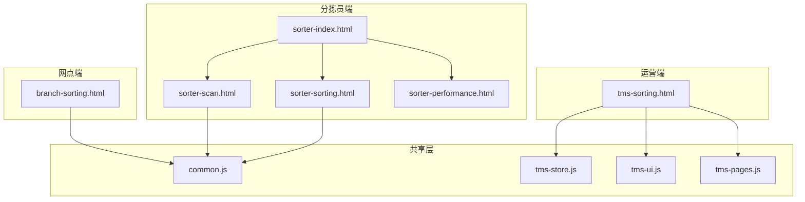
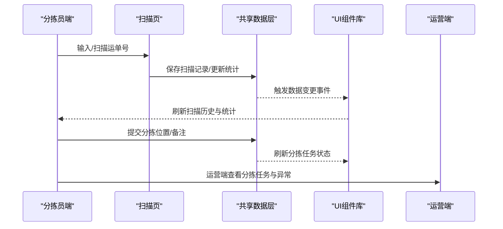
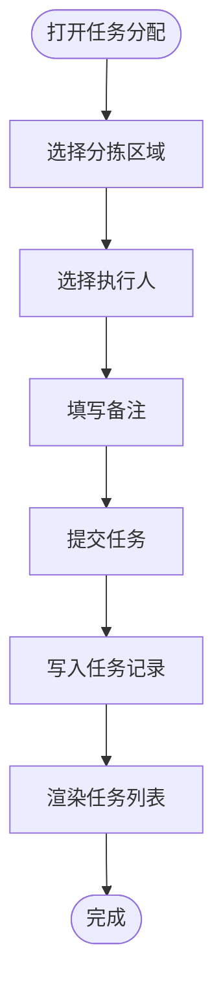
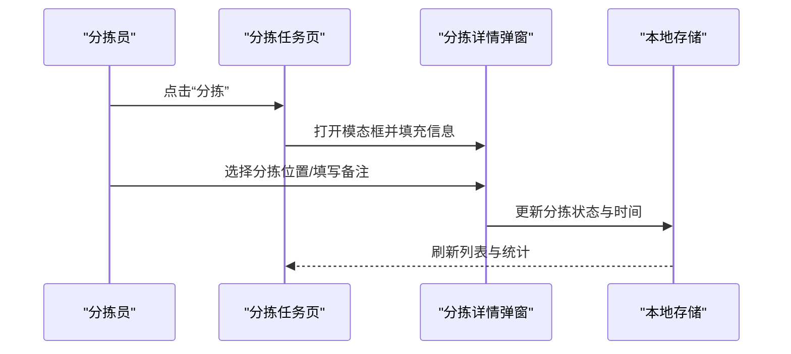
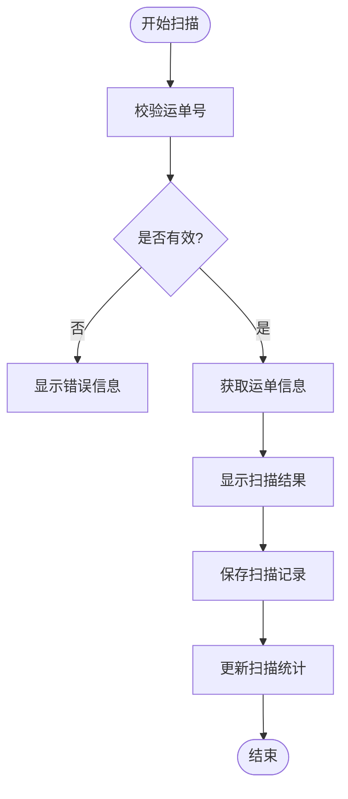
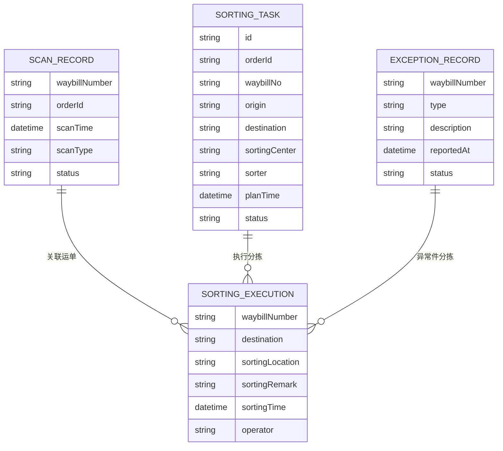
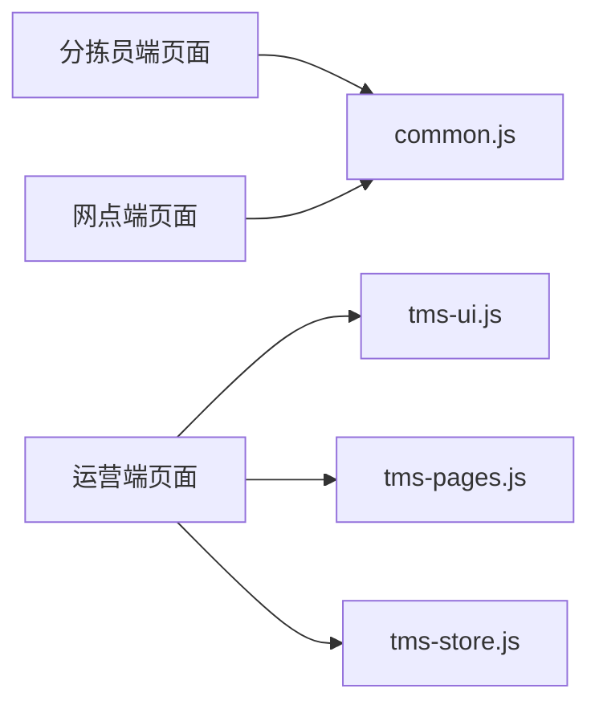

# 分拣管理

<cite>
**本文引用的文件**   
- [branch-sorting.html](file://branch-sorting.html)
- [tms-sorting.html](file://tms-sorting.html)
- [sorter-index.html](file://sorter-index.html)
- [sorter-scan.html](file://sorter-scan.html)
- [sorter-sorting.html](file://sorter-sorting.html)
- [common.js](file://common.js)
- [tms-store.js](file://tms-store.js)
- [tms-ui.js](file://tms-ui.js)
- [tms-pages.js](file://tms-pages.js)
</cite>

## 目录
1. [引言](#引言)
2. [项目结构](#项目结构)
3. [核心组件](#核心组件)
4. [架构总览](#架构总览)
5. [详细组件分析](#详细组件分析)
6. [依赖关系分析](#依赖关系分析)
7. [性能与效率监控](#性能与效率监控)
8. [故障排查指南](#故障排查指南)
9. [结论](#结论)

## 引言
本文件聚焦 TMS 系统的“分拣管理”能力，围绕分拣任务分配、分拣作业执行、分拣质量控制三大主线展开，结合仓库管理、扫描管理、异常处理等模块的集成点，给出端到端的流程说明、数据模型、规则与优化建议。系统采用前端页面 + 共享数据层（localStorage）+ UI 组件库的分层组织方式：分拣员端负责扫码与分拣操作，网点端提供到件扫描与异常上报，运营端提供分拣任务管理与统计视图；共享数据层统一维护订单、运单、轨迹、分拣任务等主数据，并通过事件机制驱动界面刷新。

## 项目结构
分拣相关功能由多类页面共同组成：
- 分拣员端：首页、包裹扫描、分拣任务、绩效评估、工作安排、打卡记录
- 网点端：揽收、分拣处理、出库、库存资产、服务售后、运营管理、系统管理
- 运营端：分拣管理、仓储管理、运输管理、异常管理、扫描管理等

图表来源
- [sorter-index.html:200-276](file://sorter-index.html#L200-L276)
- [sorter-scan.html:305-376](file://sorter-scan.html#L305-L376)
- [sorter-sorting.html:382-456](file://sorter-sorting.html#L382-L456)
- [branch-sorting.html:372-607](file://branch-sorting.html#L372-L607)
- [tms-sorting.html:345-533](file://tms-sorting.html#L345-L533)
- [common.js:135-218](file://common.js#L135-L218)
- [tms-store.js:1-12](file://tms-store.js#L1-L12)
- [tms-ui.js:1-12](file://tms-ui.js#L1-L12)
- [tms-pages.js:1-12](file://tms-pages.js#L1-L12)

章节来源
- [sorter-index.html:200-276](file://sorter-index.html#L200-L276)
- [branch-sorting.html:372-607](file://branch-sorting.html#L372-L607)
- [tms-sorting.html:345-533](file://tms-sorting.html#L345-L533)

## 核心组件
- 分拣员端
  - 首页：展示今日扫描/分拣/异常统计与快捷入口
  - 包裹扫描：条码/二维码扫描或手动输入，校验并保存扫描记录，更新当日统计
  - 分拣任务：待分拣列表、按目的地自动匹配分拣位置、确认分拣并落库
  - 绩效评估：月度指标、趋势图、明细表
- 网点端
  - 到件扫描：扫描运单号，生成到件记录
  - 包裹分拣：按区域（北/南/东/西/中心/异常）投放，记录分拣结果
  - 任务分配：按区域与人员分配分拣任务
  - 异常件处理：登记异常类型与描述，进入异常队列
- 运营端
  - 分拣管理：分拣任务列表、状态流转（待处理/进行中/已完成/异常）、查看与处理

章节来源
- [sorter-index.html:200-276](file://sorter-index.html#L200-L276)
- [sorter-scan.html:383-585](file://sorter-scan.html#L383-L585)
- [sorter-sorting.html:502-782](file://sorter-sorting.html#L502-L782)
- [branch-sorting.html:610-800](file://branch-sorting.html#L610-L800)
- [tms-sorting.html:542-653](file://tms-sorting.html#L542-L653)

## 架构总览
分拣业务在系统中的交互路径如下：
- 扫描与入库：分拣员通过扫描页录入运单，系统校验并持久化扫描记录，同时更新当日统计
- 分拣执行：分拣员在分拣任务页选择分拣位置并确认，系统更新分拣状态与时间戳
- 任务分配：网点端将分拣任务按区域与人员下发，形成任务清单
- 异常处理：扫描或分拣过程中发现异常，登记异常类型与描述，进入异常管理
- 运营监控：运营端汇总分拣任务状态、完成量与异常率，联动仓储、运输、异常等模块

图表来源
- [sorter-scan.html:413-529](file://sorter-scan.html#L413-L529)
- [sorter-sorting.html:681-738](file://sorter-sorting.html#L681-L738)
- [tms-store.js:232-244](file://tms-store.js#L232-L244)
- [tms-ui.js:758-781](file://tms-ui.js#L758-L781)

## 详细组件分析

### 分拣任务分配（网点端）
- 功能要点
  - 选择分拣区域与执行人，填写备注后创建任务
  - 任务包含区域、人员、包裹数量、分配时间与状态
  - 支持任务列表展示与状态筛选
- 数据流
  - 初始化本地存储中的任务数据
  - 用户提交后写入任务记录
  - 列表实时渲染任务状态

图表来源
- [branch-sorting.html:518-563](file://branch-sorting.html#L518-L563)
- [branch-sorting.html:738-765](file://branch-sorting.html#L738-L765)

章节来源
- [branch-sorting.html:518-563](file://branch-sorting.html#L518-L563)
- [branch-sorting.html:738-765](file://branch-sorting.html#L738-L765)

### 分拣作业执行（分拣员端）
- 功能要点
  - 待分拣包裹列表展示，支持刷新与清空已完成
  - 点击分拣弹出模态框，选择分拣位置（按目的地自动匹配），填写备注后确认
  - 确认后更新分拣状态、分拣位置、分拣时间，并刷新统计
- 关键逻辑
  - 根据目的地映射分拣位置（如北京→A区，上海→B区等）
  - 更新当日分拣统计，保持与首页一致

图表来源
- [sorter-sorting.html:636-738](file://sorter-sorting.html#L636-L738)

章节来源
- [sorter-sorting.html:502-782](file://sorter-sorting.html#L502-L782)

### 分拣质量控制（扫描与异常）
- 扫描质量
  - 校验运单号格式（以 WB 开头），失败则提示错误
  - 成功扫描后显示运单信息（订单号、始发地、目的地、客户、状态）
  - 保存扫描记录并更新当日扫描统计
- 异常处理
  - 网点端支持异常类型（破损、面单丢失、地址错误、其他）与描述
  - 异常记录进入异常队列，供后续处理闭环

图表来源
- [sorter-scan.html:413-529](file://sorter-scan.html#L413-L529)
- [branch-sorting.html:565-603](file://branch-sorting.html#L565-L603)

章节来源
- [sorter-scan.html:413-529](file://sorter-scan.html#L413-L529)
- [branch-sorting.html:565-603](file://branch-sorting.html#L565-L603)

### 分拣数据模型
- 扫描记录
  - 字段：运单号、订单号、扫描时间、扫描类型、状态
- 分拣任务
  - 字段：任务ID、订单号、运单号、来源、目的地、分拣中心、分拣员、计划时间、状态
- 分拣执行记录
  - 字段：运单号、目的地、分拣位置、分拣备注、分拣时间、操作人
- 异常记录
  - 字段：运单号、异常类型、异常描述、上报时间、处理状态

图表来源
- [sorter-scan.html:502-529](file://sorter-scan.html#L502-L529)
- [tms-sorting.html:451-530](file://tms-sorting.html#L451-L530)
- [sorter-sorting.html:681-738](file://sorter-sorting.html#L681-L738)
- [branch-sorting.html:565-603](file://branch-sorting.html#L565-L603)

### 与仓储、扫描、异常模块的集成
- 仓储管理
  - 分拣完成后，货物进入相应区域（如分拨仓/前置仓），仓储侧可查询出入库与库存健康度
- 扫描管理
  - 扫描记录作为分拣执行的依据，确保“先扫描、后分拣”的可追溯性
- 异常管理
  - 异常件从分拣环节上报，进入异常工单流程，支持与理赔联动

章节来源
- [tms-store.js:462-800](file://tms-store.js#L462-L800)
- [tms-pages.js:137-248](file://tms-pages.js#L137-L248)

## 依赖关系分析
- 页面依赖
  - 分拣员端页面依赖 common.js 进行登录校验与用户信息显示
  - 运营端分拣管理页面依赖 tms-ui.js 与 tms-pages.js 渲染表格与 KPI
  - 共享数据层 tms-store.js 提供订单、运单、轨迹、分拣任务等数据的增删改查与事件通知
- 组件依赖
  - tms-ui.js 提供表单弹窗、表格、图表等通用 UI 能力
  - tms-pages.js 定义各业务页面的装配逻辑（KPI、图表、表格、CRUD）

图表来源
- [common.js:135-218](file://common.js#L135-L218)
- [tms-ui.js:758-781](file://tms-ui.js#L758-L781)
- [tms-pages.js:108-135](file://tms-pages.js#L108-L135)
- [tms-store.js:1-12](file://tms-store.js#L1-L12)

章节来源
- [common.js:135-218](file://common.js#L135-L218)
- [tms-ui.js:758-781](file://tms-ui.js#L758-L781)
- [tms-pages.js:108-135](file://tms-pages.js#L108-L135)
- [tms-store.js:1-12](file://tms-store.js#L1-L12)

## 性能与效率监控
- 效率指标
  - 扫描量、分拣量、准确率、效率指数（分拣员绩效页）
  - 每日扫描/分拣趋势图（柱状图）
- 监控实现
  - 分拣员端通过 localStorage 存储当日统计，并在扫描与分拣时递增计数
  - 绩效页按月聚合数据，生成图表与明细表
- 优化建议
  - 批量操作：支持批量分拣与批量清空已完成项，减少重复操作
  - 自动匹配：根据目的地自动选择分拣位置，降低人工判断成本
  - 实时反馈：扫描与分拣成功后即时刷新统计与列表，提升操作体验

章节来源
- [sorter-performance.html:444-677](file://sorter-performance.html#L444-L677)
- [sorter-scan.html:502-544](file://sorter-scan.html#L502-L544)
- [sorter-sorting.html:725-782](file://sorter-sorting.html#L725-L782)

## 故障排查指南
- 常见问题
  - 扫描失败：运单号无效或未以 WB 开头
  - 分拣未完成：未选择分拣位置或未填写必要备注
  - 任务未分配：未选择区域或执行人
  - 异常未上报：未填写异常类型或描述
- 处理步骤
  - 检查输入合法性（运单号格式、必填字段）
  - 查看本地存储中的数据是否写入成功
  - 刷新页面或重新加载列表，确认状态更新
  - 对异常件进行登记并进入异常管理流程

章节来源
- [sorter-scan.html:413-529](file://sorter-scan.html#L413-L529)
- [sorter-sorting.html:681-738](file://sorter-sorting.html#L681-L738)
- [branch-sorting.html:565-603](file://branch-sorting.html#L565-L603)

## 结论
TMS 分拣管理通过分拣员端、网点端与运营端的协同，实现了从扫描、分拣到异常处理的完整闭环。系统以共享数据层为核心，结合 UI 组件库提供一致的交互体验，并通过绩效与趋势图表支撑效率监控与持续优化。未来可在以下方面进一步增强：
- 引入更严格的校验与防错机制（如强制分拣位置、二次确认）
- 扩展设备集成（扫码枪、PDA、自动化分拣机）
- 强化异常闭环与理赔联动，提升服务质量与时效保障