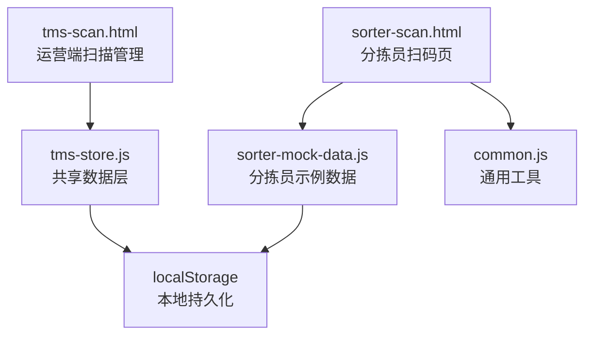
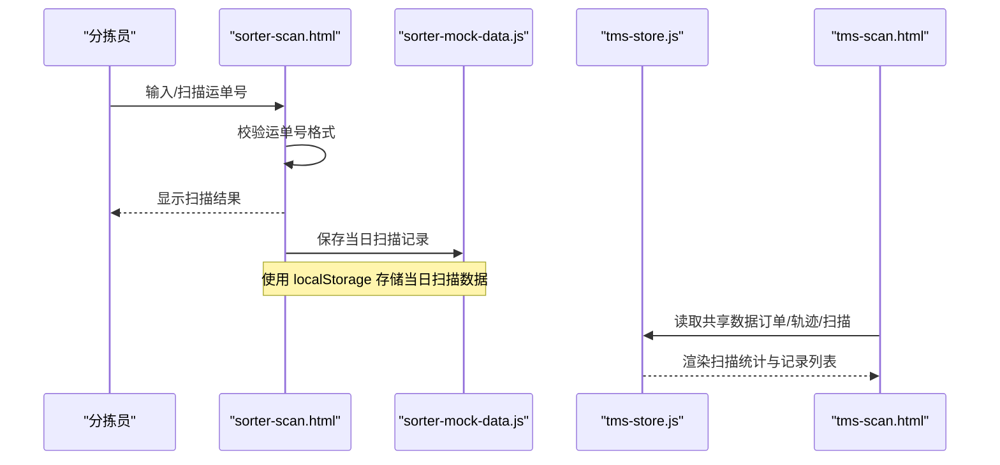
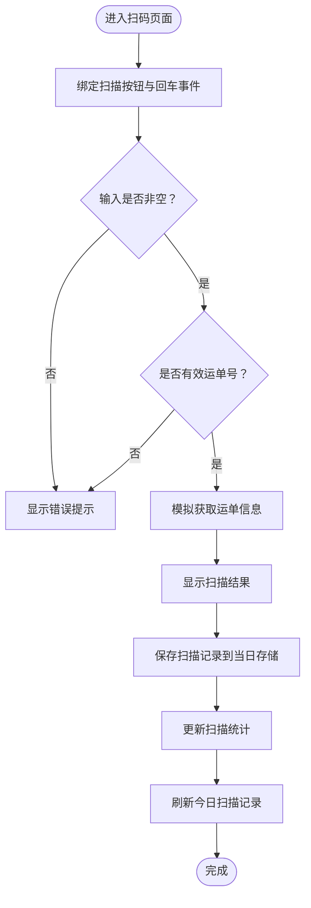
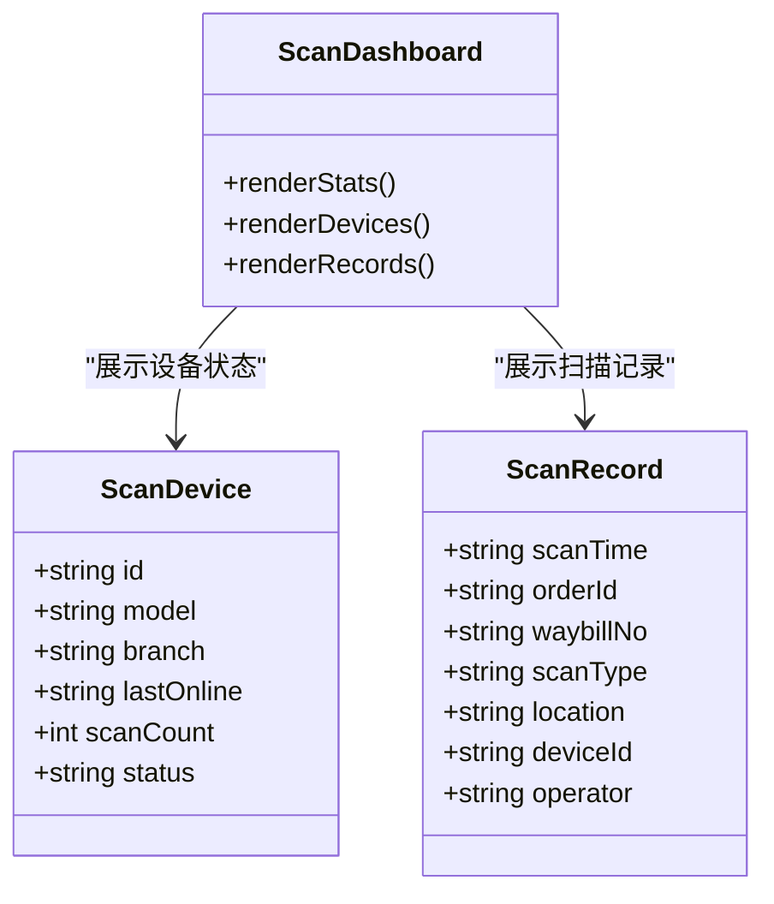
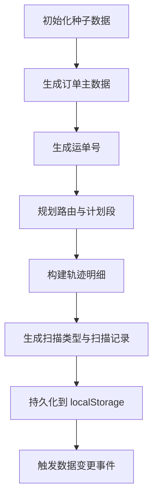
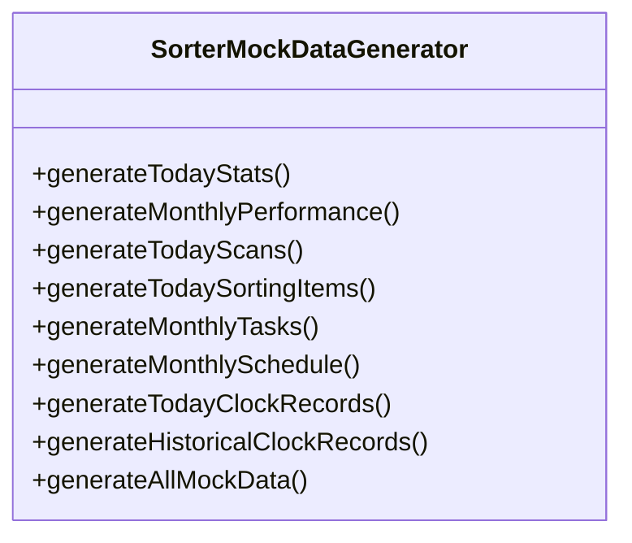
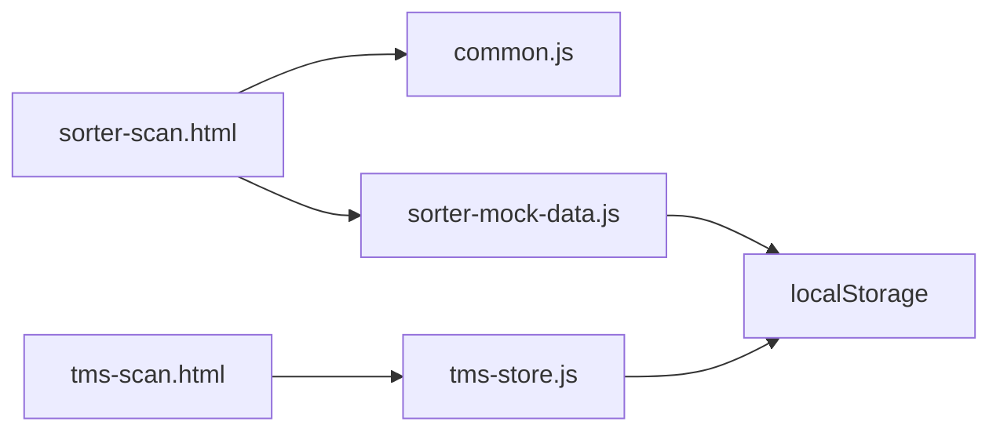

# 扫描管理

<cite>
**本文引用的文件**   
- [tms-scan.html](file://tms-scan.html)
- [sorter-scan.html](file://sorter-scan.html)
- [tms-store.js](file://tms-store.js)
- [sorter-mock-data.js](file://sorter-mock-data.js)
- [common.js](file://common.js)
</cite>

## 目录
1. [引言](#引言)
2. [项目结构](#项目结构)
3. [核心组件](#核心组件)
4. [架构总览](#架构总览)
5. [详细组件分析](#详细组件分析)
6. [依赖关系分析](#依赖关系分析)
7. [性能与效率监控](#性能与效率监控)
8. [数据模型与条码规范](#数据模型与条码规范)
9. [异常检测与准确性保障](#异常检测与准确性保障)
10. [常见问题与解决方案](#常见问题与解决方案)
11. [结论](#结论)

## 引言
本章节面向TMS系统的“扫描管理”能力，围绕扫描任务分配、条码识别、数据采集与处理进行系统化说明。文档基于仓库中的实际页面与脚本，梳理了分拣员扫码作业流程、运营端扫描设备与记录管理、以及扫描数据如何与订单、轨迹、分拣、运输等模块联动。同时给出扫描数据模型、条码生成规则、数据处理规则、效率监控与异常检测机制，并总结常见问题的排查思路。

## 项目结构
扫描管理功能由两个前端页面与共享数据层共同构成：
- 运营端扫描管理页面：用于查看扫描统计、扫描设备状态与最近扫描记录，提供查看/编辑/删除等操作入口。
- 分拣员扫码页面：用于运单条码扫描（支持手动输入），展示扫描结果与当日扫描历史。
- 共享数据层：负责订单、运单、轨迹、扫描等种子数据生成与统一访问。
- 分拣员示例数据脚本：为分拣员相关页面生成模拟的扫描、绩效、任务、排班等数据。
- 通用工具脚本：包含运单号生成等通用方法。

**图表来源**
- [tms-scan.html:461-596](file://tms-scan.html#L461-L596)
- [sorter-scan.html:335-376](file://sorter-scan.html#L335-L376)
- [tms-store.js:1-12](file://tms-store.js#L1-L12)
- [sorter-mock-data.js:1-10](file://sorter-mock-data.js#L1-L10)
- [common.js:41-46](file://common.js#L41-L46)

**章节来源**
- [tms-scan.html:461-596](file://tms-scan.html#L461-L596)
- [sorter-scan.html:335-376](file://sorter-scan.html#L335-L376)
- [tms-store.js:1-12](file://tms-store.js#L1-L12)
- [sorter-mock-data.js:1-10](file://sorter-mock-data.js#L1-L10)
- [common.js:41-46](file://common.js#L41-L46)

## 核心组件
- 运营端扫描管理界面：展示扫描设备在线状态、今日扫描量、准确率等指标；列出最近扫描记录并提供操作按钮。
- 分拣员扫码界面：提供扫码区域与手动输入框，校验运单号格式，显示扫描结果与当日扫描历史。
- 共享数据层：生成订单、运单、轨迹、扫描等种子数据，维护状态流转与关联记录。
- 分拣员示例数据：按日/月维度生成分拣员的扫描、绩效、任务、排班、打卡等模拟数据。
- 通用工具：提供运单号生成等基础方法。

**章节来源**
- [tms-scan.html:461-596](file://tms-scan.html#L461-L596)
- [sorter-scan.html:335-376](file://sorter-scan.html#L335-L376)
- [tms-store.js:462-800](file://tms-store.js#L462-L800)
- [sorter-mock-data.js:12-106](file://sorter-mock-data.js#L12-L106)
- [common.js:41-46](file://common.js#L41-L46)

## 架构总览
扫描管理的整体流程如下：
- 分拣员在扫码页面输入或扫描运单号，前端进行格式校验与模拟查询，返回包裹信息并保存扫描记录。
- 运营端扫描管理页面汇总扫描设备状态与最近扫描记录，供管理员监控与运维。
- 共享数据层在首次加载时生成稳定的种子数据，包括订单、运单、轨迹与扫描记录，确保演示环境具备真实感。
- 分拣员示例数据脚本为分拣员相关页面提供每日扫描、绩效、任务、排班等数据，便于日常演练与考核。

**图表来源**
- [sorter-scan.html:383-447](file://sorter-scan.html#L383-L447)
- [sorter-mock-data.js:61-106](file://sorter-mock-data.js#L61-L106)
- [tms-store.js:462-800](file://tms-store.js#L462-L800)
- [tms-scan.html:461-596](file://tms-scan.html#L461-L596)

## 详细组件分析

### 分拣员扫码流程
分拣员扫码页面的核心逻辑包括：
- 绑定扫描按钮与回车键事件，触发运单扫描。
- 校验输入是否为有效运单号（以特定前缀开头）。
- 模拟获取运单信息并展示扫描结果。
- 将扫描记录保存到当日存储，更新统计并刷新历史记录表格。

**图表来源**
- [sorter-scan.html:383-447](file://sorter-scan.html#L383-L447)
- [sorter-scan.html:502-529](file://sorter-scan.html#L502-L529)
- [sorter-scan.html:531-544](file://sorter-scan.html#L531-L544)
- [sorter-scan.html:546-574](file://sorter-scan.html#L546-L574)

**章节来源**
- [sorter-scan.html:383-447](file://sorter-scan.html#L383-L447)
- [sorter-scan.html:502-574](file://sorter-scan.html#L502-L574)

### 运营端扫描管理界面
运营端扫描管理页面主要承担以下职责：
- 展示扫描设备清单与在线状态。
- 展示今日扫描量、在线设备数、扫描准确率等关键指标。
- 列出最近扫描记录，支持查看、编辑、删除等操作入口。

**图表来源**
- [tms-scan.html:486-522](file://tms-scan.html#L486-L522)
- [tms-scan.html:525-596](file://tms-scan.html#L525-L596)

**章节来源**
- [tms-scan.html:461-596](file://tms-scan.html#L461-L596)

### 共享数据层与扫描数据生成
共享数据层负责：
- 生成订单与运单号，建立订单与运单的关联。
- 根据订单阶段构建轨迹节点，包含地点、时间、超时与偏差标记。
- 生成扫描类型序列（入库、分拣、出库、到达、派送、签收），并与订单阶段对应。
- 通过事件机制通知各页面数据变更。

**图表来源**
- [tms-store.js:462-800](file://tms-store.js#L462-L800)
- [tms-store.js:252-261](file://tms-store.js#L252-L261)
- [tms-store.js:442-460](file://tms-store.js#L442-L460)
- [tms-store.js:830-837](file://tms-store.js#L830-L837)

**章节来源**
- [tms-store.js:462-800](file://tms-store.js#L462-L800)
- [tms-store.js:252-261](file://tms-store.js#L252-L261)
- [tms-store.js:442-460](file://tms-store.js#L442-L460)
- [tms-store.js:830-837](file://tms-store.js#L830-L837)

### 分拣员示例数据脚本
分拣员示例数据脚本为分拣员相关页面提供模拟数据，包括：
- 今日统计数据（扫描量、分拣量、异常数）。
- 月度绩效数据（准确率、效率、每日明细）。
- 今日扫描记录（含成功与失败场景）。
- 今日分拣项目（目的地、包裹类型、备注）。
- 月度任务与排班、打卡记录等。

**图表来源**
- [sorter-mock-data.js:4-341](file://sorter-mock-data.js#L4-L341)

**章节来源**
- [sorter-mock-data.js:12-106](file://sorter-mock-data.js#L12-L106)
- [sorter-mock-data.js:108-178](file://sorter-mock-data.js#L108-L178)
- [sorter-mock-data.js:180-341](file://sorter-mock-data.js#L180-L341)

## 依赖关系分析
- sorter-scan.html 依赖 common.js 提供的登录检查与用户信息显示，同时依赖 sorter-mock-data.js 生成的当日扫描数据。
- tms-scan.html 依赖 tms-store.js 提供的共享数据层，用于渲染扫描统计与记录。
- tms-store.js 内部维护订单、运单、轨迹、扫描等数据结构，并通过事件机制驱动页面更新。
- sorter-mock-data.js 独立于 tms-store.js，专注于分拣员角色的模拟数据生成。

**图表来源**
- [sorter-scan.html:381-383](file://sorter-scan.html#L381-L383)
- [tms-scan.html:602-606](file://tms-scan.html#L602-L606)
- [tms-store.js:1-12](file://tms-store.js#L1-L12)
- [sorter-mock-data.js:344-355](file://sorter-mock-data.js#L344-L355)

**章节来源**
- [sorter-scan.html:381-383](file://sorter-scan.html#L381-L383)
- [tms-scan.html:602-606](file://tms-scan.html#L602-L606)
- [tms-store.js:1-12](file://tms-store.js#L1-L12)
- [sorter-mock-data.js:344-355](file://sorter-mock-data.js#L344-L355)

## 性能与效率监控
- 分拣员扫码页面提供“今日扫描记录”表格，展示扫描时间、类型与状态，便于快速定位异常。
- 分拣员示例数据脚本生成“今日统计数据”，包含扫描量、分拣量与异常数，可作为效率监控的基础。
- 运营端扫描管理页面展示“今日扫描量”“在线设备数”“扫描准确率”等指标，帮助管理者掌握整体扫描效率。

建议扩展：
- 增加扫描耗时统计（从输入到结果显示的时间）。
- 增加设备心跳与离线告警机制。
- 增加扫描成功率趋势图与异常类型分布图。

[本节为通用指导，不直接分析具体文件]

## 数据模型与条码规范

### 扫描数据模型
- 扫描记录字段：
  - 运单号：唯一标识包裹的条码值。
  - 订单号：与运单号关联的业务订单。
  - 扫描时间：扫描发生的时间戳。
  - 扫描类型：如分拣扫描、入库扫描、出库扫描、到达扫描、派送扫描、签收扫描。
  - 状态：成功或失败。
  - 错误信息：失败原因描述。

- 扫描设备字段：
  - 设备编号：唯一标识扫描设备。
  - 设备型号：硬件型号。
  - 所在网点：设备部署位置。
  - 最后在线时间：设备最后一次心跳时间。
  - 扫描量：累计扫描次数。
  - 状态：在线、离线、维护中。

**章节来源**
- [sorter-scan.html:502-529](file://sorter-scan.html#L502-L529)
- [tms-scan.html:486-596](file://tms-scan.html#L486-L596)

### 条码规范
- 运单号生成规则：
  - 基于订单号哈希生成固定长度的数字段，并以特定前缀标识。
  - 示例实现位于共享数据层与通用工具脚本中。

- 订单号生成规则：
  - 包含地区码、时间戳、客户哈希与随机段，保证唯一性与可解析性。

**章节来源**
- [tms-store.js:252-261](file://tms-store.js#L252-L261)
- [common.js:41-46](file://common.js#L41-L46)

### 数据处理规则
- 扫描类型与订单阶段映射：
  - 入库扫描对应订单“已入库”。
  - 分拣扫描对应订单“已分拣”。
  - 出库扫描对应订单“运输中”。
  - 到达扫描对应订单“已到达”。
  - 派送扫描对应订单“派送中”。
  - 签收扫描对应订单“已签收”。

- 轨迹节点与扫描地点：
  - 轨迹节点包含标准时限、实际时间与截止时间，支持超时与偏差标记。

**章节来源**
- [tms-store.js:830-837](file://tms-store.js#L830-L837)
- [tms-store.js:442-460](file://tms-store.js#L442-L460)

## 异常检测与准确性保障
- 分拣员扫码页面在扫描失败时显示错误信息，并在历史记录中标记失败状态。
- 分拣员示例数据脚本模拟多种错误场景（包裹信息不匹配、条形码无法识别、重量异常、目的地缺失、重复扫描）。
- 共享数据层在轨迹构建中引入超时与偏差标记，辅助异常检测。

建议增强：
- 增加重复扫描检测与去重策略。
- 增加条码质量评分与重试机制。
- 增加异常自动升级与工单联动。

**章节来源**
- [sorter-scan.html:449-500](file://sorter-scan.html#L449-L500)
- [sorter-mock-data.js:83-100](file://sorter-mock-data.js#L83-L100)
- [tms-store.js:442-460](file://tms-store.js#L442-L460)

## 常见问题与解决方案
- 扫描失败：
  - 现象：输入无效运单号或条码无法识别。
  - 处理：前端校验并提示错误；示例数据中模拟多种错误原因。
  - 解决：检查条码清晰度、重新扫描或手动输入正确运单号。

- 数据不一致：
  - 现象：扫描记录与订单状态不一致。
  - 处理：核对扫描类型与订单阶段映射；检查轨迹节点时间戳。
  - 解决：修正扫描类型或补录缺失扫描记录。

- 设备离线：
  - 现象：扫描设备显示离线或维护中。
  - 处理：检查设备网络与电源；联系运维人员。
  - 解决：重启设备或更换备用设备。

**章节来源**
- [sorter-scan.html:419-446](file://sorter-scan.html#L419-L446)
- [sorter-mock-data.js:83-100](file://sorter-mock-data.js#L83-L100)
- [tms-scan.html:486-522](file://tms-scan.html#L486-L522)

## 结论
TMS系统的扫描管理功能通过分拣员扫码页面与运营端扫描管理页面协同工作，结合共享数据层与示例数据脚本，实现了从条码识别、数据采集到状态追踪的完整闭环。当前实现提供了基础的扫描记录、设备管理与效率指标展示，后续可扩展更完善的异常检测、设备监控与数据分析能力，以提升整体扫描效率与数据准确性。