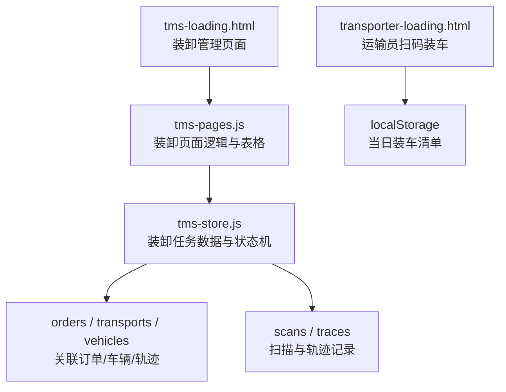
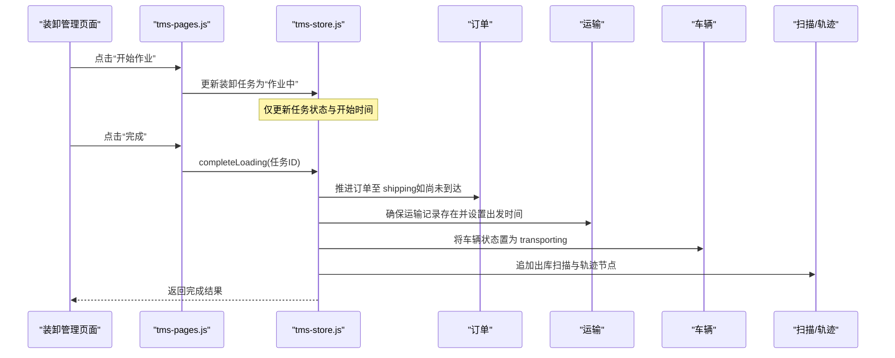
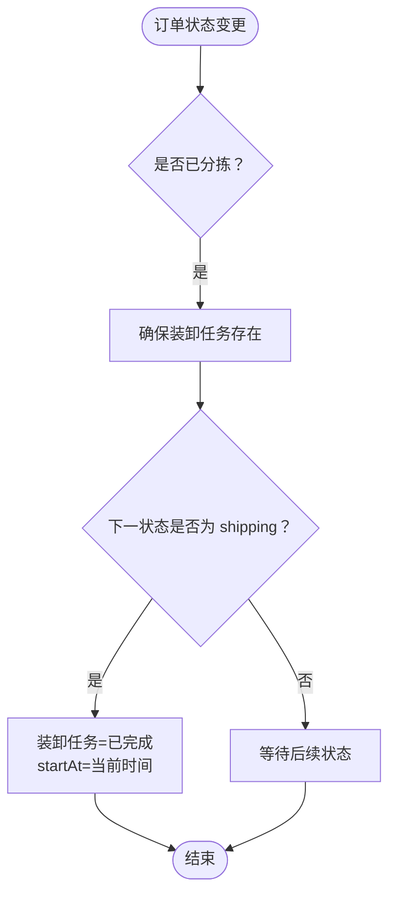
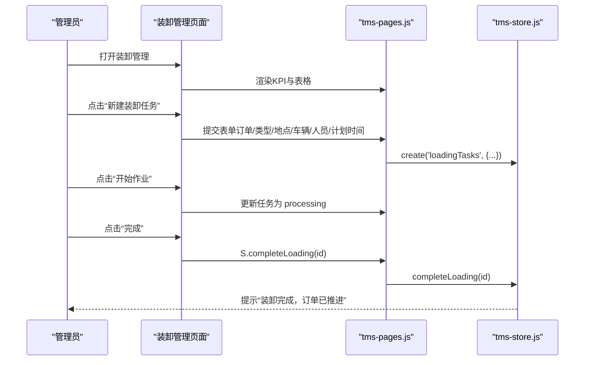
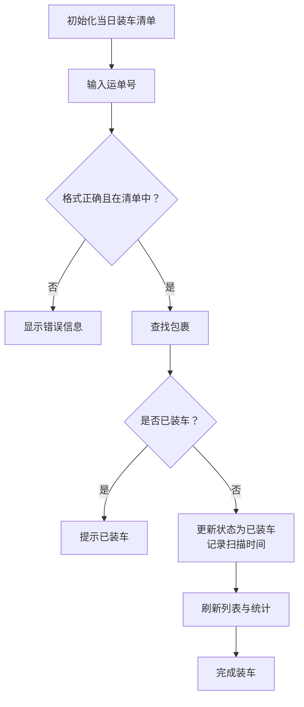
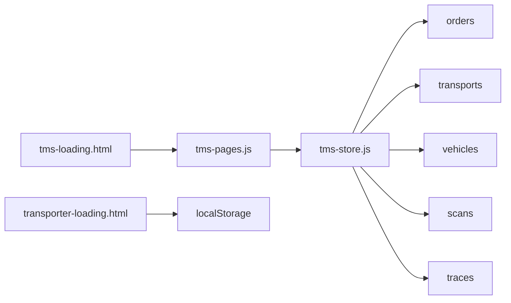

# 装卸管理

<cite>
**本文引用的文件**   
- [tms-loading.html](file://tms-loading.html)
- [transporter-loading.html](file://transporter-loading.html)
- [tms-pages.js](file://tms-pages.js)
- [tms-store.js](file://tms-store.js)
- [tms-architecture.html](file://tms-architecture.html)
</cite>

## 目录
1. [引言](#引言)
2. [项目结构](#项目结构)
3. [核心组件](#核心组件)
4. [架构总览](#架构总览)
5. [详细组件分析](#详细组件分析)
6. [依赖关系分析](#依赖关系分析)
7. [性能与效率优化](#性能与效率优化)
8. [故障排查指南](#故障排查指南)
9. [结论](#结论)
10. [附录：数据模型与字段说明](#附录数据模型与字段说明)

## 引言
本章节面向TMS系统的装卸管理功能，围绕装卸任务调度、装载执行与校验、卸货验证、以及与仓储/运输/库存等模块的集成进行系统化说明。文档基于仓库中的实际代码与页面实现，给出可追溯的实现路径、流程图和数据结构，帮助读者理解从“订单进入分拨中心”到“装车完成并推进运输状态”的完整业务闭环。

## 项目结构
装卸管理在系统中由以下关键文件共同支撑：
- tms-loading.html：运营侧装卸管理页面骨架与基础交互入口
- transporter-loading.html：运输员扫码装车界面与本地化作业流程
- tms-pages.js：装卸管理页面的表格、KPI、新建/开始/完成操作定义
- tms-store.js：装卸任务数据模型、生命周期推进、统计聚合与对外API
- tms-architecture.html：系统能力概览中关于装卸管理的定位描述

图示来源
- [tms-loading.html:443-548](file://tms-loading.html#L443-L548)
- [tms-pages.js:1399-1467](file://tms-pages.js#L1399-L1467)
- [tms-store.js:1371-1392](file://tms-store.js#L1371-L1392)
- [transporter-loading.html:465-550](file://transporter-loading.html#L465-L550)

章节来源
- [tms-loading.html:443-548](file://tms-loading.html#L443-L548)
- [tms-pages.js:1399-1467](file://tms-pages.js#L1399-L1467)
- [tms-store.js:1371-1392](file://tms-store.js#L1371-L1392)
- [transporter-loading.html:465-550](file://transporter-loading.html#L465-L550)

## 核心组件
- 装卸任务实体（loadingTasks）：承载装卸计划、作业地点、车辆、作业人员、吨位、设备、状态等核心信息
- 装卸页面（tms-loading.html + tms-pages.js）：提供装卸任务的创建、开始、完成等操作入口与KPI展示
- 运输员装车页（transporter-loading.html）：提供扫码装车、包裹清单、进度统计、核对与完成装车等现场作业能力
- 数据与状态引擎（tms-store.js）：负责装卸任务的生命周期推进、与订单/运输/扫描/轨迹的联动，以及日度统计聚合

章节来源
- [tms-pages.js:1399-1467](file://tms-pages.js#L1399-L1467)
- [tms-store.js:1371-1392](file://tms-store.js#L1371-L1392)
- [transporter-loading.html:465-550](file://transporter-loading.html#L465-L550)

## 架构总览
装卸管理贯穿“入库→分拣→出库→装车→运输→到达→派送→签收”的全链路。装卸任务在订单达到“已分拣”或“已出库”阶段时自动生成或补齐；当装卸完成时，系统自动推进订单至“运输中”，并同步更新车辆状态、扫描与轨迹。

图示来源
- [tms-pages.js:1451-1466](file://tms-pages.js#L1451-L1466)
- [tms-store.js:1993-2005](file://tms-store.js#L1993-L2005)
- [tms-store.js:1519-1538](file://tms-store.js#L1519-L1538)

## 详细组件分析

### 装卸任务数据模型与生命周期
装卸任务的核心字段包括：
- id：任务唯一标识
- orderId：关联订单
- waybillNo：运单号
- type：作业类型（装车/卸车）
- place：作业地点
- vehicleId：车辆ID
- workers：作业人员
- planAt：计划时间
- startAt：实际开始时间
- tons：吨位
- equipment：设备（如叉车）
- status：状态（待作业/作业中/已完成）

生命周期要点：
- 订单进入“已分拣”后，ensureLoadingTask会保证存在装卸任务
- 订单进入“运输中”时，装卸任务被标记为已完成，并开始时间回填
- 通过completeLoading接口，可将任务设为已完成，并自动推进订单至shipping

图示来源
- [tms-store.js:1519-1538](file://tms-store.js#L1519-L1538)
- [tms-store.js:1371-1392](file://tms-store.js#L1371-L1392)

章节来源
- [tms-store.js:1371-1392](file://tms-store.js#L1371-L1392)
- [tms-store.js:1519-1538](file://tms-store.js#L1519-L1538)

### 装卸管理页面与操作流
装卸管理页面提供：
- KPI：待作业、作业中、已完成、累计吨位
- 表格：任务ID、订单号、类型、作业地点、车辆、作业人员、计划时间、吨位、状态
- 工具栏：新建装卸任务（选择订单、类型、地点、车辆、人员、计划时间）
- 行操作：开始作业、完成

“开始作业”将任务状态改为“作业中”并记录开始时间；“完成”调用completeLoading，自动推进订单至shipping并联动运输与车辆状态。

图示来源
- [tms-pages.js:1428-1466](file://tms-pages.js#L1428-L1466)
- [tms-store.js:1993-2005](file://tms-store.js#L1993-L2005)

章节来源
- [tms-pages.js:1399-1467](file://tms-pages.js#L1399-L1467)
- [tms-store.js:1993-2005](file://tms-store.js#L1993-L2005)

### 运输员扫码装车流程
transporter-loading.html实现了现场扫码装车的关键流程：
- 初始化当日装车清单（localStorage），包含运单号、订单号、目的地、包裹信息、状态、扫描时间
- 支持条码/二维码扫描与手动输入运单号
- 校验运单号格式与是否在清单中，避免重复装车
- 更新包裹状态为“已装车”，记录扫描时间，刷新列表与统计
- 提供重置、核对清单、完成装车等操作

图示来源
- [transporter-loading.html:607-711](file://transporter-loading.html#L607-L711)
- [transporter-loading.html:746-789](file://transporter-loading.html#L746-L789)

章节来源
- [transporter-loading.html:607-711](file://transporter-loading.html#L607-L711)
- [transporter-loading.html:746-789](file://transporter-loading.html#L746-L789)

### 装卸与仓储、运输、库存的集成
- 与仓储/分拣：订单进入“已分拣”后生成装卸任务；分拣完成后触发出库扫描，随后进入装车阶段
- 与运输：装卸完成时，系统自动创建或更新运输记录，设置出发时间与状态为shipping，并将车辆置为transporting
- 与库存：装卸任务中的tons来源于订单重量，用于统计叉车作业量与吨位；库存与物料信息在仓储模块中独立维护，装卸环节不直接修改库存数量
- 与扫描/轨迹：装卸相关节点会追加扫描记录与轨迹节点，便于全链路追踪与时效监控

章节来源
- [tms-store.js:1519-1538](file://tms-store.js#L1519-L1538)
- [tms-store.js:1371-1392](file://tms-store.js#L1371-L1392)
- [tms-architecture.html:1149-1155](file://tms-architecture.html#L1149-L1155)

## 依赖关系分析
装卸管理涉及的模块依赖如下：
- 页面层：tms-loading.html 与 transporter-loading.html 分别承担管理与现场作业职责
- 逻辑层：tms-pages.js 定义装卸任务的表格、KPI与操作；tms-store.js 提供数据与状态机
- 数据层：loadingTasks 与 orders、transports、vehicles、scans、traces 强关联

图示来源
- [tms-pages.js:1399-1467](file://tms-pages.js#L1399-L1467)
- [tms-store.js:1993-2005](file://tms-store.js#L1993-L2005)
- [transporter-loading.html:607-711](file://transporter-loading.html#L607-L711)

章节来源
- [tms-pages.js:1399-1467](file://tms-pages.js#L1399-L1467)
- [tms-store.js:1993-2005](file://tms-store.js#L1993-L2005)
- [transporter-loading.html:607-711](file://transporter-loading.html#L607-L711)

## 性能与效率优化
- 装卸任务统计：按日期聚合 loadingTasks，计算叉车作业次数与吨位，便于日度效率评估
- 扫描口径控制：对入库/出库/派送扫描按订单去重并在应作业范围内统计，避免指标失真
- 车辆状态联动：装卸完成后自动将车辆置为transporting，减少人工干预与状态不一致
- 本地缓存：运输员装车使用localStorage存储当日清单，降低网络依赖，提升现场响应速度

章节来源
- [tms-store.js:2110-2155](file://tms-store.js#L2110-L2155)
- [transporter-loading.html:607-711](file://transporter-loading.html#L607-L711)

## 故障排查指南
常见问题与处理建议：
- 装卸任务未生成
  - 检查订单是否已进入“已分拣”或“已出库”阶段；若未进入，需先完成分拣与出库扫描
  - 参考 ensureLoadingTask 与 applyOrderStatus 的状态推进逻辑
- 装卸完成但订单未推进
  - 确认是否调用 completeLoading；该函数会自动推进订单至shipping并更新运输与车辆状态
- 扫码装车失败
  - 检查运单号格式（应以WB开头）与是否在当日清单中
  - 查看重复装车提示与错误消息输出
- 统计异常
  - 核对扫描记录的去重口径与日期范围；确认 loadingTasks 的 planAt 日期是否正确

章节来源
- [tms-store.js:1371-1392](file://tms-store.js#L1371-L1392)
- [tms-store.js:1519-1538](file://tms-store.js#L1519-L1538)
- [tms-store.js:1993-2005](file://tms-store.js#L1993-L2005)
- [transporter-loading.html:661-711](file://transporter-loading.html#L661-L711)

## 结论
装卸管理在TMS中扮演连接仓储与运输的关键角色。通过装卸任务的数据模型与状态机，系统实现了从“分拣完成”到“装车完成并进入运输”的自动化流转；同时，运输员扫码装车提供了高效的现场作业能力。结合扫描与轨迹记录，装卸环节的可观测性与可追溯性得到保障。未来可在装载算法与安全规范方面进一步增强，例如引入三维装载优化、重心与配载约束校验、以及安全操作提醒与异常告警。

## 附录：数据模型与字段说明
- loadingTasks
  - id：任务ID
  - orderId：订单ID
  - waybillNo：运单号
  - type：作业类型（装车/卸车）
  - place：作业地点
  - vehicleId：车辆ID
  - workers：作业人员
  - planAt：计划时间
  - startAt：实际开始时间
  - tons：吨位
  - equipment：设备（如叉车）
  - status：状态（pending/processing/done）

- 关联实体
  - orders：订单（weight、expectedAt、status等）
  - transports：运输（vehicleId、driver、departAt、eta、status等）
  - vehicles：车辆（capacityTon、status、location等）
  - scans：扫描记录（type、location、device、operator等）
  - traces：轨迹（node、nodeName、location、opTime、deadline等）

章节来源
- [tms-store.js:1371-1392](file://tms-store.js#L1371-L1392)
- [tms-store.js:1394-1417](file://tms-store.js#L1394-L1417)
- [tms-store.js:1446-1465](file://tms-store.js#L1446-L1465)