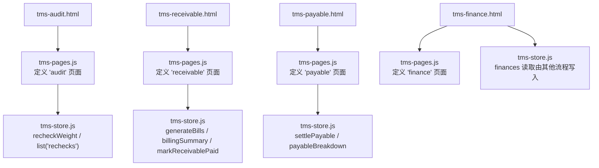
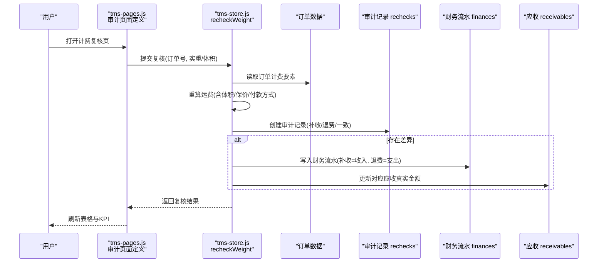
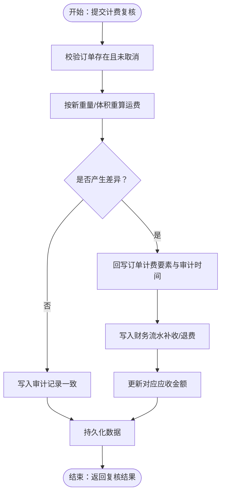
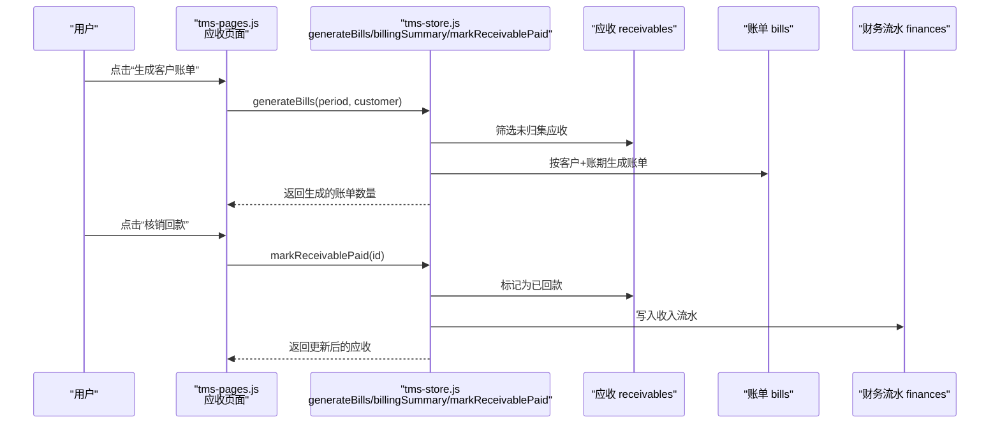
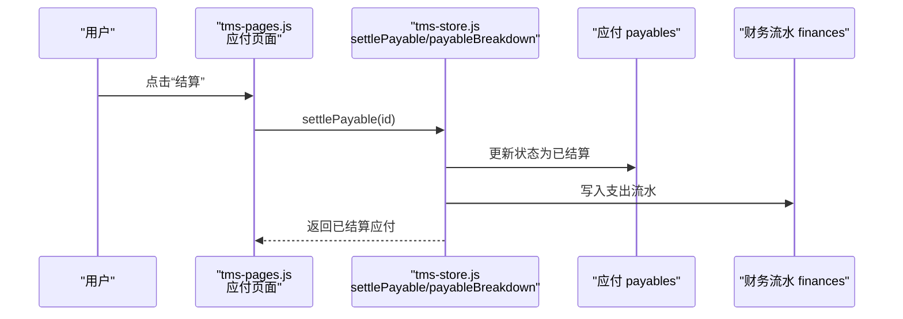
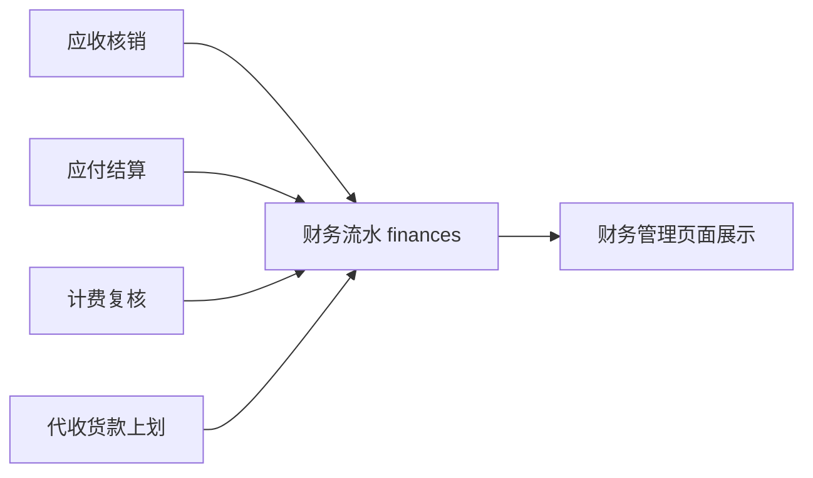
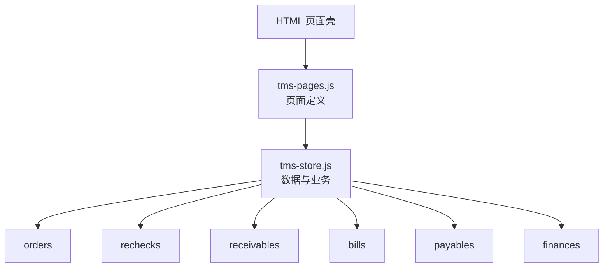

# 计费审计模块

<cite>
**本文引用的文件**   
- [tms-audit.html](file://tms-audit.html)
- [tms-receivable.html](file://tms-receivable.html)
- [tms-payable.html](file://tms-payable.html)
- [tms-finance.html](file://tms-finance.html)
- [tms-store.js](file://tms-store.js)
- [tms-pages.js](file://tms-pages.js)
</cite>

## 目录
1. [引言](#引言)
2. [项目结构](#项目结构)
3. [核心组件](#核心组件)
4. [架构总览](#架构总览)
5. [详细组件分析](#详细组件分析)
6. [依赖关系分析](#依赖关系分析)
7. [性能与扩展性](#性能与扩展性)
8. [故障排查指南](#故障排查指南)
9. [结论](#结论)

## 引言
本文件聚焦“计费审计模块”，围绕 TMS 运输管理系统中的计费复核、应收结算、应付结算与财务流水联动进行系统化说明。该模块以订单运费为核心，通过到货复磅/体积差异触发计费重算，形成补收或退费，并同步更新应收金额与财务收支流水；同时提供客户账单聚合、回款核销与成本应付结算能力，最终在财务管理页面汇总收入与支出。

## 项目结构
计费审计相关的前端入口由多个 HTML 页面组成，业务逻辑集中在两个 JS 文件中：
- tms-audit.html：计费复核页面壳，负责加载通用 UI 框架并通过路由渲染审计表格。
- tms-receivable.html / tms-payable.html：应收与应付结算页面壳，分别调用页面渲染器展示应收与应付数据。
- tms-finance.html：财务管理页面，展示收入/支出统计与明细列表。
- tms-store.js：数据层与业务规则实现，包括应收生成、账单聚合、应付结算、计费复核、财务流水等。
- tms-pages.js：页面定义与表格/图表渲染配置，将数据层暴露的 API 与 UI 组合起来。

**图示来源**
- [tms-audit.html:258-263](file://tms-audit.html#L258-L263)
- [tms-receivable.html:258-263](file://tms-receivable.html#L258-L263)
- [tms-payable.html:258-263](file://tms-payable.html#L258-L263)
- [tms-finance.html:379-384](file://tms-finance.html#L379-L384)
- [tms-pages.js:2150-2179](file://tms-pages.js#L2150-L2179)
- [tms-pages.js:1988-2079](file://tms-pages.js#L1988-L2079)
- [tms-pages.js:2087-2148](file://tms-pages.js#L2087-L2148)
- [tms-store.js:1945-2055](file://tms-store.js#L1945-L2055)

**章节来源**
- [tms-audit.html:1-268](file://tms-audit.html#L1-L268)
- [tms-receivable.html:1-268](file://tms-receivable.html#L1-L268)
- [tms-payable.html:1-268](file://tms-payable.html#L1-L268)
- [tms-finance.html:1-612](file://tms-finance.html#L1-L612)
- [tms-store.js:1945-2055](file://tms-store.js#L1945-L2055)
- [tms-pages.js:1988-2179](file://tms-pages.js#L1988-L2179)

## 核心组件
- 计费复核（Audit）
  - 功能：根据到货实际重量/体积差异，重新计算运费，记录审计轨迹，产生补收或退费，并联动应收与财务流水。
  - 关键数据实体：orders、rechecks、finances、receivables。
  - 关键方法：recheckWeight、list('rechecks')。
- 应收结算（Receivable）
  - 功能：按客户+账期聚合未归集应收为月度账单，支持确认、争议标记与回款核销。
  - 关键数据实体：receivables、bills、finances。
  - 关键方法：generateBills、billingSummary、markReceivablePaid。
- 应付结算（Payable）
  - 功能：对承运商/司机/网点的成本应付进行结算，结算后自动生成支出流水。
  - 关键数据实体：payables、finances。
  - 关键方法：settlePayable、payableBreakdown。
- 财务管理（Finance）
  - 功能：汇总本月收入/支出/净利润与本年累计收入，展示财务记录列表。
  - 数据来源：finances 表（由应收核销、应付结算、计费复核等多处写入）。

**章节来源**
- [tms-store.js:1945-2055](file://tms-store.js#L1945-L2055)
- [tms-pages.js:1988-2179](file://tms-pages.js#L1988-L2179)
- [tms-finance.html:342-370](file://tms-finance.html#L342-L370)

## 架构总览
计费审计模块采用“页面壳 + 页面定义 + 数据层”的分层结构：
- 页面壳（HTML）：负责登录校验、UI 外壳初始化与页面路由。
- 页面定义（tms-pages.js）：定义各页面的标题、KPI、图表、表格列、工具栏与操作按钮。
- 数据层（tms-store.js）：封装数据读写、业务规则与跨实体联动（订单→应收→账单→财务流水）。

**图示来源**
- [tms-pages.js:2150-2179](file://tms-pages.js#L2150-L2179)
- [tms-store.js:2004-2055](file://tms-store.js#L2004-L2055)

## 详细组件分析

### 计费复核（Audit）
- 页面入口
  - tms-audit.html 在 DOMContentLoaded 中检查管理员登录状态，初始化 UI 外壳，并调用 TmsPages.render('audit', ...) 渲染审计内容。
- 页面定义
  - tms-pages.js 定义 'audit' 页面，包含 KPI（复核笔数、累计补收、累计退费、净调整）与审计记录表格（订单号、客户、下单/实磅、计费重、运费变动、差额类型等），并提供筛选与排序。
- 业务逻辑
  - tms-store.js 的 recheckWeight 方法：
    - 校验订单是否存在且未被取消。
    - 使用新重量/体积重新计算运费，得到差额 delta。
    - 回写订单计费要素（重量、体积、计费重、费率卡ID、审计时间等），并在订单时间线追加审计事件。
    - 创建审计记录 rechecks，记录原始与审计后的重量、计费重、运费及差额类型（补收/退费/一致）。
    - 若存在差异，则写入财务流水 finances（补收为收入，退费为支出），并更新对应未结清应收的金额。
    - 持久化数据并返回复核结果。

**图示来源**
- [tms-store.js:2004-2055](file://tms-store.js#L2004-L2055)

**章节来源**
- [tms-audit.html:258-263](file://tms-audit.html#L258-L263)
- [tms-pages.js:2150-2179](file://tms-pages.js#L2150-L2179)
- [tms-store.js:2004-2055](file://tms-store.js#L2004-L2055)

### 应收结算（Receivable）
- 页面入口
  - tms-receivable.html 在 DOMContentLoaded 中检查管理员登录状态，初始化 UI 外壳，并调用 TmsPages.render('receivable', ...) 渲染应收内容。
- 页面定义
  - tms-pages.js 定义 'receivable' 页面，包含 KPI（应收总额、逾期金额、已回款、回款率）、应收账龄分布图表、客户账单表格与应收明细表格。
  - 支持“生成客户账单”、“确认账单”、“标记争议”、“核销回款”等操作。
- 业务逻辑
  - tms-store.js 的 generateBills 方法：
    - 筛选未作废且未归集的应收行，按“客户+账期”分组。
    - 为每组生成一张月度账单 bills，设置账单号、总金额、到期日等，并将应收行的 billId 指向该账单。
  - billingSummary 方法：
    - 汇总应收总额、逾期金额、已回款、回款率与账龄分布，供 KPI 与图表使用。
  - markReceivablePaid 方法：
    - 将应收标记为已回款，并写入财务流水（挂账收入结算）。

**图示来源**
- [tms-pages.js:1988-2079](file://tms-pages.js#L1988-L2079)
- [tms-store.js:1945-1967](file://tms-store.js#L1945-L1967)

**章节来源**
- [tms-receivable.html:258-263](file://tms-receivable.html#L258-L263)
- [tms-pages.js:1988-2079](file://tms-pages.js#L1988-L2079)
- [tms-store.js:1945-1967](file://tms-store.js#L1945-L1967)

### 应付结算（Payable）
- 页面入口
  - tms-payable.html 在 DOMContentLoaded 中检查管理员登录状态，初始化 UI 外壳，并调用 TmsPages.render('payable', ...) 渲染应付内容。
- 页面定义
  - tms-pages.js 定义 'payable' 页面，包含 KPI（应付总额、待结算、已结算、应付笔数）、应付结构饼图、按对象类型柱状图与应付明细表格。
  - 支持“结算”操作，结算后提示生成支出流水。
- 业务逻辑
  - tms-store.js 的 settlePayable 方法：
    - 查找应付记录，若已结算则直接返回。
    - 将应付状态置为已结算，并写入一笔支出类财务流水，备注中包含结算对象与分类。
  - payableBreakdown 方法：
    - 按分类与对象类型汇总应付金额，供图表展示。

**图示来源**
- [tms-pages.js:2087-2148](file://tms-pages.js#L2087-L2148)
- [tms-store.js:1971-2002](file://tms-store.js#L1971-L2002)

**章节来源**
- [tms-payable.html:258-263](file://tms-payable.html#L258-L263)
- [tms-pages.js:2087-2148](file://tms-pages.js#L2087-L2148)
- [tms-store.js:1971-2002](file://tms-store.js#L1971-L2002)

### 财务管理（Finance）
- 页面入口
  - tms-finance.html 在 DOMContentLoaded 中检查管理员登录状态，初始化 UI 外壳，并调用 TmsPages.render('finance', ...) 渲染财务内容。
- 页面内容
  - 展示本月总收入、总支出、净利润与本年累计收入等统计卡片。
  - 展示财务记录列表，包含收入/支出类型、金额、描述、关联订单/运单/车辆/理赔等信息。
- 数据来源
  - finances 表由应收核销、应付结算、计费复核、代收货款上划等多个业务流程写入。

**图示来源**
- [tms-finance.html:342-370](file://tms-finance.html#L342-L370)
- [tms-store.js:1940-1943](file://tms-store.js#L1940-L1943)
- [tms-store.js:1971-1984](file://tms-store.js#L1971-L1984)
- [tms-store.js:2043-2052](file://tms-store.js#L2043-L2052)

**章节来源**
- [tms-finance.html:342-370](file://tms-finance.html#L342-L370)
- [tms-store.js:1940-1943](file://tms-store.js#L1940-L1943)
- [tms-store.js:1971-1984](file://tms-store.js#L1971-L1984)
- [tms-store.js:2043-2052](file://tms-store.js#L2043-L2052)

## 依赖关系分析
- 页面壳依赖 tms-ui.js 与 tms-pages.js，通过 TmsUI.initShell() 初始化 UI 外壳，通过 TmsPages.render(...) 渲染具体页面。
- 页面定义依赖 tms-store.js 提供的数据查询与业务方法（如 recheckWeight、generateBills、settlePayable、billingSummary 等）。
- 数据层内部依赖订单、应收、账单、应付、审计、财务流水等实体，确保跨实体一致性（例如计费复核更新应收金额与财务流水）。

**图示来源**
- [tms-audit.html:258-263](file://tms-audit.html#L258-L263)
- [tms-receivable.html:258-263](file://tms-receivable.html#L258-L263)
- [tms-payable.html:258-263](file://tms-payable.html#L258-L263)
- [tms-finance.html:379-384](file://tms-finance.html#L379-L384)
- [tms-store.js:1945-2055](file://tms-store.js#L1945-L2055)

**章节来源**
- [tms-audit.html:258-263](file://tms-audit.html#L258-L263)
- [tms-receivable.html:258-263](file://tms-receivable.html#L258-L263)
- [tms-payable.html:258-263](file://tms-payable.html#L258-L263)
- [tms-finance.html:379-384](file://tms-finance.html#L379-L384)
- [tms-store.js:1945-2055](file://tms-store.js#L1945-L2055)

## 性能与扩展性
- 数据量增长建议
  - 对 rechecks、receivables、payables、bills、finances 等大表增加分页与索引字段（如 orderId、customer、period、status）。
  - 对高频查询（如 billingSummary、payableBreakdown）考虑缓存或预聚合。
- 计算优化
  - 计费重算可引入增量计算与批量处理，避免重复计算历史订单。
  - 账单聚合可按账期分区存储，减少全表扫描。
- 可扩展点
  - 计费规则扩展：新增服务类型、附加费项时，应在计费重算逻辑中统一接入。
  - 审计留痕：可在审计记录中扩展更多维度（如异常原因、审批流、附件）。
  - 财务对账：可增加银行流水对接与自动对账能力。

[本节为通用指导，不直接分析具体文件]

## 故障排查指南
- 计费复核无差异但显示补收/退费
  - 检查 recheckWeight 中 delta 的计算与阈值判断（是否小于 0.01 视为一致）。
  - 核对订单的 weight、chargeableWeight、freight 与 rateCardId 是否正确回写。
- 应收金额未随复核更新
  - 检查 recheckWeight 中是否找到对应未结清应收行并更新 amount。
  - 确认应收的 status 不是 paid 或 void。
- 财务流水缺失
  - 核查计费复核、应付结算、应收核销、代收货款上划等流程是否成功写入 finances。
  - 检查 tms-finance.html 的数据绑定与 localStorage 读取逻辑。
- 账单未生成或归集失败
  - 检查 generateBills 的过滤条件（status !== 'void' 且 billId 为空）。
  - 确认 period 与 customer 参数是否正确传入。

**章节来源**
- [tms-store.js:2004-2055](file://tms-store.js#L2004-L2055)
- [tms-store.js:1945-1967](file://tms-store.js#L1945-L1967)
- [tms-finance.html:537-607](file://tms-finance.html#L537-L607)

## 结论
计费审计模块以订单运费为核心，通过到货复磅/体积差异触发计费重算，形成补收或退费，并联动应收与财务流水；同时提供客户账单聚合、回款核销与成本应付结算能力，最终在财务管理页面汇总收入与支出。该模块通过清晰的页面壳、页面定义与数据层分层，实现了可维护、可扩展的计费审计与结算体系。