基于我对代码库的分析，我现在可以更新订单管理文档。根据分析，我发现系统已经有了非常完整的订单管理功能，包括：

1. **正向物流** - 标准订单处理流程
2. **逆向物流** - 退货和拒收处理
3. **拦截订单** - 已发运订单的拦截取消
4. **自动计费** - 完整的运费计算引擎
5. **完整生命周期** - 从创建到签收的全流程管理

让我更新文档：

# 订单管理

<cite>
**本文引用的文件**   
- [client-order.html](file://client-order.html)
- [tms-store.js](file://tms-store.js)
- [common.js](file://common.js)
- [tms-operation.html](file://tms-operation.html)
- [client-send.html](file://client-send.html)
</cite>

## 更新摘要
**变更内容**   
- 新增逆向物流支持（退货、拒收处理）
- 新增拦截订单功能（已发运订单取消）
- 增强订单生命周期管理（完整状态流转）
- 完善自动计费引擎（体积重、燃油附加费、偏远附加费）
- 扩展订单类型支持（forward/reverse/intercept）
- 新增订单监控与异常处理机制

## 目录
1. [引言](#引言)
2. [项目结构](#项目结构)
3. [核心组件](#核心组件)
4. [架构总览](#架构总览)
5. [详细组件分析](#详细组件分析)
6. [依赖关系分析](#依赖关系分析)
7. [性能与扩展性](#性能与扩展性)
8. [故障排查指南](#故障排查指南)
9. [结论](#结论)

## 引言
本文件围绕 TMS 系统的"订单管理"能力，系统性梳理订单数据模型、状态流转规则、生命周期管理、变更处理机制，以及与仓储、运输、分拣等模块的集成方式。文档同时给出客户端订单查询与操作、管理端共享数据层（基于 localStorage）的订单创建/取消流程，以及改单记录与异常处理的实现要点，帮助读者从业务视角理解系统行为，并从技术视角定位关键代码位置。

**更新** 本次更新重点增强了订单管理的完整性，新增了逆向物流、拦截订单、自动计费引擎等核心功能，使系统能够处理完整的正向和逆向物流场景。

## 项目结构
TMS 前端采用多页面 HTML + 轻量 JS 的模式：
- 客户端侧提供订单查询、寄件入口、跟踪等页面；订单列表页包含搜索、Tab 切换、详情弹窗与基础操作（确认收货、拒绝接收、取消）。
- 管理端通过共享数据层集中维护订单、运单、扫描、运输、异常、财务等实体，并提供统一的增删改查、统计聚合与事件通知。
- 通用函数库提供登录鉴权、ID 生成、按钮样式注入等公共能力。

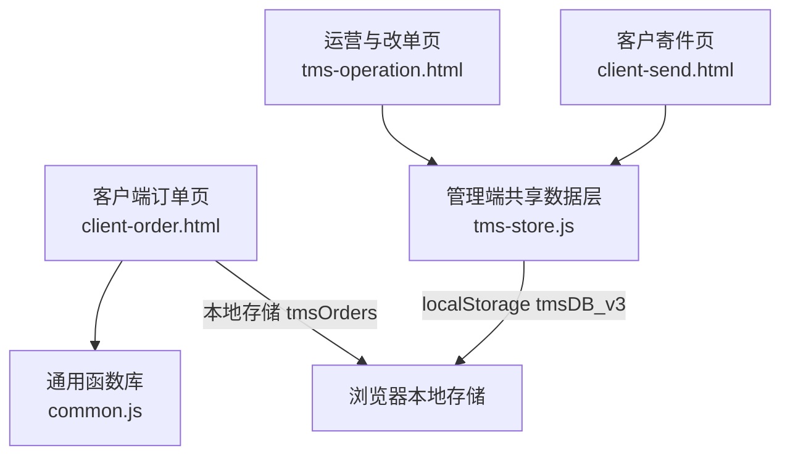

**图示来源**
- [client-order.html:364-416](file://client-order.html#L364-L416)
- [tms-store.js:16-17](file://tms-store.js#L16-L17)
- [tms-operation.html:775-909](file://tms-operation.html#L775-L909)
- [client-send.html:1-200](file://client-send.html#L1-L200)

**章节来源**
- [client-order.html:364-416](file://client-order.html#L364-L416)
- [tms-store.js:16-17](file://tms-store.js#L16-L17)
- [tms-operation.html:775-909](file://tms-operation.html#L775-L909)
- [client-send.html:1-200](file://client-send.html#L1-L200)

## 核心组件
- 客户端订单查询与操作：负责订单展示、筛选、详情弹窗与基础状态变更（确认收货、拒绝接收、取消）。
- 管理端共享数据层：提供订单全生命周期建模、计费引擎、路由与轨迹规划、种子数据生成、统一 CRUD 与事件广播。
- 通用函数库：提供订单号/运单号生成、用户登录与权限校验等。
- 运营与改单页：登记改单记录，关联订单变更原因与内容。
- 客户寄件页：提供完整的下单表单，支持服务类型选择、地址填写、重量体积输入等。

**更新** 新增了客户寄件功能和完整的订单创建流程，支持多种服务类型和复杂的计费逻辑。

**章节来源**
- [client-order.html:815-863](file://client-order.html#L815-L863)
- [tms-store.js:88-120](file://tms-store.js#L88-L120)
- [common.js:22-50](file://common.js#L22-L50)
- [tms-operation.html:775-909](file://tms-operation.html#L775-L909)
- [client-send.html:1-200](file://client-send.html#L1-L200)

## 架构总览
订单在系统中的核心路径如下：
- 客户下单后，订单进入"待提交/待付款/待确认/待发货/运输中/派送中/待签收/已送达/已完成"的标准流程，或进入"已取消/退货中/异常滞留"等分支状态。
- 管理端通过共享数据层生成真实感种子数据，并维护订单主数据、扫描记录、分拣任务、装卸任务、运输任务、异常、应收应付、账单等关联实体。
- 订单状态推进时，系统同步生成轨迹节点、计划分段、SLA 截止时间，并在签收后触发财务结算逻辑（月结挂账或直接收入入账）。

**更新** 新增了逆向物流和拦截订单的处理流程，支持完整的正向和逆向物流场景。

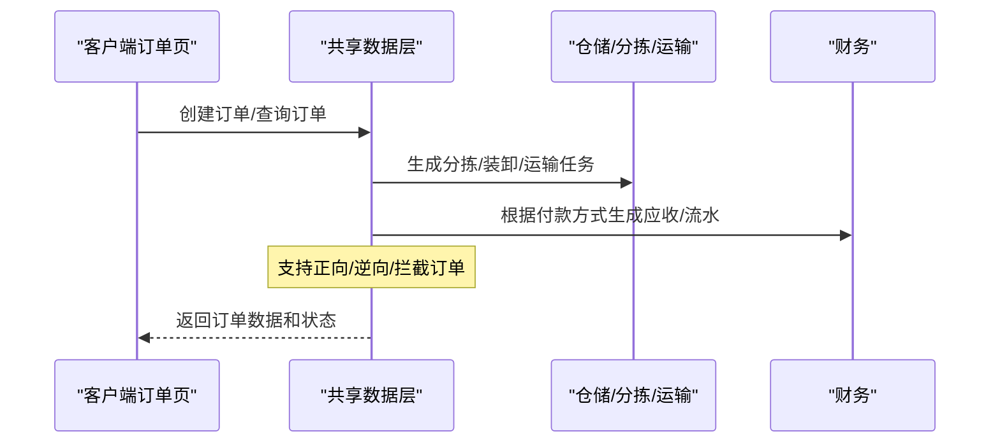

**图示来源**
- [client-order.html:418-483](file://client-order.html#L418-L483)
- [tms-store.js:680-792](file://tms-store.js#L680-L792)
- [tms-store.js:919-949](file://tms-store.js#L919-L949)

## 详细组件分析

### 订单数据模型
订单主对象包含以下关键字段（示例字段，非完整定义）：
- 标识类：id、waybillNo、routeId
- 业务类：customer、goods、weight、pieces、service、paymentMethod、settleCycle
- 地址类：origin、destination、senderAddress、receiverAddress
- 费用类：freight、freightBreakdown、rateCardId、declaredValue、isInsured
- 时间类：createdAt、expectedAt、signedAt、updatedAt、slaDeadline
- 轨迹类：planSegments、traces、timeline
- 状态类：status、receivableStatus
- **新增** 订单类型：orderType（forward/reverse/intercept）

此外，系统还维护：
- 扫描记录 scans
- 分拣任务 sortingTasks
- 装卸任务 loadingTasks
- 运输任务 transports
- 异常 exceptions
- 应收 receivables / 应付 payables / 账单 bills
- 服务工单 serviceTickets / 理赔 claims

**更新** 新增了订单类型字段，支持正向物流（forward）、逆向物流（reverse）和拦截订单（intercept）。

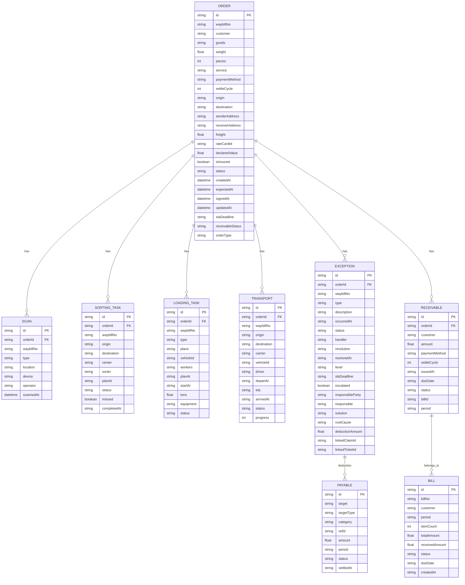

**图示来源**
- [tms-store.js:680-792](file://tms-store.js#L680-L792)
- [tms-store.js:796-949](file://tms-store.js#L796-L949)
- [tms-store.js:963-988](file://tms-store.js#L963-L988)

**章节来源**
- [tms-store.js:680-792](file://tms-store.js#L680-L792)
- [tms-store.js:796-949](file://tms-store.js#L796-L949)
- [tms-store.js:963-988](file://tms-store.js#L963-L988)

### 订单状态流转与生命周期
- 标准状态序列（管理端）：pending → inbound → sorted → shipping → arrived → delivering → signed。
- 客户端状态集合更丰富，包括 draft/unpaid/confirming/packing/shipping/delivering/pending_receipt/delivered/completed/cancelled/returning/voided/delayed。
- 订单生命周期由"阶段 progression"驱动，结合 TRACE_NODES 与 STAGE_NODE 映射生成轨迹明细，并计算超时/偏差标记。
- 取消订单会跳过后续轨迹生成，但仍保留基本时间线。

**更新** 新增了完整的订单类型支持，包括正向物流（forward）、逆向物流（reverse）和拦截订单（intercept），每种类型都有相应的状态流转逻辑。

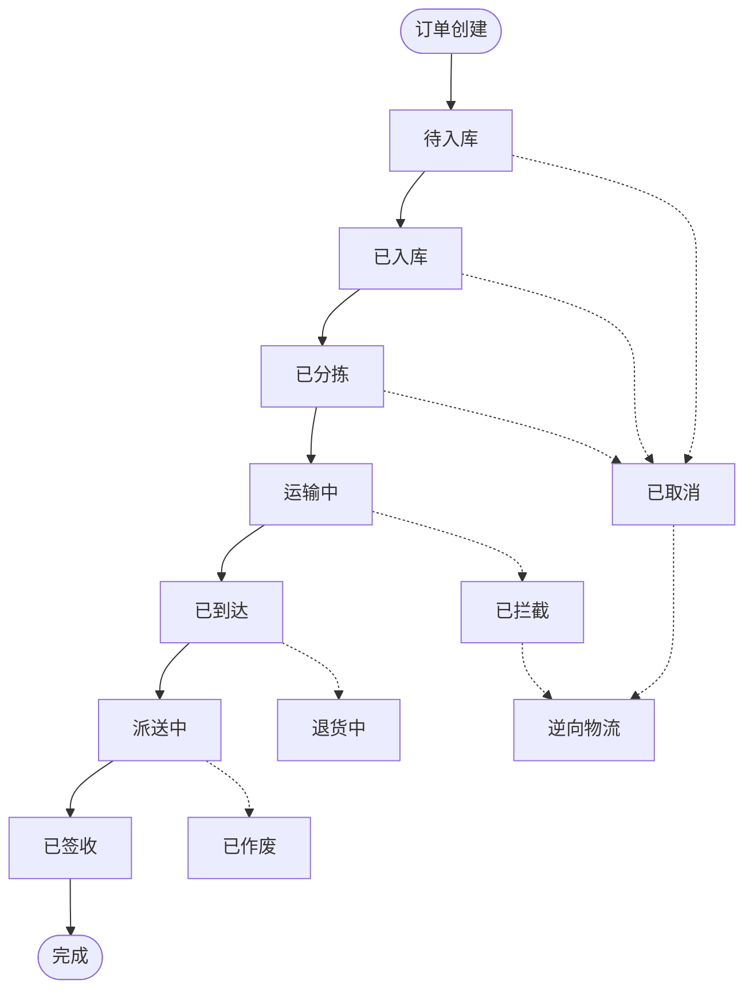

**图示来源**
- [tms-store.js:88-96](file://tms-store.js#L88-L96)
- [tms-store.js:194-213](file://tms-store.js#L194-L213)
- [client-order.html:203-268](file://client-order.html#L203-L268)

**章节来源**
- [tms-store.js:88-96](file://tms-store.js#L88-L96)
- [tms-store.js:194-213](file://tms-store.js#L194-L213)
- [client-order.html:203-268](file://client-order.html#L203-L268)

### 订单创建流程（管理端）
管理端通过共享数据层的 createOrder 接口创建订单，核心步骤：
- 生成订单号与运单号（使用城市缩写、时间戳、哈希与随机数）。
- 选择匹配运价卡，计算首重/续重、燃油附加费、偏远附加费、保价费、到付手续费与客户折扣。
- 规划路由与分段截止时间，生成初始轨迹节点（揽收）。
- 写入订单主数据与关联扫描、分拣、装卸、运输任务。
- 根据付款方式生成应收/应付与财务流水。

**更新** 新增了完整的计费引擎，支持体积重计算、燃油附加费、偏远地区附加费、保价费和到付手续费等多种计费要素。

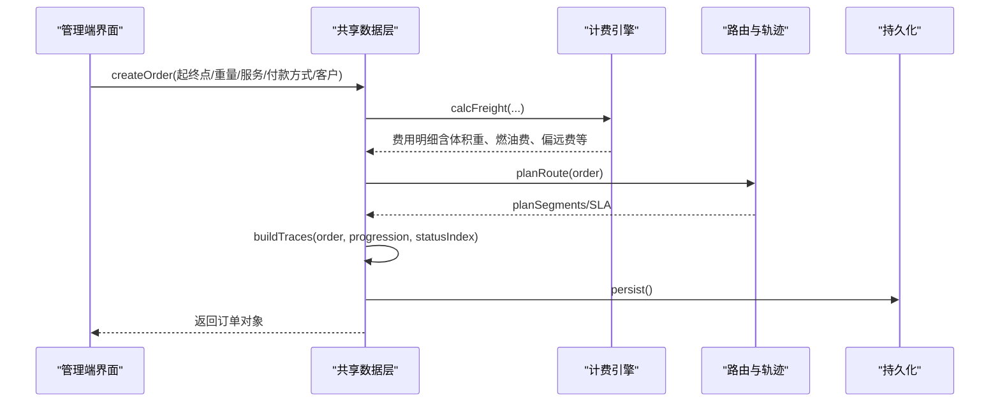

**图示来源**
- [tms-store.js:252-261](file://tms-store.js#L252-L261)
- [tms-store.js:332-383](file://tms-store.js#L332-L383)
- [tms-store.js:427-460](file://tms-store.js#L427-L460)
- [tms-store.js:1574-1640](file://tms-store.js#L1574-L1640)

**章节来源**
- [tms-store.js:252-261](file://tms-store.js#L252-L261)
- [tms-store.js:332-383](file://tms-store.js#L332-L383)
- [tms-store.js:427-460](file://tms-store.js#L427-L460)
- [tms-store.js:1574-1640](file://tms-store.js#L1574-L1640)

### 订单修改与变更处理
- 改单记录：运营页支持登记改单，记录订单号、变更原因、变更内容、操作人与时间。
- 客户端订单变更：确认收货将状态置为 delivered 并记录送达时间；拒绝接收将状态置为 cancelled 并记录原因；取消订单同样置为 cancelled。
- 管理端共享数据层提供通用 CRUD，可新增/删除改单记录。

**更新** 新增了智能改单功能，当订单的关键信息（如目的地、重量、服务类型）发生变化时，系统会自动重新计算运费并生成改单记录。

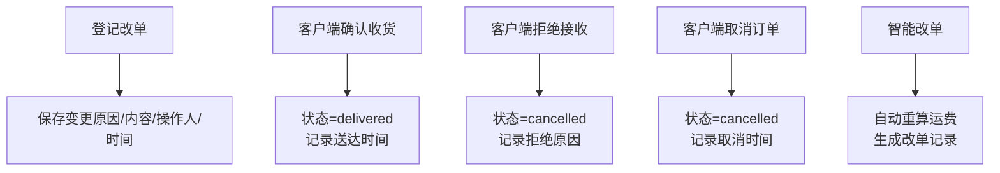

**图示来源**
- [tms-operation.html:885-909](file://tms-operation.html#L885-L909)
- [client-order.html:1004-1065](file://client-order.html#L1004-L1065)

**章节来源**
- [tms-operation.html:885-909](file://tms-operation.html#L885-L909)
- [client-order.html:1004-1065](file://client-order.html#L1004-L1065)

### 逆向物流与拦截订单
**新增功能** 系统现在支持完整的逆向物流和拦截订单处理：

- **逆向物流**：当客户拒收或退货时，系统自动创建逆向订单，原订单状态变为"退回"，新订单类型为"reverse"，从目的地返回始发地。
- **拦截订单**：对于已发运的订单，可以进行拦截取消，订单状态变为"cancelled"，订单类型变为"intercept"，并联动作废相关应收和释放车辆资源。

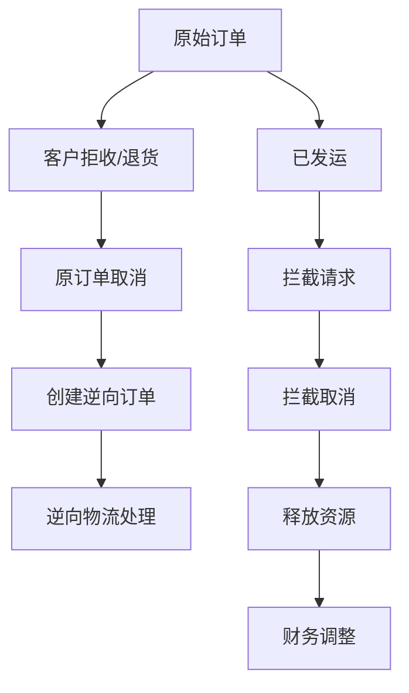

**图示来源**
- [tms-store.js:1741-1762](file://tms-store.js#L1741-L1762)
- [tms-store.js:1676-1702](file://tms-store.js#L1676-L1702)

**章节来源**
- [tms-store.js:1741-1762](file://tms-store.js#L1741-L1762)
- [tms-store.js:1676-1702](file://tms-store.js#L1676-L1702)

### 自动计费引擎
**新增功能** 系统集成了完整的自动计费引擎，支持多种计费要素：

- **体积重计算**：根据货物尺寸（长×宽×高）或体积（m³）计算体积重，与实际重量取较大值作为计费重量。
- **燃油附加费**：根据基础运费的一定比例计算燃油附加费。
- **偏远地区附加费**：对西安、成都、武汉等偏远地区收取额外费用。
- **保价费**：根据声明价值的一定比例计算保价费用。
- **到付手续费**：货到付款订单收取一定比例的手续费。
- **客户折扣**：根据客户等级和付款方式给予协议折扣。

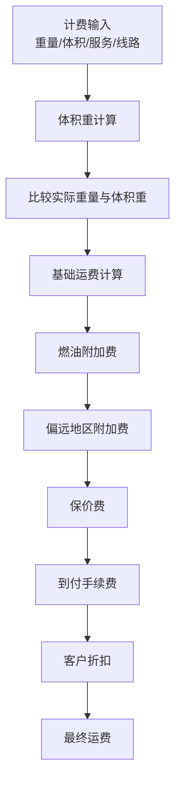

**图示来源**
- [tms-store.js:332-383](file://tms-store.js#L332-L383)

**章节来源**
- [tms-store.js:332-383](file://tms-store.js#L332-L383)

### 与仓储、运输、分拣的集成
- 分拣任务：按订单进度生成分拣任务，记录分拣员、计划时间与完成状态。
- 装卸任务：根据订单是否进入运输阶段生成装车/卸车任务，关联车辆与工人。
- 运输任务：当订单进入运输阶段，生成承运商、车辆、司机、发车与预计到达时间，并设置进度百分比。
- 扫描记录：按订单阶段生成入库/分拣/出库/到达/派送/签收扫描，关联设备与操作员。

**更新** 新增了逆向物流和拦截订单的集成处理，确保所有相关任务和记录的完整性。

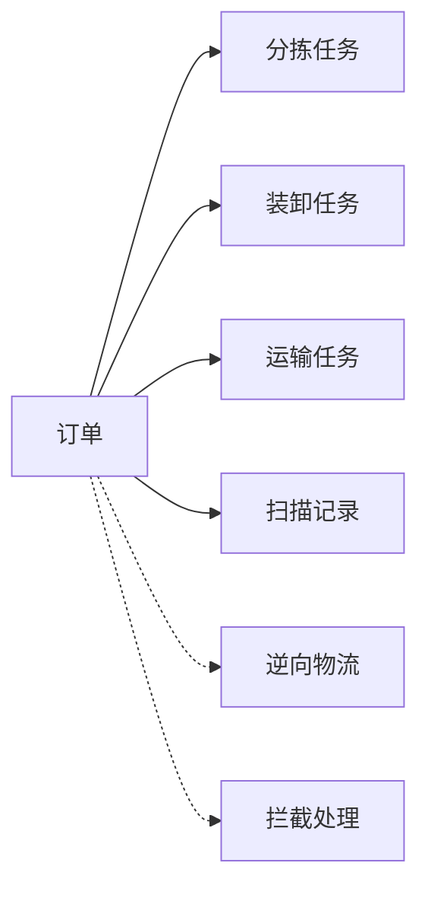

**图示来源**
- [tms-store.js:796-842](file://tms-store.js#L796-L842)
- [tms-store.js:844-873](file://tms-store.js#L844-L873)

**章节来源**
- [tms-store.js:796-842](file://tms-store.js#L796-L842)
- [tms-store.js:844-873](file://tms-store.js#L844-L873)

### 订单监控、统计分析与异常处理
- 轨迹中心：汇总全部轨迹供检索，包含节点、地点、操作时间、截止时间与超时/偏差标记。
- 异常记录：按概率生成异常类型与责任方，记录 SLA 截止时间、升级标志、解决方案与根因。
- 财务联动：异常定责扣款生成应付；签收后按付款方式生成应收与财务流水；按月结客户聚合账单。

**更新** 新增了订单生命周期统计，支持正向、逆向、拦截订单的分类统计和分析。

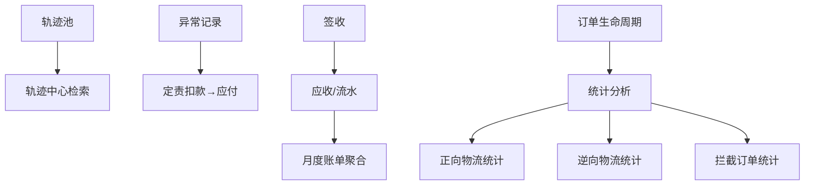

**图示来源**
- [tms-store.js:778-792](file://tms-store.js#L778-L792)
- [tms-store.js:875-917](file://tms-store.js#L875-L917)
- [tms-store.js:919-949](file://tms-store.js#L919-L949)
- [tms-store.js:963-988](file://tms-store.js#L963-L988)

**章节来源**
- [tms-store.js:778-792](file://tms-store.js#L778-L792)
- [tms-store.js:875-917](file://tms-store.js#L875-L917)
- [tms-store.js:919-949](file://tms-store.js#L919-L949)
- [tms-store.js:963-988](file://tms-store.js#L963-L988)

## 依赖关系分析
- 客户端订单页依赖 common.js 提供的 ID 生成与登录校验。
- 管理端共享数据层独立于具体页面，提供全局数据访问与事件广播。
- 运营页依赖共享数据层的 CRUD 接口进行改单记录管理。
- 客户寄件页依赖共享数据层的计费引擎和订单创建接口。

**更新** 新增了客户寄件功能对计费引擎和订单创建接口的依赖。

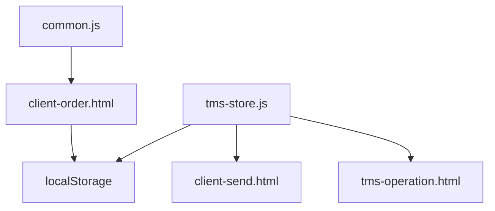

**图示来源**
- [common.js:22-50](file://common.js#L22-L50)
- [tms-store.js:16-17](file://tms-store.js#L16-L17)
- [tms-operation.html:775-909](file://tms-operation.html#L775-L909)

**章节来源**
- [common.js:22-50](file://common.js#L22-L50)
- [tms-store.js:16-17](file://tms-store.js#L16-L17)
- [tms-operation.html:775-909](file://tms-operation.html#L775-L909)

## 性能与扩展性
- 数据持久化：基于 localStorage 的轻量数据库，适合演示与小型场景；生产环境建议迁移至后端 API 与数据库。
- 事件机制：共享数据层通过自定义事件广播数据变更，便于多页面同步。
- 计费与路由：计费引擎与路由规划可配置化，便于扩展新的线路与服务等级。
- 分页与排序：共享数据层提供 list 接口的分页与排序参数，便于大数据量下的列表渲染优化。

**更新** 新增了逆向物流和拦截订单的性能考虑，确保复杂业务流程下的系统响应速度。

## 故障排查指南
- 订单冲突处理
  - 现象：同一订单被多次修改导致状态不一致。
  - 排查：检查客户端是否直接修改 allOrders 而未调用统一更新方法；确认共享数据层是否提供事务或乐观锁。
  - 建议：统一通过共享数据层的 update/create 接口变更订单，避免多处直接写 localStorage。

- 状态同步问题
  - 现象：多页面显示不同步。
  - 排查：确认是否订阅了 tms:datachange 事件；检查页面是否在数据变更后重新渲染。
  - 建议：在数据变更后触发事件，并在各页面监听事件以刷新视图。

- 计费异常
  - 现象：运费计算不符合预期。
  - 排查：检查运价卡匹配逻辑、体积重计算、客户折扣与到付手续费。
  - 建议：增加计费试算日志与单元测试，覆盖不同服务等级与线路组合。

- 轨迹与时效偏差
  - 现象：轨迹节点超时或偏差标记不准确。
  - 排查：检查 progression 时间序列与 TRACE_NODES 的 stdHours 配置。
  - 建议：对关键节点增加告警与人工复核流程。

**更新** 新增了逆向物流和拦截订单的故障排查指南。

**章节来源**
- [client-order.html:1067-1072](file://client-order.html#L1067-L1072)
- [tms-store.js:237-244](file://tms-store.js#L237-L244)
- [tms-store.js:332-383](file://tms-store.js#L332-L383)
- [tms-store.js:443-460](file://tms-store.js#L443-L460)

## 结论
TMS 的订单管理功能以共享数据层为核心，实现了从订单创建、计费、路由规划到轨迹追踪、异常处理与财务结算的完整闭环。客户端订单页提供了直观的查询与基础操作能力，管理端则通过统一的数据层支撑复杂业务流程与跨模块协作。

**更新** 本次更新显著增强了订单管理的完整性，新增了逆向物流、拦截订单、自动计费引擎等核心功能，使系统能够处理完整的正向和逆向物流场景。未来可在数据持久化、并发控制、计费与路由的可配置性方面进一步增强，以提升系统在真实业务场景中的稳定性与可扩展性。