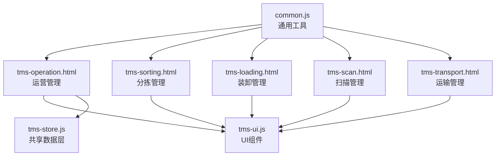
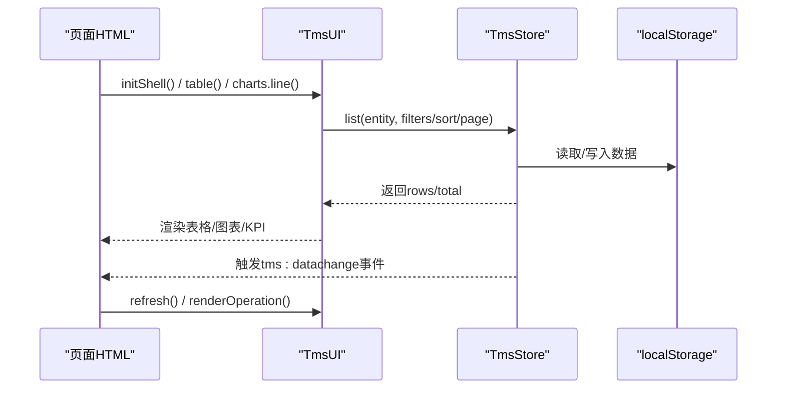
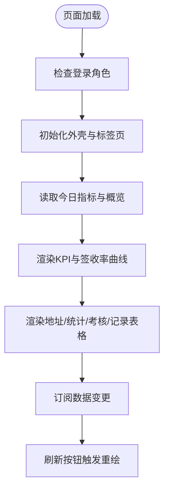
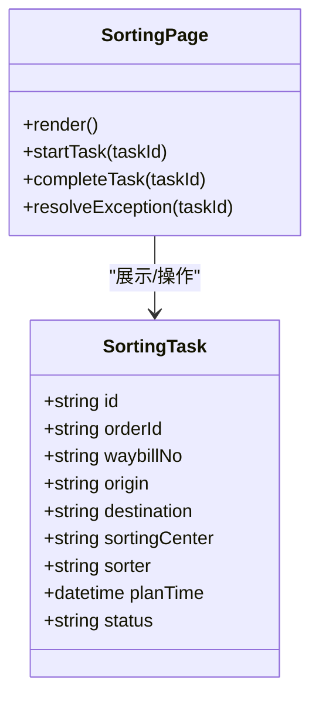
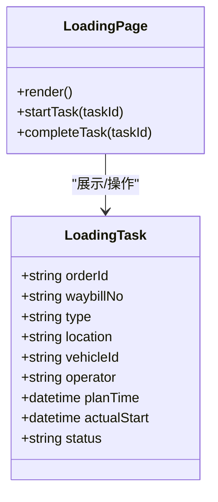
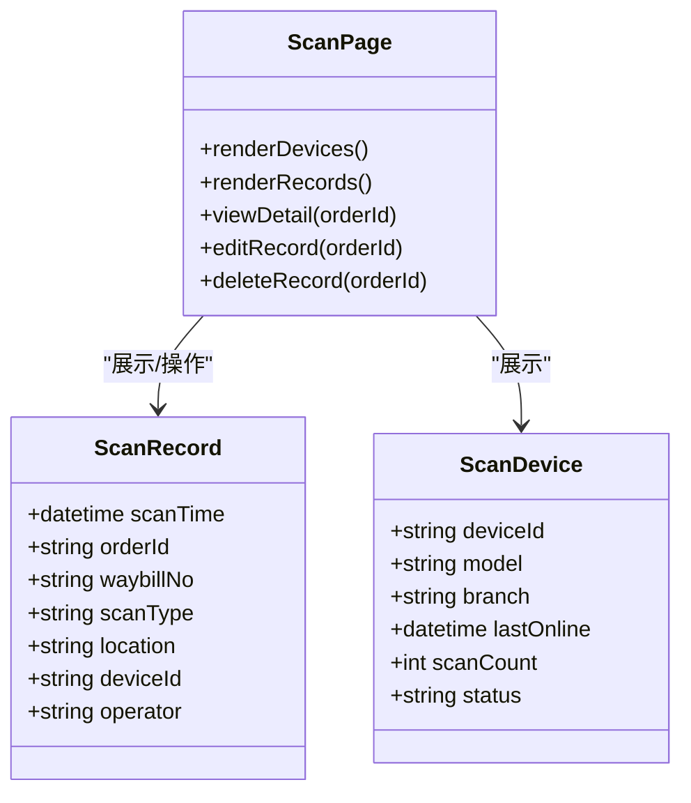
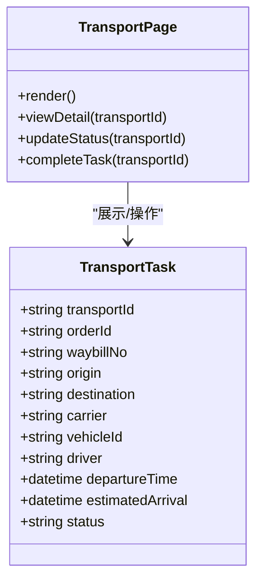
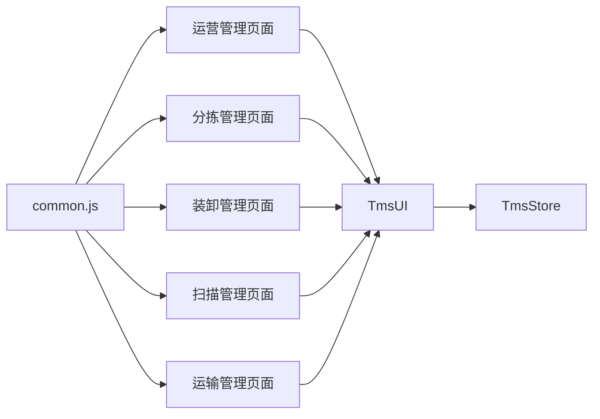

# 运营管理

<cite>
**本文引用的文件**   
- [tms-operation.html](file://tms-operation.html)
- [tms-sorting.html](file://tms-sorting.html)
- [tms-loading.html](file://tms-loading.html)
- [tms-scan.html](file://tms-scan.html)
- [tms-transport.html](file://tms-transport.html)
- [common.js](file://common.js)
- [tms-ui.js](file://tms-ui.js)
- [tms-store.js](file://tms-store.js)
</cite>

## 目录
1. [引言](#引言)
2. [项目结构](#项目结构)
3. [核心组件](#核心组件)
4. [架构总览](#架构总览)
5. [详细组件分析](#详细组件分析)
6. [依赖关系分析](#依赖关系分析)
7. [性能与可观测性](#性能与可观测性)
8. [故障排查指南](#故障排查指南)
9. [结论](#结论)

## 引言
本文件面向TMS系统的“运营管理”模块，聚焦订单管理、运输调度、分拣管理、装卸管理与扫描管理等运营能力的实现细节、调用关系、接口与业务模型。文档基于仓库中的前端页面与共享库进行代码级分析，说明数据如何从共享数据层（TmsStore）流向UI组件（TmsUI），以及各运营页面的交互流程、状态流转与统计口径。同时给出常见问题与解决方案，帮助读者快速定位问题并优化运营流程的监控、调度与优化能力。

## 项目结构
运营管理相关的前端页面采用“页面HTML + 共享JS库”的结构：
- 页面HTML负责布局、导航与事件绑定；
- common.js提供通用工具（登录、用户信息、ID生成等）；
- tms-ui.js提供通用UI组件（表格、弹窗、图表、KPI等）；
- tms-store.js提供共享数据层（种子数据、CRUD、统计聚合、订单生命周期）。

图示来源
- [tms-operation.html:507-529](file://tms-operation.html#L507-L529)
- [tms-sorting.html:531-542](file://tms-sorting.html#L531-L542)
- [tms-loading.html:548-558](file://tms-loading.html#L548-L558)
- [tms-scan.html:596-606](file://tms-scan.html#L596-L606)
- [tms-transport.html:459-469](file://tms-transport.html#L459-L469)
- [common.js:365-383](file://common.js#L365-L383)
- [tms-ui.js:756-780](file://tms-ui.js#L756-L780)
- [tms-store.js:1-12](file://tms-store.js#L1-L12)

章节来源
- [tms-operation.html:507-529](file://tms-operation.html#L507-L529)
- [tms-sorting.html:531-542](file://tms-sorting.html#L531-L542)
- [tms-loading.html:548-558](file://tms-loading.html#L548-L558)
- [tms-scan.html:596-606](file://tms-scan.html#L596-L606)
- [tms-transport.html:459-469](file://tms-transport.html#L459-L469)
- [common.js:365-383](file://common.js#L365-L383)
- [tms-ui.js:756-780](file://tms-ui.js#L756-L780)
- [tms-store.js:1-12](file://tms-store.js#L1-L12)

## 核心组件
- TmsStore（共享数据层）
  - 职责：首次访问生成真实感种子数据；统一增删改查、搜索、筛选、排序、分页；维护订单全生命周期状态流转；自动写入扫描、运输、财务等关联记录；提供统计聚合（KPI、趋势、分布、日报）。
  - 关键能力：list、update、remove、subscribe、dailyStats、overview、labels等。
- TmsUI（共享UI组件库）
  - 职责：列表/搜索/筛选/分页、表单弹窗、确认框、Toast、SVG图表、KPI、详情展示、页面外壳初始化。
  - 关键能力：table、formModal、confirm、toast、charts.line/bar/donut、kpis、initShell等。
- common.js（通用工具）
  - 职责：登录校验、用户信息展示、ID生成（订单号、运单号）、按钮样式注入等。
  - 关键能力：checkLoginStatus、displayCurrentUser、generateOrderId、generateWaybillNumber等。

章节来源
- [tms-store.js:1-12](file://tms-store.js#L1-L12)
- [tms-ui.js:1-12](file://tms-ui.js#L1-L12)
- [common.js:1-12](file://common.js#L1-L12)

## 架构总览
运营管理模块以“页面HTML → UI组件 → 数据层”的分层方式组织。页面通过TmsUI渲染表格、图表与弹窗，并通过TmsStore订阅数据变更，实现实时刷新。

图示来源
- [tms-operation.html:514-529](file://tms-operation.html#L514-L529)
- [tms-ui.js:301-542](file://tms-ui.js#L301-L542)
- [tms-store.js:220-244](file://tms-store.js#L220-L244)

## 详细组件分析

### 运营管理（tms-operation.html）
- 功能范围
  - 运营概览：近7日签收率曲线、今日作业进度、待办事项（异常、库存偏低、待结算财务、待受理工单）。
  - 派送地址管理：新增/审核/编辑/删除，支持按状态与审核过滤。
  - 统计分析：近7日运营日报、签收率、入库扫描率、出库扫描率、派送扫描率、漏拣率、叉车货统计。
  - 考核管理：指标配置与员工考核结果查看。
  - 改单记录：登记与查询。
- 数据流
  - 使用TmsStore.dailyStats(7)获取近7日指标；TmsStore.overview()获取异常与工单待办数量；TmsStore.list('deliveryAddresses'/'evalMetrics'/'evaluations'/'changeRecords')拉取实体数据。
  - 通过TmsUI.kpis、charts.line、detailGrid渲染KPI与图表；TmsUI.table构建可搜索、筛选、分页的表格。
- 关键调用
  - 初始化：DOMContentLoaded → checkLoginStatus('admin') → TmsUI.initShell() → bindOpTabs() → initOperationTables() → renderOperation()。
  - 刷新：点击“刷新数据” → renderOperation() + OP_TABLES.forEach(refresh)。
  - 订阅：TmsStore.subscribe(renderOperation)，数据变更自动重绘。
- 配置项与参数
  - 表格配置：entity、pageSize、searchFields、filters、columns、toolbar、actions等。
  - 图表配置：labels、series、height、area等。
  - KPI配置：label、value、color、sub等。
- 与其他组件的关系
  - 与异常管理、仓储、财务、客服等页面通过链接跳转联动；与扫描、装卸、分拣等页面共享同一数据层。

图示来源
- [tms-operation.html:514-529](file://tms-operation.html#L514-L529)
- [tms-operation.html:571-612](file://tms-operation.html#L571-L612)
- [tms-operation.html:614-800](file://tms-operation.html#L614-L800)

章节来源
- [tms-operation.html:507-529](file://tms-operation.html#L507-L529)
- [tms-operation.html:571-612](file://tms-operation.html#L571-L612)
- [tms-operation.html:614-800](file://tms-operation.html#L614-L800)

### 分拣管理（tms-sorting.html）
- 功能范围
  - 分拣任务列表：任务ID、订单号、运单号、来源、目的地、分拣中心、分拣员、计划时间、状态、操作（查看/开始/完成/处理异常）。
  - 统计卡片：分拣任务总数、待处理、分拣中、已完成。
- 数据流
  - 页面通过TmsPages.render('sorting', ...)渲染内容；当前为静态示例表，后续可扩展为TmsUI.table绑定TmsStore.sorting实体。
- 关键调用
  - DOMContentLoaded → checkLoginStatus('admin') → TmsUI.initShell() → TmsPages.render('sorting', content)。
- 扩展建议
  - 将示例表替换为TmsUI.table，entity='sorting'，columns包含任务关键字段，actions绑定开始/完成/异常处理逻辑。

图示来源
- [tms-sorting.html:445-525](file://tms-sorting.html#L445-L525)
- [tms-sorting.html:531-542](file://tms-sorting.html#L531-L542)

章节来源
- [tms-sorting.html:445-525](file://tms-sorting.html#L445-L525)
- [tms-sorting.html:531-542](file://tms-sorting.html#L531-L542)

### 装卸管理（tms-loading.html）
- 功能范围
  - 装卸任务列表：订单号、运单号、装卸类型（装车/卸车）、作业地点、车辆ID、作业人员、计划时间、实际开始、状态、操作（查看/开始/完成）。
  - 统计卡片：装卸任务总数、待处理、进行中、已完成。
- 数据流
  - 页面通过TmsPages.render('loading', ...)渲染内容；当前为静态示例表，后续可扩展为TmsUI.table绑定TmsStore.loading实体。
- 关键调用
  - DOMContentLoaded → checkLoginStatus('admin') → TmsUI.initShell() → TmsPages.render('loading', content)。
- 扩展建议
  - 将示例表替换为TmsUI.table，entity='loading'，columns包含装卸关键字段，actions绑定开始/完成逻辑。

图示来源
- [tms-loading.html:462-542](file://tms-loading.html#L462-L542)
- [tms-loading.html:548-558](file://tms-loading.html#L548-L558)

章节来源
- [tms-loading.html:462-542](file://tms-loading.html#L462-L542)
- [tms-loading.html:548-558](file://tms-loading.html#L548-L558)

### 扫描管理（tms-scan.html）
- 功能范围
  - 扫描设备管理：设备ID、型号、所在网点、最后在线、扫描量、状态（在线/离线/维护）。
  - 最近扫描记录：扫描时间、订单号、运单号、扫描类型（到达/发出/中转/派送）、扫描位置、设备、人员、操作（查看/编辑/删除）。
  - 统计卡片：设备数、今日扫描量、在线设备、扫描准确率。
- 数据流
  - 页面通过TmsPages.render('scan', ...)渲染内容；当前为静态示例表，后续可扩展为TmsUI.table绑定TmsStore.scans实体。
- 关键调用
  - DOMContentLoaded → checkLoginStatus('admin') → TmsUI.initShell() → TmsPages.render('scan', content)。
- 扩展建议
  - 将示例表替换为TmsUI.table，entity='scans'，columns包含扫描关键字段，actions绑定查看/编辑/删除逻辑。

图示来源
- [tms-scan.html:480-590](file://tms-scan.html#L480-L590)
- [tms-scan.html:596-606](file://tms-scan.html#L596-L606)

章节来源
- [tms-scan.html:480-590](file://tms-scan.html#L480-L590)
- [tms-scan.html:596-606](file://tms-scan.html#L596-L606)

### 运输管理（tms-transport.html）
- 功能范围
  - 运输任务列表：运输任务ID、订单号、运单号、起点、终点、承运商、车辆ID、司机姓名、出发时间、预计到达、当前状态、操作（查看/更新状态/完成任务）。
  - 状态分类：待发车、运输中、已到达、派送中、已完成、已取消。
- 数据流
  - 页面通过TmsPages.render('transport', ...)渲染内容；当前为静态示例表，后续可扩展为TmsUI.table绑定TmsStore.transports实体。
- 关键调用
  - DOMContentLoaded → checkLoginStatus('admin') → TmsUI.initShell() → TmsPages.render('transport', content)。
- 扩展建议
  - 将示例表替换为TmsUI.table，entity='transports'，columns包含运输关键字段，actions绑定更新状态/完成任务逻辑。

图示来源
- [tms-transport.html:381-453](file://tms-transport.html#L381-L453)
- [tms-transport.html:459-469](file://tms-transport.html#L459-L469)

章节来源
- [tms-transport.html:381-453](file://tms-transport.html#L381-L453)
- [tms-transport.html:459-469](file://tms-transport.html#L459-L469)

## 依赖关系分析
- 页面到UI组件
  - 所有运营页面均通过TmsUI.initShell()初始化外壳，并使用TmsUI.table/charts/kpis等组件渲染数据。
- 页面到数据层
  - 运营管理页面直接调用TmsStore.list/dailyStats/overview；其他页面可通过TmsStore扩展实体（如sorting/loading/scans/transports）。
- 通用工具
  - common.js提供登录校验与用户信息展示，被所有页面复用。

图示来源
- [tms-operation.html:507-529](file://tms-operation.html#L507-L529)
- [tms-sorting.html:531-542](file://tms-sorting.html#L531-L542)
- [tms-loading.html:548-558](file://tms-loading.html#L548-L558)
- [tms-scan.html:596-606](file://tms-scan.html#L596-L606)
- [tms-transport.html:459-469](file://tms-transport.html#L459-L469)
- [common.js:365-383](file://common.js#L365-L383)

章节来源
- [tms-operation.html:507-529](file://tms-operation.html#L507-L529)
- [tms-sorting.html:531-542](file://tms-sorting.html#L531-L542)
- [tms-loading.html:548-558](file://tms-loading.html#L548-L558)
- [tms-scan.html:596-606](file://tms-scan.html#L596-L606)
- [tms-transport.html:459-469](file://tms-transport.html#L459-L469)
- [common.js:365-383](file://common.js#L365-L383)

## 性能与可观测性
- 性能要点
  - 表格组件内置防抖搜索与分页，避免频繁重绘；订阅机制仅在非输入焦点时重绘，减少抖动。
  - 图表渲染使用轻量SVG，适合中小数据集；大数据集建议分页或后端聚合。
- 可观测性
  - TmsStore在数据变更后触发tms:datachange事件，便于跨页面同步；运营页面通过订阅实现实时刷新。
  - 建议在关键操作（开始/完成/异常处理）增加日志埋点，便于追踪运营流程。

章节来源
- [tms-ui.js:301-542](file://tms-ui.js#L301-L542)
- [tms-store.js:220-244](file://tms-store.js#L220-L244)

## 故障排查指南
- 登录后无法进入页面
  - 现象：页面跳转到登录页或提示无权限。
  - 原因：checkLoginStatus('admin')未通过或localStorage中用户信息缺失。
  - 解决：确认登录流程正确写入localStorage；检查requiredRole是否匹配。
- 表格不显示数据
  - 现象：表格为空或总数为0。
  - 原因：TmsStore.list(entity)返回空；或entity未初始化。
  - 解决：确认TmsStore.seed已执行且entity存在；检查filters/search条件是否过严。
- 图表不渲染
  - 现象：图表容器为空。
  - 原因：传入labels或series为空；容器高度为0。
  - 解决：确保数据源非空；设置合理height。
- 订阅不生效
  - 现象：数据变更后页面未刷新。
  - 原因：未调用TmsStore.subscribe；或订阅回调未触发render。
  - 解决：在页面初始化时添加订阅；确保回调中调用TmsUI.refresh或renderOperation。

章节来源
- [common.js:176-199](file://common.js#L176-L199)
- [tms-ui.js:301-542](file://tms-ui.js#L301-L542)
- [tms-store.js:220-244](file://tms-store.js#L220-L244)

## 结论
运营管理模块以清晰的“页面HTML → UI组件 → 数据层”分层实现，覆盖订单、运输、分拣、装卸、扫描等核心运营场景。通过TmsStore提供的统一数据能力与TmsUI的丰富组件，系统实现了高效的运营监控、调度与优化。建议后续将静态示例表逐步替换为TmsUI.table绑定真实实体，完善异常处理与日志埋点，进一步提升运营流程的可观测性与稳定性。