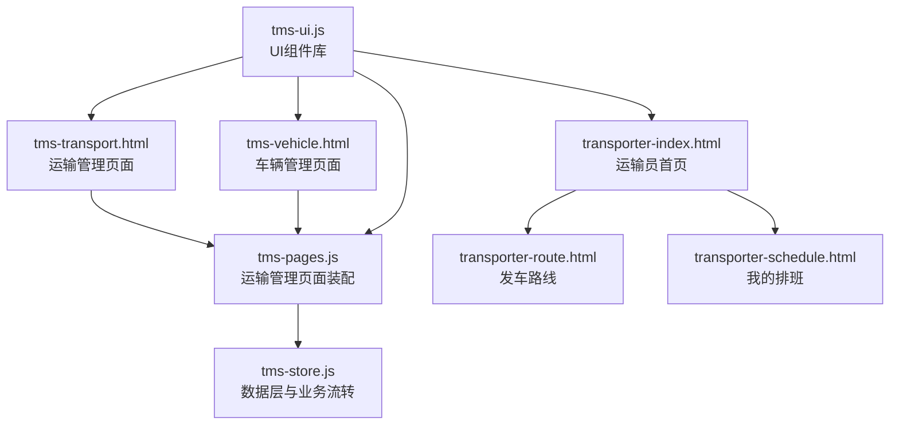
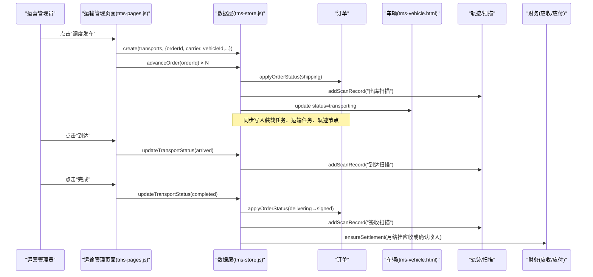
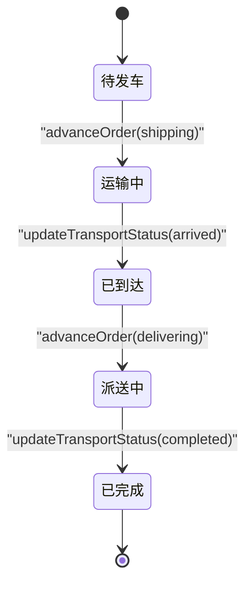
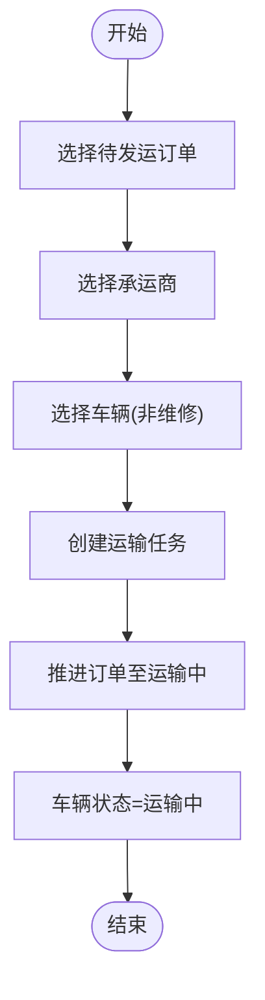
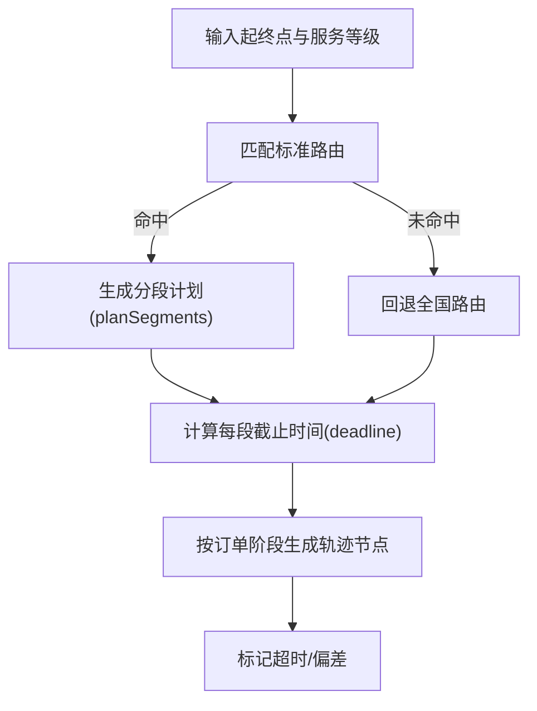
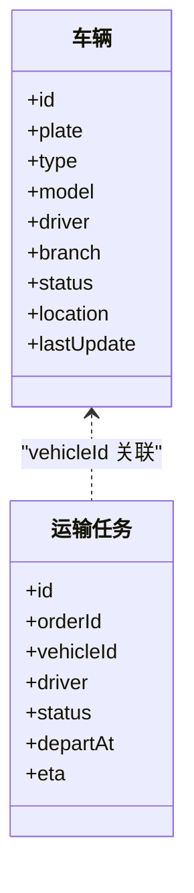
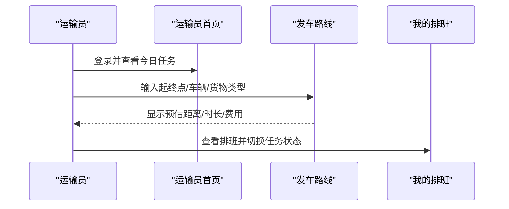
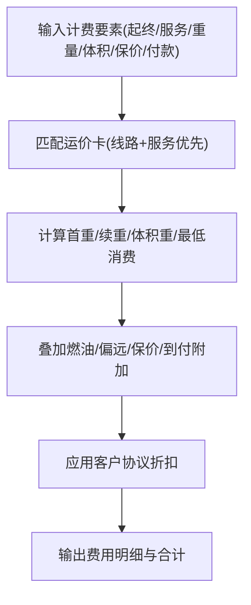
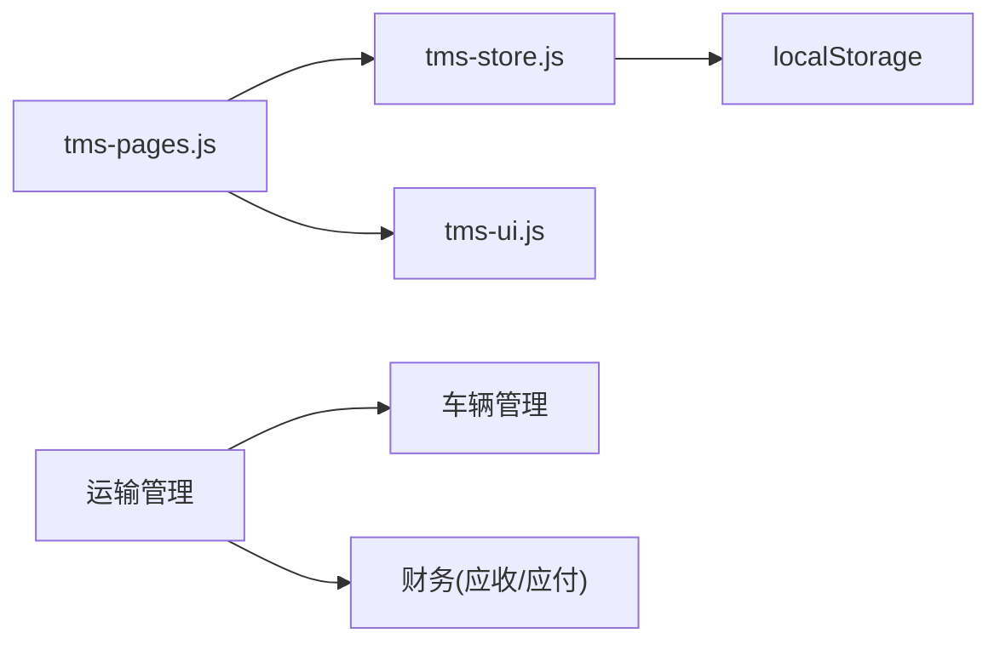

# 运输调度

<cite>
**本文引用的文件**   
- [tms-store.js](file://tms-store.js)
- [tms-pages.js](file://tms-pages.js)
- [tms-ui.js](file://tms-ui.js)
- [tms-transport.html](file://tms-transport.html)
- [tms-vehicle.html](file://tms-vehicle.html)
- [transporter-index.html](file://transporter-index.html)
- [transporter-route.html](file://transporter-route.html)
- [transporter-schedule.html](file://transporter-schedule.html)
</cite>

## 目录
1. [引言](#引言)
2. [项目结构](#项目结构)
3. [核心组件](#核心组件)
4. [架构总览](#架构总览)
5. [详细组件分析](#详细组件分析)
6. [依赖关系分析](#依赖关系分析)
7. [性能与成本优化](#性能与成本优化)
8. [故障排查指南](#故障排查指南)
9. [结论](#结论)

## 引言
本文件面向TMS系统的“运输调度”能力，聚焦以下目标：
- 解释运输任务分配、车辆调度、路线规划等核心业务逻辑的实现细节。
- 基于仓库中的实际代码，展示运输任务的创建、分配和执行过程。
- 记录运输数据模型、调度算法与资源配置规则。
- 说明与车辆管理、司机管理、GPS/轨迹跟踪等模块的集成关系。
- 总结效率优化、成本控制与实时监控机制，并给出常见问题及解决方案。

## 项目结构
围绕运输调度，相关页面与共享库的职责如下：
- tms-store.js：本地数据层（localStorage），提供订单、运单、运输、车辆、运力、路由、轨迹、异常、财务等数据的生成、CRUD、状态流转与统计聚合。
- tms-pages.js：管理员端页面装配器，定义各业务页的KPI、表格、筛选、工具栏与操作；其中“运输管理”“车辆管理”“运力管理”直接参与调度流程。
- tms-ui.js：通用UI组件库，提供表格、弹窗、表单、图表、状态标签、时间线等。
- tms-transport.html / transporter-*：运营与运输员侧的前端页面骨架与交互入口。
- tms-vehicle.html：车辆管理与状态展示。

**图示来源**
- [tms-transport.html:464-469](file://tms-transport.html#L464-L469)
- [tms-pages.js:250-357](file://tms-pages.js#L250-L357)
- [tms-store.js:1187-1195](file://tms-store.js#L1187-L1195)
- [tms-ui.js:758-781](file://tms-ui.js#L758-L781)

**章节来源**
- [tms-transport.html:464-469](file://tms-transport.html#L464-L469)
- [tms-pages.js:250-357](file://tms-pages.js#L250-L357)
- [tms-store.js:1187-1195](file://tms-store.js#L1187-L1195)
- [tms-ui.js:758-781](file://tms-ui.js#L758-L781)

## 核心组件
- 数据与业务引擎（tms-store.js）
  - 统一数据源：通过 localStorage 维护多实体数据，并提供 list/get/create/update/remove/subscribe 等接口。
  - 计费与报价：根据线路、服务等级、重量/体积、保价、到付、客户协议折扣计算运费明细。
  - 路由与轨迹：按起终点匹配标准路由，生成分段计划与截止时间；按订单阶段生成轨迹节点，标记超时与偏差。
  - 订单生命周期：从待入库→已入库→已分拣→运输中→已到达→派送中→已签收，联动扫描、装卸、运输、财务等关联记录。
  - 资源与策略：车辆、运力、电子围栏、时效规则、改单记录、考核指标等基础数据与策略。
- 页面装配（tms-pages.js）
  - 运输管理：提供“调度发车”“到达”“完成”等操作，驱动订单推进与状态联动。
  - 车辆管理：查看、编辑、维修、恢复车辆状态，统计在线/运输中/离线数量。
  - 运力管理：维护线路运力容量与剩余量，满载预警。
- UI组件（tms-ui.js）
  - 表格、筛选、分页、排序、弹窗、表单、KPI、图表、状态标签、时间线等。

**章节来源**
- [tms-store.js:263-383](file://tms-store.js#L263-L383)
- [tms-store.js:385-460](file://tms-store.js#L385-L460)
- [tms-store.js:1497-1559](file://tms-store.js#L1497-L1559)
- [tms-pages.js:250-357](file://tms-pages.js#L250-L357)
- [tms-pages.js:474-575](file://tms-pages.js#L474-L575)
- [tms-pages.js:577-658](file://tms-pages.js#L577-L658)
- [tms-ui.js:303-544](file://tms-ui.js#L303-L544)

## 架构总览
下图展示了从“订单创建→分拣→装车→发车→在途→到达→派送→签收→结算”的全链路，以及运输调度在其中扮演的角色。

**图示来源**
- [tms-pages.js:289-357](file://tms-pages.js#L289-L357)
- [tms-store.js:1497-1559](file://tms-store.js#L1497-L1559)
- [tms-store.js:1328-1348](file://tms-store.js#L1328-L1348)
- [tms-store.js:1467-1495](file://tms-store.js#L1467-L1495)

## 详细组件分析

### 运输任务数据模型与状态机
- 运输任务关键字段
  - id、orderId、waybillNo、origin、destination、carrier、vehicleId、driver、departAt、eta、arrivedAt、status、progress。
- 状态映射
  - pending/shipping/arrived/delivering/completed/cancelled。
- 与订单状态联动
  - 订单 shipping→运输中；arrived→已到达；delivering→派送中；signed→已完成。
- 关键实现位置
  - 状态标签与枚举：[STATUS_LABELS:98-120](file://tms-store.js#L98-L120)。
  - 状态推进与联动：[applyOrderStatus:1497-1559](file://tms-store.js#L1497-L1559)。
  - 运输任务创建与默认值：[ensureTransport:1394-1417](file://tms-store.js#L1394-L1417)。
  - 页面操作按钮与调用：[transport 页面装配:289-357](file://tms-pages.js#L289-L357)。

**图示来源**
- [tms-store.js:98-120](file://tms-store.js#L98-L120)
- [tms-store.js:1497-1559](file://tms-store.js#L1497-L1559)
- [tms-pages.js:289-357](file://tms-pages.js#L289-L357)

**章节来源**
- [tms-store.js:98-120](file://tms-store.js#L98-L120)
- [tms-store.js:1394-1417](file://tms-store.js#L1394-L1417)
- [tms-store.js:1497-1559](file://tms-store.js#L1497-L1559)
- [tms-pages.js:289-357](file://tms-pages.js#L289-L357)

### 运输任务创建与分配流程
- 创建运输任务
  - 运营在“运输管理”页面选择待发运订单、承运商与车辆，提交后系统创建运输任务并推进订单至“运输中”。
  - 若未显式创建运输任务，系统在订单进入“shipping”时自动补齐运输任务与装载任务。
- 分配车辆与司机
  - 页面允许选择非维修状态的车辆；系统根据车辆ID获取司机信息。
  - 当订单进入“shipping”，系统将对应车辆状态更新为“transporting”，并在签收完成后恢复为“online”。
- 关键实现位置
  - 页面“调度发车”表单与提交：[transport toolbar:289-318](file://tms-pages.js#L289-L318)。
  - 自动补齐运输任务：[ensureTransport:1394-1417](file://tms-store.js#L1394-L1417)。
  - 车辆状态联动：[applyOrderStatus(shipping):1527-1538](file://tms-store.js#L1527-L1538)、[applyOrderStatus(signed):1549-1557](file://tms-store.js#L1549-L1557)。

**图示来源**
- [tms-pages.js:289-318](file://tms-pages.js#L289-L318)
- [tms-store.js:1394-1417](file://tms-store.js#L1394-L1417)
- [tms-store.js:1527-1538](file://tms-store.js#L1527-L1538)

**章节来源**
- [tms-pages.js:289-318](file://tms-pages.js#L289-L318)
- [tms-store.js:1394-1417](file://tms-store.js#L1394-L1417)
- [tms-store.js:1527-1538](file://tms-store.js#L1527-L1538)

### 路线规划与轨迹跟踪
- 路线规划
  - 系统预置多条干线路由（含全国兵底），按起终点精确匹配，否则回退到全国路由。
  - 对每个订单生成 planSegments，包含每段的模式、标准耗时与截止时间。
- 轨迹跟踪
  - 按订单阶段生成轨迹节点（揽收、入库、分拣、发车、干线在途、到达、派送、签收）。
  - 每条轨迹带地点、截止时间、是否超时与是否偏差标记。
- 前端路线规划界面
  - 运输员“发车路线”页面提供出发地/目的地/车辆/货物类型/路线偏好输入，模拟计算距离、时长、油耗与过路费，支持保存历史与常用路线。
- 关键实现位置
  - 路由构建与匹配：[buildRoutes/findRoute:385-424](file://tms-store.js#L385-L424)、[planRoute:427-440](file://tms-store.js#L427-L440)。
  - 轨迹生成：[buildTraces:442-460](file://tms-store.js#L442-L460)。
  - 轨迹追加与全局索引：[addTrace:1446-1465](file://tms-store.js#L1446-L1465)。
  - 运输员路线规划UI与模拟计算：[transporter-route.html:438-520](file://transporter-route.html#L438-L520)、[simulateRoutePlanning:723-739](file://transporter-route.html#L723-L739)。

**图示来源**
- [tms-store.js:385-460](file://tms-store.js#L385-L460)
- [tms-store.js:1446-1465](file://tms-store.js#L1446-L1465)
- [transporter-route.html:438-520](file://transporter-route.html#L438-L520)
- [transporter-route.html:723-739](file://transporter-route.html#L723-L739)

**章节来源**
- [tms-store.js:385-460](file://tms-store.js#L385-L460)
- [tms-store.js:1446-1465](file://tms-store.js#L1446-L1465)
- [transporter-route.html:438-520](file://transporter-route.html#L438-L520)
- [transporter-route.html:723-739](file://transporter-route.html#L723-L739)

### 车辆与司机管理集成
- 车辆状态
  - online/transporting/maintenance/offline；页面提供查看、编辑、维修、恢复操作。
- 与运输调度的联动
  - 订单 shipping：车辆状态设为 transporting；
  - 订单 signed：车辆状态恢复为 online。
- 关键实现位置
  - 车辆状态标签与样式：[STATUS_CLASS:57-69](file://tms-ui.js#L57-L69)。
  - 车辆管理页面装配：[vehicle 页面:474-575](file://tms-pages.js#L474-L575)。
  - 调度时车辆状态变更：[applyOrderStatus(shipping/signed):1527-1538](file://tms-store.js#L1527-L1538)、[applyOrderStatus(signed):1549-1557](file://tms-store.js#L1549-L1557)。

**图示来源**
- [tms-pages.js:474-575](file://tms-pages.js#L474-L575)
- [tms-store.js:1527-1538](file://tms-store.js#L1527-L1538)
- [tms-store.js:1549-1557](file://tms-store.js#L1549-L1557)

**章节来源**
- [tms-ui.js:57-69](file://tms-ui.js#L57-L69)
- [tms-pages.js:474-575](file://tms-pages.js#L474-L575)
- [tms-store.js:1527-1538](file://tms-store.js#L1527-L1538)
- [tms-store.js:1549-1557](file://tms-store.js#L1549-L1557)

### 运输员作业与排班
- 运输员首页
  - 展示今日任务、快捷操作（打卡、装车、发车、路线）、统计数据。
- 发车路线
  - 提供路线规划表单与历史/常用路线管理。
- 我的排班
  - 日/周/月视图日历，任务列表，任务状态切换（待开始/进行中/已完成）。
- 关键实现位置
  - 运输员首页与任务加载：[transporter-index.html:341-458](file://transporter-index.html#L341-L458)。
  - 发车路线规划与历史：[transporter-route.html:562-800](file://transporter-route.html#L562-L800)。
  - 排班日历与任务状态切换：[transporter-schedule.html:423-800](file://transporter-schedule.html#L423-L800)。

**图示来源**
- [transporter-index.html:341-458](file://transporter-index.html#L341-L458)
- [transporter-route.html:562-800](file://transporter-route.html#L562-L800)
- [transporter-schedule.html:423-800](file://transporter-schedule.html#L423-L800)

**章节来源**
- [transporter-index.html:341-458](file://transporter-index.html#L341-L458)
- [transporter-route.html:562-800](file://transporter-route.html#L562-L800)
- [transporter-schedule.html:423-800](file://transporter-schedule.html#L423-L800)

### 计费与成本核算
- 计费引擎
  - 根据首重/续重、体积重、燃油附加、偏远附加、保价费、到付手续费、客户协议折扣计算总费用。
  - 支持全国兵底与具体线路+服务等级的优先级匹配。
- 成本与结算
  - 签收后按付款方式处理：月结挂应收并生成账单；现付/到付直接确认收入。
  - 向承运商结算干线运费（示例按收入约60%估算），异常定责扣款生成应付。
- 关键实现位置
  - 计费试算与折扣：[calcFreight/discountRateFor/settleCycleFor:263-383](file://tms-store.js#L263-L383)。
  - 签收结算：[ensureSettlement:1467-1495](file://tms-store.js#L1467-L1495)。
  - 种子数据中的应付与账单聚合：[payables/bills:863-988](file://tms-store.js#L863-L988)。

**图示来源**
- [tms-store.js:263-383](file://tms-store.js#L263-L383)
- [tms-store.js:1467-1495](file://tms-store.js#L1467-L1495)
- [tms-store.js:863-988](file://tms-store.js#L863-L988)

**章节来源**
- [tms-store.js:263-383](file://tms-store.js#L263-L383)
- [tms-store.js:1467-1495](file://tms-store.js#L1467-L1495)
- [tms-store.js:863-988](file://tms-store.js#L863-L988)

## 依赖关系分析
- 页面与数据层
  - tms-pages.js 通过 TmsStore.list/get/create/update 访问数据，并通过 TmsStore.subscribe 订阅数据变化刷新UI。
- UI与数据层
  - tms-ui.js 提供表格、弹窗等组件，不直接访问数据，由页面装配器注入数据。
- 业务耦合点
  - 订单状态推进会联动扫描、装卸、运输、车辆状态与财务结算。
  - 运输任务与车辆通过 vehicleId 关联，状态随订单推进而变更。

**图示来源**
- [tms-pages.js:108-135](file://tms-pages.js#L108-L135)
- [tms-store.js:1187-1195](file://tms-store.js#L1187-L1195)
- [tms-store.js:1497-1559](file://tms-store.js#L1497-L1559)

**章节来源**
- [tms-pages.js:108-135](file://tms-pages.js#L108-L135)
- [tms-store.js:1187-1195](file://tms-store.js#L1187-L1195)
- [tms-store.js:1497-1559](file://tms-store.js#L1497-L1559)

## 性能与成本优化
- 效率优化
  - 使用标准路由与分段截止时间进行时效管控，减少人工排程误差。
  - 通过扫描节点与轨迹标记（超时/偏差）快速定位瓶颈环节。
  - 运力管理以“剩余量/满载”可视化，辅助提前扩容或分流。
- 成本控制
  - 计费引擎精细化拆分首重/续重/燃油/偏远/保价/到付，结合客户协议折扣控制收入与利润。
  - 异常定责扣款与承运商结算联动，形成闭环成本归集。
- 实时监控
  - 运输任务进度条与状态标签实时反映在途情况。
  - 车辆状态与最后更新时间用于监控在线率与活跃度。

[本节为通用指导，不直接分析具体文件]

## 故障排查指南
- 运力不足
  - 现象：无可用车辆或运力满载。
  - 排查：检查车辆状态是否为 maintenance/offline；查看运力剩余量是否低于阈值。
  - 解决：将车辆恢复为 online；释放或新增运力；调整承运商组合。
  - 参考：[车辆管理操作:557-575](file://tms-pages.js#L557-L575)、[运力管理:577-658](file://tms-pages.js#L577-L658)。
- 路线冲突或时效延误
  - 现象：轨迹出现超时或偏差标记。
  - 排查：核对 planSegments 的 deadline 与实际 opTime；检查是否走全国兵底导致时效较长。
  - 解决：优化线路选择或服务等级；加强节点扫描与异常升级。
  - 参考：[planRoute/buildTraces:427-460](file://tms-store.js#L427-L460)、[addTrace:1446-1465](file://tms-store.js#L1446-L1465)。
- 车辆状态不同步
  - 现象：订单已签收但车辆仍为 transporting。
  - 排查：确认是否执行了 signed 状态推进；检查车辆状态更新逻辑。
  - 解决：重新触发订单推进或手动恢复车辆状态。
  - 参考：[applyOrderStatus(signed):1549-1557](file://tms-store.js#L1549-L1557)。
- 计费异常
  - 现象：运费合计与预期不符。
  - 排查：检查是否触发了最低消费、偏远附加、保价或到付手续费；确认客户协议折扣是否正确。
  - 解决：修正计费参数或运价卡配置。
  - 参考：[calcFreight:332-383](file://tms-store.js#L332-L383)。

**章节来源**
- [tms-pages.js:557-575](file://tms-pages.js#L557-L575)
- [tms-pages.js:577-658](file://tms-pages.js#L577-L658)
- [tms-store.js:427-460](file://tms-store.js#L427-L460)
- [tms-store.js:1446-1465](file://tms-store.js#L1446-L1465)
- [tms-store.js:1549-1557](file://tms-store.js#L1549-L1557)
- [tms-store.js:332-383](file://tms-store.js#L332-L383)

## 结论
本TMS系统的运输调度以“订单状态机”为核心，串联扫描、装卸、运输、车辆与财务等模块，形成端到端的可追踪、可结算、可优化的闭环。通过标准路由与轨迹节点，系统实现了时效与质量的量化管理；通过计费引擎与异常扣款，形成了精细化的成本控制。前端页面提供了直观的调度、排班与路线规划能力，便于运营与运输员协同作业。未来可在路径优化算法、动态定价与智能派车方面进一步扩展，以提升整体效率与盈利能力。