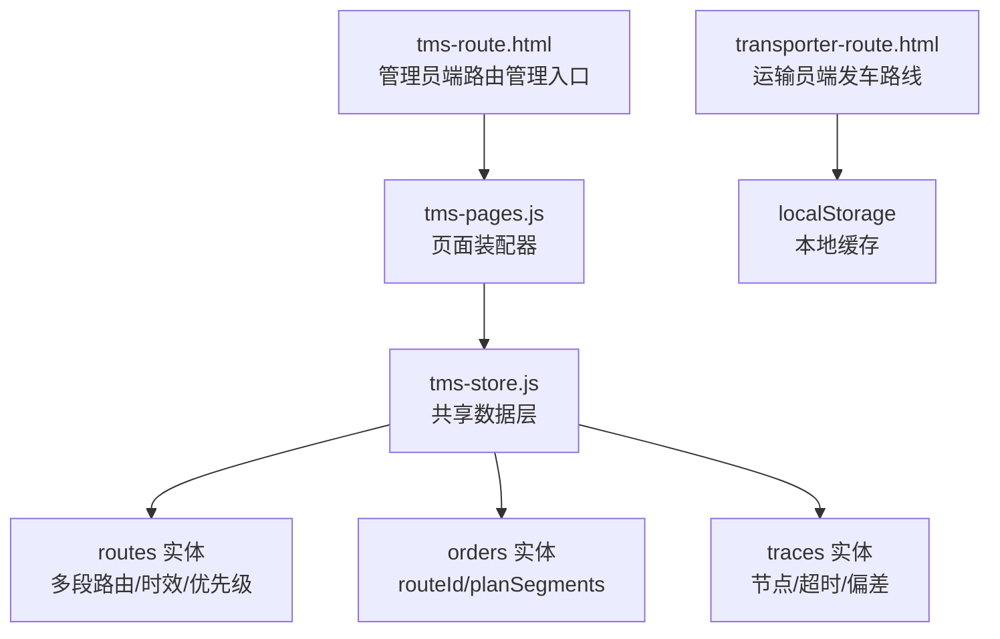
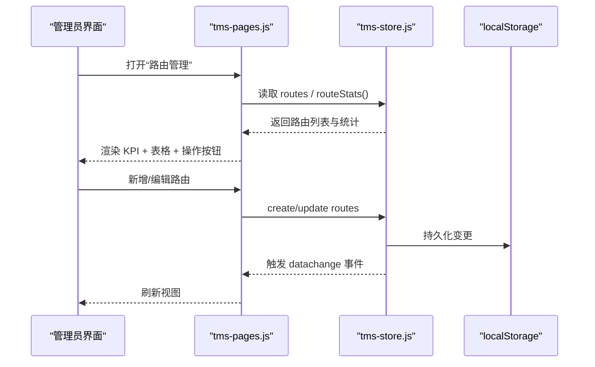
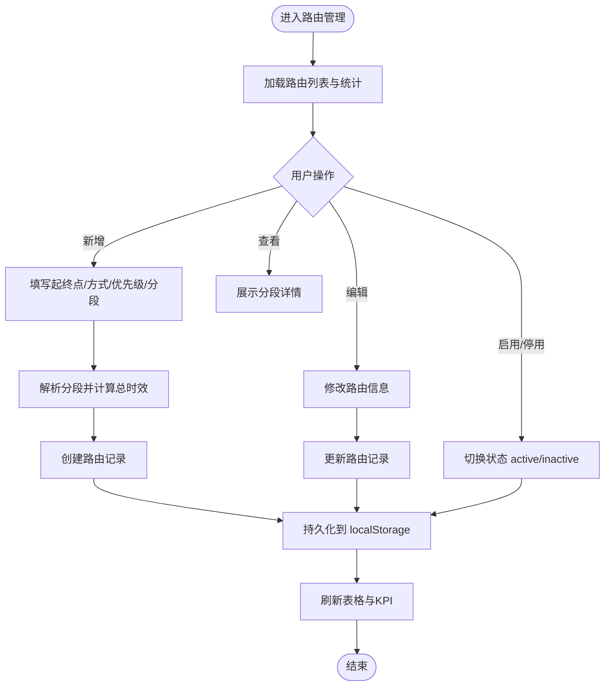
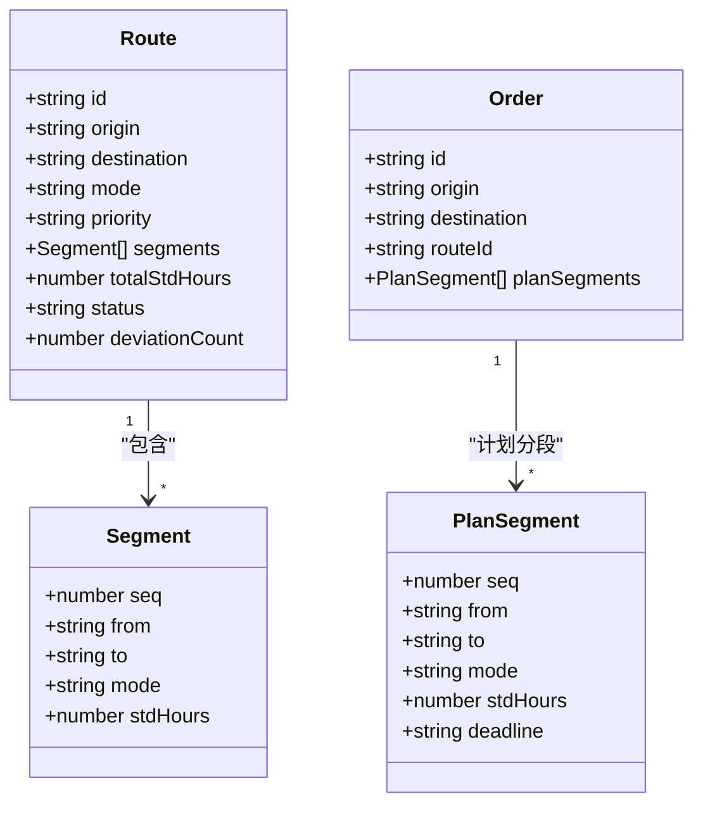
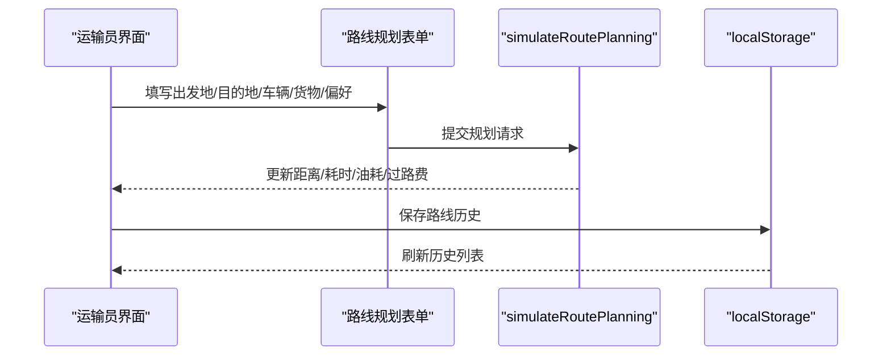
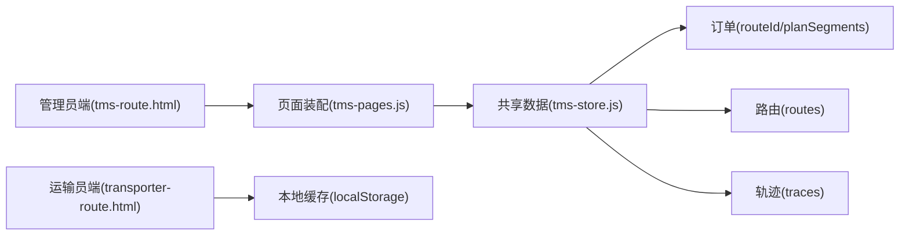

# 路线管理模块

<cite>
**本文引用的文件**   
- [tms-route.html](file://tms-route.html)
- [transporter-route.html](file://transporter-route.html)
- [tms-store.js](file://tms-store.js)
- [tms-pages.js](file://tms-pages.js)
</cite>

## 目录
1. [引言](#引言)
2. [项目结构](#项目结构)
3. [核心组件](#核心组件)
4. [架构总览](#架构总览)
5. [详细组件分析](#详细组件分析)
6. [依赖关系分析](#依赖关系分析)
7. [性能与扩展建议](#性能与扩展建议)
8. [故障排查指南](#故障排查指南)
9. [结论](#结论)

## 引言
本文件聚焦“路线管理模块”，覆盖管理员端路由配置、订单路由计划生成、轨迹偏差监控，以及运输员端的发车路线规划与常用路线管理。该模块以共享数据层为核心，通过页面装配器渲染表格与表单，支撑从线路建模到执行落地的完整闭环。

## 项目结构
围绕路线管理的相关文件如下：
- 管理员端路由管理入口：tms-route.html
- 运输员端发车路线页：transporter-route.html
- 共享数据层（含路由构建、匹配、计划、统计）：tms-store.js
- 管理员端页面装配（含路由管理页面定义）：tms-pages.js

图表来源
- [tms-route.html:256-261](file://tms-route.html#L256-L261)
- [tms-pages.js:2221-2276](file://tms-pages.js#L2221-L2276)
- [tms-store.js:387-440](file://tms-store.js#L387-L440)
- [transporter-route.html:427-557](file://transporter-route.html#L427-L557)

章节来源
- [tms-route.html:256-261](file://tms-route.html#L256-L261)
- [transporter-route.html:427-557](file://transporter-route.html#L427-L557)
- [tms-store.js:387-440](file://tms-store.js#L387-L440)
- [tms-pages.js:2221-2276](file://tms-pages.js#L2221-L2276)

## 核心组件
- 管理员端路由管理页面：提供路由的增删改查、启用/停用、查看分段详情。
- 共享数据层：负责构建种子路由、按起终点匹配路由、为订单生成计划分段与截止时间、统计路由偏差。
- 运输员端发车路线：提供出发地/目的地选择、车辆与货物类型、路线偏好、模拟规划、保存历史与常用路线。

章节来源
- [tms-pages.js:2221-2276](file://tms-pages.js#L2221-L2276)
- [tms-store.js:387-440](file://tms-store.js#L387-L440)
- [transporter-route.html:427-557](file://transporter-route.html#L427-L557)

## 架构总览
管理员端通过 tms-route.html 加载壳层并调用 TmsPages.render('route')，由 tms-pages.js 渲染路由管理表格与表单；所有数据读写通过 tms-store.js 提供的统一接口完成。运输员端 transporter-route.html 独立维护本地路线历史与常用路线，用于辅助发车规划。

图表来源
- [tms-route.html:256-261](file://tms-route.html#L256-L261)
- [tms-pages.js:2221-2276](file://tms-pages.js#L2221-L2276)
- [tms-store.js:220-244](file://tms-store.js#L220-L244)

## 详细组件分析

### 管理员端路由管理（tms-route.html + tms-pages.js）
- 页面壳层：tms-route.html 初始化登录态、侧边栏与内容区，并通过 TmsPages.render('route') 挂载路由管理页面。
- 页面装配：tms-pages.js 中 define('route', ...) 定义了路由管理的 KPI、筛选、列、工具栏与动作（新增、编辑、查看、启用/停用）。
- 数据模型：routes 包含 id、origin、destination、mode、priority、segments、totalStdHours、status、deviationCount 等字段。
- 交互流程：新增/编辑时解析 segments 文本，计算 totalStdHours，写入或更新 routes；查看时展示分段详情。

图表来源
- [tms-pages.js:2221-2276](file://tms-pages.js#L2221-L2276)
- [tms-store.js:220-244](file://tms-store.js#L220-L244)

章节来源
- [tms-route.html:256-261](file://tms-route.html#L256-L261)
- [tms-pages.js:2221-2276](file://tms-pages.js#L2221-L2276)

### 共享数据层中的路由逻辑（tms-store.js）
- 构建种子路由：buildRoutes() 根据城市对与主干方式构造多段路由，并为全国兜底线路生成标准三段式路径。
- 路由匹配：findRoute(database, origin, destination) 优先精确匹配，其次回退到“全国”兜底。
- 订单路由计划：planRoute(order, database) 将匹配到的路由写入 order.routeId，并按分段累计 stdHours 计算每段 deadline。
- 轨迹生成：buildTraces(...) 基于订单阶段生成轨迹节点，标记超时与偏差。
- 统计：routeStats() 汇总路由总数、平均全程时效、偏差轨迹数与涉及订单数。

图表来源
- [tms-store.js:387-440](file://tms-store.js#L387-L440)

章节来源
- [tms-store.js:387-440](file://tms-store.js#L387-L440)

### 运输员端发车路线（transporter-route.html）
- 功能要点：
  - 标签页：路线规划、路线历史、常用路线。
  - 表单：出发地、目的地、出发时间、车辆选择、货物类型、路线偏好。
  - 模拟规划：随机生成距离、耗时、油耗、过路费，并更新地图预览区域。
  - 保存路线：将规划结果写入 localStorage 的 routeHistory，支持后续查看。
  - 常用路线：维护高频线路，便于快速复用。
- 数据流：
  - 初始化时若 localStorage 无数据则填充示例历史与常用路线。
  - 提交表单后调用 simulateRoutePlanning 进行模拟计算，再更新 UI。
  - 点击“保存路线”将新记录追加至 routeHistory 并刷新列表。

图表来源
- [transporter-route.html:594-679](file://transporter-route.html#L594-L679)
- [transporter-route.html:701-798](file://transporter-route.html#L701-L798)

章节来源
- [transporter-route.html:427-557](file://transporter-route.html#L427-L557)
- [transporter-route.html:594-679](file://transporter-route.html#L594-L679)
- [transporter-route.html:701-798](file://transporter-route.html#L701-L798)

## 依赖关系分析
- 页面与数据层解耦：tms-route.html 仅负责壳层与路由注入，业务逻辑集中在 tms-pages.js 与 tms-store.js。
- 数据一致性：tms-store.js 在持久化后触发 tms:datachange 事件，驱动各页面刷新。
- 跨角色协作：管理员配置路由规则，订单创建/变更时自动应用 planRoute；轨迹中心可识别偏差并联动异常处理。

图表来源
- [tms-route.html:256-261](file://tms-route.html#L256-L261)
- [tms-pages.js:2221-2276](file://tms-pages.js#L2221-L2276)
- [tms-store.js:387-440](file://tms-store.js#L387-L440)
- [transporter-route.html:594-679](file://transporter-route.html#L594-L679)

章节来源
- [tms-route.html:256-261](file://tms-route.html#L256-L261)
- [tms-pages.js:2221-2276](file://tms-pages.js#L2221-L2276)
- [tms-store.js:387-440](file://tms-store.js#L387-L440)
- [transporter-route.html:594-679](file://transporter-route.html#L594-L679)

## 性能与扩展建议
- 路由匹配优化：当 routes 规模增长时，可将 findRoute 改为按 (origin, destination) 索引查找，避免线性扫描。
- 批量更新：在批量导入路由或订单时，使用事务式更新减少多次 localStorage 写入与事件触发。
- 前端渲染：对大量分段与轨迹明细采用虚拟滚动或分页加载，降低 DOM 压力。
- 可扩展点：
  - 支持动态地理围栏与实时位置校验，增强偏差检测。
  - 引入外部地图服务替换当前占位地图预览。
  - 增加路由版本管理与灰度发布能力。

[本节为通用建议，不直接分析具体文件]

## 故障排查指南
- 路由未生效：
  - 检查 routes 是否存在对应 origin→destination 的记录，或是否被停用。
  - 确认订单创建时是否调用了 planRoute，且 routeId 已写入。
- 轨迹偏差过多：
  - 核对分段 stdHours 设置是否合理，必要时调整总时效与节点时限。
  - 使用轨迹中心的“触发超时巡检”功能定位问题节点。
- 运输员端保存失败：
  - 检查 localStorage 是否可用，或浏览器隐私模式限制。
  - 确认表单必填项是否完整，避免空值导致保存中断。

章节来源
- [tms-store.js:387-440](file://tms-store.js#L387-L440)
- [tms-pages.js:2281-2372](file://tms-pages.js#L2281-L2372)
- [transporter-route.html:701-798](file://transporter-route.html#L701-L798)

## 结论
路线管理模块以管理员端的路由配置为基础，结合共享数据层的匹配与计划能力，为订单提供标准时效与偏差基准；同时通过轨迹中心实现偏差预警与异常联动。运输员端提供发车路线规划与常用路线管理，形成从策略到执行的完整链路。建议在数据规模增长时加强索引与批处理能力，并逐步接入真实地图与实时定位以提升体验与准确性。