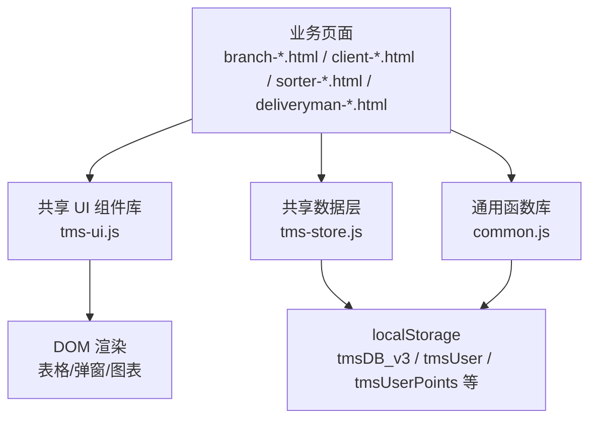
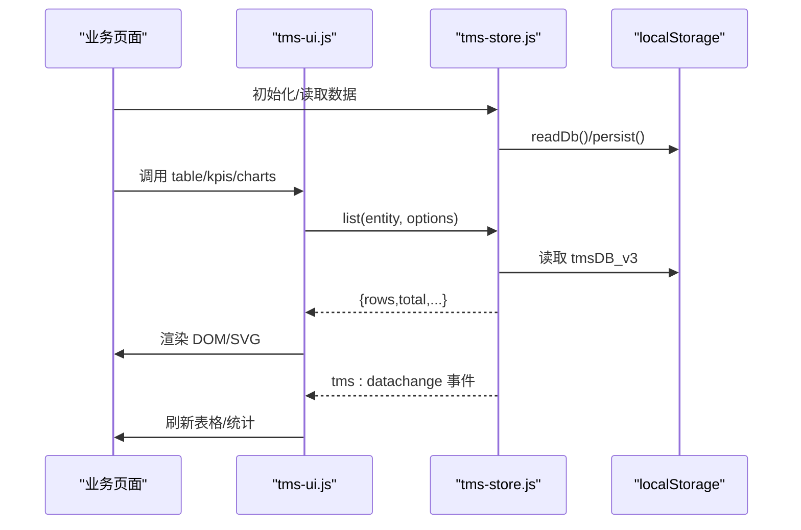
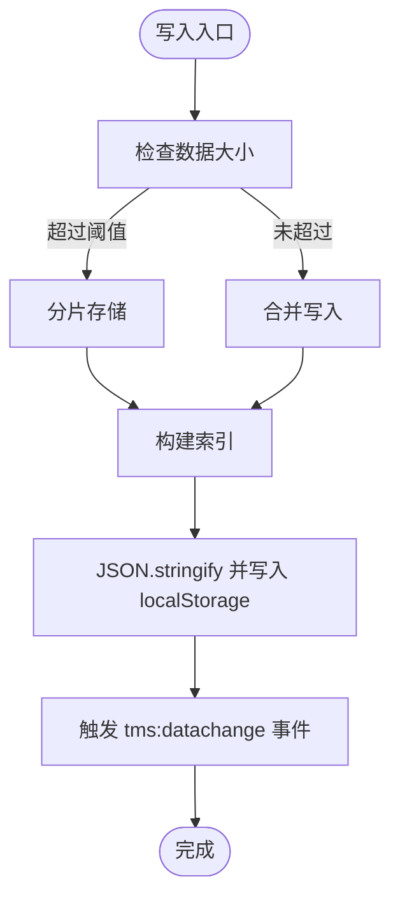
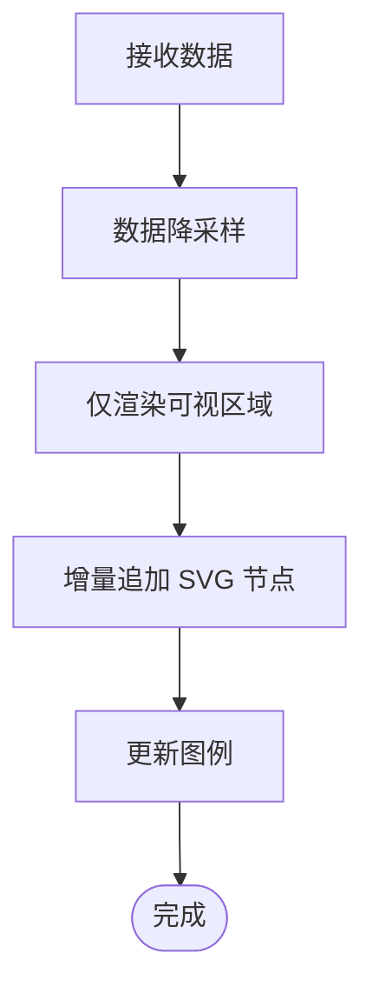
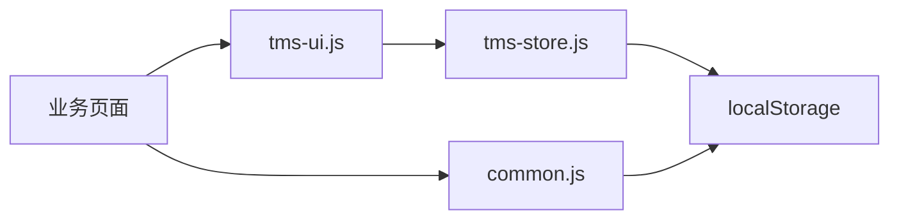

# 性能监控与优化

<cite>
**本文引用的文件**   
- [tms-ui.js](file://tms-ui.js)
- [common.js](file://common.js)
- [tms-store.js](file://tms-store.js)
- [branch-collection.html](file://branch-collection.html)
- [branch-sorting.html](file://branch-sorting.html)
- [sorter-performance.html](file://sorter-performance.html)
- [deliveryman-performance.html](file://deliveryman-performance.html)
</cite>

## 目录
1. [引言](#引言)
2. [项目结构](#项目结构)
3. [核心组件](#核心组件)
4. [架构总览](#架构总览)
5. [详细组件分析](#详细组件分析)
6. [依赖关系分析](#依赖关系分析)
7. [性能考虑](#性能考虑)
8. [故障排查指南](#故障排查指南)
9. [结论](#结论)
10. [附录](#附录)

## 引言
本文件面向 TMS 系统的前端性能监控与优化，目标包括：
- 明确页面加载时间、交互响应时间与内存使用等关键指标。
- 给出 localStorage 的分片存储与查询优化策略。
- 提供浏览器缓存与 Service Worker 的落地建议。
- 针对 SVG 图表渲染提出大数据量虚拟滚动与增量更新方案。
- 给出 JavaScript 执行优化（代码分割、懒加载）建议。
- 规范网络请求频率控制与数据预加载策略。
- 提供性能瓶颈识别工具与调试方法。
- 补充移动端性能优化与适配方案。

本项目为纯前端演示型 TMS，数据层基于 localStorage，UI 组件集中在共享库中，多个业务页面通过 HTML 脚本引入通用逻辑。因此，性能优化的重点在于：减少重复初始化成本、降低 DOM 操作与重排重绘、优化本地存储读写、合理拆分资源并延迟加载。

## 项目结构
TMS 前端采用“多页面 + 共享 JS/CSS”的结构：
- 共享 UI 组件库：tms-ui.js，提供表格、弹窗、表单、KPI、SVG 图表等能力。
- 通用函数库：common.js，提供登录、用户信息、积分等通用逻辑。
- 共享数据层：tms-store.js，封装基于 localStorage 的数据模型、CRUD、事件通知与业务流转。
- 各角色页面：如 branch-*.html、client-*.html、deliveryman-*.html、sorter-*.html、tms-*.html 等。

**图示来源**
- [tms-ui.js:301-542](file://tms-ui.js#L301-L542)
- [tms-store.js:220-244](file://tms-store.js#L220-L244)
- [common.js:136-218](file://common.js#L136-L218)

**章节来源**
- [tms-ui.js:1-781](file://tms-ui.js#L1-L781)
- [common.js:1-383](file://common.js#L1-L383)
- [tms-store.js:1-2377](file://tms-store.js#L1-L2377)

## 核心组件
- 共享 UI 组件库（tms-ui.js）
  - 提供通用表格、搜索筛选分页、弹窗、表单、状态徽章、KPI、SVG 折线/柱状/环形图、页面外壳等。
  - 列表渲染存在全量过滤、排序与分页逻辑；图表通过 innerHTML 拼接 SVG 节点。
- 通用函数库（common.js）
  - 提供登录、权限校验、用户信息显示、积分余额与历史记录等。
  - 多处直接读写 localStorage，用于保存用户信息与积分数据。
- 共享数据层（tms-store.js）
  - 以 tmsDB_v3 作为主键，维护订单、运输、异常、财务、员工、车辆、仓库、库存、运力、电子围栏、路由、计费卡、账单等多实体。
  - 提供 list/get/create/update/remove/subscribe/reset 等接口，并在数据变更时触发 tms:datachange 事件。
  - 包含种子数据生成、计费引擎、路由规划、轨迹生成、订单状态机推进等复杂业务逻辑。

**章节来源**
- [tms-ui.js:301-542](file://tms-ui.js#L301-L542)
- [tms-ui.js:573-678](file://tms-ui.js#L573-L678)
- [common.js:136-218](file://common.js#L136-L218)
- [tms-store.js:220-244](file://tms-store.js#L220-L244)
- [tms-store.js:1209-1319](file://tms-store.js#L1209-L1319)

## 架构总览
下图展示 TMS 前端在运行时的主要交互路径：页面加载后初始化 UI 与数据层，用户操作触发表格或图表渲染，数据变化通过事件机制驱动视图刷新。

**图示来源**
- [tms-store.js:220-244](file://tms-store.js#L220-L244)
- [tms-store.js:1209-1319](file://tms-store.js#L1209-L1319)
- [tms-ui.js:301-542](file://tms-ui.js#L301-L542)

## 详细组件分析

### 前端性能监控指标定义
- 页面加载时间
  - 首屏可交互时间：从页面开始加载到用户可点击按钮的时间。
  - 资源加载完成时间：所有脚本、样式、图片等资源加载完毕时间。
  - 建议通过浏览器开发者工具的 Performance 面板记录关键时间点，并结合自定义埋点统计。
- 交互响应时间
  - 表格搜索、筛选、排序、翻页的响应时间。
  - 弹窗打开/关闭、表单提交、确认框响应的耗时。
  - 建议在 UI 组件的关键回调处增加计时埋点，例如搜索输入防抖结束、排序切换、分页切换、表单提交成功/失败。
- 内存使用情况
  - 关注长时间运行后内存是否持续增长，尤其是大量 DOM 节点与 SVG 元素未释放。
  - 结合浏览器 Memory 面板进行堆快照对比，定位未释放引用。

[本节为概念性说明，不直接分析具体文件]

### localStorage 使用优化策略
当前项目中 localStorage 的使用主要集中在：
- 用户信息与积分：common.js 中 login/logout/checkLoginStatus/displayCurrentUser/saveUserProfile/getUserProfile/updateUserProfile/initUserPoints/addUserPoints/deductUserPoints/getUserPointsHistory 等函数。
- 业务数据：tms-store.js 中以 tmsDB_v3 作为主键，集中管理所有业务实体。
- 部分页面级数据：branch-collection.html、branch-sorting.html 等页面将订单、任务、扫描包裹等数据保存在各自 key 下。

优化建议：
- 数据分片存储
  - 将大对象拆分为多个小对象，按模块或实体分片，例如 orders、transports、exceptions、finances、users、vehicles、warehouses、inventory、capacities、geofences、policies、routingRules、rateCards、routes、deliveryAddresses、timingRules、changeRecords、evalMetrics、evaluations、performance、adminRecords、receivables、payables、bills 等。
  - 对热点数据（如 orders、scans、traces）单独分片，便于增量更新与局部重建。
- 查询性能优化
  - 在 list 接口中避免频繁 slice 和 sort，优先在服务端或数据层完成过滤与排序，再返回分页结果。
  - 对高频字段建立内存索引（如 id、orderId、status），减少全表扫描。
  - 对搜索字段做前缀索引或倒排索引，提升模糊匹配效率。
- 写入优化
  - 合并多次写入，批量持久化，减少 localStorage 序列化与 I/O 次数。
  - 对大型数组（如 scans、traces）设置上限并进行裁剪，避免无限增长导致 JSON 序列化开销过大。
- 版本迁移
  - 保持 DB_VERSION 与数据结构兼容，升级时进行渐进式迁移，避免一次性重建全部数据。

**图示来源**
- [tms-store.js:220-244](file://tms-store.js#L220-L244)
- [tms-store.js:1209-1319](file://tms-store.js#L1209-L1319)
- [common.js:136-218](file://common.js#L136-L218)

**章节来源**
- [common.js:136-218](file://common.js#L136-L218)
- [tms-store.js:220-244](file://tms-store.js#L220-L244)
- [tms-store.js:1209-1319](file://tms-store.js#L1209-L1319)
- [branch-collection.html:607-857](file://branch-collection.html#L607-L857)
- [branch-sorting.html:685-798](file://branch-sorting.html#L685-L798)

### 浏览器缓存策略配置
- HTTP 缓存头
  - 静态资源（JS/CSS/图片）启用强缓存（Cache-Control: max-age=31536000, immutable），配合版本号或哈希文件名。
  - HTML 文档使用短缓存或 no-cache，确保页面逻辑更新及时生效。
  - API 响应根据数据稳定性设置合适的 Cache-Control 与 ETag。
- Service Worker 缓存管理
  - 预缓存关键资源，确保离线可用。
  - 运行时缓存 API 响应，结合 stale-while-revalidate 策略提升体验。
  - 定期清理过期缓存，避免占用过多存储空间。

[本节为概念性说明，不直接分析具体文件]

### 图表渲染性能优化
当前 SVG 图表实现通过 innerHTML 拼接节点，适合中小数据量；当数据量大时，需考虑：
- 虚拟滚动
  - 对 X/Y 轴标签与数据点进行按需渲染，仅显示可视区域的数据点。
  - 对折线图与柱状图的点与线段进行分批绘制，避免一次性创建大量 DOM 节点。
- 增量更新
  - 对新增数据点追加 SVG 元素，而非整表重绘。
  - 对历史数据进行降采样（如每 N 个点取一个代表点），减少渲染压力。
- 动画与过渡
  - 避免频繁触发布局计算，尽量使用 transform 与 opacity 进行动画。
  - 对大数据集禁用复杂阴影与渐变，改用纯色填充。

**图示来源**
- [tms-ui.js:573-678](file://tms-ui.js#L573-L678)

**章节来源**
- [tms-ui.js:573-678](file://tms-ui.js#L573-L678)

### JavaScript 执行性能优化
- 代码分割
  - 将大体积脚本拆分为模块，按需加载，例如将图表库、地图库、第三方组件库延迟加载。
  - 对非首屏功能（如报表导出、高级筛选）使用动态 import。
- 懒加载
  - 对长列表与大图使用 IntersectionObserver 懒加载。
  - 对弹窗与表单仅在需要时渲染 DOM。
- 事件优化
  - 使用事件委托减少监听器数量。
  - 对高频事件（如 input、scroll）使用防抖与节流。

[本节为概念性说明，不直接分析具体文件]

### 网络请求优化
- API 调用频率控制
  - 对轮询接口设置最小间隔，避免频繁请求。
  - 对批量操作进行合并请求，减少往返次数。
- 数据预加载
  - 在用户可能访问的页面提前加载必要数据，提升首屏体验。
  - 对热点数据使用缓存策略，减少重复请求。

[本节为概念性说明，不直接分析具体文件]

### 移动端性能优化与适配
- 减少 DOM 操作与重排重绘，优先使用 CSS 动画与 transform。
- 对大图与视频进行压缩与懒加载。
- 对触摸事件进行优化，避免频繁触发。
- 对字体与图标使用矢量格式，减少资源体积。

[本节为概念性说明，不直接分析具体文件]

## 依赖关系分析
TMS 前端的依赖关系如下：
- 业务页面依赖 tms-ui.js 与 common.js。
- tms-ui.js 依赖全局 TmsStore 与 DOM API。
- tms-store.js 依赖 localStorage 与 CustomEvent。
- common.js 依赖 localStorage 与 DOM API。

**图示来源**
- [tms-ui.js:756-779](file://tms-ui.js#L756-L779)
- [tms-store.js:220-244](file://tms-store.js#L220-L244)
- [common.js:366-382](file://common.js#L366-L382)

**章节来源**
- [tms-ui.js:756-779](file://tms-ui.js#L756-L779)
- [tms-store.js:220-244](file://tms-store.js#L220-L244)
- [common.js:366-382](file://common.js#L366-L382)

## 性能考虑
- 表格渲染
  - 当前 table 组件支持搜索、筛选、排序与分页，但每次操作都会重新渲染整个表格。建议对大数据集采用虚拟滚动与增量更新。
  - 对行点击与操作按钮的事件绑定建议使用事件委托，减少监听器数量。
- 图表渲染
  - 当前 SVG 图表通过 innerHTML 拼接，适合中小数据量。大数据量场景建议采用 Canvas 或 WebGL 渲染，或进行数据降采样与虚拟滚动。
- 数据层
  - tms-store.js 的 list 接口支持过滤、排序与分页，但仍在内存中进行全表处理。建议对热点字段建立索引，减少扫描开销。
  - persist 函数每次写入都会触发 tms:datachange 事件，需注意监听器的数量与复杂度，避免不必要的重渲染。
- 用户界面
  - common.js 中的 displayCurrentUser 会遍历多个元素 ID 进行更新，建议优化为更精确的选择器或缓存已更新元素。

**章节来源**
- [tms-ui.js:301-542](file://tms-ui.js#L301-L542)
- [tms-ui.js:573-678](file://tms-ui.js#L573-L678)
- [tms-store.js:1209-1319](file://tms-store.js#L1209-L1319)
- [common.js:221-270](file://common.js#L221-L270)

## 故障排查指南
- 性能瓶颈识别
  - 使用浏览器 Performance 面板录制页面交互过程，分析长任务、布局抖动与重绘重绘。
  - 使用 Memory 面板进行堆快照对比，定位未释放引用与内存泄漏。
  - 对 localStorage 读写进行计时，分析序列化与 I/O 开销。
- 常见问题
  - 表格卡顿：检查是否频繁全量渲染，是否缺少虚拟滚动。
  - 图表卡顿：检查是否一次性创建大量 SVG 节点，是否可进行数据降采样。
  - 内存增长：检查是否有未移除的事件监听器或未销毁的 DOM 节点。
  - 数据不一致：检查 tms-store.js 的 persist 与 emit 逻辑是否正确触发事件。

**章节来源**
- [tms-store.js:220-244](file://tms-store.js#L220-L244)
- [tms-ui.js:301-542](file://tms-ui.js#L301-L542)

## 结论
TMS 前端当前以 localStorage 为核心数据源，UI 组件与业务页面耦合度较低，具备良好的扩展性。性能优化的重点在于：
- 对 localStorage 进行分片存储与索引优化，减少序列化与 I/O 开销。
- 对表格与图表进行虚拟滚动与增量更新，避免全量渲染。
- 对 JavaScript 执行进行代码分割与懒加载，降低首屏负担。
- 对网络请求进行频率控制与数据预加载，提升用户体验。
- 对移动端进行专项优化，确保流畅交互。

[本节为总结性内容，不直接分析具体文件]

## 附录
- 相关页面示例
  - 分拣员绩效页面：sorter-performance.html
  - 快递员绩效页面：deliveryman-performance.html
  - 网点揽收页面：branch-collection.html
  - 网点分拣页面：branch-sorting.html

**章节来源**
- [sorter-performance.html:526-677](file://sorter-performance.html#L526-L677)
- [deliveryman-performance.html:486-636](file://deliveryman-performance.html#L486-L636)
- [branch-collection.html:607-857](file://branch-collection.html#L607-L857)
- [branch-sorting.html:685-798](file://branch-sorting.html#L685-L798)