# 故障排查与维护

<cite>
**本文引用的文件**   
- [common.js](file://common.js)
- [tms-ui.js](file://tms-ui.js)
- [tms-store.js](file://tms-store.js)
- [tms-pages.js](file://tms-pages.js)
- [index.html](file://index.html)
- [readme](file://readme)
</cite>

## 目录
1. [引言](#引言)
2. [项目结构](#项目结构)
3. [核心组件](#核心组件)
4. [架构总览](#架构总览)
5. [详细组件分析](#详细组件分析)
6. [依赖关系分析](#依赖关系分析)
7. [性能与容量注意事项](#性能与容量注意事项)
8. [故障排查指南](#故障排查指南)
9. [运维自动化与监控告警](#运维自动化与监控告警)
10. [系统健康检查与预防性维护](#系统健康检查与预防性维护)
11. [结论](#结论)

## 引言
本文件面向TMS系统的运维与技术支持人员，聚焦于常见问题的诊断方法、浏览器兼容性处理、localStorage数据问题、JavaScript错误调试、用户权限问题定位、日志收集与分析、以及运维自动化与健康检查。文档基于仓库中的前端代码实现进行说明，重点覆盖登录流程、数据加载、界面渲染、权限控制与本地存储等关键环节。

## 项目结构
TMS为纯前端单页应用集合，采用“共享UI库 + 共享数据层 + 页面装配”的分层组织方式：
- 通用函数与登录逻辑位于 common.js
- 共享UI组件与图表能力位于 tms-ui.js
- 基于 localStorage 的轻量业务数据库位于 tms-store.js
- 管理员端各业务页面的统一装配逻辑位于 tms-pages.js
- 登录入口页面为 index.html
- 订单号/运单号规范见 readme

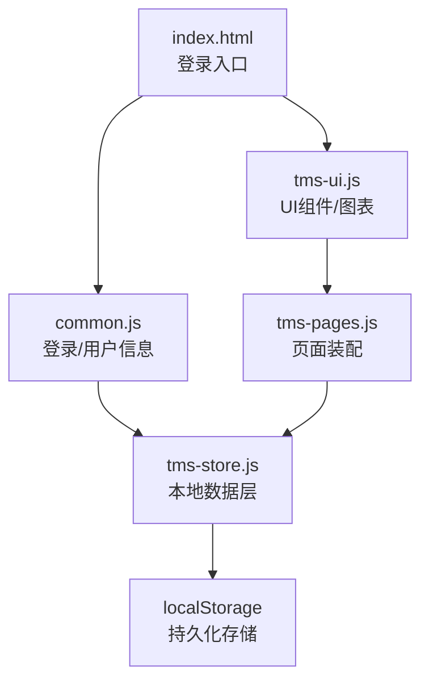

**图示来源**
- [index.html:1-200](file://index.html#L1-L200)
- [common.js:135-218](file://common.js#L135-L218)
- [tms-ui.js:703-782](file://tms-ui.js#L703-L782)
- [tms-store.js:220-244](file://tms-store.js#L220-L244)
- [tms-pages.js:108-135](file://tms-pages.js#L108-L135)

**章节来源**
- [readme:1-3](file://readme#L1-L3)
- [index.html:1-200](file://index.html#L1-L200)
- [common.js:135-218](file://common.js#L135-L218)
- [tms-ui.js:703-782](file://tms-ui.js#L703-L782)
- [tms-store.js:220-244](file://tms-store.js#L220-L244)
- [tms-pages.js:108-135](file://tms-pages.js#L108-L135)

## 核心组件
- 通用函数与登录模块（common.js）
  - 提供登录、登出、当前用户获取与显示、用户积分管理等基础能力
  - 使用 localStorage 保存用户会话与个人信息
- 共享UI组件库（tms-ui.js）
  - 提供Toast、Modal、表单弹窗、表格、KPI、图表等通用UI能力
  - 提供 initShell 初始化页面外壳、异常角标等
- 共享数据层（tms-store.js）
  - 基于 localStorage 的轻量数据库，负责种子数据生成、CRUD、搜索筛选排序分页、订阅事件
  - 维护订单生命周期、轨迹、扫描、运输、财务等业务关联
- 页面装配器（tms-pages.js）
  - 将各业务页面统一装配为“KPI + 图表 + 可筛选分页表格 + CRUD操作”的结构
  - 通过 TmsStore 与 TmsUI 组合构建页面

**章节来源**
- [common.js:135-383](file://common.js#L135-L383)
- [tms-ui.js:86-782](file://tms-ui.js#L86-L782)
- [tms-store.js:1-244](file://tms-store.js#L1-L244)
- [tms-pages.js:1-135](file://tms-pages.js#L1-L135)

## 架构总览
下图展示从登录到数据加载与界面渲染的关键调用链：

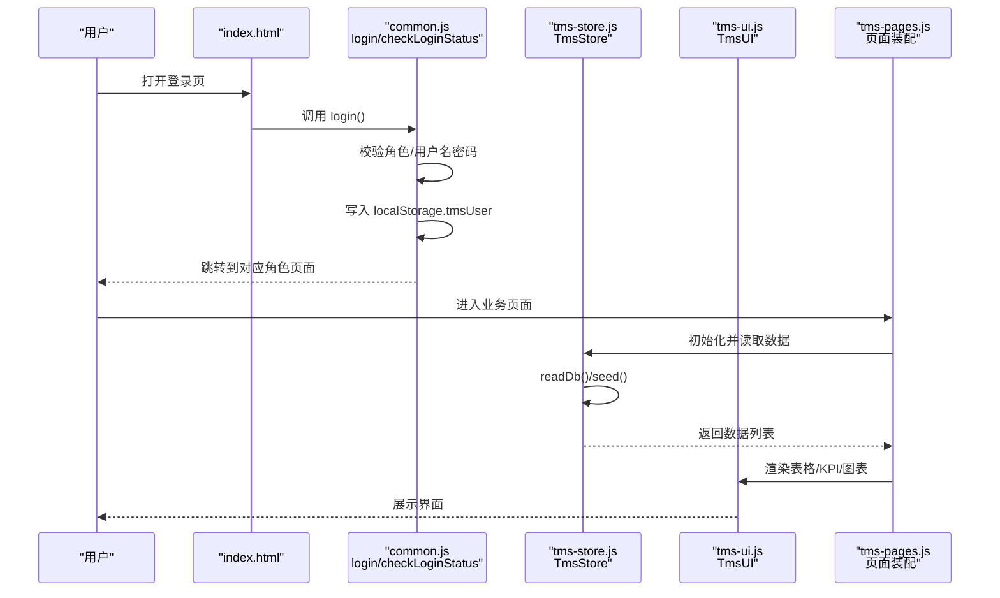

**图示来源**
- [common.js:135-218](file://common.js#L135-L218)
- [tms-store.js:220-244](file://tms-store.js#L220-L244)
- [tms-pages.js:108-135](file://tms-pages.js#L108-L135)
- [tms-ui.js:703-782](file://tms-ui.js#L703-L782)

## 详细组件分析

### 登录与权限控制
- 登录流程
  - 输入用户名、密码并选择角色后，common.js 的 login 函数校验必填项与角色选择
  - 成功后将用户信息写入 localStorage.tmsUser，并按角色跳转至对应页面
- 权限校验
  - checkLoginStatus 用于检查当前用户是否具备访问某页面的所需角色
  - 若未登录或角色不匹配，则提示无权限并跳转回登录页
- 登出流程
  - logout 删除 localStorage.tmsUser 并跳转回登录页

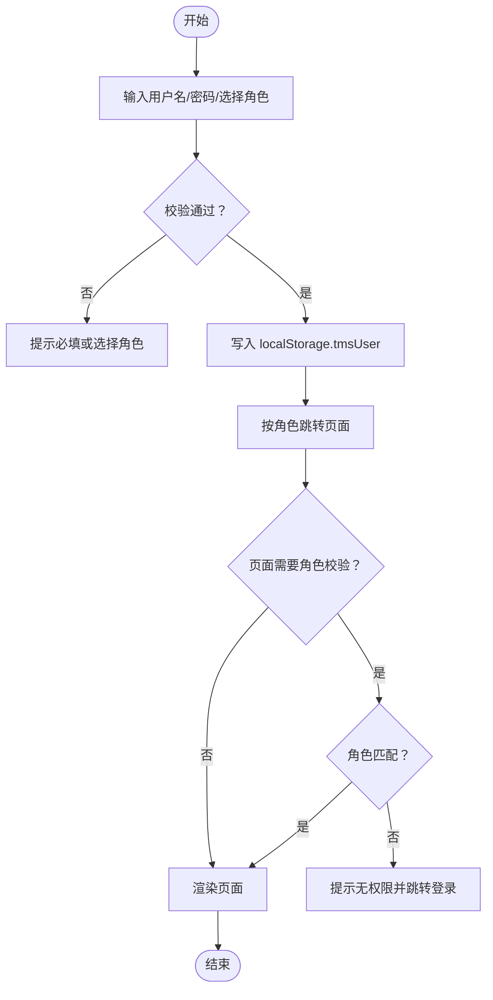

**图示来源**
- [common.js:135-218](file://common.js#L135-L218)

**章节来源**
- [common.js:135-218](file://common.js#L135-L218)

### 数据加载与状态管理
- 数据层初始化
  - tms-store.js 通过 readDb 尝试从 localStorage 读取已存在的数据；若不存在或版本不一致，则执行 seed 生成种子数据
  - persist 将内存中的 db 对象序列化后写入 localStorage，并触发 tms:datachange 事件
- 查询与变更
  - list/get/create/update/remove 提供统一的CRUD能力
  - subscribe 允许UI组件订阅数据变化，自动刷新视图
- 业务流转
  - advanceOrder 推进订单状态，联动扫描记录、运输任务、车辆状态、财务流水等

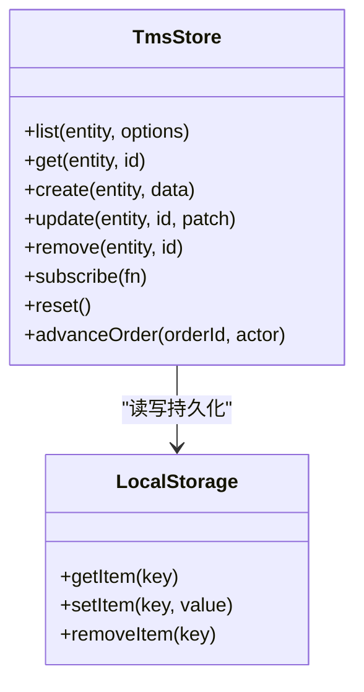

**图示来源**
- [tms-store.js:220-244](file://tms-store.js#L220-L244)
- [tms-store.js:1196-1319](file://tms-store.js#L1196-L1319)

**章节来源**
- [tms-store.js:220-244](file://tms-store.js#L220-L244)
- [tms-store.js:1196-1319](file://tms-store.js#L1196-L1319)

### 界面渲染与交互
- UI组件库
  - toast/modal/formModal/table/kpis/charts 等组件提供一致的交互体验
  - initShell 初始化导航高亮、退出按钮绑定、当前用户信息显示、异常待办角标
- 页面装配
  - tms-pages.js 定义各业务页面配置，统一渲染KPI、图表、表格与工具栏
  - 通过 TmsStore.subscribe 监听数据变化，自动刷新页面

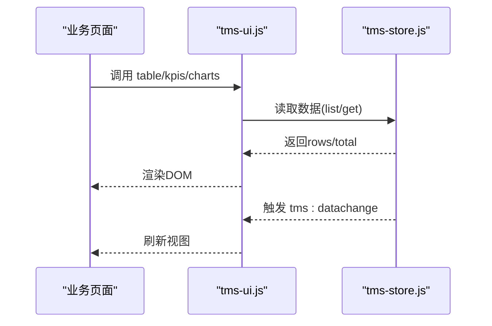

**图示来源**
- [tms-ui.js:703-782](file://tms-ui.js#L703-L782)
- [tms-pages.js:108-135](file://tms-pages.js#L108-L135)
- [tms-store.js:237-244](file://tms-store.js#L237-L244)

**章节来源**
- [tms-ui.js:703-782](file://tms-ui.js#L703-L782)
- [tms-pages.js:108-135](file://tms-pages.js#L108-L135)

## 依赖关系分析
- common.js 暴露全局函数供页面直接调用（如 login、checkLoginStatus、logout、displayCurrentUser）
- tms-ui.js 暴露 TmsUI 对象，被 tms-pages.js 使用以渲染UI
- tms-store.js 暴露 TmsStore 对象，被 tms-pages.js 和 tms-ui.js 使用以读写数据
- tms-pages.js 作为页面装配器，组合 TmsStore 与 TmsUI 完成业务页面构建

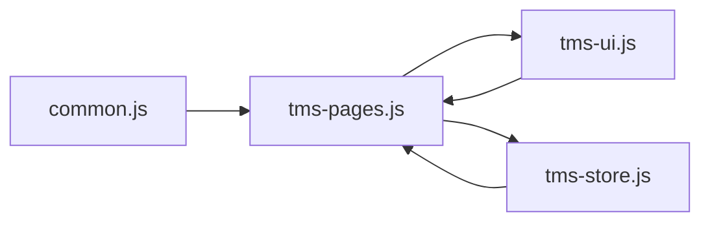

**图示来源**
- [common.js:365-383](file://common.js#L365-L383)
- [tms-ui.js:758-782](file://tms-ui.js#L758-L782)
- [tms-store.js:1186-1194](file://tms-store.js#L1186-L1194)
- [tms-pages.js:10-12](file://tms-pages.js#L10-L12)

**章节来源**
- [common.js:365-383](file://common.js#L365-L383)
- [tms-ui.js:758-782](file://tms-ui.js#L758-L782)
- [tms-store.js:1186-1194](file://tms-store.js#L1186-L1194)
- [tms-pages.js:10-12](file://tms-pages.js#L10-L12)

## 性能与容量注意事项
- localStorage 容量限制
  - 浏览器对每个域名的 localStorage 通常限制在约5MB左右，超大JSON可能导致写入失败
  - 建议定期清理无用键值，避免重复写入大对象
- 大数据量渲染
  - 表格分页与过滤在 tms-store.js 中实现，但前端全量过滤仍可能带来卡顿
  - 建议在页面配置中合理设置 pageSize，减少单次渲染数据量
- 事件订阅与重绘
  - tms-store.js 在每次数据变更后触发 tms:datachange，UI组件需避免频繁重绘

[本节为通用指导，无需具体文件引用]

## 故障排查指南

### 登录失败
常见问题与排查步骤：
- 未选择角色或未填写用户名/密码
  - 现象：点击登录后弹出提示“请选择角色”或“请输入用户名和密码”
  - 排查：确认页面元素是否存在，role-btn.active 是否正确设置
- localStorage 写入失败
  - 现象：登录后未跳转或刷新后仍需重新登录
  - 排查：检查浏览器控制台是否有 Storage 相关错误；确认存储空间是否充足
- 角色权限不匹配
  - 现象：进入页面后被提示“您没有权限访问此页面”并跳转回登录页
  - 排查：检查 checkLoginStatus 的 requiredRole 参数是否与当前用户角色一致

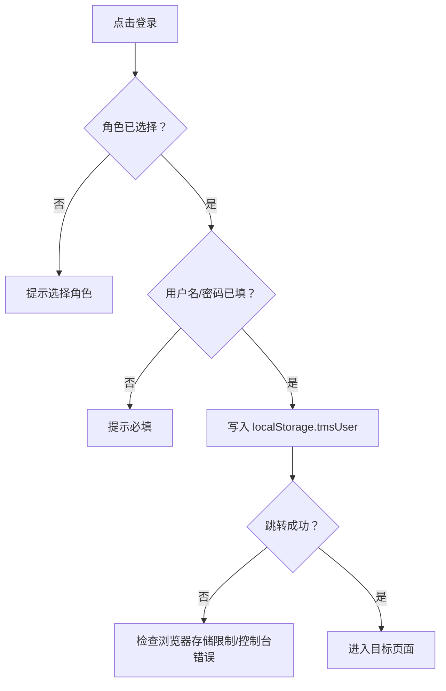

**图示来源**
- [common.js:135-218](file://common.js#L135-L218)

**章节来源**
- [common.js:135-218](file://common.js#L135-L218)

### 数据加载异常
常见问题与排查步骤：
- 首次访问无数据
  - 现象：页面显示“暂无数据”或表格为空
  - 排查：确认 tms-store.js 的 seed 是否执行；检查 localStorage 中是否存在有效数据
- 数据版本不一致
  - 现象：数据丢失或结构异常
  - 排查：readDb 会忽略 version 不匹配的旧数据，必要时调用 reset 重建数据
- 订阅未触发
  - 现象：数据变更后界面未刷新
  - 排查：确认 TmsStore.subscribe 是否注册；检查 tms:datachange 事件是否正常派发

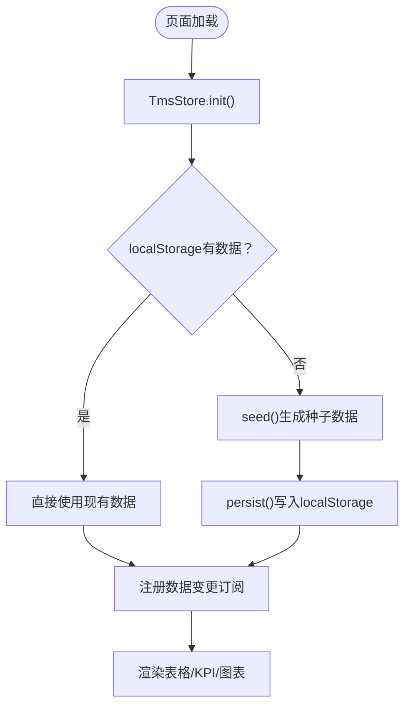

**图示来源**
- [tms-store.js:220-244](file://tms-store.js#L220-L244)
- [tms-store.js:1186-1194](file://tms-store.js#L1186-L1194)

**章节来源**
- [tms-store.js:220-244](file://tms-store.js#L220-L244)
- [tms-store.js:1186-1194](file://tms-store.js#L1186-L1194)

### 界面显示问题
常见问题与排查步骤：
- 用户名未显示
  - 现象：页面右上角未显示当前用户名
  - 排查：检查 displayCurrentUser 是否被调用；确认 DOM 中存在对应的元素ID
- Toast/Modal未出现
  - 现象：操作后无提示或弹窗
  - 排查：确认 TmsUI.toast/modal 是否被正确调用；检查容器元素是否存在
- 表格未渲染
  - 现象：表格区域空白
  - 排查：确认 TmsUI.table 的 container 是否为空；检查 TmsStore.list 返回的 rows 是否为空

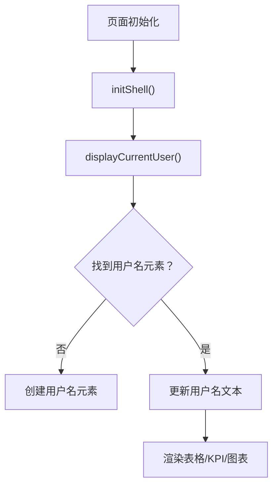

**图示来源**
- [tms-ui.js:703-782](file://tms-ui.js#L703-L782)
- [common.js:221-270](file://common.js#L221-L270)

**章节来源**
- [tms-ui.js:703-782](file://tms-ui.js#L703-L782)
- [common.js:221-270](file://common.js#L221-L270)

### 浏览器兼容性问题
- 控制台日志分析
  - 使用浏览器开发者工具的Console面板查看错误堆栈
  - 关注 StorageError、SyntaxError、TypeError 等常见错误
- 兼容层配置
  - 确保页面引入必要的polyfill（如需）
  - 检查 localStorage API在各浏览器的支持情况
- 特殊处理
  - 某些企业内网环境可能禁用localStorage，需考虑替代方案（如sessionStorage或后端会话）

[本节为通用指导，无需具体文件引用]

### localStorage相关问题
- 存储空间不足
  - 现象：写入失败，抛出QuotaExceededError
  - 排查：检查浏览器存储配额；清理无用键值
- 数据损坏修复
  - 现象：JSON解析失败或数据结构异常
  - 排查：使用 TmsStore.reset 重建数据；检查 readDb 的版本校验逻辑

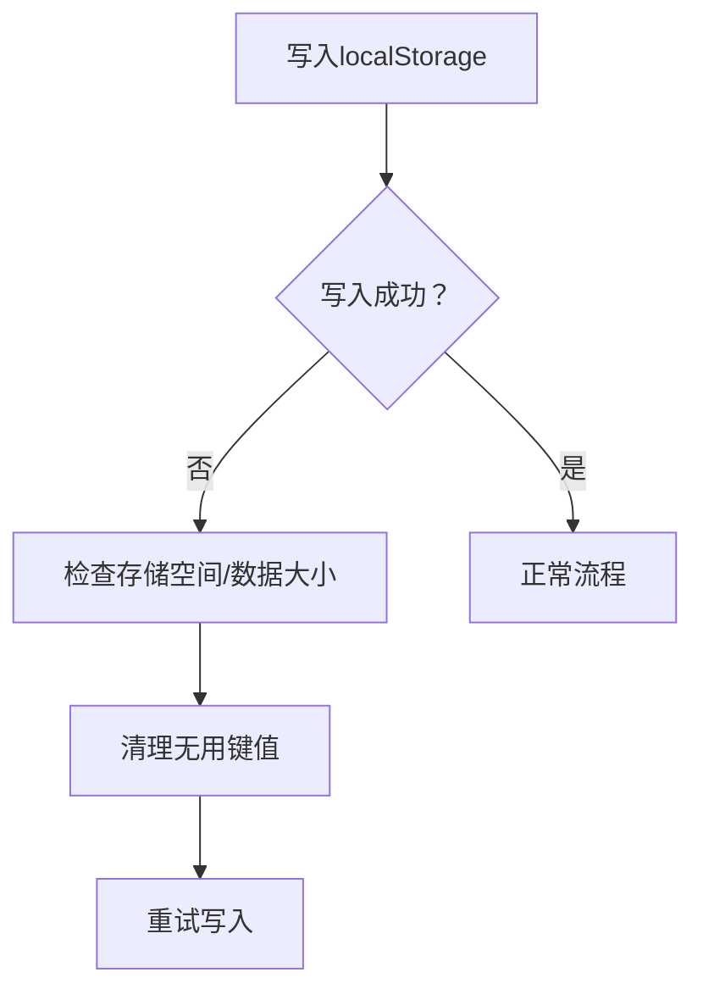

**图示来源**
- [tms-store.js:232-234](file://tms-store.js#L232-L234)
- [tms-store.js:1314-1319](file://tms-store.js#L1314-L1319)

**章节来源**
- [tms-store.js:232-234](file://tms-store.js#L232-L234)
- [tms-store.js:1314-1319](file://tms-store.js#L1314-L1319)

### JavaScript错误调试技巧
- 控制台日志分析
  - 利用 console.log 输出关键变量与状态
  - 关注错误堆栈中的函数调用链
- 断点调试
  - 在关键函数处设置断点（如 login、checkLoginStatus、list、render）
  - 逐步执行观察数据流与DOM变化
- 错误堆栈追踪
  - 捕获未处理的Promise拒绝与异步错误
  - 使用 try-catch 包裹关键逻辑，输出友好错误信息

[本节为通用指导，无需具体文件引用]

### 用户权限问题排查
- 角色配置验证
  - 检查当前用户的 role 字段是否与页面要求的 requiredRole 匹配
  - 确认 checkLoginStatus 的逻辑是否正确拦截无权限访问
- 权限控制调试
  - 在页面初始化时打印当前用户信息与所需角色
  - 检查 localStorage.tmsUser 的内容是否正确

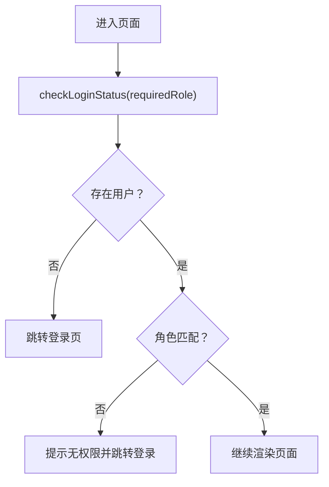

**图示来源**
- [common.js:176-199](file://common.js#L176-L199)

**章节来源**
- [common.js:176-199](file://common.js#L176-L199)

### 系统日志收集与分析
- 前端日志
  - 利用 console.log 输出关键操作与状态
  - 在错误处理中记录错误堆栈与上下文信息
- 用户行为日志
  - 记录用户登录、操作、错误发生的时间与页面路径
- 数据分析
  - 汇总错误类型与频率，定位高频问题
  - 结合业务指标分析系统稳定性

[本节为通用指导，无需具体文件引用]

## 运维自动化与监控告警
- 自动化脚本
  - 定期清理过期localStorage数据
  - 自动生成测试数据与报表
- 监控告警
  - 监控前端错误率与性能指标
  - 设置阈值告警（如错误率超过1%）

[本节为通用指导，无需具体文件引用]

## 系统健康检查与预防性维护
- 健康检查
  - 定期检查localStorage可用性
  - 验证关键功能（登录、数据加载、界面渲染）是否正常
- 预防性维护
  - 优化数据存储结构，减少冗余
  - 定期清理无用数据，释放存储空间

[本节为通用指导，无需具体文件引用]

## 结论
本文档基于TMS系统的前端代码实现了全面的故障排查与维护指南。通过理解登录流程、数据加载机制、界面渲染逻辑与权限控制策略，运维人员可以快速定位并解决常见问题。同时，提供了浏览器兼容性处理、localStorage问题修复、JavaScript调试技巧、权限问题排查、日志收集分析与运维自动化建议，帮助提升系统的稳定性与可维护性。