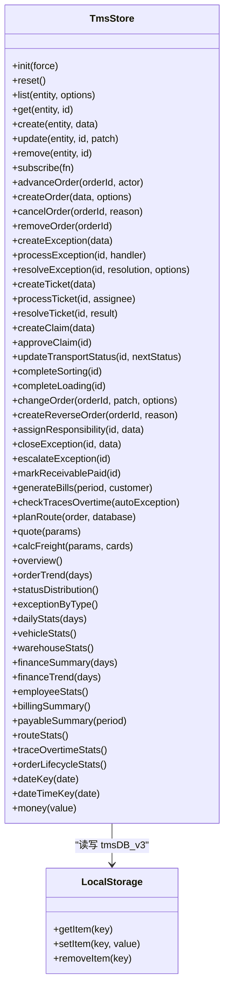
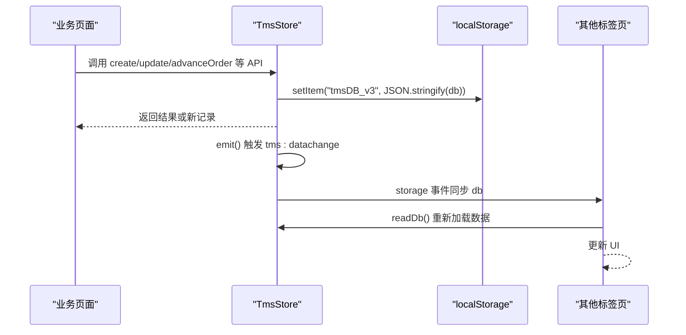
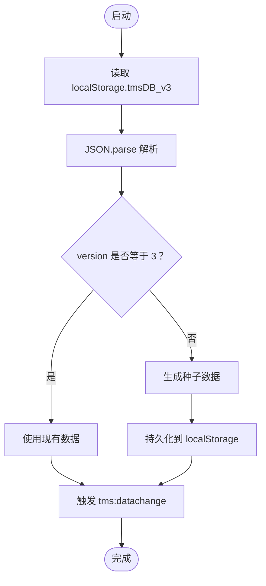
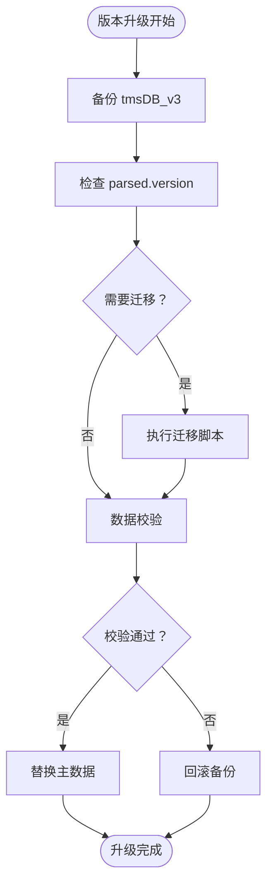
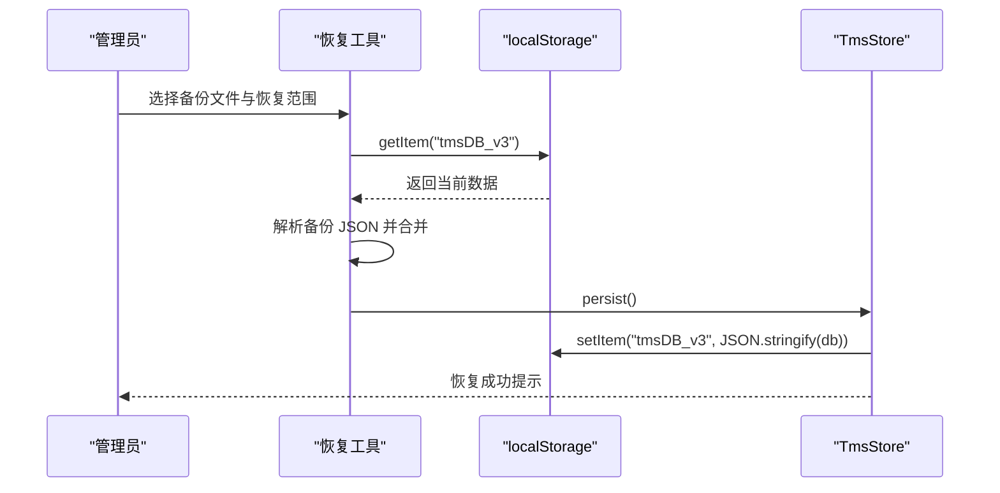
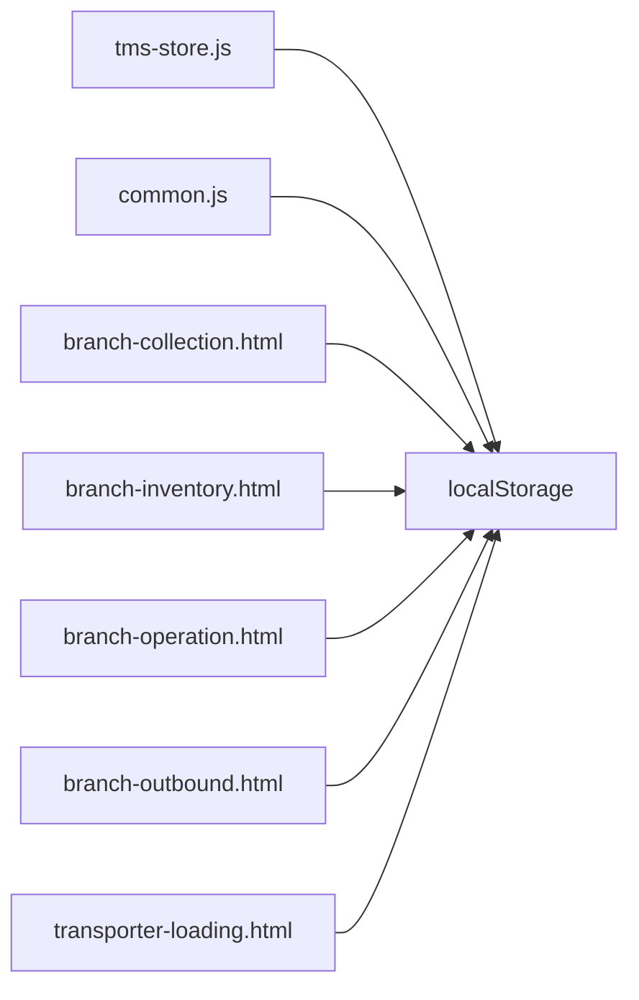

# 数据备份与恢复

<cite>
**本文引用的文件**   
- [tms-store.js](file://tms-store.js)
- [common.js](file://common.js)
- [branch-collection.html](file://branch-collection.html)
- [branch-inventory.html](file://branch-inventory.html)
- [branch-operation.html](file://branch-operation.html)
- [branch-outbound.html](file://branch-outbound.html)
- [transporter-loading.html](file://transporter-loading.html)
- [tms-architecture.html](file://tms-architecture.html)
</cite>

## 目录
1. [引言](#引言)
2. [项目结构与数据范围](#项目结构与数据范围)
3. [核心组件与数据模型](#核心组件与数据模型)
4. [架构总览](#架构总览)
5. [详细组件分析](#详细组件分析)
6. [依赖关系分析](#依赖关系分析)
7. [性能与存储策略](#性能与存储策略)
8. [安全与敏感数据处理](#安全与敏感数据处理)
9. [故障排查指南](#故障排查指南)
10. [结论](#结论)

## 引言
本文件为 TMS 系统的数据备份与恢复文档，聚焦于基于浏览器 `localStorage` 的本地数据层。TMS 的核心业务数据由共享数据层统一维护，并通过事件机制在多个页面间保持一致。本文说明：
- 当前 `localStorage` 数据的结构、版本控制与初始化流程
- 定期自动备份与手动备份策略建议
- 数据导出格式与导入方法，支持 JSON 批量处理
- 数据迁移工具与版本升级兼容性处理
- 灾难恢复与业务中断恢复流程
- 数据完整性校验与一致性保证措施
- 大数据量下的备份性能优化与存储策略
- 敏感数据的加密存储与安全传输方案

## 项目结构与数据范围
TMS 的前端页面通过共享数据层访问 `localStorage`，主要涉及以下数据范围：
- 主数据库键：用于保存订单、运输、异常、财务、用户、车辆、仓库等全量业务数据
- 各业务模块页面使用各自的 `localStorage` 键，例如分支网点、出库、装车等场景
- 通用登录与用户信息也保存在 `localStorage`

```mermaid
graph TB
subgraph "浏览器本地存储"
DB["主数据库<br/>tmsDB_v3"]
USER["用户会话<br/>tmsUser"]
PROFILE["用户档案<br/>tmsUserProfile"]
POINTS["积分数据<br/>tmsUserPoints"]
BRANCH_ORDERS["分支订单<br/>branchOrders"]
BRANCH_TASKS["分支任务<br/>branchTasks"]
INVENTORY["库存数据<br/>branchInventory"]
MATERIALS["物料数据<br/>branchMaterials"]
TEMP_STORAGE["临时存储<br/>branchTempStorage"]
ORDER_RECORDS["订单记录<br/>orderRecords"]
LOADING_RECORDS["装车记录<br/>loadingRecords"]
HANDOVER_RECORDS["交接记录<br/>handoverRecords"]
OUTBOUND_RECORDS["出库记录<br/>outboundRecords"]
TRANSPORTER_LOADING["当日装车数据<br/>transporterLoading_日期"]
end
STORE["共享数据层<br/>TmsStore"]
COMMON["通用函数库<br/>common.js"]
PAGE_BRANCH_COLLECTION["分支揽收页面<br/>branch-collection.html"]
PAGE_BRANCH_INVENTORY["分支库存页面<br/>branch-inventory.html"]
PAGE_BRANCH_OPERATION["分支运营页面<br/>branch-operation.html"]
PAGE_BRANCH_OUTBOUND["分支出库页面<br/>branch-outbound.html"]
PAGE_TRANSPORTER_LOADING["承运商装车页面<br/>transporter-loading.html"]
STORE --> DB
COMMON --> USER
COMMON --> PROFILE
COMMON --> POINTS
PAGE_BRANCH_COLLECTION --> BRANCH_ORDERS
PAGE_BRANCH_COLLECTION --> BRANCH_TASKS
PAGE_BRANCH_INVENTORY --> INVENTORY
PAGE_BRANCH_INVENTORY --> MATERIALS
PAGE_BRANCH_INVENTORY --> TEMP_STORAGE
PAGE_BRANCH_OPERATION --> ORDER_RECORDS
PAGE_BRANCH_OUTBOUND --> LOADING_RECORDS
PAGE_BRANCH_OUTBOUND --> HANDOVER_RECORDS
PAGE_BRANCH_OUTBOUND --> OUTBOUND_RECORDS
PAGE_TRANSPORTER_LOADING --> TRANSPORTER_LOADING
```

**图表来源**
- [tms-store.js:16-17](file://tms-store.js#L16-L17)
- [tms-store.js:220-234](file://tms-store.js#L220-L234)
- [common.js:154-161](file://common.js#L154-L161)
- [common.js:274-295](file://common.js#L274-L295)
- [common.js:299-363](file://common.js#L299-L363)
- [branch-collection.html:607-698](file://branch-collection.html#L607-L698)
- [branch-inventory.html:485-592](file://branch-inventory.html#L485-L592)
- [branch-operation.html:797-875](file://branch-operation.html#L797-L875)
- [branch-outbound.html:719-771](file://branch-outbound.html#L719-L771)
- [transporter-loading.html:841-855](file://transporter-loading.html#L841-L855)

**章节来源**
- [tms-store.js:16-17](file://tms-store.js#L16-L17)
- [tms-store.js:220-234](file://tms-store.js#L220-L234)
- [common.js:154-161](file://common.js#L154-L161)
- [common.js:274-295](file://common.js#L274-L295)
- [common.js:299-363](file://common.js#L299-L363)
- [branch-collection.html:607-698](file://branch-collection.html#L607-L698)
- [branch-inventory.html:485-592](file://branch-inventory.html#L485-L592)
- [branch-operation.html:797-875](file://branch-operation.html#L797-L875)
- [branch-outbound.html:719-771](file://branch-outbound.html#L719-L771)
- [transporter-loading.html:841-855](file://transporter-loading.html#L841-L855)

## 核心组件与数据模型
TMS 的主数据层由 `tms-store.js` 提供，负责：
- 从 `localStorage` 读取和写入主数据库对象
- 首次访问时生成种子数据并持久化
- 提供统一的增删改查、状态流转、统计聚合接口
- 通过 `tms:datachange` 事件通知其他页面数据变更
- 监听 `storage` 事件实现跨标签页数据同步

主数据库对象包含版本、元数据、实体集合（订单、运输、扫描、异常、财务、应收应付、账单、用户、角色、权限、部门、区域、员工、车辆、仓库、库存、运力、围栏、设备、策略、路由规则、配送地址、时效规则、改单记录、考核指标、评估、绩效、行政记录、服务工单、理赔等）。

**图表来源**
- [tms-store.js:220-234](file://tms-store.js#L220-L234)
- [tms-store.js:1185-1193](file://tms-store.js#L1185-L1193)
- [tms-store.js:1195-1318](file://tms-store.js#L1195-L1318)
- [tms-store.js:2296-2364](file://tms-store.js#L2296-L2364)

**章节来源**
- [tms-store.js:220-234](file://tms-store.js#L220-L234)
- [tms-store.js:1185-1193](file://tms-store.js#L1185-L1193)
- [tms-store.js:1195-1318](file://tms-store.js#L1195-L1318)
- [tms-store.js:2296-2364](file://tms-store.js#L2296-L2364)

## 架构总览
TMS 的数据流围绕 `localStorage` 展开：
- 页面调用 `TmsStore` 提供的 API 进行数据操作
- `TmsStore` 将数据序列化为 JSON 后写入 `localStorage`
- 数据变更后触发 `tms:datachange` 事件，订阅者刷新视图
- 多标签页通过 `storage` 事件保持数据一致
- 各业务页面独立维护自己的 `localStorage` 键，用于局部业务状态

**图表来源**
- [tms-store.js:232-244](file://tms-store.js#L232-L244)
- [tms-store.js:2367-2372](file://tms-store.js#L2367-L2372)

**章节来源**
- [tms-store.js:232-244](file://tms-store.js#L232-L244)
- [tms-store.js:2367-2372](file://tms-store.js#L2367-L2372)

## 详细组件分析

### 主数据库键与版本控制
- 主数据库键：`tmsDB_v3`
- 版本号：`DB_VERSION = 3`
- 读取逻辑会校验 `parsed.version === DB_VERSION`，不匹配则视为无效数据并回退到种子数据
- 初始化时若不存在有效数据，则生成种子数据并持久化

**图表来源**
- [tms-store.js:16-17](file://tms-store.js#L16-L17)
- [tms-store.js:220-234](file://tms-store.js#L220-L234)
- [tms-store.js:1185-1193](file://tms-store.js#L1185-L1193)

**章节来源**
- [tms-store.js:16-17](file://tms-store.js#L16-L17)
- [tms-store.js:220-234](file://tms-store.js#L220-L234)
- [tms-store.js:1185-1193](file://tms-store.js#L1185-L1193)

### 数据导出与导入（JSON 批量处理）
当前代码未内置“导出/导入”按钮或 API，但可通过以下方式实现：
- 导出：读取 `localStorage.getItem('tmsDB_v3')`，解析为对象，选择需要的实体数组（如 `orders`、`transports`、`exceptions`、`finances`、`receivables`、`payables`、`bills`、`users`、`vehicles`、`warehouses`、`inventory`、`employees`、`serviceTickets`、`claims`），序列化为 JSON 文件下载
- 导入：上传 JSON 文件，解析为对象，合并到现有 `db` 中，再 `persist()` 写回 `localStorage`
- 批量处理：对导入数据进行去重、字段映射、时间格式化、金额精度修正等

建议导出的标准 JSON 结构示例（仅描述字段类别，不包含具体值）：
- 基础元数据：`version`、`seededAt`、`meta.counters`
- 业务实体：`orders`、`transports`、`sortingTasks`、`loadingTasks`、`scans`、`traces`、`exceptions`、`finances`、`receivables`、`payables`、`bills`、`serviceTickets`、`claims`
- 管理实体：`users`、`roles`、`permissions`、`departments`、`areas`、`employees`、`vehicles`、`warehouses`、`inventory`、`capacities`、`geofences`、`devices`、`policies`、`routingRules`、`deliveryAddresses`、`timingRules`、`changeRecords`、`evalMetrics`、`evaluations`、`performance`、`adminRecords`

**章节来源**
- [tms-store.js:1111-1151](file://tms-store.js#L1111-L1151)
- [tms-store.js:2296-2364](file://tms-store.js#L2296-L2364)

### 数据迁移与版本升级兼容性
- 当前 `readDb` 严格校验 `version === DB_VERSION`，旧版本数据会被忽略并重建
- `importLegacyData` 尝试兼容旧的用户数据键 `tmsUsers`，避免丢失历史用户
- 升级建议：
  - 新增 `migrations` 配置，按版本顺序执行迁移脚本
  - 迁移前备份 `tmsDB_v3`，迁移后校验关键实体数量与关键字段
  - 灰度发布：先在新标签页运行迁移，确认无误后再替换主数据

**图表来源**
- [tms-store.js:220-234](file://tms-store.js#L220-L234)
- [tms-store.js:1164-1183](file://tms-store.js#L1164-L1183)

**章节来源**
- [tms-store.js:220-234](file://tms-store.js#L220-L234)
- [tms-store.js:1164-1183](file://tms-store.js#L1164-L1183)

### 数据恢复流程
- 日常恢复：从最近一次备份 JSON 文件中恢复指定实体，合并到 `db`，再 `persist()`
- 灾难恢复：清空 `localStorage.tmsDB_v3`，导入完整备份，重新初始化
- 业务中断恢复：仅恢复受影响实体（如 `orders`、`transports`、`exceptions`），保留其他实体不变

**图表来源**
- [tms-store.js:232-234](file://tms-store.js#L232-L234)
- [tms-store.js:1313-1318](file://tms-store.js#L1313-L1318)

**章节来源**
- [tms-store.js:232-234](file://tms-store.js#L232-L234)
- [tms-store.js:1313-1318](file://tms-store.js#L1313-L1318)

### 数据完整性校验与一致性保证
- 读取时校验 `version`，防止旧结构数据被误用
- 所有写操作通过 `persist()` 序列化并触发事件，确保 UI 与跨标签页一致
- 业务逻辑中多处设置 `updatedAt`、`createdAt`、`timeline`，便于审计与回溯
- 建议在恢复工具中加入：
  - JSON 语法校验
  - 必填字段校验（如 `id`、`orderId`、`amount`、`date`）
  - 关联一致性校验（如 `orders` 与 `transports`、`exceptions`、`scans` 的 `orderId` 对应）
  - 金额精度校验（保留两位小数）

**章节来源**
- [tms-store.js:220-234](file://tms-store.js#L220-L234)
- [tms-store.js:1263-1284](file://tms-store.js#L1263-L1284)
- [tms-store.js:1287-1294](file://tms-store.js#L1287-L1294)

## 依赖关系分析
- `TmsStore` 依赖 `localStorage` 进行数据持久化
- 各业务页面依赖 `localStorage` 中的各自键存储局部状态
- `common.js` 提供用户登录、个人信息、积分等通用功能，也依赖 `localStorage`

**图表来源**
- [tms-store.js:220-234](file://tms-store.js#L220-L234)
- [common.js:154-161](file://common.js#L154-L161)
- [branch-collection.html:607-698](file://branch-collection.html#L607-L698)
- [branch-inventory.html:485-592](file://branch-inventory.html#L485-L592)
- [branch-operation.html:797-875](file://branch-operation.html#L797-L875)
- [branch-outbound.html:719-771](file://branch-outbound.html#L719-L771)
- [transporter-loading.html:841-855](file://transporter-loading.html#L841-L855)

**章节来源**
- [tms-store.js:220-234](file://tms-store.js#L220-L234)
- [common.js:154-161](file://common.js#L154-L161)
- [branch-collection.html:607-698](file://branch-collection.html#L607-L698)
- [branch-inventory.html:485-592](file://branch-inventory.html#L485-L592)
- [branch-operation.html:797-875](file://branch-operation.html#L797-L875)
- [branch-outbound.html:719-771](file://branch-outbound.html#L719-L771)
- [transporter-loading.html:841-855](file://transporter-loading.html#L841-L855)

## 性能与存储策略
- `localStorage` 容量有限（通常 5-10MB），不适合超大业务数据集
- 建议策略：
  - 定期归档历史数据（如超过 30 天的订单）到外部存储（IndexedDB、后端服务器）
  - 使用增量备份，仅备份变更实体
  - 压缩 JSON 输出（如 gzip）以减少体积
  - 分页导出，避免一次性序列化大对象导致卡顿
  - 监控 `localStorage` 使用率，接近上限时触发告警

参考架构文档中的备份与恢复建议：
- 全量备份：每周一次
- 增量备份：每天一次
- 恢复演练：定期进行

**章节来源**
- [tms-architecture.html:1428-1441](file://tms-architecture.html#L1428-L1441)

## 安全与敏感数据处理
- 当前 `localStorage` 明文存储，存在安全风险
- 建议：
  - 敏感字段（如手机号、身份证、银行卡号）在写入前进行加密（如 AES-GCM）
  - 密钥管理：使用 Web Crypto API 或后端托管密钥，避免硬编码
  - 传输安全：若需导出到后端，使用 HTTPS 与身份认证
  - 访问控制：限制导出权限，仅管理员可执行备份/恢复操作
  - 审计日志：记录备份/恢复操作的时间、操作人、影响范围

**章节来源**
- [common.js:154-161](file://common.js#L154-L161)
- [common.js:274-295](file://common.js#L274-L295)
- [common.js:299-363](file://common.js#L299-L363)

## 故障排查指南
- 数据无法加载：检查 `localStorage.tmsDB_v3` 是否存在且 `version === 3`
- 数据不一致：检查 `tms:datachange` 事件是否正常触发，多标签页是否同步
- 备份失败：检查 JSON 序列化是否成功，文件大小是否超出限制
- 恢复失败：检查导入 JSON 结构是否符合预期，必填字段是否缺失
- 性能问题：检查 `localStorage` 使用率，考虑归档历史数据

**章节来源**
- [tms-store.js:220-234](file://tms-store.js#L220-L234)
- [tms-store.js:2367-2372](file://tms-store.js#L2367-L2372)

## 结论
TMS 系统当前基于 `localStorage` 的本地数据层提供了完整的业务数据管理能力，但未内置备份/恢复与导出/导入功能。建议尽快实现：
- 自动备份任务（定时触发）
- 手动备份/恢复界面
- JSON 导出/导入工具
- 数据迁移框架
- 完整性校验与一致性保障
- 敏感数据加密与访问控制
- 性能优化与存储策略

这些改进将显著提升系统的可靠性、可维护性与安全性。