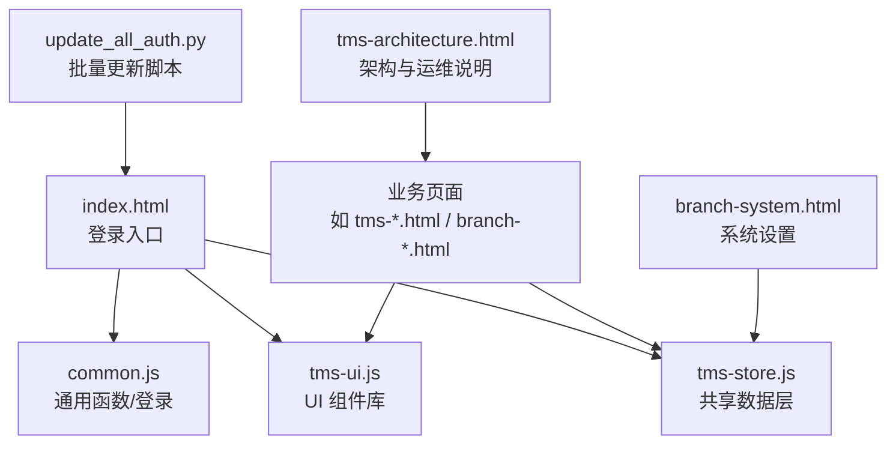
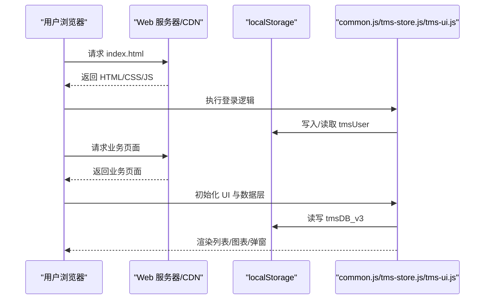
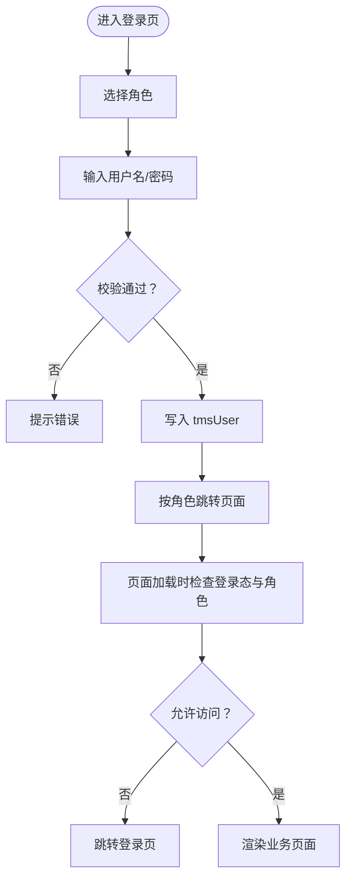
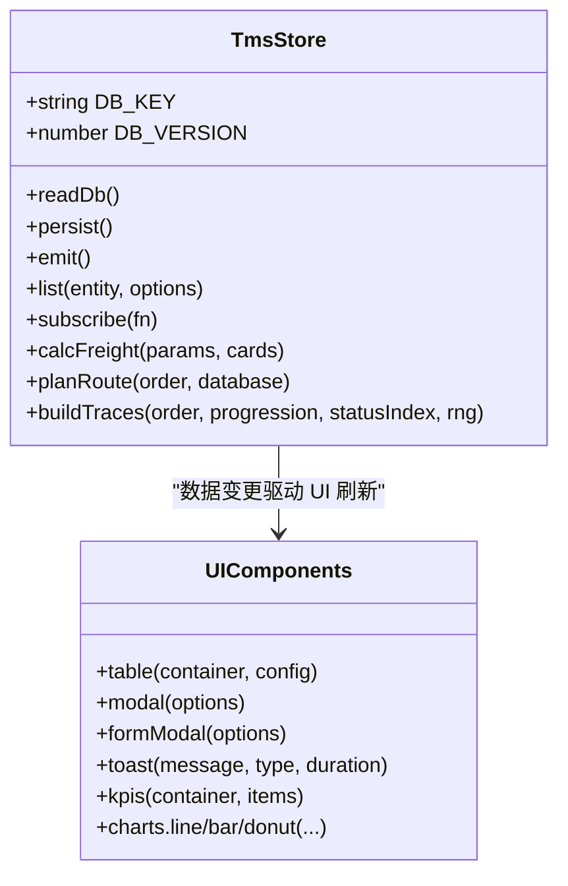
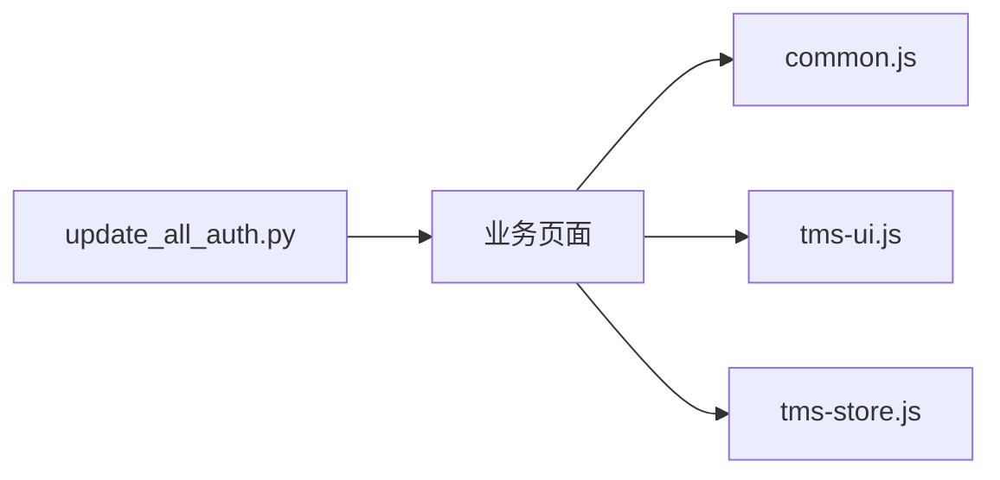

# 部署与维护

<cite>
**本文引用的文件**   
- [readme](file://readme)
- [index.html](file://index.html)
- [common.js](file://common.js)
- [tms-store.js](file://tms-store.js)
- [tms-ui.js](file://tms-ui.js)
- [update_all_auth.py](file://update_all_auth.py)
- [branch-system.html](file://branch-system.html)
- [tms-architecture.html](file://tms-architecture.html)
</cite>

## 目录
1. [引言](#引言)
2. [项目结构](#项目结构)
3. [核心组件](#核心组件)
4. [架构总览](#架构总览)
5. [详细组件分析](#详细组件分析)
6. [依赖关系分析](#依赖关系分析)
7. [性能与容量规划](#性能与容量规划)
8. [安全配置与访问控制](#安全配置与访问控制)
9. [日志与可观测性](#日志与可观测性)
10. [数据备份、迁移与版本升级](#数据备份迁移与版本升级)
11. [CDN 加速与域名配置](#cdn-加速与域名配置)
12. [监控与告警](#监控与告警)
13. [故障排查指南](#故障排查指南)
14. [常见问题与优化建议](#常见问题与优化建议)
15. [结论](#结论)

## 引言
本手册面向运维与平台工程团队，覆盖 TMS 系统的静态资源部署、域名与 CDN 配置、数据备份策略、性能监控、故障排查、系统更新与版本升级、数据迁移、安全与访问控制、日志管理、监控告警与容量规划。TMS 当前为纯前端应用，业务数据通过浏览器本地存储持久化；因此部署重点在于静态站点托管、缓存策略、版本发布流程与客户端数据治理。

## 项目结构
仓库包含多角色页面（客户、网点、分拣、运输、配送员、管理员）以及共享的 UI 组件库与数据层：
- 入口与登录页：index.html
- 通用工具与登录逻辑：common.js
- 共享 UI 组件库：tms-ui.js
- 共享数据层（基于 localStorage）：tms-store.js
- 批量更新脚本：update_all_auth.py
- 分支系统设置页：branch-system.html
- 架构与运维说明文档：tms-architecture.html
- 其他业务页面：各角色 HTML 页面

图表来源
- [index.html:133-172](file://index.html#L133-L172)
- [common.js:135-199](file://common.js#L135-L199)
- [tms-ui.js:701-744](file://tms-ui.js#L701-L744)
- [tms-store.js:1-12](file://tms-store.js#L1-L12)
- [update_all_auth.py:36-61](file://update_all_auth.py#L36-L61)
- [branch-system.html:743-763](file://branch-system.html#L743-L763)
- [tms-architecture.html:1423-1444](file://tms-architecture.html#L1423-L1444)

章节来源
- [index.html:133-172](file://index.html#L133-L172)
- [common.js:1-50](file://common.js#L1-L50)
- [tms-ui.js:1-10](file://tms-ui.js#L1-L10)
- [tms-store.js:1-12](file://tms-store.js#L1-L12)

## 核心组件
- 登录与权限校验：common.js 提供统一登录、角色跳转、登录状态检查与用户信息展示。
- 共享 UI 组件：tms-ui.js 提供表格、弹窗、表单、KPI、图表等能力，供各业务页面复用。
- 共享数据层：tms-store.js 基于 localStorage 维护订单、运单、运输、异常、扫描、财务等实体，并提供增删改查、搜索、筛选、排序、分页与事件通知。
- 编号规范：readme 定义了订单号与运单号的生成规则，common.js 与 tms-store.js 均实现了相应算法。

章节来源
- [common.js:135-199](file://common.js#L135-L199)
- [tms-ui.js:301-542](file://tms-ui.js#L301-L542)
- [tms-store.js:16-17](file://tms-store.js#L16-L17)
- [readme:1-3](file://readme#L1-L3)

## 架构总览
TMS 采用“静态站点 + 浏览器本地存储”的轻量架构：
- 静态资源由 Web 服务器或对象存储托管，支持 CDN 加速。
- 登录与鉴权在前端完成，角色决定可访问页面。
- 业务数据存储在浏览器 localStorage，跨标签页通过自定义事件同步。
- UI 组件与数据层解耦，页面通过 window.TmsStore 与 window.TmsUI 调用。

图表来源
- [index.html:133-172](file://index.html#L133-L172)
- [common.js:135-199](file://common.js#L135-L199)
- [tms-store.js:220-244](file://tms-store.js#L220-L244)
- [tms-ui.js:701-744](file://tms-ui.js#L701-L744)

## 详细组件分析

### 登录与访问控制
- 登录流程：选择角色后提交用户名密码，common.js 将用户信息写入 localStorage，并跳转到对应角色页面。
- 访问控制：页面加载时通过 checkLoginStatus(requiredRole) 校验是否已登录及角色是否匹配，不匹配则回退到登录页。
- 批量更新脚本：update_all_auth.py 用于批量替换内联登录相关代码，确保页面中统一调用 displayCurrentUser() 与 checkLoginStatus('admin')。

图表来源
- [common.js:135-199](file://common.js#L135-L199)
- [index.html:133-172](file://index.html#L133-L172)
- [update_all_auth.py:36-61](file://update_all_auth.py#L36-L61)

章节来源
- [common.js:135-199](file://common.js#L135-L199)
- [index.html:133-172](file://index.html#L133-L172)
- [update_all_auth.py:36-61](file://update_all_auth.py#L36-L61)

### 共享数据层（tms-store.js）
- 数据模型：订单、运单、运输、分拣、装卸、扫描、异常、财务、员工、车辆、仓库、库存、运力、电子围栏、策略、路由、计费卡等。
- 持久化：使用 DB_KEY='tmsDB_v3' 与 DB_VERSION=3，首次访问自动生成种子数据，变更触发 tms:datachange 事件。
- 查询能力：list(entity, options) 支持 filters、search、sort、page、pageSize。
- 计费引擎：根据线路、服务等级、重量/体积、保价、到付、客户协议折扣计算运费。
- 路由与轨迹：构建多段路由与标准时效，按订单阶段生成轨迹明细。

图表来源
- [tms-store.js:16-17](file://tms-store.js#L16-L17)
- [tms-store.js:220-244](file://tms-store.js#L220-L244)
- [tms-store.js:1209-1248](file://tms-store.js#L1209-L1248)
- [tms-store.js:332-383](file://tms-store.js#L332-L383)
- [tms-store.js:417-460](file://tms-store.js#L417-L460)
- [tms-ui.js:301-542](file://tms-ui.js#L301-L542)

章节来源
- [tms-store.js:16-17](file://tms-store.js#L16-L17)
- [tms-store.js:220-244](file://tms-store.js#L220-L244)
- [tms-store.js:332-383](file://tms-store.js#L332-L383)
- [tms-store.js:417-460](file://tms-store.js#L417-L460)
- [tms-store.js:1209-1248](file://tms-store.js#L1209-L1248)
- [tms-ui.js:301-542](file://tms-ui.js#L301-L542)

### 编号生成与一致性
- 订单号：HL+发货省份首字母+时间戳+4位用户ID哈希+4位随机数。
- 运单号：WB+10位订单号哈希+4位随机数。
- common.js 与 tms-store.js 均实现相同规则，保证前后端一致性与可追溯性。

章节来源
- [readme:1-3](file://readme#L1-L3)
- [common.js:22-50](file://common.js#L22-L50)
- [tms-store.js:252-261](file://tms-store.js#L252-L261)

## 依赖关系分析
- 页面依赖 common.js 进行登录与基础工具调用。
- 业务页面依赖 tms-ui.js 提供的 UI 组件与图表能力。
- 业务页面依赖 tms-store.js 的数据层进行数据读写与事件订阅。
- update_all_auth.py 对 HTML 中的登录相关内联脚本进行批量替换，确保统一行为。

图表来源
- [common.js:135-199](file://common.js#L135-L199)
- [tms-ui.js:701-744](file://tms-ui.js#L701-L744)
- [tms-store.js:220-244](file://tms-store.js#L220-L244)
- [update_all_auth.py:36-61](file://update_all_auth.py#L36-L61)

章节来源
- [common.js:135-199](file://common.js#L135-L199)
- [tms-ui.js:701-744](file://tms-ui.js#L701-L744)
- [tms-store.js:220-244](file://tms-store.js#L220-L244)
- [update_all_auth.py:36-61](file://update_all_auth.py#L36-L61)

## 性能与容量规划
- 静态资源优化：启用 HTTP 缓存、Gzip/Brotli 压缩、HTTP/2、合并与按需加载 JS/CSS。
- 本地存储容量：localStorage 通常限制约 5-10MB，需关注 tmsDB_v3 大小增长，必要时清理历史数据或归档。
- 大数据量处理：避免一次性渲染大量行，使用分页与虚拟滚动；减少复杂计算在渲染路径上的执行。
- 网络与 CDN：静态资源走 CDN，开启边缘缓存与预取；动态接口（如有）做限流与缓存。
- 容量规划：以并发用户数、平均会话时长、页面交互频率估算带宽与存储；结合业务峰值（如大促）预留冗余。

[本节为通用指导，无需特定文件引用]

## 安全配置与访问控制
- 前端鉴权：登录态与角色保存在 localStorage，页面加载时校验 requiredRole。
- 敏感操作：建议在服务端增加二次确认与签名校验；前端仅作为体验层。
- 输入校验：对用户输入进行白名单校验与转义，防止 XSS。
- 最小权限：默认授予最小必要权限，角色与菜单动态渲染。
- 审计与留痕：关键操作记录操作人、时间与结果，便于审计追踪。

章节来源
- [common.js:135-199](file://common.js#L135-L199)
- [tms-ui.js:12-19](file://tms-ui.js#L12-L19)

## 日志与可观测性
- 前端日志：使用 console.log 输出关键流程（登录、数据变更、错误），生产环境建议接入统一日志采集。
- 错误边界：对可能抛错的区域添加 try/catch，避免影响主流程。
- 性能埋点：记录页面加载时间、接口耗时、渲染耗时与用户行为。
- 可观测性集成：对接 APM、日志平台与指标平台，建立统一看板。

章节来源
- [common.js:152-161](file://common.js#L152-L161)
- [tms-ui.js:728-743](file://tms-ui.js#L728-L743)

## 数据备份、迁移与版本升级

### 数据备份策略
- 本地数据导出：定期导出 localStorage 中的 tmsDB_v3 与 tmsUser 等键值，保存至对象存储或备份中心。
- 全量与增量：每周全量备份，每日增量备份；保留策略按合规要求设定。
- 恢复演练：定期进行恢复演练，验证备份有效性与 RTO/RPO。

章节来源
- [tms-store.js:16-17](file://tms-store.js#L16-L17)
- [common.js:154-161](file://common.js#L154-L161)

### 数据迁移方案
- 双写与校验：新数据同时写入新旧结构，历史数据异步迁移；迁移完成后进行一致性校验。
- 灰度切换：逐步将流量切换到新结构，出现问题可快速回滚。
- 版本兼容：保持向后兼容字段，旧版页面仍可读取新版数据。

章节来源
- [tms-architecture.html:1428-1441](file://tms-architecture.html#L1428-L1441)

### 版本升级流程
- 静态资源版本化：文件名加哈希或版本号，配合强缓存与缓存失效策略。
- 渐进式发布：先灰度小流量，观察指标后再全量发布。
- 回滚预案：保留上一版本资源，出现异常立即回滚。
- 数据迁移脚本：在发布前执行数据迁移脚本，确保数据结构一致。

[本节为通用指导，无需特定文件引用]

## CDN 加速与域名配置

### 静态资源部署
- 部署目标：将 HTML/CSS/JS/图片等静态资源上传至对象存储或静态站点托管平台。
- 目录结构：保持仓库原结构，便于维护与定位问题。
- 缓存策略：HTML 短缓存（no-cache），静态资源长缓存（max-age 与 etag）。

### 域名与 HTTPS
- 绑定域名：在托管平台绑定主域名与子域名（如 app.tms.example.com）。
- HTTPS：启用强制 HTTPS，配置 TLS 证书与 HSTS。
- 重定向：HTTP 自动重定向到 HTTPS。

### CDN 加速
- 源站配置：配置 CDN 源站为对象存储或静态站点地址。
- 缓存规则：按扩展名设置缓存 TTL，HTML 不缓存或短缓存。
- 预热与回源：发布后预热热门资源，异常时回源拉取最新资源。
- 安全：启用 Referer 白名单、防盗链与 WAF。

[本节为通用指导，无需特定文件引用]

## 监控与告警

### 系统监控
- 可用性监控：对主域名与关键页面进行拨测，检测 5xx、超时与降级。
- 性能监控：监控首屏时间、接口响应时间、错误率与资源大小。
- 业务监控：订单创建量、异常数量、签收率、准时率等 KPI。

### 告警设置
- 阈值告警：错误率 > 1%、P95 延迟 > 2s、CPU/内存 > 80% 等。
- 趋势告警：环比/同比异常波动。
- 通知渠道：短信、邮件、IM 群机器人。

### 容量规划
- 资源评估：根据并发用户数、峰值 QPS、带宽与存储增长预测资源需求。
- 弹性扩容：CDN 与对象存储天然弹性，后端服务（如有）使用自动扩缩容。
- 压测与演练：大促前进行压测与故障演练，验证容量与应急预案。

[本节为通用指导，无需特定文件引用]

## 故障排查指南

### 登录失败
- 现象：无法登录或登录后无权限。
- 排查：检查 localStorage 中 tmsUser 是否存在且 role 正确；确认页面是否正确调用 checkLoginStatus(requiredRole)。
- 修复：清除无效缓存，重新登录；检查批量更新脚本是否生效。

章节来源
- [common.js:135-199](file://common.js#L135-L199)
- [update_all_auth.py:36-61](file://update_all_auth.py#L36-L61)

### 数据未显示或不同步
- 现象：列表为空或数据不更新。
- 排查：检查 tmsDB_v3 是否存在且 version 匹配；确认 tms:datachange 事件是否触发；检查 UI 组件是否正确订阅数据变化。
- 修复：重置数据层或清理 localStorage；检查 UI 组件初始化逻辑。

章节来源
- [tms-store.js:220-244](file://tms-store.js#L220-L244)
- [tms-ui.js:523-542](file://tms-ui.js#L523-L542)

### 页面样式错乱
- 现象：按钮样式缺失或布局异常。
- 排查：检查 common.js 是否在页面加载时注入样式；确认 CSS 文件路径正确。
- 修复：确保 common.js 被正确引入；检查 CDN 缓存是否过期。

章节来源
- [common.js:52-133](file://common.js#L52-L133)

### 系统设置异常
- 现象：时区或通知设置未生效。
- 排查：检查 branch-system.html 中设置项是否正确保存与读取。
- 修复：修正设置项键名与默认值；确保 localStorage 写入成功。

章节来源
- [branch-system.html:743-763](file://branch-system.html#L743-L763)

## 常见问题与优化建议

### 常见问题
- 本地存储已满：清理历史数据或升级存储策略。
- 缓存不一致：强制刷新或清理浏览器缓存；检查 CDN 缓存规则。
- 编号冲突：确保时间戳与随机数唯一性；校验订单号与运单号生成逻辑。

### 优化建议
- 前端性能：懒加载非关键资源，减少首屏体积；使用虚拟列表渲染大数据。
- 数据层优化：分页与过滤在服务端（如有）执行；前端仅做轻量计算。
- 用户体验：增加加载骨架与错误重试；提供操作反馈与帮助文档。

[本节为通用指导，无需特定文件引用]

## 结论
TMS 当前为纯前端应用，部署与维护的核心在于静态资源托管、CDN 加速、版本发布流程与客户端数据治理。通过统一的登录与访问控制、共享 UI 与数据层、完善的备份与迁移策略、监控与告警体系，可保障系统稳定运行与高效管理。建议在生产环境中引入后端服务与数据库，进一步提升安全性、可扩展性与可观测性。

[本节为总结性内容，无需特定文件引用]