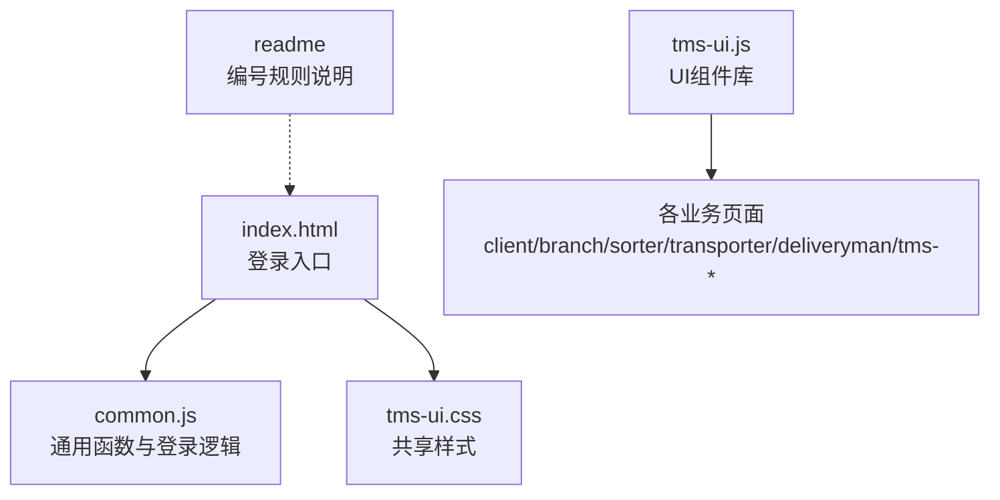
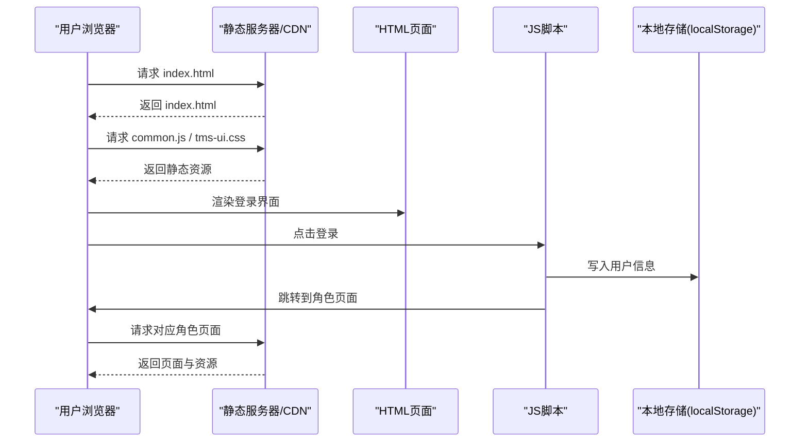
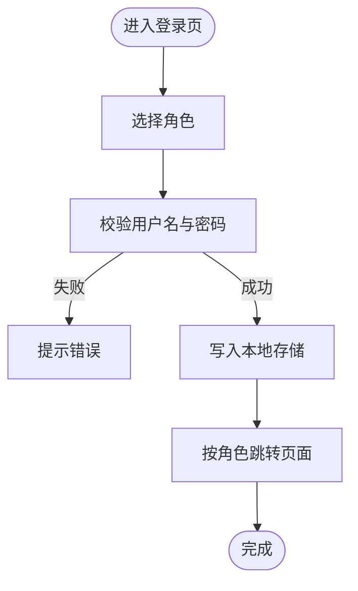
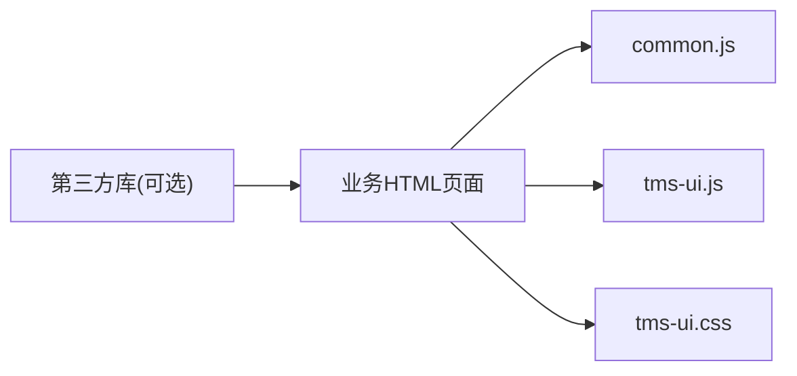

# 部署指南

<cite>
**本文引用的文件**   
- [index.html](file://index.html)
- [common.js](file://common.js)
- [tms-ui.js](file://tms-ui.js)
- [tms-ui.css](file://tms-ui.css)
- [readme](file://readme)
</cite>

## 目录
1. [简介](#简介)
2. [项目结构](#项目结构)
3. [核心组件](#核心组件)
4. [架构总览](#架构总览)
5. [详细组件分析](#详细组件分析)
6. [依赖关系分析](#依赖关系分析)
7. [性能与缓存优化](#性能与缓存优化)
8. [故障排查](#故障排查)
9. [结论](#结论)
10. [附录：部署清单与参考路径](#附录部署清单与参考路径)

## 简介
本部署指南面向TMS运输管理系统的静态站点部署，覆盖以下目标：
- 静态资源（HTML、CSS、JavaScript）的完整部署流程
- 域名配置（DNS、SSL证书、HTTPS访问）
- CDN加速与缓存策略
- 多环境差异（开发、测试、生产）
- Docker容器化与Kubernetes集群部署
- 负载均衡与高可用架构设计
- 反向代理（Nginx/Apache）配置要点

本项目为纯前端静态站点，所有页面均为HTML文件，样式集中在共享样式表，脚本包含通用逻辑与UI组件库。登录与权限校验基于浏览器本地存储实现，不涉及后端服务。

## 项目结构
仓库根目录包含多个角色入口页面（如客户、网点、分拣员、运输员、派送员、管理员等），以及共享的样式与脚本：
- HTML页面：各角色与功能模块的独立页面
- CSS样式：统一UI样式库
- JavaScript：通用函数库与UI组件库
- 说明文档：订单号与运单号格式规范

**图表来源**
- [index.html:1-172](file://index.html#L1-L172)
- [common.js:1-383](file://common.js#L1-L383)
- [tms-ui.js:1-781](file://tms-ui.js#L1-L781)
- [tms-ui.css:1-795](file://tms-ui.css#L1-L795)
- [readme:1-3](file://readme#L1-L3)

**章节来源**
- [index.html:1-172](file://index.html#L1-L172)
- [common.js:1-383](file://common.js#L1-L383)
- [tms-ui.js:1-781](file://tms-ui.js#L1-L781)
- [tms-ui.css:1-795](file://tms-ui.css#L1-L795)
- [readme:1-3](file://readme#L1-L3)

## 核心组件
- 登录入口与角色路由：通过登录页选择角色后跳转到对应页面，使用本地存储保存用户信息。
- 通用函数库：提供订单号、运单号生成、按钮样式注入、用户登录/登出、个人信息与积分管理等能力。
- UI组件库：提供表格、弹窗、表单、图表、状态徽章、分页等可复用组件。
- 共享样式：统一的视觉风格与交互反馈。

这些组件共同构成一个无后端的静态应用，适合直接部署到任意静态Web服务器或CDN。

**章节来源**
- [index.html:145-169](file://index.html#L145-L169)
- [common.js:135-209](file://common.js#L135-L209)
- [tms-ui.js:756-779](file://tms-ui.js#L756-L779)
- [tms-ui.css:1-795](file://tms-ui.css#L1-L795)

## 架构总览
从部署视角看，系统由“浏览器客户端 + 静态资源服务器 + 可选CDN”组成。浏览器加载HTML并依次请求CSS与JS，执行登录后将用户信息写入本地存储，随后根据角色跳转至相应页面。

**图表来源**
- [index.html:145-169](file://index.html#L145-L169)
- [common.js:135-209](file://common.js#L135-L209)

## 详细组件分析

### 登录与角色路由流程
- 登录页提供角色选择按钮，点击后调用通用登录函数。
- 登录成功后将用户名与角色保存到本地存储。
- 根据角色映射跳转到对应页面。

**图表来源**
- [index.html:145-169](file://index.html#L145-L169)
- [common.js:135-209](file://common.js#L135-L209)

**章节来源**
- [index.html:145-169](file://index.html#L145-L169)
- [common.js:135-209](file://common.js#L135-L209)

### 通用函数库（common.js）
- 订单号与运单号生成：遵循仓库说明文档中的格式规范。
- 按钮样式注入：动态注入统一按钮样式。
- 用户登录/登出：基于localStorage的用户会话管理。
- 个人信息与积分：提供基础的数据存取接口。

建议在生产环境中对敏感字段进行脱敏处理，并在需要时引入服务端鉴权以增强安全性。

**章节来源**
- [common.js:1-50](file://common.js#L1-L50)
- [common.js:52-133](file://common.js#L52-L133)
- [common.js:135-209](file://common.js#L135-L209)
- [common.js:272-383](file://common.js#L272-L383)
- [readme:1-3](file://readme#L1-L3)

### UI组件库（tms-ui.js）
- 提供Toast、Modal、FormModal、Table、Charts等组件。
- 暴露全局API供各页面调用。
- 支持列表搜索、筛选、排序与分页。

在部署时确保该脚本在所有业务页面之前加载，以避免组件未定义错误。

**章节来源**
- [tms-ui.js:1-781](file://tms-ui.js#L1-L781)

### 共享样式（tms-ui.css）
- 定义页面骨架、面板、工具栏、按钮、表格、分页、弹窗、表单、详情、时间线、Toast、导航角标等样式。
- 采用tms-前缀避免与页面自有样式冲突。

建议在生产构建阶段启用压缩与合并以减少请求数量。

**章节来源**
- [tms-ui.css:1-795](file://tms-ui.css#L1-L795)

## 依赖关系分析
- HTML页面依赖common.js与tms-ui.css。
- 业务页面依赖tms-ui.js提供的组件API。
- 部分页面可能引用第三方库（如地图、图表），需确保CDN可达或替换为自托管资源。

**图表来源**
- [index.html:145-169](file://index.html#L145-L169)
- [tms-ui.js:756-779](file://tms-ui.js#L756-L779)
- [tms-ui.css:1-795](file://tms-ui.css#L1-L795)

**章节来源**
- [index.html:145-169](file://index.html#L145-L169)
- [tms-ui.js:756-779](file://tms-ui.js#L756-L779)
- [tms-ui.css:1-795](file://tms-ui.css#L1-L795)

## 性能与缓存优化
- 静态资源缓存策略
  - HTML：设置较短缓存时间（如几分钟），便于快速发布更新。
  - CSS/JS：开启长期缓存（如一年），并通过文件名哈希或版本号控制更新。
  - 图片与字体：启用强缓存与Gzip/Brotli压缩。
- 全球分发优化
  - 使用CDN边缘节点就近分发静态资源。
  - 针对大体积JS/CSS启用HTTP/2与资源预加载。
- 浏览器端优化
  - 减少重绘与回流，避免频繁DOM操作。
  - 按需加载第三方库，避免阻塞首屏。

[本节为通用指导，不直接分析具体文件]

## 故障排查
- 登录失败或无法跳转
  - 检查浏览器控制台是否有脚本加载错误。
  - 确认localStorage是否被禁用或清理。
  - 验证角色映射是否正确。
- 页面样式错乱
  - 检查CSS是否被缓存导致版本不一致。
  - 确认tms-ui.css已正确引入且未被其他样式覆盖。
- 组件未生效
  - 确认tms-ui.js已加载且顺序正确。
  - 检查是否存在命名冲突或全局变量污染。

**章节来源**
- [index.html:145-169](file://index.html#L145-L169)
- [common.js:135-209](file://common.js#L135-L209)
- [tms-ui.js:756-779](file://tms-ui.js#L756-L779)
- [tms-ui.css:1-795](file://tms-ui.css#L1-L795)

## 结论
TMS系统作为纯前端静态站点，具备部署简单、扩展灵活的特点。通过合理的静态资源组织、域名与SSL配置、CDN缓存策略以及容器化与集群部署方案，可在不同环境下稳定运行并提供良好的用户体验。建议在后续迭代中引入服务端鉴权与数据持久化，以提升安全性与可扩展性。

[本节为总结性内容，不直接分析具体文件]

## 附录：部署清单与参考路径

### 静态资源部署流程
- 准备资源
  - HTML页面：登录页与各业务页面
  - CSS样式：tms-ui.css
  - JavaScript：common.js、tms-ui.js
- 上传至静态服务器或对象存储
- 配置MIME类型与压缩
- 验证页面加载与功能正常

参考路径
- [index.html:1-172](file://index.html#L1-L172)
- [common.js:1-383](file://common.js#L1-L383)
- [tms-ui.js:1-781](file://tms-ui.js#L1-L781)
- [tms-ui.css:1-795](file://tms-ui.css#L1-L795)

### 域名配置步骤
- DNS设置
  - 为站点域名添加A记录或CNAME指向服务器或CDN。
  - 如需子域（如admin.tms.example.com），分别解析。
- SSL证书配置
  - 申请并安装证书（Let’s Encrypt或云厂商证书）。
  - 配置TLS版本与加密套件，启用HSTS。
- HTTPS访问配置
  - 强制HTTP跳转HTTPS。
  - 配置安全响应头（Content-Security-Policy、X-Frame-Options等）。

[本节为通用指导，不直接分析具体文件]

### CDN加速配置方案
- 静态资源缓存策略
  - HTML短缓存，CSS/JS长缓存并带版本。
  - 启用Brotli/Gzip压缩。
- 全球分发优化
  - 开启边缘缓存与预热。
  - 针对热点资源设置更高优先级。
- 回源配置
  - 配置回源域名与鉴权参数。
  - 设置缓存命中与未命中的日志。

[本节为通用指导，不直接分析具体文件]

### 不同部署环境的配置差异
- 开发环境
  - 关闭压缩与缓存，便于调试。
  - 启用详细日志与错误堆栈。
- 测试环境
  - 模拟生产配置但使用测试域名与证书。
  - 接入测试版CDN与监控。
- 生产环境
  - 启用强缓存、压缩与安全头。
  - 配置灰度发布与回滚策略。

[本节为通用指导，不直接分析具体文件]

### Docker容器化部署方案
- 镜像构建
  - 使用轻量级基础镜像（如nginx:alpine）。
  - 将静态资源复制到镜像指定目录。
- 容器运行
  - 暴露80/443端口。
  - 挂载配置文件与证书目录。
- 编排与发布
  - 使用docker-compose或CI/CD流水线自动化构建与发布。

[本节为通用指导，不直接分析具体文件]

### Kubernetes集群部署配置
- Deployment与Service
  - 定义Deployment副本数与资源限制。
  - 暴露Service类型为LoadBalancer或Ingress。
- Ingress与TLS
  - 配置Ingress控制器与TLS Secret。
  - 设置域名与路径规则。
- ConfigMap与Secret
  - 将Nginx/Apache配置与证书分离管理。
- 滚动更新与健康检查
  - 配置探针与自动重启策略。

[本节为通用指导，不直接分析具体文件]

### 负载均衡与高可用架构设计
- 多实例部署
  - 至少两个实例分布在不同可用区。
  - 使用健康检查剔除异常节点。
- 会话保持
  - 由于本系统使用本地存储，无需会话保持；如需服务端会话，请引入Redis。
- 灾难恢复
  - 配置跨区域备份与快速切换。

[本节为通用指导，不直接分析具体文件]

### 反向代理配置示例（Nginx/Apache）
- Nginx
  - 监听443端口并启用TLS。
  - 配置静态资源缓存与压缩。
  - 强制HTTPS跳转。
- Apache
  - 启用mod_ssl与mod_rewrite。
  - 配置虚拟主机与缓存头。
  - 设置安全响应头。

[本节为通用指导，不直接分析具体文件]