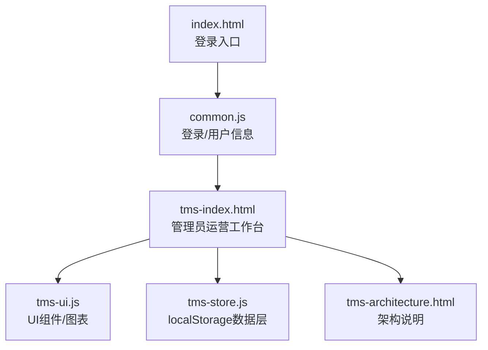
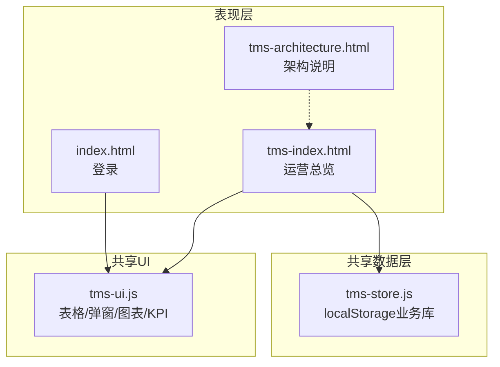
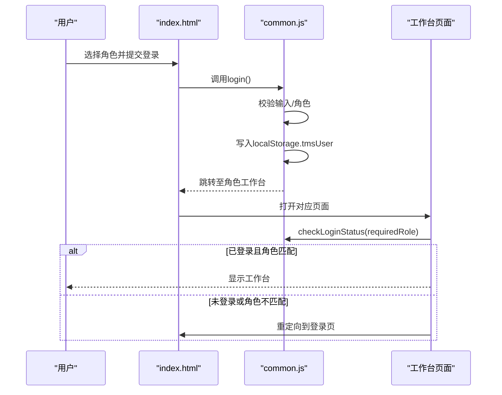
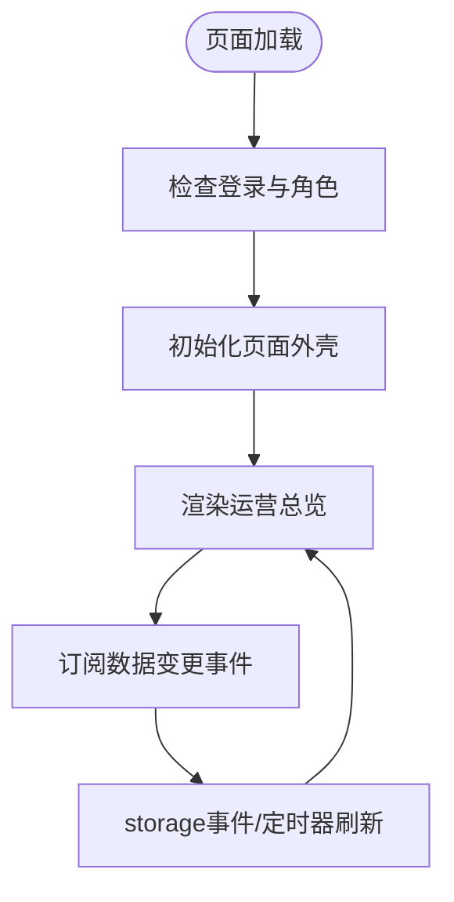
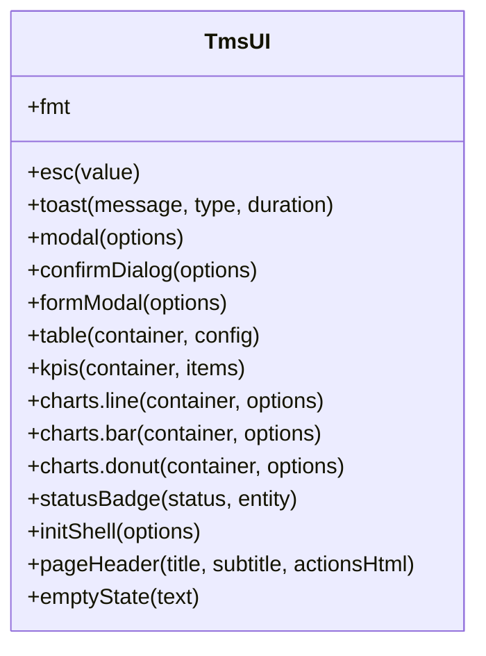
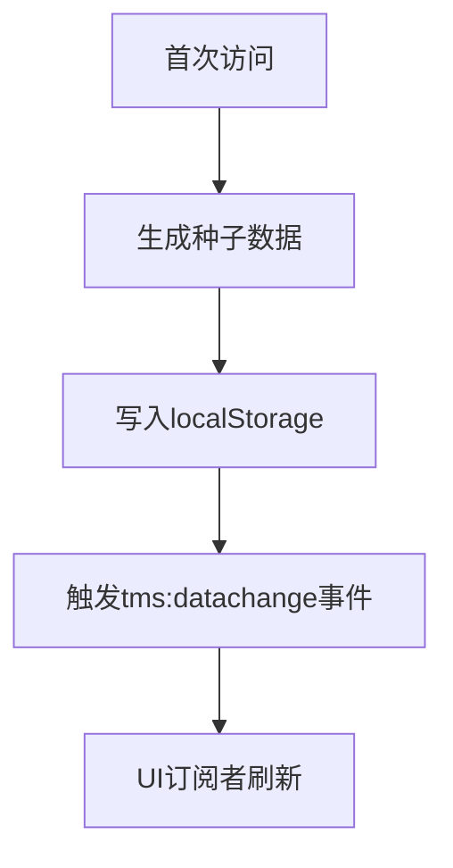
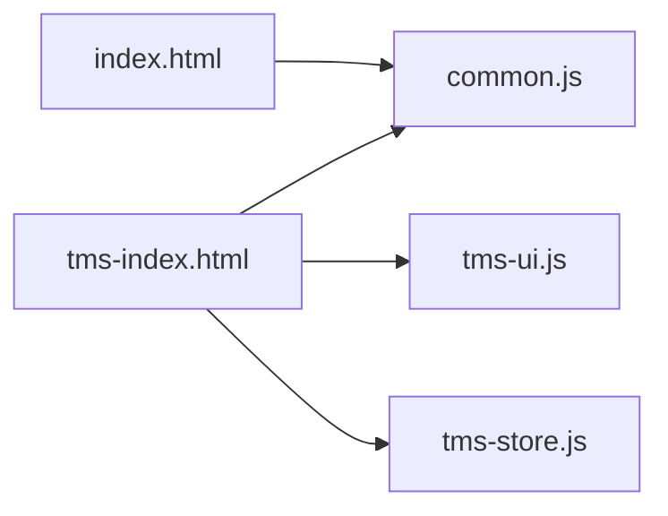

# 项目概述

<cite>
**本文引用的文件**   
- [index.html](file://index.html)
- [common.js](file://common.js)
- [tms-index.html](file://tms-index.html)
- [tms-ui.js](file://tms-ui.js)
- [tms-store.js](file://tms-store.js)
- [tms-architecture.html](file://tms-architecture.html)
</cite>

## 目录
1. [引言](#引言)
2. [项目结构](#项目结构)
3. [核心组件](#核心组件)
4. [架构总览](#架构总览)
5. [详细组件分析](#详细组件分析)
6. [依赖关系分析](#依赖关系分析)
7. [性能与可扩展性](#性能与可扩展性)
8. [快速开始指南](#快速开始指南)
9. [故障排查](#故障排查)
10. [结论](#结论)

## 引言
TMS运输管理系统是一个基于纯前端技术构建的物流管理演示系统，覆盖客户、网点、分拣员、运输员、派送员与管理员等多角色协同场景。系统通过浏览器本地存储模拟真实业务数据，提供订单全生命周期管理、运输调度、异常处理、财务与人事等运营能力，并内置实时数据可视化看板，适合教学演示、方案验证与学习实践。

主要特点：
- 全流程物流管理：从下单、入库、分拣、装车、干线运输、到达、派送到签收的全链路状态流转。
- 多角色协同：统一登录入口按角色分发到不同工作台，支持跨端协作演示。
- 实时数据可视化：运营总览展示趋势、分布、KPI与待办异常，数据变更自动刷新。
- 演示与学习用途：内置稳定种子数据，无需后端即可体验完整业务流程。

技术栈：
- HTML5、CSS3、JavaScript(ES5)
- localStorage 作为数据存储
- 自研轻量图表（SVG）与通用 UI 组件库；同时保留 Chart.js 集成点以便扩展

## 项目结构
仓库采用“页面 + 共享脚本”的组织方式：
- 登录入口与角色选择：index.html
- 管理员运营工作台：tms-index.html
- 通用工具与登录逻辑：common.js
- 共享 UI 组件与图表：tms-ui.js
- 共享数据层与种子数据：tms-store.js
- 架构介绍页：tms-architecture.html
- 其他角色页面：client-*、branch-*、sorter-*、transporter-*、deliveryman-*

**图示来源**
- [index.html:117-172](file://index.html#L117-L172)
- [common.js:135-174](file://common.js#L135-L174)
- [tms-index.html:431-434](file://tms-index.html#L431-L434)
- [tms-ui.js:756-779](file://tms-ui.js#L756-L779)
- [tms-store.js:1-12](file://tms-store.js#L1-L12)
- [tms-architecture.html:638-715](file://tms-architecture.html#L638-L715)

**章节来源**
- [index.html:1-172](file://index.html#L1-L172)
- [tms-index.html:1-581](file://tms-index.html#L1-L581)
- [common.js:1-383](file://common.js#L1-L383)
- [tms-ui.js:1-781](file://tms-ui.js#L1-L781)
- [tms-store.js:1-800](file://tms-store.js#L1-L800)
- [tms-architecture.html:638-715](file://tms-architecture.html#L638-L715)

## 核心组件
- 登录与角色路由：负责选择角色、保存用户信息、跳转到对应工作台。
- 运营工作台：管理员首页，聚合 KPI、趋势图、状态分布、最新订单与异常。
- 共享 UI 组件：表格、表单弹窗、确认框、Toast、KPI、SVG 折线/柱状/环形图、页面外壳。
- 共享数据层：基于 localStorage 的业务数据库，维护订单、运单、运输、异常、扫描、财务、人员、车辆、仓储、运力、电子围栏等实体，并提供统计聚合。

**章节来源**
- [common.js:135-174](file://common.js#L135-L174)
- [tms-index.html:431-577](file://tms-index.html#L431-L577)
- [tms-ui.js:84-779](file://tms-ui.js#L84-L779)
- [tms-store.js:1-12](file://tms-store.js#L1-L12)

## 架构总览
系统为纯前端应用，采用“表现层 + 共享 UI + 共享数据层”的分层设计：
- 表现层：HTML 页面承载各角色工作台与功能模块。
- 共享 UI：统一的交互组件与图表渲染，保证界面一致性与可复用性。
- 共享数据层：以 localStorage 为持久化介质，提供增删改查、搜索筛选、排序分页与事件订阅。

**图示来源**
- [index.html:117-172](file://index.html#L117-L172)
- [tms-index.html:431-577](file://tms-index.html#L431-L577)
- [tms-ui.js:756-779](file://tms-ui.js#L756-L779)
- [tms-store.js:1-12](file://tms-store.js#L1-L12)
- [tms-architecture.html:638-715](file://tms-architecture.html#L638-L715)

## 详细组件分析

### 登录与角色路由
- 登录流程：选择角色后提交用户名密码，校验通过后写入 localStorage 的用户会话，并按角色跳转至对应工作台。
- 权限控制：页面加载时检查登录态与角色，未登录或角色不匹配则返回登录页。
- 退出登录：清除本地用户信息并跳转回登录页。

**图示来源**
- [index.html:145-168](file://index.html#L145-L168)
- [common.js:135-199](file://common.js#L135-L199)

**章节来源**
- [index.html:117-172](file://index.html#L117-L172)
- [common.js:135-199](file://common.js#L135-L199)

### 运营总览与数据可视化
- 数据源：所有指标与列表来自 TmsStore，包括订单趋势、状态分布、最近订单与待处理异常。
- 实时更新：订阅数据变更事件、监听 storage 事件，并定时刷新以保证跨标签页数据同步。
- 可视化：使用 TmsUI 提供的 KPI、折线图、环形图渲染近 7 日订单趋势与状态分布。

**图示来源**
- [tms-index.html:431-458](file://tms-index.html#L431-L458)
- [tms-ui.js:544-678](file://tms-ui.js#L544-L678)
- [tms-store.js:220-244](file://tms-store.js#L220-L244)

**章节来源**
- [tms-index.html:431-577](file://tms-index.html#L431-L577)
- [tms-ui.js:544-678](file://tms-ui.js#L544-L678)

### 共享 UI 组件库
- 基础工具：字符串转义、日期时间/金额格式化、状态徽章。
- 交互组件：Toast、Modal、Confirm、FormModal（含字段校验与异步提交）。
- 数据表格：支持搜索、筛选、排序、分页、行点击与操作列。
- 图表：折线图、柱状图、环形图（SVG），以及 KPI 卡片。
- 页面外壳：高亮当前菜单、绑定退出登录、异常角标提示。

**图示来源**
- [tms-ui.js:12-779](file://tms-ui.js#L12-L779)

**章节来源**
- [tms-ui.js:12-779](file://tms-ui.js#L12-L779)

### 共享数据层与种子数据
- 职责：首次访问生成稳定种子数据；提供统一的数据存取、搜索筛选、排序分页；维护订单生命周期并联动关联记录；提供统计聚合接口。
- 持久化：使用 localStorage 键 tmsDB_v3 存储结构化数据对象，包含版本控制与元数据计数器。
- 事件机制：数据变更后触发自定义事件 tms:datachange，供 UI 订阅更新。
- 关键实体：订单、运单、运输任务、异常、扫描、财务流水、员工、车辆、仓库、库存、运力、电子围栏、策略、路由规则、时效规则、改单记录、考核指标、服务工单、理赔申请、行政记录、设备。

**图示来源**
- [tms-store.js:1-12](file://tms-store.js#L1-L12)
- [tms-store.js:220-244](file://tms-store.js#L220-L244)
- [tms-store.js:265-800](file://tms-store.js#L265-L800)

**章节来源**
- [tms-store.js:1-800](file://tms-store.js#L1-L800)

## 依赖关系分析
- index.html 依赖 common.js 实现登录与角色跳转。
- tms-index.html 依赖 common.js、tms-ui.js、tms-store.js 完成工作台渲染与数据交互。
- tms-ui.js 暴露全局 TmsUI，供各页面复用。
- tms-store.js 暴露全局 TmsStore，提供数据查询与事件订阅。

**图示来源**
- [index.html:145-168](file://index.html#L145-L168)
- [tms-index.html:431-434](file://tms-index.html#L431-L434)
- [tms-ui.js:756-779](file://tms-ui.js#L756-L779)
- [tms-store.js:1-12](file://tms-store.js#L1-L12)

**章节来源**
- [index.html:145-168](file://index.html#L145-L168)
- [tms-index.html:431-434](file://tms-index.html#L431-L434)

## 性能与可扩展性
- 数据量与渲染：运营总览默认仅渲染少量近期数据，避免一次性渲染过多 DOM；表格组件支持分页与延迟渲染。
- 刷新策略：订阅数据变更与 storage 事件，配合定时刷新保证跨标签页一致性；可根据实际数据规模调整刷新频率。
- 可扩展点：
  - 在 TmsUI.charts 中接入 Chart.js 或其他图表库替换 SVG 图表。
  - 在 TmsStore 中扩展新的实体与统计方法，并在页面中订阅渲染。
  - 将 localStorage 替换为 IndexedDB 或后端 API，保持事件驱动架构不变。

[本节为通用指导，不直接分析具体文件]

## 快速开始指南
- 访问系统：在浏览器中打开 index.html，选择角色并登录。
- 主要功能模块概览：
  - 运营总览：查看今日新增订单、在途运输、待处理异常、近 7 日趋势与状态分布。
  - 订单管理：新建订单、查看订单详情与轨迹。
  - 运输管理：发车、到达、签收与进度跟踪。
  - 分拣与装卸：拣货任务、漏拣统计、叉车作业。
  - 异常与客服：异常登记、处理与升级，服务工单流转。
  - 财务与人事：收入支出、结算与绩效考核。
- 系统架构图：参考 tms-architecture.html 中的分层与网络部署说明。

**章节来源**
- [index.html:117-172](file://index.html#L117-L172)
- [tms-index.html:308-425](file://tms-index.html#L308-L425)
- [tms-architecture.html:638-715](file://tms-architecture.html#L638-L715)

## 故障排查
- 无法登录或登录后无权限：
  - 检查 localStorage 中是否存在 tmsUser，若为空则重新登录。
  - 确认所需角色的权限是否匹配，必要时清理缓存后重试。
- 数据不刷新或图表空白：
  - 确认 TmsStore 与 TmsUI 是否正确加载。
  - 检查是否触发了 tms:datachange 事件，或 storage 事件是否被拦截。
- 示例数据异常：
  - 首次访问会生成种子数据，若需重置可清除 localStorage 中 tmsDB_v3 后刷新页面。

**章节来源**
- [common.js:176-199](file://common.js#L176-L199)
- [tms-store.js:220-244](file://tms-store.js#L220-L244)

## 结论
本系统以纯前端技术实现了完整的物流管理演示环境，通过共享 UI 与共享数据层解耦了页面与数据，便于扩展与维护。其多角色协同、全流程管理与实时可视化特性，使其成为物流系统教学、方案演示与技术验证的理想载体。未来可在保持事件驱动架构的前提下，逐步引入更强大的存储与图表能力，以满足更大规模与更高性能的需求。

[本节为总结性内容，不直接分析具体文件]